<p align="center">
  <a href="https://gately.cn/fr/"></a>
</p>

<p align="center">
  <a href="https://github.com/wangwanjie/gately/releases/latest"></a>
  <a href="https://github.com/wangwanjie/gately/pkgs/container/gately"></a>
  <a href="LICENSE"></a>
  <a href="https://github.com/wangwanjie/gately/stargazers"></a>
  <a href="https://gately.cn/fr/"></a>
  <a href="https://t.me/gately_chat"></a>
</p>

<p align="center">
  <a href="https://gately.cn/fr/"><b>Site officiel</b></a> &nbsp;·&nbsp; <a href="https://gately.cn/fr/docs/guide/quick-start"><b>Démarrage rapide</b></a> &nbsp;·&nbsp; <a href="https://gately.cn/fr/docs/guide/install"><b>Guide d'installation</b></a> &nbsp;·&nbsp; <a href="https://gately.cn/fr/docs/guide/introduction"><b>Documentation</b></a> &nbsp;·&nbsp; <a href="https://github.com/wangwanjie/gately/releases/latest"><b>Télécharger</b></a> &nbsp;·&nbsp; <a href="https://gately.cn/fr/news/"><b>Journal des modifications</b></a>
</p>

<p align="center">
  <a href="https://gately.cn/fr/sponsor"></a>
</p>

<p align="center">
  <a href="README.md">English</a> | <a href="README.zh-CN.md">简体中文</a> | <a href="README.zh-TW.md">繁體中文</a> | <a href="README.ja.md">日本語</a> | <a href="README.ko.md">한국어</a> | <a href="README.es.md">Español</a> | <b>Français</b> | <a href="README.de.md">Deutsch</a> | <a href="README.ru.md">Русский</a> | <a href="README.pt-BR.md">Português (Brasil)</a>
</p>

DNS et traversée de NAT, reverse proxy et certificats HTTPS, WAF et prévention des intrusions, authentification unique et partage de fichiers : tout ce dont votre réseau domestique et vos serveurs ont besoin en frontal, réuni dans une seule console. Installez-le sur un NAS, un routeur logiciel ou un serveur cloud, et configurez tout depuis votre navigateur. Open source sous licence Apache-2.0 ; votre configuration et vos données restent sur votre appareil, et rien n'est collecté ni transmis.

> **Utilisateurs de fnOS :** Gately est disponible en application native fnOS. Elle s'intègre à la **passerelle unifiée fnOS** : elle s'ouvre depuis l'icône du bureau fnOS et fonctionne sur la même adresse que fnOS, y compris votre domaine distant, sans port supplémentaire à ouvrir. Une fois l'option activée, **les administrateurs fnOS se connectent directement avec leur session fnOS**, sans mot de passe Gately ni code à deux facteurs. Voir [Application native fnOS](https://gately.cn/fr/docs/guide/install#fnos).

## Démarrage rapide

Trois étapes : lancez le conteneur, ouvrez `http://<IP de l'appareil>:16680`, connectez-vous avec `admin` / `gately.cn`. Les autres plateformes sont plus bas, et le [guide d'installation](https://gately.cn/fr/docs/guide/install) détaille toutes les options.

### Docker

L'image prend en charge amd64, arm64 et arm/v7 :

```bash
docker run -d --name gately --network host --cap-add NET_ADMIN \
  -v ./gately-data:/etc/gately \
  -v /var/run/docker.sock:/var/run/docker.sock \
  ghcr.io/wangwanjie/gately:latest
```

Ouvrez `http://<IP de l'appareil>:16680`, connectez-vous avec le compte par défaut `admin` et le mot de passe par défaut `gately.cn`, puis changez le mot de passe et activez l'authentification à deux facteurs dans « Paramètres ». Un exemple Compose complet est disponible dans [deploy/docker-compose.yml](deploy/docker-compose.yml).

En cas d'oubli du mot de passe ou de perte de l'application d'authentification, exécutez `gately reset-password` ou `gately reset-totp` sur le serveur (avec Docker : `docker exec -it gately gately reset-password`) ; la réinitialisation s'applique dès la confirmation. Consultez [Réinitialiser le mot de passe et l'authentification à deux facteurs](https://gately.cn/fr/docs/guide/install#reset).

La redirection de ports, STUN et le service web doivent écouter sur les ports de l'hôte ; `--network host` est recommandé. Si vous n'avez pas besoin de la gestion Docker, vous pouvez supprimer le montage de `docker.sock`. `--cap-add NET_ADMIN` permet à la prévention d'intrusion d'écrire les bannissements dans le pare-feu nftables de l'hôte ; sans lui, les bannissements s'appliquent toujours aux services de Gately.

Vous préférez une autre méthode d'installation ? Choisissez-la ci-dessous.

<details>
<summary><b>Binaire</b></summary>

Téléchargez l'archive correspondant à votre plateforme depuis [Releases](https://github.com/wangwanjie/gately/releases) (Linux amd64/arm64/arm/mips/mipsle/riscv64, macOS, Windows, FreeBSD), décompressez-la puis exécutez :

```bash
./gately -c /etc/gately
```

Paramètres : `-c` répertoire de configuration (la variable d'environnement `GATELY_CONFIG_DIR` fonctionne aussi), `-listen` remplace l'adresse d'écoute de l'interface d'administration, `-apply` applique à chaque démarrage les fichiers `<nom>.json` d'un répertoire au répertoire de configuration (`GATELY_APPLY_DIR`, pratique pour le GitOps et Kubernetes ; les fichiers de comptes et de jetons ne peuvent pas être écrasés), `-version` affiche la version. Pour une installation sans intervention, définissez `GATELY_INITIAL_PASSWORD` afin de choisir le mot de passe administrateur initial à la place du mot de passe par défaut `gately.cn`.

Modèles de service : [systemd](deploy/systemd/gately.service) et [OpenWrt procd](deploy/openwrt/gately.init). Pour vérifier les archives et images téléchargées (signatures cosign, provenance de build, SBOM), consultez [Vérifier les artefacts publiés](docs/fr/VERIFY.md).

</details>

<details>
<summary><b>Application native fnOS</b></summary>

Chaque Release fournit des paquets `.fpk` hors ligne pour fnOS : `gately_<version>_fnos_x86.fpk` (Intel/AMD) et `gately_<version>_fnos_arm.fpk` (ARM). Ils ne figurent pas dans le Centre d'applications officiel ; installez-les donc manuellement : ouvrez **Centre d'applications → Installation manuelle** (le bouton en bas à gauche), sélectionnez le fichier et terminez l'assistant.

- **Intégrée à la passerelle unifiée fnOS** : cliquez sur l'icône Gately du bureau fnOS et l'interface d'administration s'ouvre via la passerelle unifiée fnOS sous `/app/gately/`, sur le même point d'entrée que celui que vous utilisez déjà pour fnOS. L'adresse du réseau local comme votre domaine fnOS distant fonctionnent, sans avoir à ouvrir ni rediriger le port 16680. L'accès via la passerelle est contrôlé par fnOS (seuls les administrateurs fnOS peuvent l'ouvrir) ; les réglages « Entrée sécurisée » et « Accès réseau local uniquement » s'appliquent donc uniquement à l'accès direct sur le port 16680.
- **Connexion des administrateurs fnOS avec leur session fnOS** : activez **Paramètres → Contrôle d'accès → Connexion via fnOS** et les administrateurs fnOS déjà connectés à fnOS entrent dans Gately depuis l'icône du bureau, sans mot de passe ni code à deux facteurs ; les utilisateurs fnOS ordinaires doivent toujours se connecter. Après une déconnexion, la page de connexion propose un bouton « Se connecter avec le compte fnOS &lt;nom&gt; » au lieu de vous reconnecter silencieusement. Ce réglage est désactivé par défaut et n'apparaît que dans le paquet fnOS.
- Sur le réseau local, l'interface d'administration est aussi accessible à `http://<adresse du NAS>:16680`. Le compte par défaut est `admin`, avec le mot de passe par défaut `gately.cn`.
- L'application s'exécute en `root` afin de pouvoir écouter sur 80/443, gérer Docker via `docker.sock` et ouvrir un vrai terminal Web. Installez-la uniquement sur un NAS que vous contrôlez.
- La configuration se trouve dans le répertoire `var` de l'application et est conservée lors de la désinstallation, sauf si vous choisissez « tout supprimer » dans l'assistant de désinstallation. Pour mettre à niveau, installez manuellement le `.fpk` plus récent.
- Le paquet ajoute aussi une commande `gately` (`/usr/local/bin/gately`) pour `gately ctl` et `gately mcp`.
- Le port 16680 est partagé avec l'image Docker. Arrêtez le conteneur `gately` avant de démarrer l'application native.
- Vérifiez le téléchargement selon [Vérifier les artefacts publiés](docs/fr/VERIFY.md) ; les fichiers `.fpk` figurent dans `checksums.txt`.

</details>

<details>
<summary><b>OpenWrt</b></summary>

Chaque Release fournit des paquets OpenWrt : `gately_<version>_openwrt_<architecture>.ipk` pour OpenWrt 24.10 et antérieur (y compris iStoreOS), à installer avec `opkg install`, et `.apk` pour OpenWrt 25.12 et ultérieur, à installer avec `apk add --allow-untrusted`. Les paquets couvrent amd64 / arm64 / arm / mipsle / mips / riscv64 ; choisissez selon `DISTRIB_ARCH` dans `/etc/openwrt_release` (voir le tableau du [guide d'installation](https://gately.cn/fr/docs/guide/install#openwrt)).

- Le service est activé et démarré dès l'installation ; l'interface d'administration est accessible à `http://<adresse du routeur>:16680`, avec le compte par défaut `admin` et le mot de passe par défaut `gately.cn`.
- La configuration se trouve dans `/etc/gately` et est conservée lors des mises à niveau, des désinstallations et des mises à jour du firmware (sysupgrade). Pour mettre à niveau, installez le paquet plus récent ; la mise à niveau en ligne de la page À propos vous oriente alors vers le gestionnaire de paquets.
- Le binaire pèse environ 32 Mo : les paquets conviennent donc aux routeurs logiciels x86, aux boîtiers ARM64 et aux autres appareils dotés d'un stockage confortable ; le paquet arm nécessite un ARMv7 avec virgule flottante matérielle.
- Une application LuCI indépendante de l'architecture, `luci-app-gately_<version>_openwrt_all.ipk` / `.apk`, ajoute **Services → Gately** à LuCI : état du service, démarrage / arrêt, démarrage automatique, port d'administration et lien direct vers l'interface.

</details>

<details>
<summary><b>Supervision</b></summary>

Créez un jeton d'API disposant uniquement de l'autorisation `metrics:read` et pointez Prometheus vers `/api/metrics`. Les métriques, les exemples d'alertes et le tableau de bord Grafana sont décrits dans [Supervision](docs/fr/MONITORING.md).

</details>

<details>
<summary><b>Appels d'API</b></summary>

Créez un jeton dans la page « Jetons d'API » de la console d'administration (plusieurs jetons possibles, avec lecture seule ou lecture-écriture par module, date d'expiration configurable ; la valeur en clair n'est affichée qu'une seule fois après la création), puis vos scripts peuvent appeler l'API d'administration en masse :

```bash
curl -H "Authorization: Bearer gtl_xxxx" http://localhost:16680/api/ddns/tasks
```

Les API de compte, d'authentification à deux facteurs, de gestion des jetons, ainsi que celles de sauvegarde, de restauration, de redémarrage et de paramètres système ne fonctionnent qu'avec une session connectée. L'ensemble des API, les autorisations requises et les structures de données sont décrits dans la page « Documentation de l'API » de la console d'administration ; vous pouvez aussi les exporter avec `make api-docs` vers [docs/api](docs/api/fr) (`openapi.json` et `API.md`), que le site https://gately.cn référence directement lors de sa publication.

Lors d'une mise à niveau depuis une ancienne version, l'ancien jeton d'API global devient automatiquement un « jeton hérité » (valeur inchangée, avec toutes les autorisations de module). Il est recommandé de restreindre ses autorisations ou de le remplacer par un nouveau jeton dans la page des jetons d'API.

</details>

<details>
<summary><b>Tailscale, frp, cloudflared</b></summary>

Ces trois modules gèrent des programmes externes officiels (redémarrage automatique, journaux regroupés dans l'interface). Gately ne les embarque pas. La carte « Installation en ligne » de chaque page de module télécharge depuis l'amont la dernière version stable ou une version précise, vérifie son SHA-256, l'installe dans `bin/` sous le répertoire de configuration et redémarre les processus qui l'utilisent ; chaque programme peut avoir son propre proxy de téléchargement, et à défaut le proxy de mise à jour des paramètres est utilisé. Les 3 dernières versions remplacées sont conservées pour revenir en arrière en un clic si la nouvelle pose problème, et le programme peut être désinstallé quand il ne sert plus. Le bouton « Rétablir les valeurs par défaut » de l'en-tête est distinct de la désinstallation : il arrête les processus, efface les paramètres du module et supprime les fichiers que Gately a générés pour lui (fichiers de configuration frp, données des instances File Browser, état de connexion Tailscale) ; l'ancienne configuration reste récupérable dans l'historique de configuration. Tailscale ne publie des paquets directement exécutables que pour Linux ; sur les autres systèmes, utilisez l'installateur officiel et indiquez le chemin. Les programmes sont recherchés dans cet ordre : le chemin indiqué dans les paramètres du module, `bin/` sous le répertoire de configuration, puis `PATH`. Vous pouvez aussi placer le binaire vous-même dans le répertoire de configuration, avec Docker par exemple `./gately-data/bin/frpc` ; Tailscale nécessite de fournir à la fois `tailscale` et `tailscaled`. Les jetons et clés des fichiers de configuration sont enregistrés avec les permissions 0600, et le jeton de cloudflared est transmis par variable d'environnement, il n'apparaît donc pas dans la liste des processus.

Le module File Browser héberge [FileBrowser Quantum](https://github.com/gtsteffaniak/filebrowser) (le filebrowser d’origine est archivé et ne reçoit plus de correctifs de sécurité) avec le même ordre de recherche et la même installation, mise à jour et retour arrière en ligne ; il est installé dans `bin/filebrowser`. Le mot de passe administrateur est transmis par une variable d’environnement et n’est jamais écrit dans le fichier de configuration.

</details>

## Fonctionnalités

Un aperçu rapide de l'interface d'administration. La liste complète des modules se trouve à la fin de cette section.

### Tout en un coup d'œil

La vue d'ensemble affiche CPU, mémoire, disque et trafic, les interfaces réseau avec leurs IPv4 et IPv6 publiques, et l'état de chaque module : en quelques secondes, vous voyez si quelque chose demande votre attention.


### Des services web capables de remplacer nginx

Reverse proxy, fichiers statiques et redirections par domaine, avec HTTPS et HTTP/3. Chaque site a son propre WAF, ses règles d'IP et sa connexion, et les modifications s'appliquent sans couper les connexions.


<p><b>Statistiques par site</b> — requêtes, erreurs, santé des backends, principales IP et pays d'origine, minute par minute.</p>


### Un seul port 443 pour tous vos services

Le routage SNI de la redirection de ports permet à plusieurs services de partager un même port selon le domaine : le TLS passe tel quel et le protocole PROXY conserve l'adresse réelle du client.


### DNS dynamique avec les principaux fournisseurs

Cloudflare, Alibaba Cloud, DNSPod, Route 53 et d'autres. IPv4 et IPv6, adresse obtenue depuis une URL, une interface réseau ou une commande, et une notification à chaque changement.


### Prévention d'intrusion

Des règles à la fail2ban lisent les journaux de fichiers, de journald et des conteneurs, tandis que les ports pièges et la détection de scans repèrent les sondages. Les bannissements sont synchronisés avec nftables et le trafic est rejeté dans le noyau.


### frp, Tailscale et tunnels Cloudflare

Plusieurs instances frpc et frps côte à côte, à côté de Tailscale et des tunnels cloudflared. Gately installe, met à jour et restaure ces programmes pour vous.


### Et aussi

<table>
<tr>
<td width="50%" valign="top">

**Docker**<br>Conteneurs, Compose, journaux et terminaux, avec mise à niveau des images en un clic et retour arrière automatique en cas d'échec.


</td>
<td width="50%" valign="top">

**Terminal web**<br>SSH, Telnet et shell local dans le navigateur, avec SFTP et écran partagé.


</td>
</tr>
</table>

<table>
<tr>
<td width="50%" valign="top">

**Historique de configuration**<br>Chaque modification conserve la version précédente, avec comparaison des différences et retour arrière en un clic.


</td>
<td width="50%" valign="top">

**API, ligne de commande et MCP**<br>Jetons d'API par module, documentation OpenAPI intégrée, `gately ctl` et un serveur MCP pour les assistants IA.


</td>
</tr>
</table>

<details>
<summary><b>Liste complète des fonctionnalités</b></summary>

| Module | Capacités |
| --- | --- |
| DNS dynamique | Alibaba Cloud, Cloudflare, Tencent Cloud, DNSPod, Huawei Cloud, GoDaddy, Porkbun, dynv6, DuckDNS, Amazon Route 53, OVHcloud, Gandi, NS1, Bunny DNS, Namecheap, DynDNS2 (No-IP, Dynu, …), rappel personnalisé ; récupération de l'IP par URL/interface réseau/commande ; IPv4/IPv6 ; Webhook ; groupes, tri et recherche |
| Traversée STUN | TCP/UDP, keep-alive, UPnP/NAT-PMP, redirection intégrée, déclenchement de Webhook et de scripts lors d'un changement d'adresse |
| Redirection de ports | TCP/UDP, IPv4/IPv6, plages de ports, basculement multi-cibles, limite de connexions, statistiques de trafic, protocole PROXY v1/v2 ; routage SNI pour que plusieurs services partagent un même port comme le 443 (passage TLS direct selon le domaine, cible par défaut, protocole PROXY par route) ; groupes, tri et recherche |
| Certificats SSL | Émission et renouvellement automatiques ACME via DNS-01 (wildcard ; zone DNS des sous-domaines délégués détectée par SOA) ou HTTP-01 (sans fournisseur DNS), certificats de courte durée et certificats pour adresses IP publiques (profil shortlived de Let's Encrypt), EAB, téléversement, lecture depuis un fichier, copie vers un répertoire avec exécution de scripts ; après une mise à jour, envoi du certificat par SSH vers d'autres hôtes avec exécution d'une commande, ou redémarrage des conteneurs Docker qui l'utilisent |
| Tailscale | Gère tailscaled (réseau en espace utilisateur, adapté aux conteneurs) ou se connecte à un démon système existant ; clé d'authentification/lien de connexion, Headscale, routes de sous-réseau, nœud de sortie, liste des nœuds et proxy SOCKS5, port fixe, arguments supplémentaires et variables d'environnement de tailscaled ; installation, mise à jour, retour arrière et désinstallation en ligne sous Linux ; rétablissement des valeurs par défaut |
| frp | Plusieurs instances frpc et frps, chacune indépendante : Client frpc (proxys tcp/udp/http/https/stcp/xtcp, ajout et suppression pris en compte immédiatement) et serveur frps (liste blanche de ports, sous-domaines, tableau de bord) ; import en un clic des configurations ini anciennes et toml récentes ; installation, mise à jour, retour arrière et désinstallation en ligne ; rétablissement des valeurs par défaut |
| Tunnel Cloudflare | Tunnel à jeton cloudflared et tunnel temporaire trycloudflare, plusieurs tunnels, redémarrage automatique, affichage de l'adresse publique ; installation, mise à jour, retour arrière et désinstallation en ligne ; rétablissement des valeurs par défaut ; modification des routes des tunnels à jeton via l’API Cloudflare et création des enregistrements DNS |
| Service web | Reverse proxy/redirection/fichiers statiques/texte fixe/fermeture de connexion (comme return 444 de nginx) par domaine ; HTTPS et HTTP/3 (QUIC), HTTP et HTTPS sur le même port (redirection ou service direct) ; WebSocket ; envoi et réception du protocole PROXY ; authentification de base, authentification web, connexion GitHub/Google/QQ/OIDC, utilisateurs partagés avec vérification en deux étapes TOTP et authentification unique entre sous-domaines, fournisseur d'identité OIDC intégré pour connecter Gitea, Grafana et d'autres applications OpenID Connect avec les utilisateurs partagés, authentification déléguée à un service externe comme Authelia, un Gately public peut transmettre ses cookies de connexion à un Gately du réseau local ; listes blanche et noire d'IP et listes d'IP abonnées actualisées périodiquement (par exemple les plages d'IP par province ou ville), règles par chemin, liens de partage temporaires, bannissement automatique après échecs d'authentification, filtrage par pays GeoIP ; backends par chemin, backends par utilisateur connecté (comme map $remote_user de nginx), backends HTTPS recevant le domaine visité comme SNI, poids des backends/secours/politiques d'équilibrage de charge, contrôles de santé actifs et passifs, compression, limitation de débit, cache des réponses, réécriture de chemins ; sites statiques avec URL sans extension et page 404 personnalisée ; les modifications de site s'appliquent sans couper les connexions ouvertes ; groupes, tri et recherche de sites ; statistiques d'accès à la minute et métriques Prometheus ; changement de mot de passe en libre-service pour les utilisateurs partagés ; les sites peuvent fermer la connexion au lieu de répondre 403 en cas de refus |
| Pare-feu WAF | Coraza + OWASP CRS v4, activation des règles par fichier, SecLang personnalisé, blocage/détection seule ; limite d'inspection du corps de requête réglable, avec inspection du seul début ou exemption par chemin au-delà de la limite, pour protéger aussi les sites de cloud personnel ou WebDAV qui reçoivent des envois |
| Prévention d'intrusion | Règles de journaux à la fail2ban (fichiers journaux, journal systemd, sortie de commande, journaux de conteneurs Docker, échecs de connexion à la console, blocages du WAF) avec des modèles pour SSH, Nginx, Vaultwarden et d'autres ; ports pièges et détection de scan ; une liste de bannissement avec bannissements manuels de réseaux CIDR et permanents, durées progressives et liste blanche ; les bannissements sont synchronisés avec le pare-feu du système (nftables) et rejetés dans le noyau, ou s'appliquent aux services de Gately là où nftables est absent ; bannissement des sondages de chemins web par écoute : chemins leurres comme /.env et /.git, scans de domaines inconnus et 404 répétés |
| Gestion Docker | Création et édition de conteneurs, journaux et terminal, Compose, vérification des mises à jour d'images et mise à niveau en un clic (retour arrière automatique en cas d'échec), réseaux et volumes |
| Terminal web | SSH (confiance dans la clé d'hôte à la première connexion), Telnet, shell local (désactivé par défaut) ; proxy, sessions persistantes, gestion de fichiers SFTP, 2FA et confirmation du protocole, commandes rapides, écran partagé |
| Diagnostic réseau | Ping, traceroute, sondage de ports, requêtes DNS, test de débit, scan du réseau local |
| Centre de notifications | Webhook, Telegram, Bark, ntfy, Gotify, Pushover, Discord, Slack, ServerChan, PushPlus, WeCom, DingTalk, Feishu, e-mail ; niveaux, jokers et règles de mise en sourdine et de déduplication ; modèles de règles intégrés (pannes critiques, expiration des certificats, changements d'adresse, connexions, modifications de configuration) |
| Sauvegarde de la configuration | Sauvegardes chiffrées (scrypt + AES-GCM), politique de rétention, sauvegardes planifiées vers un répertoire local ou un point de montage de stockage |
| Ligne de commande et MCP | `gately ctl` interroge une instance en cours d'exécution ; `gately mcp` fournit un service MCP via stdio (lecture seule par défaut) |
| Wake-on-LAN | Diffusion de paquets magiques, détection de présence en ligne |
| WebDAV | Multi-utilisateur, répertoire indépendant par utilisateur, lecture seule ; utilisateurs partagés communs à WebDAV, FTP et SMB |
| FTP | Multi-utilisateur, répertoire indépendant par utilisateur, lecture seule, prise en charge de FTPS et d'une plage de ports passifs ; utilisateurs partagés communs à WebDAV, FTP et SMB |
| SMB | Multi-utilisateur, partages par utilisateur sur un ou plusieurs répertoires, lecture seule, prise en charge de SMB 2/3, du chiffrement et de la découverte Bonjour ; utilisateurs partagés communs à WebDAV, FTP et SMB |
| File Browser | Héberge le gestionnaire de fichiers web FileBrowser Quantum : plusieurs instances, plusieurs répertoires partagés avec lecture seule, authentification par mot de passe ou par proxy inverse ; installation, mise à jour, retour arrière et désinstallation en ligne ; rétablissement des valeurs par défaut |
| Montages de stockage | Répertoires locaux, montages WebDAV distants et partages SMB, gestion de fichiers en ligne |
| Tâches planifiées | Expressions cron, commandes ou requêtes HTTP, historique d'exécution |
| Sécurité et paramètres | Connexion par passkey (WebAuthn), authentification à deux facteurs (TOTP), comptes en lecture seule, limitation des échecs de connexion, point d'entrée sécurisé, accès réservé au réseau interne, HTTPS pour l'interface d'administration, plusieurs jetons d'API (autorisations en lecture/écriture par module), mots de passe et clés enregistrés affichables à la demande (permission d'écriture requise), DNS personnalisé (DoH pris en charge), fuseau horaire, sauvegarde et restauration de la configuration, adresse réelle du client depuis les proxys inverses locaux de confiance, activation ou désactivation des modules fonctionnels (un module désactivé ne démarre aucun service et n'expose aucune API) |
| Application native fnOS | Paquets `.fpk` hors ligne (x86 / ARM) ; intégrée à la passerelle unifiée fnOS, s'ouvre depuis l'icône du bureau fnOS et fonctionne via votre domaine fnOS distant ; les administrateurs fnOS peuvent se connecter avec leur session fnOS (désactivé par défaut) ; s'exécute en root pour écouter sur 80/443 et gérer Docker |
| Audit et historique | Journal d'audit des connexions, des modifications de configuration et des accès aux contenus sensibles (n'enregistre jamais les corps de requête ni les secrets) ; chaque fichier de configuration écrasé conserve ses versions précédentes, avec diff et restauration en un clic ; répertoire de configuration déclarative (`-apply`) pour le GitOps |
| Supervision et autodiagnostic | Point de terminaison Prometheus global `/api/metrics` (certificats, DDNS, STUN, redirection de ports, services web) avec un tableau de bord Grafana prêt à l'emploi ; autodiagnostic réseau en un clic (IP publique, CGNAT, horloge, ports 80/443, résolution DDNS, expiration des certificats, sites HTTPS sans certificat, conflits de proxys frp) |
| Migration | Import de configuration nginx (sortie de `nginx -T` acceptée) : reverse proxy et upstream, répertoires statiques, redirections, backends par chemin, contrôle d'accès, `auth_request` converti en authentification déléguée |

</details>

## Pourquoi Gately

Gately est entièrement open source afin que les utilisateurs et la communauté puissent examiner directement le code source et la configuration. Pour un logiciel qui s'exécute à la frontière du réseau et manipule des clés DNS et des clés privées de certificats, l'open source permet de voir ce qu'il fait. Les engagements de Gately :

- Le code source est publié sous licence Apache-2.0 et ouvert à l'examen de la communauté
- Aucune connexion aux serveurs du projet et aucun envoi d'informations sur l'appareil par défaut ; la connexion via un tiers utilise votre propre application OAuth, sans intermédiaire
- Toutes les adresses externes (interrogation de l'IP publique, serveurs STUN, etc.) sont visibles, modifiables et désactivables
- La configuration est du JSON en clair, que vous pouvez placer dans git pour l'audit et le retour en arrière

## Performances

La redirection de ports avec routage SNI, associée au service web, peut remplacer le duo courant haproxy (routage TCP par SNI) + nginx (TLS et reverse proxy). Les chiffres ci-dessous comparent les deux sur la même machine avec la configuration d'un vrai serveur : 90 domaines routés par SNI, protocole PROXY v2 entre les deux sauts et un certificat ECDSA P-256 avec TLS 1.3.

| Scénario | haproxy + nginx | Gately |
| --- | --- | --- |
| Reverse proxy HTTPS, keep-alive, réponses de 1 Ko, 64 connexions | 14 767 req/s (p99 35,9 ms) | **26 434 req/s** (p99 5,7 ms) |
| Idem en HTTP/2 | non testé (la configuration nginx utilisait HTTP/1.1) | 27 795 req/s |
| Une nouvelle connexion TLS pour chaque requête, 32 à la fois | 2 557 req/s | **3 448 req/s** |
| Réponses de 1 Mo, 16 connexions | 1 053 Mo/s | **1 585 Mo/s** |
| Passage SNI direct d'un flux TLS, 4 connexions | 2 927 Mo/s | **4 962 Mo/s** |
| Passage SNI direct, nouvelles connexions par seconde, 64 à la fois | 6 334 /s | 6 266 /s (à égalité) |
| Mémoire sous charge | haproxy ≈ 21 Mo + nginx ≈ 21 Mo | ≈ 110 Mo (un seul processus avec tous les modules) |

<details>
<summary><b>Méthode de mesure</b></summary>

- Hôte : Intel Core i5-13500T. Chaque pile était limitée à 2 cœurs de processeur (haproxy et nginx dans Docker avec `--cpuset-cpus`, Gately épinglé avec `taskset`) pour imiter un petit serveur cloud. Les backends et le générateur de charge tournaient sur d'autres cœurs.
- haproxy utilisait `mode tcp` avec des règles `req_ssl_sni` et `send-proxy-v2`. nginx utilisait `worker_processes 2` et les paramètres de proxy du site de production, qui envoient `Connection: upgrade` et ouvrent donc une nouvelle connexion backend par requête ; un nginx optimisé avec keep-alive vers l'amont réduirait l'écart sur les petites réponses.
- Le chemin de Gately était la règle SNI, PROXY v2, puis un écouteur du service web, soit le même nombre de sauts que haproxy → nginx.
- Chaque cas a duré 10 secondes, et les cas répétés concordaient à 3 % près. Sur un vrai hôte cloud à 2 vCPU, le site statique a servi 5,5k req/s contre 3,4k req/s. Les nouvelles connexions TLS étaient à égalité (environ 480–550 par seconde pour les deux) quand le client utilisait X25519 ; avec l'échange de clés hybride post-quantique que proposent les clients Go et les navigateurs récents, Gately a terminé environ 13 % de poignées de main en moins lors de cette mesure.
- Les résultats dépendent du matériel, de la configuration et du trafic. Voyez-y un contrôle de cohérence montrant que Gately tient la comparaison avec haproxy et nginx, et mesurez avec votre propre charge.

</details>

## Développement

Prérequis : Go 1.26+, Node.js 24+, pnpm.

```bash
make web      # compile le frontend (sortie dans web/dist, intégré via go:embed)
make build    # compile bin/gately
make test     # go test -race ./...
make lint     # gofmt, go vet, vérification des types du frontend
```

Pour développer le frontend, lancez `cd web && pnpm dev` ; `/api` est relayé vers `127.0.0.1:16680` en local.

Certains tests sont ignorés par défaut et nécessitent des conditions supplémentaires :

| Test | Activation |
| --- | --- |
| ACME de bout en bout (Pebble) | Installer pebble et pebble-challtestsrv, définir `GATELY_PEBBLE_BIN` et `GATELY_PEBBLE_SRC` (exécuté automatiquement en CI) |
| Serveurs STUN publics réels | `GATELY_NET_TEST=1` |

La structure des répertoires et les choix techniques sont décrits dans [docs/fr/ROADMAP.md](docs/fr/ROADMAP.md).

Le code source du site web ([gately.cn](https://gately.cn)) se trouve dans `website/` et repose sur VitePress : `cd website && pnpm install && pnpm dev` ; `pnpm deploy:site` compile et synchronise vers le serveur.

## Règles de contribution

- Le code de compatibilité doit reposer uniquement sur des comportements, interfaces et formats de configuration observables publiquement. Ne soumettez pas de code copié des binaires ou du frontend d'un logiciel tiers.
- Un nouveau module nécessite : une structure de configuration avec validation, un démarrage/arrêt à l'exécution, une interface REST et des tests unitaires ; les modules qui souhaitent afficher leur état sur la page de synthèse implémentent `module.Summarizer`.
- Les commentaires de code sont rédigés en chinois ; les instructions de contrôle doivent toujours utiliser des accolades.

## Communauté

Questions, retours et astuces d’utilisation sont les bienvenus dans le groupe Telegram : [t.me/gately_chat](https://t.me/gately_chat), ou scannez le QR code avec votre téléphone :

<a href="https://t.me/gately_chat"></a>

Les bugs se signalent dans [GitHub Issues](https://github.com/wangwanjie/gately/issues), avec un [paquet de diagnostic](docs/fr/DIAGNOSTICS.md) en pièce jointe (Paramètres → Diagnostic). Il est généré localement et ne contient ni mots de passe, ni jetons, ni domaines, ni IP réelles.

## Soutenir

Toutes les fonctionnalités de Gately sont gratuites. S'il vous est utile, vous pouvez soutenir son développement avec USDT, [Afdian](https://ifdian.net/a/gately) ou WeChat Pay ; les adresses et QR codes se trouvent sur la [page de soutien](https://gately.cn/fr/sponsor).

## Historique des étoiles

[](https://star-history.com/#wangwanjie/gately&Date)

## Licence

[Apache License 2.0](LICENSE)
