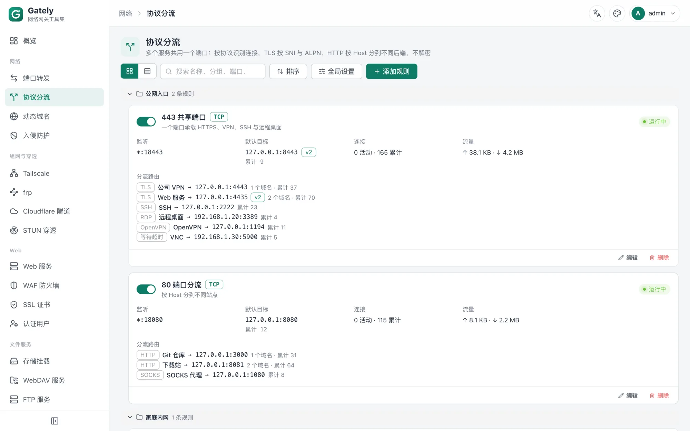

<p align="center">
  <a href="https://gately.cn/en/"></a>
</p>

<p align="center">
  <a href="https://github.com/wangwanjie/gately/releases/latest"></a>
  <a href="https://github.com/wangwanjie/gately/pkgs/container/gately"></a>
  <a href="LICENSE"></a>
  <a href="https://github.com/wangwanjie/gately/stargazers"></a>
  <a href="https://gately.cn/en/"></a>
  <a href="https://t.me/gately_chat"></a>
</p>

<p align="center">
  <a href="https://gately.cn/en/"><b>Website</b></a> &nbsp;·&nbsp; <a href="https://gately.cn/en/docs/guide/quick-start"><b>Quick start</b></a> &nbsp;·&nbsp; <a href="https://gately.cn/en/docs/guide/install"><b>Install guide</b></a> &nbsp;·&nbsp; <a href="https://gately.cn/en/docs/guide/introduction"><b>Docs</b></a> &nbsp;·&nbsp; <a href="https://github.com/wangwanjie/gately/releases/latest"><b>Download</b></a> &nbsp;·&nbsp; <a href="https://gately.cn/en/news/"><b>Changelog</b></a>
</p>

<p align="center">
  <a href="https://gately.cn/en/sponsor"></a>
</p>

<p align="center">
  <b>English</b> | <a href="README.zh-CN.md">简体中文</a> | <a href="README.zh-TW.md">繁體中文</a> | <a href="README.ja.md">日本語</a> | <a href="README.ko.md">한국어</a> | <a href="README.es.md">Español</a> | <a href="README.fr.md">Français</a> | <a href="README.de.md">Deutsch</a> | <a href="README.ru.md">Русский</a> | <a href="README.pt-BR.md">Português (Brasil)</a>
</p>

DNS and NAT traversal, reverse proxy and HTTPS certificates, WAF and intrusion prevention, single sign-on and file sharing: everything your home network and servers need at the edge, managed from one console. Run it on a NAS, a soft router or a cloud server and set it all up in your browser. Open source under Apache-2.0; your config and data stay on your own device, and nothing is collected or reported.

> **fnOS users:** Gately ships as a native fnOS app. It plugs into the **fnOS unified gateway**, so it opens from the fnOS desktop icon and works over the same address you use for fnOS, including your remote domain, with no extra port to open. Once enabled, **fnOS administrators can sign in directly with their fnOS session**, without a Gately password or two-step code. See [fnOS native app](https://gately.cn/en/docs/guide/install#fnos).

## Quick Start

Three steps: start the container, open `http://<device-ip>:16680`, sign in with `admin` / `gately.cn`. Other platforms are below, and the [install guide](https://gately.cn/en/docs/guide/install) covers every option.

### Docker

Images are available for amd64, arm64, and arm/v7:

```bash
docker run -d --name gately --network host --cap-add NET_ADMIN \
  -v ./gately-data:/etc/gately \
  -v /var/run/docker.sock:/var/run/docker.sock \
  ghcr.io/wangwanjie/gately:latest
```

Open `http://<device-ip>:16680` and sign in with the default account `admin` and the default password `gately.cn`. Then change the password and enable two-factor authentication under Settings. See [deploy/docker-compose.yml](deploy/docker-compose.yml) for a complete Compose example.

If you forget the password or lose your authenticator, run `gately reset-password` or `gately reset-totp` on the server (`docker exec -it gately gately reset-password` for Docker); the change takes effect once you confirm. See [Reset password and two-factor authentication](https://gately.cn/en/docs/guide/install#reset).

Port forwarding, STUN, and web services listen on host ports, so `--network host` is recommended. If you do not need Docker management, drop the `docker.sock` mount. `--cap-add NET_ADMIN` lets Intrusion Prevention write bans to the host's nftables firewall; without it, bans still apply to Gately's own services.

Prefer another way to install? Pick one below.

<details>
<summary><b>Binary</b></summary>

Download the archive for your platform from [Releases](https://github.com/wangwanjie/gately/releases) (Linux amd64/arm64/arm/mips/mipsle/riscv64, macOS, Windows, FreeBSD), extract it, and run:

```bash
./gately -c /etc/gately
```

Flags: `-c` sets the config directory (the `GATELY_CONFIG_DIR` environment variable also works), `-listen` overrides the admin UI listen address, `-apply` applies `<name>.json` files from a directory to the config directory on every start (`GATELY_APPLY_DIR`, handy for GitOps and Kubernetes; the account and token files cannot be overwritten), and `-version` prints the version. For unattended installs, set `GATELY_INITIAL_PASSWORD` to choose the initial admin password instead of the default `gately.cn`.

Service templates: [systemd](deploy/systemd/gately.service) and [OpenWrt procd](deploy/openwrt/gately.init). To verify downloaded archives and images (cosign signatures, build provenance, SBOM), see [Verifying release artifacts](docs/en/VERIFY.md).

</details>

<details>
<summary><b>fnOS native app</b></summary>

Each Release ships offline `.fpk` packages for fnOS: `gately_<version>_fnos_x86.fpk` (Intel/AMD) and `gately_<version>_fnos_arm.fpk` (ARM). They are not in the official App Center, so install them manually: open **App Center → Manual install** (the button at the bottom-left), pick the file, and finish the wizard.

- **Works with the fnOS unified gateway**: click the Gately icon on the fnOS desktop and the admin UI opens through the fnOS unified gateway under `/app/gately/`, sharing the entry point you already use for fnOS. Both the LAN address and your remote fnOS domain work, with no need to open or forward port 16680. Access through the gateway is controlled by fnOS (only fnOS administrators can open it), so the safe entry and LAN-only settings apply only to direct access on port 16680.
- **Signs fnOS administrators in with their fnOS session**: turn on **Settings → Access control → Sign in with fnOS** and fnOS administrators who are signed in to fnOS enter Gately from the desktop icon without a password or two-step code; regular fnOS users still sign in. After you sign out, the login page offers a "Sign in as fnOS user &lt;name&gt;" button instead of signing you back in silently. The setting is off by default and only shown in the fnOS package.
- On the LAN the admin UI is also at `http://<NAS address>:16680`. The default account is `admin` and the default password is `gately.cn`.
- The app runs as `root`, so it can listen on 80/443, manage Docker through `docker.sock`, and open a real Web terminal. Install it only on a NAS you control.
- Config lives in the app's `var` directory and is kept on uninstall unless you choose "delete all" in the uninstall wizard. Upgrading is another manual install of the newer `.fpk`.
- The package also adds a `gately` command (`/usr/local/bin/gately`) for `gately ctl` and `gately mcp`.
- Port 16680 is shared with the Docker image. Stop the `gately` container before starting the native app.
- Verify the download as described in [Verifying release artifacts](docs/en/VERIFY.md); `.fpk` files are listed in `checksums.txt`.

</details>

<details>
<summary><b>OpenWrt</b></summary>

Each Release ships OpenWrt packages: `gately_<version>_openwrt_<arch>.ipk` for OpenWrt 24.10 and earlier (including iStoreOS), installed with `opkg install`, and `.apk` for OpenWrt 25.12 and later, installed with `apk add --allow-untrusted`. Packages cover amd64 / arm64 / arm / mipsle / mips / riscv64; pick one by `DISTRIB_ARCH` in `/etc/openwrt_release` (see the table in the [install guide](https://gately.cn/en/docs/guide/install#openwrt)).

- The service is enabled and started on install; the admin UI is at `http://<router address>:16680`, and the default account is `admin` with the password `gately.cn`.
- Config lives in `/etc/gately` and is kept across upgrades, uninstalls and firmware upgrades (sysupgrade). To upgrade, install the newer package; the online upgrade on the About page points you to the package manager instead.
- The binary is about 32 MB, so the packages suit x86 soft routers, ARM64 boxes and other devices with ample storage; the arm package needs ARMv7 with hardware floating point.
- An architecture-independent LuCI app, `luci-app-gately_<version>_openwrt_all.ipk` / `.apk`, adds **Services → Gately** to LuCI: service state, start / stop, start at boot, the admin port and a one-click link to the admin interface.

</details>

<details>
<summary><b>Monitoring</b></summary>

Create an API token with only the `metrics:read` permission and point Prometheus at `/api/metrics`. Metrics, alert examples and the Grafana dashboard are described in [Monitoring](docs/en/MONITORING.md).

</details>

<details>
<summary><b>API usage</b></summary>

Create a token on the "API Tokens" page of the admin console. You can create several, grant each read-only or read-write access per module, set an expiry, and the plaintext is shown only once, right after creation. Scripts can then call the admin API in bulk:

```bash
curl -H "Authorization: Bearer gtl_xxxx" http://localhost:16680/api/ddns/tasks
```

Account, two-factor authentication, and token management, as well as the backup, restore, restart, and system settings endpoints, accept login sessions only. All endpoints, required permissions, and data schemas are listed on the "API Docs" page of the admin console. You can also export them to [docs/api/en](docs/api/en) (`openapi.json` and `API.md`) with `make api-docs`; the website https://gately.cn references them directly when published.

When upgrading from an older version, the previous global API token becomes a "legacy token" automatically (same value, full access to every module). Tighten its permissions or replace it with a new token on the API Tokens page.

</details>

<details>
<summary><b>Tailscale, frp, cloudflared</b></summary>

These three modules manage the official external programs (automatic restart, logs aggregated in the UI). Gately does not bundle them. The "online install" card on each module page downloads the latest stable release or a specific version from upstream, verifies its SHA-256, installs it into `bin/` under the config directory and restarts the processes that use it; each program can have its own download proxy, and when it is empty the update proxy from Settings is used. The last 3 replaced versions are kept, so you can roll back with one click if a new version has problems, and a program you no longer need can be uninstalled. "Restore defaults" in the page header is separate from uninstalling: it stops the processes, resets the module settings and deletes the files Gately generated for it (frp config files, File Browser instance data, Tailscale login state); the old settings can be restored from the config history. Tailscale only publishes ready-to-run packages for Linux; on other systems use the official installer and enter its path. Programs are located in this order: the path set in the module settings, `bin/` under the config directory, then `PATH`. You can also put the binary into the config directory yourself, for example `./gately-data/bin/frpc` in Docker deployments; Tailscale needs both `tailscale` and `tailscaled`. Tokens and keys in config files are stored with 0600 permissions, and the cloudflared token is passed via an environment variable so it never appears in the process list.

The File Browser module hosts [FileBrowser Quantum](https://github.com/gtsteffaniak/filebrowser) (the original filebrowser is archived and no longer receives security fixes) with the same lookup order and the same online install, update and rollback as above, installed as `bin/filebrowser`. The admin password is passed via an environment variable and never written to the config file.

</details>

## Features

A quick tour of the admin UI. The full list of modules is at the end of this section.

### Everything at a glance

The overview shows CPU, memory, disk and traffic, network interfaces with their public IPv4 and IPv6, and the state of every module, so you can tell in seconds whether anything needs attention.


### Web services that can replace nginx

Reverse proxy, static files and redirects by domain, with HTTPS and HTTP/3. Each site gets its own WAF, IP rules and sign-in, and changes apply without dropping connections.


<p><b>Per-site statistics</b> — requests, errors, backend health, top client IPs and countries, minute by minute.</p>


### One port 443 for every service

Protocol routing lets several services share a single port by domain or protocol, passing TLS straight through and keeping the real client address with the PROXY protocol.



### Dynamic DNS for all the major providers

Cloudflare, Alibaba Cloud, DNSPod, Route 53 and more. IPv4 and IPv6, addresses from a URL, an interface or a command, and a notification when anything changes.


### Intrusion prevention

fail2ban-style jails read logs from files, journald and containers, while trap ports and scan detection catch probing. Bans sync to nftables and are dropped in the kernel.


### frp, Tailscale and Cloudflare Tunnel

Run several frpc and frps instances side by side, next to Tailscale and cloudflared tunnels. Gately installs, updates and rolls back these programs for you.


### And more

<table>
<tr>
<td width="50%" valign="top">

**Docker**<br>Containers, Compose, logs and terminals, with one-click image upgrades that roll back on failure.


</td>
<td width="50%" valign="top">

**Web terminal**<br>SSH, Telnet and the local shell in the browser, with SFTP and split panes.


</td>
</tr>
</table>

<table>
<tr>
<td width="50%" valign="top">

**Config history**<br>Every change keeps the previous version, with a diff and one-click rollback.


</td>
<td width="50%" valign="top">

**API, CLI and MCP**<br>Per-module API tokens, built-in OpenAPI docs, `gately ctl` and an MCP server for AI assistants.


</td>
</tr>
</table>

<details>
<summary><b>Full feature list</b></summary>

| Module | Capabilities |
| --- | --- |
| Dynamic DNS | Alibaba Cloud, Cloudflare, Tencent Cloud, DNSPod, Huawei Cloud, GoDaddy, Porkbun, dynv6, DuckDNS, Amazon Route 53, OVHcloud, Gandi, NS1, Bunny DNS, Namecheap, DynDNS2 (No-IP, Dynu, …), custom callbacks; IP discovery via URL, network interface, or command; IPv4/IPv6; webhooks; groups, sorting and search |
| STUN traversal | TCP/UDP, keep-alive, UPnP/NAT-PMP, built-in forwarding, webhooks and scripts triggered on address change |
| Port forwarding | TCP/UDP, IPv4/IPv6, port ranges, multi-target failover, connection limits, traffic statistics, PROXY protocol v1/v2; groups, sorting and search |
| Protocol routing | Several services share one port such as 443: connections are identified by protocol and passed through without decryption — TLS by SNI and ALPN, HTTP by Host, Minecraft by server address, plus SSH, RDP, SOCKS, OpenVPN, RTSP, SIP, XMPP, MQTT, AMQP, PostgreSQL, Redis, SMB, Git, IRC, ADB, BitTorrent and a wait-timeout route for server-first protocols such as VNC; a default target, PROXY protocol per route; replaces haproxy SNI routing and sslh |
| SSL certificates | Automatic ACME issuance and renewal via DNS-01 (wildcard; DNS zone of delegated subdomains detected via SOA) or HTTP-01 (no DNS provider needed), short-lived certificates and certificates for public IP addresses (Let's Encrypt shortlived profile), EAB, upload, read from file, map to a directory and run a script; after renewal, push certificates to other hosts over SSH and run a command, or restart the Docker containers that use them |
| Tailscale | Managed tailscaled (userspace networking, container-friendly) or attach to an existing system daemon; auth keys / login links, Headscale, subnet routes, exit nodes, peer list and SOCKS5 proxy, fixed port, extra tailscaled arguments and environment variables; online install, update, rollback and uninstall on Linux; restore default settings |
| frp | Multiple frpc and frps instances, each running on its own: frpc client (tcp/udp/http/https/stcp/xtcp proxies, changes apply instantly) and frps server (port allowlist, subdomains, dashboard); one-click import of legacy ini and new toml configs; online install, update, rollback and uninstall; restore default settings |
| Cloudflare Tunnel | cloudflared token tunnels and trycloudflare quick tunnels, multiple tunnels, automatic restart, public address display; online install, update, rollback and uninstall; restore default settings; edit the routes of token tunnels through the Cloudflare API and create their DNS records |
| Web services | Per-domain reverse proxy / redirect / static files / fixed text / close connection (like nginx return 444); HTTPS and HTTP/3 (QUIC); HTTP and HTTPS on the same port (redirect or serve); WebSocket; PROXY protocol in and out; basic auth, web auth, GitHub/Google/QQ/OIDC sign-in, shared users with TOTP two-step verification and single sign-on across subdomains, a built-in OIDC identity provider that lets Gitea, Grafana and other OpenID Connect apps sign in with the shared users, forward auth to an external service such as Authelia, a public Gately can forward its sign-in cookies to a LAN Gately; IP allow/deny lists and subscribed IP lists refreshed on a schedule (such as province or city IP ranges), path rules, temporary share links, automatic ban on failed auth, GeoIP country filtering; per-path backends, per-user backends for signed-in users (like nginx map $remote_user), HTTPS backends that receive the visited domain as SNI, backend weights / standby / load-balancing policies, active and passive health checks, compression, rate limiting, response caching, path rewriting; static sites with clean URLs and a custom 404 page; site changes apply without dropping open connections; site groups, sorting and search; per-minute access statistics and Prometheus metrics; shared users can change their own password; sites can close the connection instead of answering 403 when access is denied |
| WAF | Coraza + OWASP CRS v4, per-file rule toggles, custom SecLang, block or detection-only mode; adjustable request body inspection limit that can inspect only the first part or skip by path, so cloud drives, WebDAV and other upload sites can sit behind the WAF |
| Intrusion Prevention | fail2ban-style log jails (log files, systemd journal, command output, Docker container logs, failed admin logins, WAF blocks) with templates for SSH, Nginx, Vaultwarden and more; trap ports and port-scan detection; one ban list with manual CIDR and permanent bans, escalating durations and a whitelist; bans are synced to the system firewall (nftables) and dropped in the kernel, or apply to Gately's own services where nftables is unavailable; web path probing bans by listener: decoy paths such as /.env and /.git, unknown-domain scans and repeated 404s |
| Docker management | Create and edit containers, logs and terminal, Compose, image update checks with one-click upgrade (automatic rollback on failure), networks and volumes |
| Web terminal | SSH (trust host key on first use), Telnet, local shell (off by default); proxies, persistent sessions, SFTP file manager, 2FA and protocol confirmation, quick commands, split panes |
| Network diagnostics | Ping, traceroute, port probe, DNS lookup, speed test, LAN scan |
| Notification center | Webhook, Telegram, Bark, ntfy, Gotify, Pushover, Discord, Slack, ServerChan, PushPlus, WeCom, DingTalk, Feishu, email; severity levels, wildcard, and silencing / dedup rules; built-in rule templates (critical failures, certificate expiry, address changes, sign-ins, configuration changes) |
| Config backup | Encrypted backups (scrypt + AES-GCM), retention policy, scheduled backups to a local directory or storage mount |
| CLI and MCP | `gately ctl` talks to a running instance; `gately mcp` serves MCP over stdio (read-only by default) |
| Wake-on-LAN | Magic packet broadcast, online detection |
| WebDAV | Multiple users, per-user directories, read-only mode; shared users common to WebDAV, FTP and SMB |
| FTP | Multiple users, per-user directories, read-only mode, FTPS and passive port ranges; shared users common to WebDAV, FTP and SMB |
| SMB | Multiple users, per-user shares backed by one or more directories, read-only mode, SMB 2/3, encryption and Bonjour discovery; shared users common to WebDAV, FTP and SMB |
| File Browser | Hosts the FileBrowser Quantum web file manager: multiple instances, several shared directories with read-only mode, password or reverse proxy auth; online install, update, rollback and uninstall; restore default settings |
| Storage mounts | Local directories, remote WebDAV mounts and SMB shares, online file manager |
| Scheduled tasks | Cron expressions, commands or HTTP requests, run history |
| List management | Rules, instances, certificates, DNS records, terminal connections, API tokens and other lists share grouping, manual sorting (drag or arrows, with multi-select) and search, and most lists switch between card and compact views; reordering or regrouping never restarts a service, and it all works on phones |
| Security and settings | Passkey (WebAuthn) sign-in, two-factor authentication (TOTP), read-only accounts, login rate limiting, secure entry path, LAN-only access, HTTPS for the admin UI, multiple API tokens (per-module read/write grants), saved passwords and keys shown on request (write permission required), custom DNS (DoH supported), time zone, config backup and restore, real client address from trusted local reverse proxies, turn feature modules on or off (disabled modules start no services and serve no API) |
| fnOS native app | Offline `.fpk` packages (x86 / ARM); integrated with the fnOS unified gateway, opens from the fnOS desktop icon and works over your remote fnOS domain; fnOS administrators can sign in with their fnOS session (off by default); runs as root to listen on 80/443 and manage Docker |
| Audit and history | Audit log of sign-ins, configuration changes and access to sensitive content (never records request bodies or secrets); every overwritten config file keeps its previous versions with diff and one-click rollback; declarative config directory (`-apply`) for GitOps |
| Monitoring and self-check | Global Prometheus endpoint `/api/metrics` (certificates, DDNS, STUN, port forwarding, web services) with a ready-made Grafana dashboard; one-click network self-check (public IP, CGNAT, clock, ports 80/443, DDNS resolution, certificate expiry, HTTPS sites missing a certificate, frp proxy conflicts) |
| Migration | Import nginx config (including `nginx -T` output): reverse proxies and upstreams, static directories, redirects, per-path backends, access control, with `auth_request` converted to forward auth |

</details>

## Why Gately

Gately is fully open source, so users and the community can read the source and the configuration directly. For software that sits on your network edge and holds your DNS keys and certificate private keys, open source lets you see exactly what it does. Gately's commitments:

- The source is released under Apache-2.0 and open to community review
- No connections to any project-operated server by default and no device information reported; third-party sign-in uses your own OAuth apps, with no relay in between
- Every outbound address (public IP lookup, STUN servers, and so on) is visible, editable, and can be turned off
- Configuration is plain-text JSON, so you can put it under git for auditing and rollback

## Performance

Protocol routing by SNI plus Web Services can replace the common haproxy (TCP routing by SNI) + nginx (TLS and reverse proxy) pair. The numbers below compare the two on the same machine with the configuration of a real server: 90 domains routed by SNI, PROXY protocol v2 between the two hops, and an ECDSA P-256 certificate with TLS 1.3.

| Scenario | haproxy + nginx | Gately |
| --- | --- | --- |
| HTTPS reverse proxy, keep-alive, 1 KB responses, 64 connections | 14,767 req/s (p99 35.9 ms) | **26,434 req/s** (p99 5.7 ms) |
| The same over HTTP/2 | not tested (the nginx config used HTTP/1.1) | 27,795 req/s |
| A new TLS connection for every request, 32 at a time | 2,557 req/s | **3,448 req/s** |
| 1 MB responses, 16 connections | 1,053 MB/s | **1,585 MB/s** |
| SNI passthrough of a TLS stream, 4 connections | 2,927 MB/s | **4,962 MB/s** |
| SNI passthrough, new connections per second, 64 at a time | 6,334 /s | 6,266 /s (on par) |
| Memory under load | haproxy ≈ 21 MB + nginx ≈ 21 MB | ≈ 110 MB (one process with every module) |

<details>
<summary><b>How it was measured</b></summary>

- Host: Intel Core i5-13500T. Each stack was limited to 2 CPU cores (haproxy and nginx in Docker with `--cpuset-cpus`, Gately pinned with `taskset`) to match a small cloud server. Backends and the load generator ran on other cores.
- haproxy used `mode tcp` with `req_ssl_sni` rules and `send-proxy-v2`. nginx used `worker_processes 2` and the proxy settings of the production site, which send `Connection: upgrade` and therefore open a new backend connection per request; a tuned nginx with upstream keep-alive would narrow the gap on small responses.
- Gately's path was the SNI rule, PROXY v2, then a Web Services listener, the same number of hops as haproxy → nginx.
- Each case ran for 10 seconds, and the cases that were repeated agreed within 3%. On a real 2 vCPU cloud host the static site served 5.5k req/s against 3.4k req/s. New TLS connections were on par (about 480–550 per second for both) when the client used X25519; with the post-quantum hybrid key exchange that Go clients and recent browsers offer, Gately completed about 13% fewer handshakes in that run.
- Results depend on hardware, configuration and traffic. Treat them as a sanity check that Gately keeps up with haproxy and nginx, and measure with your own workload.

</details>

## Development

Requirements: Go 1.26+, Node.js 24+, pnpm.

```bash
make web      # build the frontend (outputs to web/dist, embedded via go:embed)
make build    # compile bin/gately
make test     # go test -race ./...
make lint     # gofmt, go vet, frontend type check
```

For frontend development, run `cd web && pnpm dev`; `/api` is proxied to local `127.0.0.1:16680`.

Some tests are skipped by default and need extra setup:

| Test | How to enable |
| --- | --- |
| ACME end-to-end (Pebble) | Install pebble and pebble-challtestsrv, set `GATELY_PEBBLE_BIN` and `GATELY_PEBBLE_SRC` (runs automatically in CI) |
| Real public STUN servers | `GATELY_NET_TEST=1` |

For the directory layout and technology choices, see [docs/en/ROADMAP.md](docs/en/ROADMAP.md).

The website ([gately.cn](https://gately.cn)) source lives in `website/` and is built with VitePress: `cd website && pnpm install && pnpm dev`; `pnpm deploy:site` builds and syncs it to the server.

## Contributing

- Compatibility code must be based on publicly observable behavior, interfaces and configuration formats only. Do not submit code copied from binaries or frontend artifacts of third-party software.
- A new module needs a config schema with validation, runtime start/stop, REST endpoints, and unit tests. Modules that want to show status on the overview page implement `module.Summarizer`.
- Code comments are written in Chinese; control statements must use braces.

## Community

Questions, feedback and usage tips are welcome in the Telegram group: [t.me/gately_chat](https://t.me/gately_chat), or scan the QR code with your phone:

<a href="https://t.me/gately_chat"></a>

Please report bugs in [GitHub Issues](https://github.com/wangwanjie/gately/issues) and attach a [diagnostics bundle](docs/en/DIAGNOSTICS.md) (Settings → Diagnostics); it is generated locally and contains no passwords, tokens, domains or real IPs.

## Sponsor

Every Gately feature is free. If it helps you, you can sponsor development with USDT, [Afdian](https://ifdian.net/a/gately) or WeChat Pay; addresses and QR codes are on the [sponsor page](https://gately.cn/en/sponsor).

## Star History

[](https://star-history.com/#wangwanjie/gately&Date)

## License

[Apache License 2.0](LICENSE)
