<p align="center">
  <a href="https://gately.cn/en/"></a>
</p>

<p align="center">
  <a href="https://gately.cn/en/">Website</a> · <a href="https://gately.cn/en/docs/guide/quick-start">Docs</a> · <a href="https://github.com/wangwanjie/gately/releases/latest">Download</a> · <a href="https://gately.cn/en/news/">Changelog</a> · <a href="https://github.com/user-attachments/assets/ae5b60a4-9402-4a66-86a1-48e40038b4d0">2-min tour</a> · <a href="https://github.com/wangwanjie/gately/discussions">Discussions</a> · <a href="https://t.me/gately_chat">Telegram</a><br>
  <b>English</b> | <a href="README.zh-CN.md">简体中文</a> | <a href="docs/readme/README.zh-TW.md">繁體中文</a> | <a href="docs/readme/README.ja.md">日本語</a> | <a href="docs/readme/README.ko.md">한국어</a> | <a href="docs/readme/README.es.md">Español</a> | <a href="docs/readme/README.fr.md">Français</a> | <a href="docs/readme/README.de.md">Deutsch</a> | <a href="docs/readme/README.ru.md">Русский</a> | <a href="docs/readme/README.pt-BR.md">Português (Brasil)</a>
</p>

<p align="center">
  <a href="https://github.com/wangwanjie/gately/releases/latest"></a>
  <a href="LICENSE"></a>
  <a href="https://hub.docker.com/r/vanjayak/gately"></a>
</p>

# Gately

**A self-hosted gateway with a web UI: reverse proxy, automatic HTTPS, dynamic DNS, NAT traversal, WAF and fail2ban-style bans in one binary.**

Gately sits at the edge of a home network or a server and handles the path from the internet to your services: it keeps your domain pointed at a changing IP, gets and renews certificates, routes every service through one port 443, puts sign-in and a WAF in front of them, and bans addresses that probe. Everything is configured in the browser. Apache-2.0, no telemetry, config stored as plain JSON on your own device.

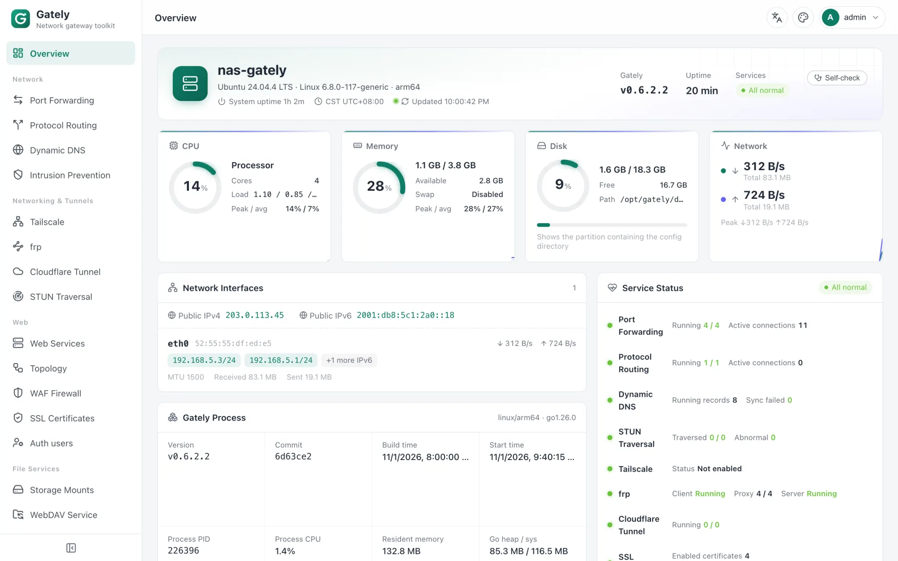

## What it replaces

| You run today | In Gately |
| --- | --- |
| nginx or Nginx Proxy Manager | Web services: reverse proxy, static sites, redirects, HTTP/3, per-site access rules; imports nginx config and imports Nginx Proxy Manager configs |
| certbot / acme.sh | ACME certificates with DNS-01 and HTTP-01, wildcard, automatic renewal and deployment |
| ddns-go or DDNS scripts | Dynamic DNS for 30+ providers, IPv4 and IPv6 |
| haproxy SNI routing / sslh | Protocol routing: HTTPS, SSH, RDP and more share one port |
| fail2ban | Log jails, decoy ports and scan detection, bans dropped in nftables or iptables |
| ModSecurity / a separate WAF | Coraza with OWASP CRS v4, per site |
| Authelia-style login in front of apps | Built-in sign-in, TOTP, Passkeys and an OIDC provider; forward auth also supported |
| Hand-run frpc / cloudflared / tailscaled | Managed frp, Cloudflare Tunnel, Tailscale, NetBird and EasyTier with install, update and rollback |
| Port-forwarding workarounds without a public IPv4 | STUN traversal: TCP / UDP hole punching, address changes sync to DNS records, webhooks and scripts |

You can turn off any module you do not need, or build a binary with only the modules you pick at [build.gately.cn](https://build.gately.cn).

## Try it

```bash
docker run -d --name gately --network host --cap-add NET_ADMIN \
  -v ./gately-data:/etc/gately \
  ghcr.io/wangwanjie/gately:latest
```

Open `http://<device-ip>:16680`, sign in as `admin` / `gately.cn`, and set your own password when prompted. Host networking lets Gately listen on the ports you configure; `NET_ADMIN` lets bans reach the host firewall (without it, bans still apply to Gately's own services). Add `-v /var/run/docker.sock:/var/run/docker.sock` if you want the Docker module. Images exist for amd64, arm64 and arm/v7 on GHCR and on Docker Hub as `vanjayak/gately` (same image; use it if GHCR is hard to reach).

Other ways to install: [binary and system service](#install) · [OpenWrt](#install) · [fnOS](#install) · [Docker Compose](deploy/docker-compose.yml) · [all options](https://gately.cn/en/docs/guide/install)

Forgot the password or lost the authenticator? Run `gately reset-password` or `gately reset-totp` on the server (`docker exec -it gately gately reset-password` in Docker); see [Reset password and two-factor authentication](https://gately.cn/en/docs/guide/install#reset). Short on storage, for example on a router? [build.gately.cn](https://build.gately.cn) builds a binary, OpenWrt or fnOS package, or a multi-arch Docker image with only the modules and UI languages you pick.

## Why you can trust it at your network edge

- **Readable and quiet**: Apache-2.0, no connection to any project-operated server by default and no device information reported; every outbound address (IP lookup, STUN, update check) is visible, editable and can be turned off. Third-party sign-in uses your own OAuth apps, with no relay in between.
- **Verifiable releases**: cosign signatures, build provenance and SBOM for every artifact ([how to verify](docs/en/VERIFY.md)); security fixes are published as [GitHub advisories](https://github.com/wangwanjie/gately/security/advisories). `checksums.txt` is also signed with minisign, and online upgrades check that signature before installing.
- **Every change is recorded**: audit log, config history with diff and one-click rollback, plain JSON you can keep in git.
- **Keeps up with haproxy + nginx**: 26k req/s against 14.7k on the same 2 cores in a like-for-like setup ([numbers and method](#performance)).

## Features

A quick tour of the admin UI. The full list of modules is at the end of this section.

### Everything at a glance

The overview shows CPU, memory, disk and traffic, network interfaces with their public IPv4 and IPv6, and the state of every module, so you can tell in seconds whether anything needs attention.


### Web services that can replace nginx

Reverse proxy, static files and redirects by domain, with HTTPS and HTTP/3. Each site gets its own WAF, IP rules and sign-in, and changes apply without dropping connections.

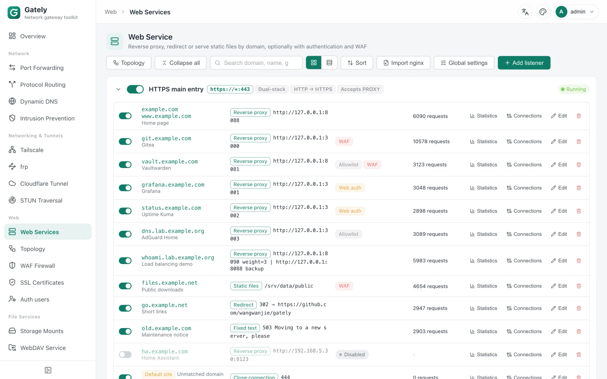

<p><b>Per-site statistics</b> — requests, errors, backend health, top client IPs and countries, minute by minute.</p>

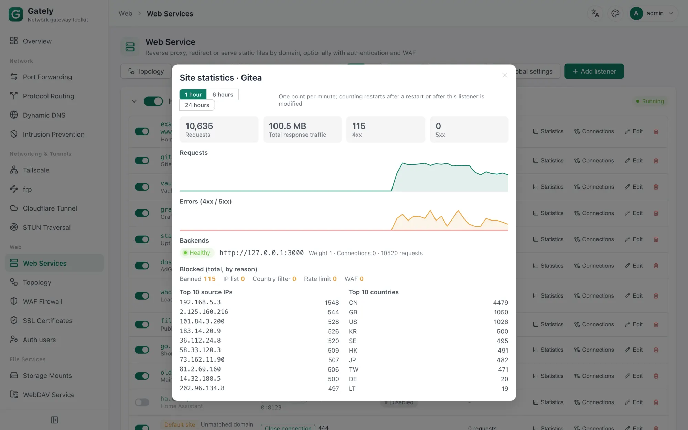

### Network topology

See how traffic flows from visitors through listeners and sites to backends, live. Pick a node for QPS, traffic and active IPs, filter by visitor IP, switch between seven layouts, and mask addresses before you share a screenshot.

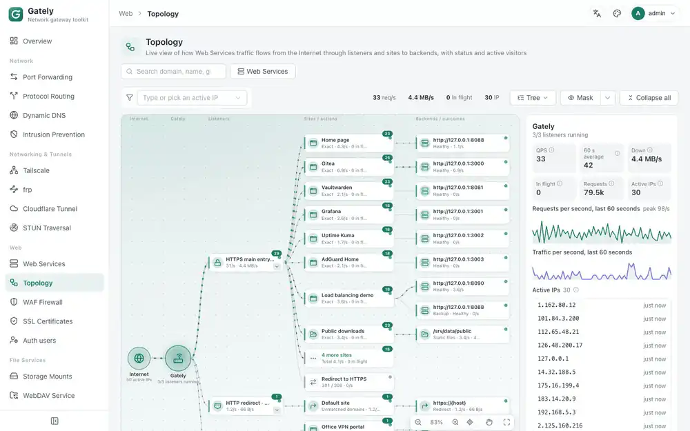

### One port 443 for every service

Protocol routing lets several services share a single port by domain or protocol, passing TLS straight through and keeping the real client address with the PROXY protocol.

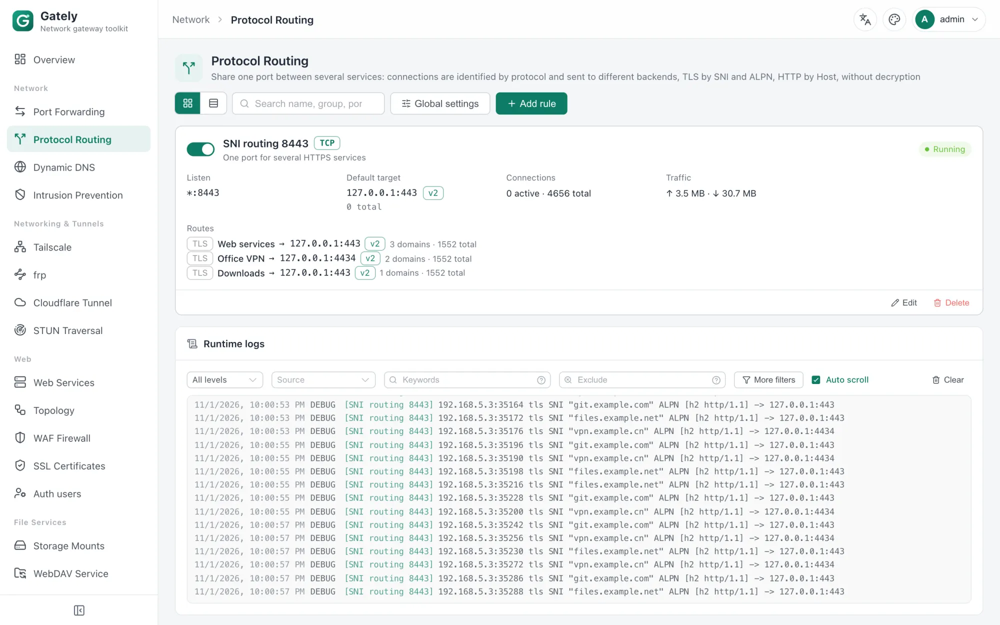

### Dynamic DNS for all the major providers

Cloudflare, Alibaba Cloud, DNSPod, Route 53 and more. IPv4 and IPv6, addresses from a URL, an interface or a command, and a notification when anything changes.

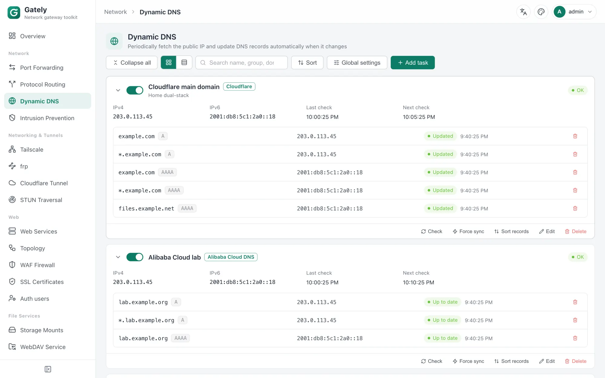

### Intrusion prevention

fail2ban-style jails read logs from files, journald and containers, while trap ports and scan detection catch probing. Bans sync to nftables and are dropped in the kernel.

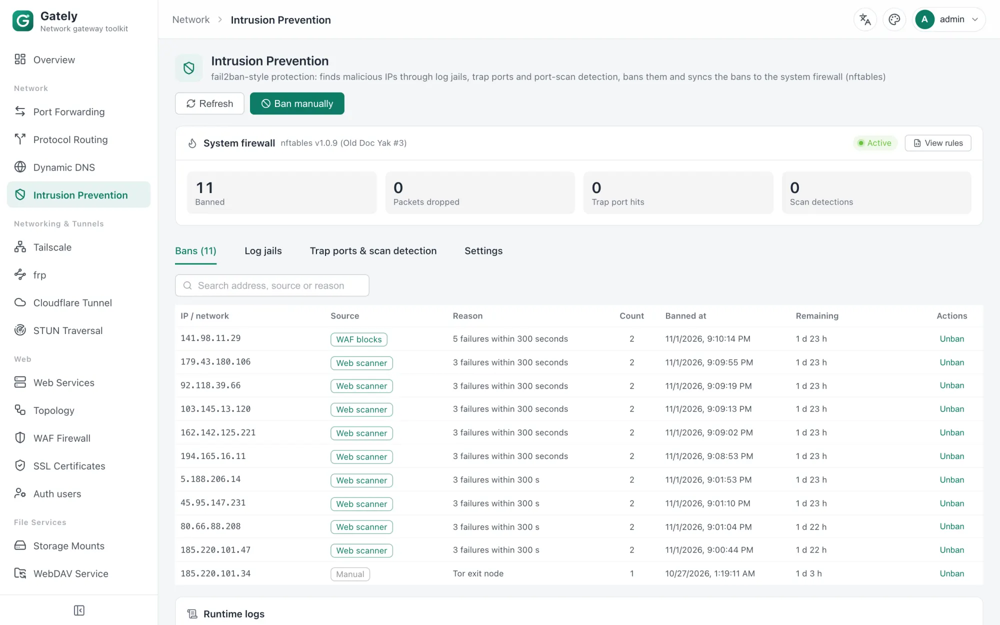

### frp, Tailscale and Cloudflare Tunnel

Run several frpc and frps instances side by side, next to Tailscale and cloudflared tunnels. Gately installs, updates and rolls back these programs for you.

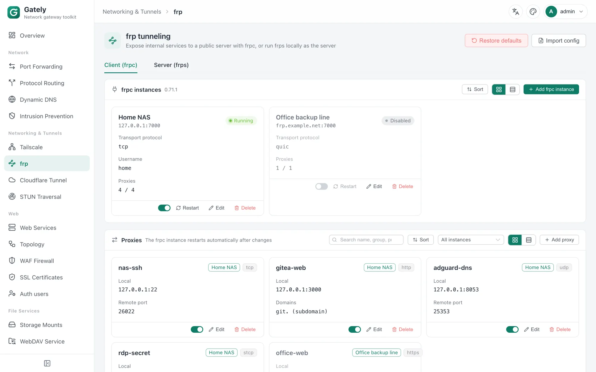

### And more

<table>
<tr>
<td width="50%" valign="top">

**Docker**<br>Containers, Compose, logs and terminals, with one-click image upgrades that roll back on failure.

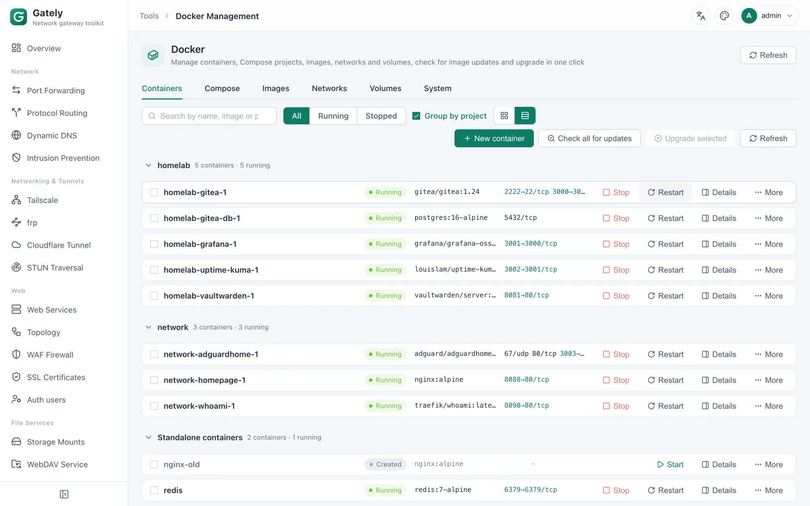

</td>
<td width="50%" valign="top">

**Web terminal**<br>SSH, Telnet and the local shell in the browser, with SFTP and split panes.

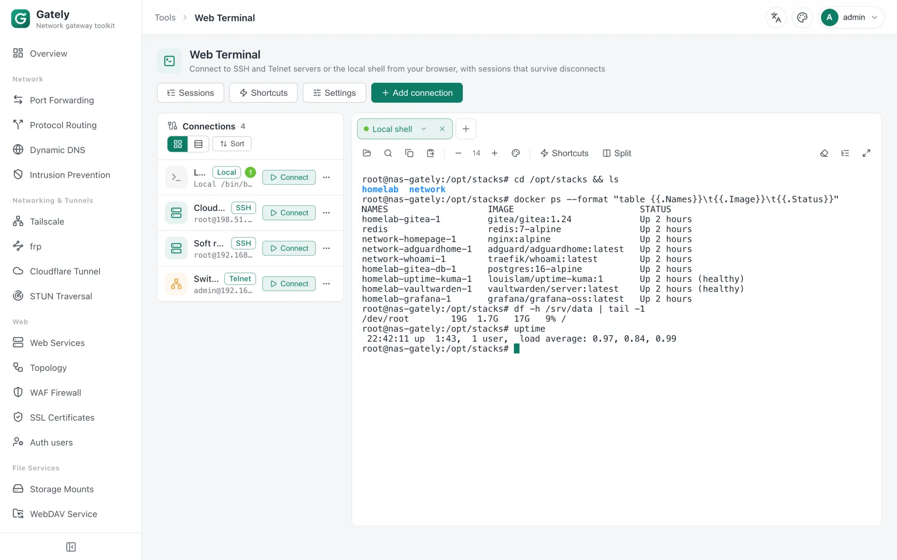

</td>
</tr>
</table>

<table>
<tr>
<td width="50%" valign="top">

**Config history**<br>Every change keeps the previous version, with a diff and one-click rollback.

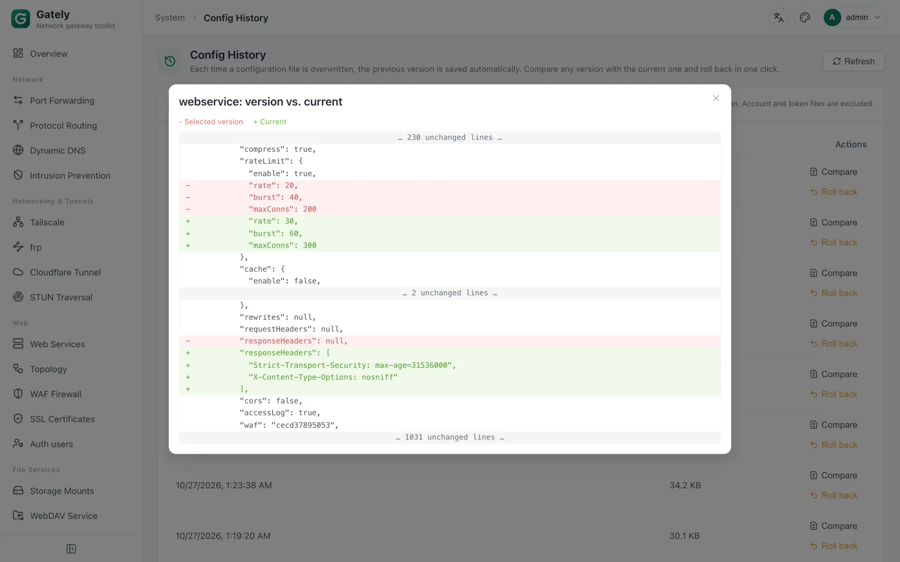

</td>
<td width="50%" valign="top">

**API, CLI and MCP**<br>Per-module API tokens, built-in OpenAPI docs, `gately ctl` and an MCP server for AI assistants.

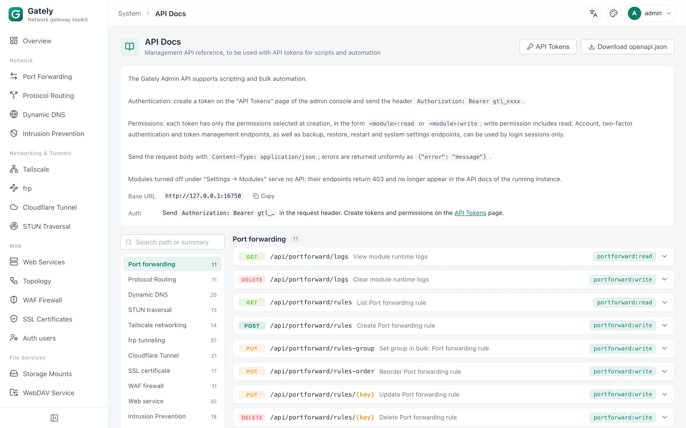

</td>
</tr>
</table>

<details>
<summary><b>Full feature list</b></summary>

Several modules share the same building blocks. STUN traversal, port forwarding and protocol routing accept a source IP allowlist / blocklist and an always-deny list (which can reference subscribed IP lists) and open their ports in the local firewall automatically. Tailscale, NetBird, EasyTier, frp, Cloudflare Tunnel and File Browser run external programs that Gately installs, updates, rolls back and uninstalls online, and every one of them has a "restore default settings" action.

| Module | Capabilities |
| --- | --- |
| Dynamic DNS | Alibaba Cloud, Cloudflare, Tencent Cloud, DNSPod, Huawei Cloud, GoDaddy, Porkbun, dynv6, DuckDNS, Amazon Route 53, OVHcloud, Gandi, NS1, Bunny DNS, Namecheap, Tencent Cloud EdgeOne, Alibaba Cloud ESA, Baidu AI Cloud, Volcano Engine, DNS.LA, Rainyun, Now.cn, Eranet, Tnet.hk, HiPM DNSMgr, Vercel, NameSilo, Dynadot, Spaceship, Name.com, Gcore, ClouDNS, deSEC, DynDNS2 (No-IP, Dynu, …), custom callbacks |
| Dynamic DNS: tasks | IP discovery via URL, network interface or command; IPv4/IPv6; webhooks; groups, sorting and search; remarks written to the provider; deleting a task can also delete the record at the provider |
| STUN traversal | TCP/UDP, keep-alive, UPnP/NAT-PMP, built-in forwarding; webhooks and scripts triggered on address change |
| Port forwarding | TCP/UDP, IPv4/IPv6, port ranges, multi-target failover, connection limits, traffic statistics, PROXY protocol v1/v2; groups, sorting and search; per-source connection limits and a timeout for connections that never send data |
| Protocol routing | Several services share one port such as 443, passed through without decryption: TLS by SNI and ALPN, HTTP by Host, Minecraft by server address, plus SSH, RDP, SOCKS, OpenVPN, RTSP, SIP, XMPP, MQTT, AMQP, PostgreSQL, Redis, SMB, Git, IRC, ADB, BitTorrent, and a wait-timeout route for server-first protocols such as VNC; a default target and PROXY protocol per route |
| SSL certificates | Automatic ACME issuance and renewal via DNS-01 (wildcard; DNS zone of delegated subdomains detected via SOA) or HTTP-01 (no DNS provider needed); EAB, upload, read from file, map to a directory and run a script |
| SSL certificates: IP and short-lived | Short-lived certificates and certificates for public IP addresses (Let's Encrypt shortlived profile) |
| SSL certificates: deployment | After renewal, push certificates to other hosts over SSH and run a command, or restart the Docker containers that use them |
| Tailscale | Managed tailscaled (userspace networking, container-friendly) or an existing system daemon; auth keys / login links, Headscale, subnet routes, exit nodes, peer list, SOCKS5 proxy, fixed port, extra arguments and environment variables; online install on Linux |
| NetBird | NetBird Cloud or a self-hosted management server; managed netbird daemon (userspace networking, lets other peers reach local services) or an existing system service; setup keys / login links, routes, routing peer, DNS, block inbound, peer list (direct / relayed, latency), SOCKS5 proxy; online install on Linux, macOS and Windows |
| EasyTier | Managed easytier-core: P2P hole punching first, self-hosted or chosen relay nodes, userspace networking with port forwarding, subnet proxy, exit nodes, KCP / QUIC proxy |
| frp | Multiple frpc and frps instances: frpc (tcp/udp/http/https/stcp/xtcp proxies, changes apply instantly, access addresses to click or copy) and frps (port allowlist, subdomains, dashboard, source IP limits for frpc logins); one-click import of legacy ini and new toml configs; frps KCP and QUIC ports, QUIC tuning on both ends, and frps ports opened in the local firewall automatically |
| Cloudflare Tunnel | cloudflared token tunnels and trycloudflare quick tunnels, multiple tunnels, automatic restart, public address display; edit the routes of token tunnels through the Cloudflare API and create their DNS records |
| WAF | Coraza + OWASP CRS v4, per-file rule toggles, custom SecLang, block or detection-only mode; can also send requests to a self-hosted SafeLine detection engine; admin sessions of this instance bypass the WAF; can trust signed-in users |
| WAF: large requests | Adjustable request body inspection limit that can inspect only the first part or skip by path, so cloud drives, WebDAV and other upload sites can sit behind the WAF |
| Intrusion Prevention: jails | fail2ban-style log jails (log files, systemd journal, command output, Docker container logs, failed admin logins, WAF blocks, rejected port knocks) with templates for SSH, Nginx, Vaultwarden and more |
| Intrusion Prevention: probes | Trap ports and port-scan detection (recognizes the open ports of Gately's modules, including remote ports requested by frpc; IPv6 strict mode bans per /64; ban reasons list the ports hit); web path probing bans by listener (decoy paths such as /.env and /.git, unknown-domain scans, repeated 404s); TLS handshake failure bans by failure type (aborted, reset, timeout, not TLS and more) and listener |
| Intrusion Prevention: bans | One ban list with manual CIDR and permanent bans, escalating durations and a whitelist; synced to the system firewall (nftables / iptables + ipset) and dropped in the kernel, or applied to Gately's own services where nftables is unavailable |
| Port Knocking | Single packet authorization (SPA) compatible with fwknop clients: AES-256 encryption, HMAC authentication, replay protection and a time window; protected ports are blocked in the system firewall (nftables / iptables + ipset) and a knocking address is let through for a limited time, established connections unaffected |
| Port Knocking: integrations | Port Forwarding, Protocol Routing (per route) and STUN can "Require knock" without firewall privileges; Protocol Routing can receive knock packets over TCP so only one port is open; release after web login grants the visitor's IP (IPv6 per /64, can be written to the system firewall), no client needed; rejected knocks can be handed to Intrusion Prevention |
| Docker management | Create and edit containers, logs and terminal, Compose, image update checks with one-click upgrade (automatic rollback on failure), networks and volumes; background tasks such as pulls, builds, Compose and batch upgrades can be stopped midway |
| Docker: self upgrade | Upgrade the container Gately itself runs in through a temporary helper container, restoring the old container on failure |
| Web terminal | SSH (trust host key on first use), Telnet, local shell (off by default); proxies, persistent sessions, SFTP file manager, 2FA and protocol confirmation, quick commands, split panes; long-press select and copy on phones, paste panel and clipboard history |
| Network diagnostics | Ping, traceroute, port probe, DNS lookup, speed test, LAN scan |
| Notification center | Webhook, Telegram, Bark, ntfy, Gotify, Pushover, Discord, Slack, ServerChan, PushPlus, WeCom, DingTalk, Feishu, email; severity levels, wildcard, and silencing / dedup rules; global or per-channel proxy (HTTP and SOCKS5); built-in rule templates (critical failures, certificate expiry, address changes, sign-ins, configuration changes, version updates); alerts for admin sign-ins from new addresses |
| Config backup | Encrypted backups (scrypt + AES-GCM), retention policy, scheduled backups to a local directory or storage mount |
| CLI and MCP | `gately ctl` talks to a running instance; `gately mcp` serves MCP over stdio (read-only by default) |
| Wake-on-LAN | Magic packet broadcast, online detection; Bemfa voice control (Xiao AI, Xiaodu, Google Assistant) |
| Wake-on-LAN: shutdown | Remote shutdown, reboot and sleep through an agent on the device (Windows/Linux/macOS/OpenWrt, connects out, no open port needed), a Web terminal SSH command or an HTTP request |
| WebDAV, FTP, SMB | Multiple users, per-user directories, read-only mode; shared users common to the three services; FTP adds FTPS and passive port ranges; SMB adds per-user shares backed by one or more directories, SMB 2/3, encryption and Bonjour discovery |
| File Browser | Hosts the FileBrowser Quantum web file manager: multiple instances, several shared directories with read-only mode, password or reverse proxy auth |
| Storage mounts | Local directories, remote WebDAV mounts and SMB shares, online file manager |
| Scheduled tasks | Cron expressions, commands or HTTP requests, run history |
| List management | Rules, instances, certificates, DNS records, terminal connections, API tokens and other lists share grouping, manual sorting (drag or arrows, with multi-select) and search, with bulk enable, disable and delete; Web service sites also support bulk adding, removing or replacing domains, bulk option changes and moving to another listener (by editing, in bulk or by dragging); most lists switch between card and compact views; reordering or regrouping never restarts a service, and it all works on phones; most entries can be duplicated as a starting point, reusing their saved secrets |
| Admin sign-in | Passkey (WebAuthn) sign-in, two-factor authentication (TOTP), read-only accounts, login rate limiting (escalating lockout), unfamiliar-address failure budget (against brute force spread across many addresses), weak password detection with forced password change, password login can be turned off (Passkey only), security score |
| Admin access | Secure entry path, LAN-only access, a configurable response for unauthorized requests that hides the admin port (plain 404, blank page, closed connection, no response or a custom page), HTTPS for the admin UI, real client address from trusted local reverse proxies |
| Settings | Multiple API tokens (per-module read/write grants), saved passwords and keys shown on request (write permission required), custom DNS (DoH supported), time zone, config backup and restore, turn feature modules on or off (disabled modules start no services and serve no API), log level (`GATELY_LOG_LEVEL`) |
| Admin UI | Global search (Ctrl/⌘+K) for pages, tabs, site domains, port forwarding rules, DDNS records and certificates; a first-run scene picker with a Getting started checklist; a three-step quick site wizard that tests the backend address; scenario templates on empty port forwarding and DDNS lists; read-only public demo mode (`-demo`) |
| Update checks | Automatic checks for new releases and security advisories (anonymous GitHub requests, can be turned off), with a prominent alert and a notification when a published security issue affects the running version |
| fnOS native app | Offline `.fpk` packages (x86 / ARM); integrated with the fnOS unified gateway, opens from the fnOS desktop icon and works over your remote fnOS domain; fnOS administrators can sign in with their fnOS session (off by default); runs as root to listen on 80/443 and manage Docker |
| Audit and history | Audit log of sign-ins, configuration changes and access to sensitive content (never records request bodies or secrets); every overwritten config file keeps its previous versions with diff and one-click rollback; declarative config directory (`-apply`) for GitOps |
| Monitoring | Performance dashboard with 60 second / 1 hour / 24 hour trends for the host, the Gately process and sites, including time to first byte P50 / P95; CPU and memory of managed processes (frp, Tailscale, NetBird, cloudflared, File Browser); threshold alerts (metric + threshold + duration) with firing and recovery notices through the notification center |
| Metrics and self-check | Global Prometheus endpoint `/api/metrics` (certificates, DDNS, STUN, port forwarding, web services) with a ready-made Grafana dashboard; one-click network self-check (public IP, CGNAT, clock, ports 80/443, DDNS resolution, certificate expiry, HTTPS sites missing a certificate, frp proxy conflicts) |
| Migration | Import nginx config (including `nginx -T` output): reverse proxies and upstreams, static directories, redirects, per-path backends, access control, with `auth_request` converted to forward auth; Nginx Proxy Manager configs import directly (`set` variables substituted into `proxy_pass`); Sun-Panel 1.x / 2.x exports convert into navigation panels |

#### Web services

Per-feature details are in the [Web services documentation](https://gately.cn/en/docs/modules/web).

| Area | Capabilities |
| --- | --- |
| Site types | Reverse proxy, redirect, static files (clean URLs, custom 404 page), fixed text, close connection (like nginx `return 444`), navigation panel |
| Listeners and protocols | HTTPS, HTTP/3 (QUIC), HTTP and HTTPS on one port (redirect or serve), an extra HTTP port per listener (such as 80 next to 443), WebSocket, cleartext HTTP/2 (h2c) backends for gRPC, PROXY protocol in and out, ports opened in the local firewall automatically |
| Backends | Per-path backends, per-user backends for signed-in users (like nginx `map $remote_user`, also for redirect, static file, navigation panel and fixed text sites), weights / standby / load-balancing policies, active and passive health checks, retry on the next backend when connecting fails, connect / TLS handshake / response header timeouts, visitor read/write idle timeouts, HTTPS backends that receive the visited domain as SNI, path rewriting and prefix stripping |
| Sign-in | Basic auth, web auth, GitHub / Google / QQ / OIDC sign-in, shared users with TOTP two-step verification, Passkeys and self-service password change, single sign-on across subdomains, a built-in OIDC identity provider for Gitea, Grafana and other OpenID Connect apps, forward auth to an external service such as Authelia, a public Gately forwarding its sign-in cookies to a LAN Gately, request headers with the signed-in user's username, email, display name and groups, admin sign-in bypass (administrators signed in to the admin UI reach sites without authenticating again, also across parent domains), trust signed-in users (skip the WAF and path probing) |
| Access control | IP allow / deny lists, subscribed IP lists refreshed on a schedule (such as province or city IP ranges), an always-deny list checked before the allowlist (suited to malicious-IP feeds), GeoIP country filtering, path rules, temporary share links, automatic ban on failed auth, knock admission (sources without a knock release cannot reach the site) and release after login, close the connection instead of answering 403 when access is denied |
| Performance | Compression, rate limiting, response caching with per-path rules (off / own duration / force) and cache purge |
| Error pages | 404 and 5xx pages in 10 built-in styles or your own HTML (uploaded or a server file, checked and sandboxed), optionally replacing backend errors (like nginx `proxy_intercept_errors`) |
| Visibility | Per-minute access statistics and Prometheus metrics, live connections per site with close or ban, topology view of live QPS, traffic and active IPs from listeners through sites to backends (per-IP path highlighting, address masking, "Active only" focus, replay of recorded snapshots kept in memory by size, off by default), visitor audit per address (sites, paths, identities, blocked share, retention), daily compressed access log archives and export |
| Navigation panels | A links page served as a site: LAN visitors get LAN addresses, built-in icons, other access methods, themes matching the admin UI, search engines, background image, sign-in-only links, card sizes, visitor language menu, custom footer; link styles (cards or app icons) and layout (icon size, links per row, spacing, width); an address chooser for links with several addresses; optional group counts and address badges |
| Operations | Changes apply without dropping open connections, site groups, sorting and search, real visitor IP from the headers of trusted proxies (CDN, WAF), domains open on click and copy as full addresses, HTTPS site rows show the matched certificate and its remaining days |

</details>

## Install

Docker is the quickest way (see [Try it](#try-it)). The other ways:

<details>
<summary><b>Binary</b></summary>

Download the archive for your platform from [Releases](https://github.com/wangwanjie/gately/releases) (Linux amd64/arm64/arm/mips/mipsle/riscv64, macOS, Windows, FreeBSD), extract it, and run:

```bash
./gately -c /etc/gately
```

Flags: `-c` sets the config directory (the `GATELY_CONFIG_DIR` environment variable also works), `-listen` overrides the admin UI listen address, `-apply` applies `<name>.json` files from a directory to the config directory on every start (`GATELY_APPLY_DIR`, handy for GitOps and Kubernetes; the account and token files cannot be overwritten), and `-version` prints the version. For unattended installs, set `GATELY_INITIAL_PASSWORD` to choose the initial admin password instead of the default `gately.cn`.

Start at boot: after extracting, run `sudo ./gately service install` (Windows: `.\gately.exe service install` in an administrator terminal). It registers a systemd unit on Linux, a launchd daemon on macOS (add `-user` for a login item without sudo) and a Windows service, starts Gately and brings it back after a crash; the config directory defaults to `/etc/gately`, `/usr/local/etc/gately` or `%ProgramData%\Gately` and `-c` and `-listen` override it. Keep the binary at its final location first, because the service points at that path. Use `gately service uninstall|start|stop|restart|status` to manage it afterwards; the config directory is kept when uninstalling.

Service templates: [systemd](deploy/systemd/gately.service) and [OpenWrt procd](deploy/openwrt/gately.init). To verify downloaded archives and images (cosign signatures, build provenance, SBOM), see [Verifying release artifacts](docs/en/VERIFY.md).

</details>

<details>
<summary><b>fnOS native app</b></summary>

Each Release ships offline `.fpk` packages for fnOS: `gately_<version>_fnos_x86.fpk` (Intel/AMD) and `gately_<version>_fnos_arm.fpk` (ARM). They are not in the official App Center, so install them manually: open **App Center → Manual install** (the button at the bottom-left), pick the file, and finish the wizard.

- **Works with the fnOS unified gateway**: click the Gately icon on the fnOS desktop and the admin UI opens through the fnOS unified gateway under `/app/gately/`, sharing the entry point you already use for fnOS. Both the LAN address and your remote fnOS domain work, with no need to open or forward port 16680. Access through the gateway is controlled by fnOS (only fnOS administrators can open it), so the safe entry and LAN-only settings apply only to direct access on port 16680.
- **Signs fnOS administrators in with their fnOS session**: turn on **Settings → Access control → Sign in with fnOS** and fnOS administrators who are signed in to fnOS enter Gately from the desktop icon without a password or two-step code; regular fnOS users still sign in. After you sign out, the login page offers a "Sign in as fnOS user &lt;name&gt;" button instead of signing you back in silently. The setting is off by default and only shown in the fnOS package.
- On the LAN the admin UI is also at `http://<NAS address>:16680`. The default account is `admin` and the default password is `gately.cn`.
- The app runs as `root`, so it can listen on 80/443, manage Docker through `docker.sock`, and open a real Web terminal. Install it only on a NAS you control.
- Config lives in the app's `var` directory and is kept on uninstall unless you choose "delete all" in the uninstall wizard. Upgrading is another manual install of the newer `.fpk`.
- The package also adds a `gately` command (`/usr/local/bin/gately`) for `gately ctl` and `gately mcp`.
- Port 16680 is shared with the Docker image. Stop the `gately` container before starting the native app.
- Verify the download as described in [Verifying release artifacts](docs/en/VERIFY.md); `.fpk` files are listed in `checksums.txt`.

</details>

<details>
<summary><b>OpenWrt</b></summary>

Each Release ships OpenWrt packages: `gately_<version>_openwrt_<arch>.ipk` for OpenWrt 24.10 and earlier (including iStoreOS), installed with `opkg install`, and `.apk` for OpenWrt 25.12 and later, installed with `apk add --allow-untrusted`. Packages cover amd64 / arm64 / arm / mipsle / mips / riscv64; pick one by `DISTRIB_ARCH` in `/etc/openwrt_release` (see the table in the [install guide](https://gately.cn/en/docs/guide/install#openwrt)).

- The service is enabled and started on install; the admin UI is at `http://<router address>:16680`, and the default account is `admin` with the password `gately.cn`.
- Config lives in `/etc/gately` and is kept across upgrades, uninstalls and firmware upgrades (sysupgrade). To upgrade, install the newer package; the online upgrade on the About page points you to the package manager instead.
- The binary is about 32 MB, so the packages suit x86 OpenWrt boxes, ARM64 boxes and other devices with ample storage; the arm package needs ARMv7 with hardware floating point.
- An architecture-independent LuCI app, `luci-app-gately_<version>_openwrt_all.ipk` / `.apk`, adds **Services → Gately** to LuCI: service state, start / stop, start at boot, the admin port and a one-click link to the admin interface.

</details>

## Operations

Monitoring, the API and the managed programs have their own pages in the [documentation](https://gately.cn/en/docs/guide/introduction); the essentials are here.

<details>
<summary><b>Monitoring</b></summary>

Create an API token with only the `metrics:read` permission and point Prometheus at `/api/metrics`. Metrics, alert examples and the Grafana dashboard are described in [Monitoring](docs/en/MONITORING.md).

</details>

<details>
<summary><b>API usage</b></summary>

Create a token on the "API Tokens" page of the admin console. You can create several, grant each read-only or read-write access per module, set an expiry, and the plaintext is shown only once, right after creation. Scripts can then call the admin API in bulk:

```bash
curl -H "Authorization: Bearer gtl_xxxx" http://localhost:16680/api/ddns/tasks
```

Account, two-factor authentication, and token management, as well as the backup, restore, restart, and system settings endpoints, accept login sessions only. All endpoints, required permissions, and data schemas are listed on the "API Docs" page of the admin console. You can also export them to [docs/api/en](docs/api/en) (`openapi.json` and `API.md`) with `make api-docs`; the website https://gately.cn references them directly when published.

When upgrading from an older version, the previous global API token becomes a "legacy token" automatically (same value, full access to every module). Tighten its permissions or replace it with a new token on the API Tokens page.

</details>

<details>
<summary><b>Tailscale, NetBird, EasyTier, frp, cloudflared</b></summary>

These five modules manage the official external programs (automatic restart, logs aggregated in the UI). Gately does not bundle them. The "online install" card on each module page downloads the latest stable release or a specific version from upstream, verifies its SHA-256, installs it into `bin/` under the config directory and restarts the processes that use it; each program can have its own download proxy, and when it is empty the update proxy from Settings is used. The last 3 replaced versions are kept, so you can roll back with one click if a new version has problems, and a program you no longer need can be uninstalled. "Restore defaults" in the page header is separate from uninstalling: it stops the processes, resets the module settings and deletes the files Gately generated for it (frp config files, File Browser instance data, Tailscale and NetBird login state); the old settings can be restored from the config history. Tailscale only publishes ready-to-run packages for Linux; on other systems use the official installer and enter its path. Programs are located in this order: the path set in the module settings, `bin/` under the config directory, then `PATH`. You can also put the binary into the config directory yourself, for example `./gately-data/bin/frpc` in Docker deployments; Tailscale needs both `tailscale` and `tailscaled`. Tokens and keys in config files are stored with 0600 permissions, and the cloudflared token is passed via an environment variable so it never appears in the process list.

The File Browser module hosts [FileBrowser Quantum](https://github.com/gtsteffaniak/filebrowser) (the original filebrowser is archived and no longer receives security fixes) with the same lookup order and the same online install, update and rollback as above, installed as `bin/filebrowser`. The admin password is passed via an environment variable and never written to the config file.

</details>

## Performance

Protocol routing by SNI plus Web Services can replace the common haproxy (TCP routing by SNI) + nginx (TLS and reverse proxy) pair. The numbers below compare the two on the same machine with the configuration of a real server: 90 domains routed by SNI, PROXY protocol v2 between the two hops, and an ECDSA P-256 certificate with TLS 1.3.

| Scenario | haproxy + nginx | Gately |
| --- | --- | --- |
| HTTPS reverse proxy, keep-alive, 1 KB responses, 64 connections | 14,767 req/s (p99 35.9 ms) | **26,434 req/s** (p99 5.7 ms) |
| The same over HTTP/2 | not tested (the nginx config used HTTP/1.1) | 27,795 req/s |
| A new TLS connection for every request, 32 at a time | 2,557 req/s | **3,448 req/s** |
| 1 MB responses, 16 connections | 1,053 MB/s | **1,585 MB/s** |
| SNI passthrough of a TLS stream, 4 connections | 2,927 MB/s | **4,962 MB/s** |
| SNI passthrough, new connections per second, 64 at a time | 6,334 /s | 6,266 /s (on par) |
| Memory under load | haproxy ≈ 21 MB + nginx ≈ 21 MB | ≈ 110 MB (one process with every module) |

<details>
<summary><b>How it was measured</b></summary>

- Host: Intel Core i5-13500T. Each stack was limited to 2 CPU cores (haproxy and nginx in Docker with `--cpuset-cpus`, Gately pinned with `taskset`) to match a small cloud server. Backends and the load generator ran on other cores.
- haproxy used `mode tcp` with `req_ssl_sni` rules and `send-proxy-v2`. nginx used `worker_processes 2` and the proxy settings of the production site, which send `Connection: upgrade` and therefore open a new backend connection per request; a tuned nginx with upstream keep-alive would narrow the gap on small responses.
- Gately's path was the SNI rule, PROXY v2, then a Web Services listener, the same number of hops as haproxy → nginx.
- Each case ran for 10 seconds, and the cases that were repeated agreed within 3%. On a real 2 vCPU cloud host the static site served 5.5k req/s against 3.4k req/s. New TLS connections were on par (about 480–550 per second for both) when the client used X25519; with the post-quantum hybrid key exchange that Go clients and recent browsers offer, Gately completed about 13% fewer handshakes in that run.
- Results depend on hardware, configuration and traffic. Treat them as a sanity check that Gately keeps up with haproxy and nginx, and measure with your own workload.

</details>

## Development

Requirements: Go 1.26+, Node.js 24+, pnpm.

```bash
make web      # build the frontend (outputs to web/dist, embedded via go:embed)
make build    # compile bin/gately
make test     # go test -race ./...
make lint     # gofmt, go vet, frontend type check
```

Custom build tags, the tests that need extra setup, module requirements and the i18n workflow are in [CONTRIBUTING.md](CONTRIBUTING.md). The directory layout and technology choices are in [docs/en/ROADMAP.md](docs/en/ROADMAP.md). The website ([gately.cn](https://gately.cn)) source lives in `website/` and is built with VitePress: `cd website && pnpm install && pnpm dev`.

## Release policy

- Gately is below 1.0. Version numbers have up to four parts (for example `v0.6.6.6`); the last part increases for follow-up releases of a minor version.
- Every `v*` tag runs the [release workflow](.github/workflows/release.yml), which builds the binaries, OpenWrt and fnOS packages and the multi-arch Docker image, and signs the artifacts. Images are tagged with the version and with `latest`, which always points to the newest release.
- Releases are frequent: 55 version tags between October 17 and November 15, 2026. [GitHub Releases](https://github.com/wangwanjie/gately/releases) group the notes by module and call out upgrade notes; the [changelog](https://gately.cn/en/news/) on the website has the announcements.
- Security fixes ship for the latest version only ([SECURITY.md](SECURITY.md)). For production, pin an image tag such as `ghcr.io/wangwanjie/gately:v0.6.6.6`, read the release notes before upgrading, and use config history to roll a setting back.

## Contributing

Issues and pull requests are welcome. The checklist for code, modules, tests and translations is in [CONTRIBUTING.md](CONTRIBUTING.md), and everyone taking part follows the [Code of Conduct](CODE_OF_CONDUCT.md).

## Community

Ask questions in [GitHub Discussions Q&A](https://github.com/wangwanjie/gately/discussions/categories/q-a) so the answers stay searchable, and share your setup in Discussions; the Telegram group is for instant chat: [t.me/gately_chat](https://t.me/gately_chat).

Please report bugs in [GitHub Issues](https://github.com/wangwanjie/gately/issues) and attach a [diagnostics bundle](docs/en/DIAGNOSTICS.md) (Settings → Diagnostics); it is generated locally and contains no passwords, tokens, domains or real IPs. Report security problems privately as described in [SECURITY.md](SECURITY.md).

## Sponsor

Every Gately feature is free. If it helps you, you can sponsor development with USDT, [Afdian](https://ifdian.net/a/gately) or WeChat Pay; addresses and QR codes are on the [sponsor page](https://gately.cn/en/sponsor).

## License

[Apache License 2.0](LICENSE)
