<p align="center">
  <a href="https://gately.cn/"></a>
</p>

<p align="center">
  <a href="https://gately.cn/">官网</a> · <a href="https://gately.cn/docs/guide/quick-start">文档</a> · <a href="https://github.com/wangwanjie/gately/releases/latest">下载</a> · <a href="https://gately.cn/news/">更新日志</a> · <a href="https://github.com/user-attachments/assets/a86576dc-22f9-40f8-bc57-b013b044e139">巡览视频</a> · <a href="https://github.com/wangwanjie/gately/discussions">Discussions</a> · <a href="https://t.me/gately_chat">Telegram</a><br>
  <a href="README.md">English</a> | <b>简体中文</b> | <a href="docs/readme/README.zh-TW.md">繁體中文</a> | <a href="docs/readme/README.ja.md">日本語</a> | <a href="docs/readme/README.ko.md">한국어</a> | <a href="docs/readme/README.es.md">Español</a> | <a href="docs/readme/README.fr.md">Français</a> | <a href="docs/readme/README.de.md">Deutsch</a> | <a href="docs/readme/README.ru.md">Русский</a> | <a href="docs/readme/README.pt-BR.md">Português (Brasil)</a>
</p>

<p align="center">
  <a href="https://github.com/wangwanjie/gately/releases/latest"></a>
  <a href="LICENSE"></a>
  <a href="https://hub.docker.com/r/vanjayak/gately"></a>
</p>

# Gately

**装在 NAS、软路由或云服务器上的网络网关：反向代理、HTTPS 证书、动态域名、内网穿透、WAF 和入侵防护，一个程序，全部在浏览器里配置。**

从公网到你家里或服务器上的服务，这一路要做的事 Gately 都接管：域名跟着变化的 IP 走，证书自动签发续期，所有服务共用一个 443 端口，每个站点前面可以加登录和 WAF，探测和爆破的地址自动封禁。源码以 Apache-2.0 开源，配置是本机上的明文 JSON，默认不连接任何项目方服务器。

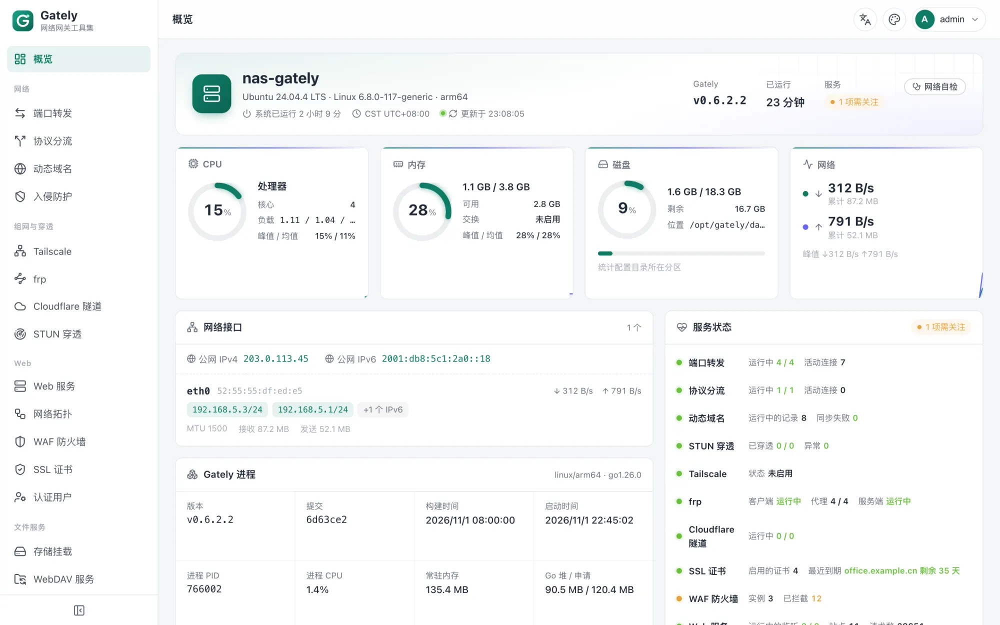

## 能替代哪些工具

| 你现在在用 | Gately 里对应 |
| --- | --- |
| nginx、Nginx Proxy Manager | Web 服务：反向代理、静态站点、重定向、HTTP/3、按站点的访问控制；可导入 nginx 配置 |
| acme.sh、certbot | SSL 证书：DNS-01 / HTTP-01、泛域名、自动续期与分发 |
| ddns-go、DDNS 脚本 | 动态域名：30+ 服务商，IPv4 / IPv6 |
| haproxy 按 SNI 分流、sslh | 协议分流：HTTPS、SSH、RDP 等共用一个端口 |
| fail2ban | 入侵防护：日志规则、诱饵端口、扫描检测，封禁写入 nftables / iptables |
| 单独部署的 WAF | Coraza + OWASP CRS v4，按站点开关 |
| 应用前面另加的登录网关 | 内置网页认证、两步验证、Passkey 和 OIDC 身份提供方 |
| 手动维护的 frpc、cloudflared、tailscaled | 托管 frp、Cloudflare Tunnel、Tailscale、NetBird、EasyTier，带安装、更新、回滚 |
| 没有公网 IPv4 时的各种打洞方案 | STUN 穿透：TCP / UDP 打洞，地址变化可同步到解析记录、Webhook 与脚本 |

用不到的模块可以关闭，也可以在 [build.gately.cn](https://build.gately.cn) 只选需要的模块生成更小的安装包。

## 一分钟跑起来

```bash
docker run -d --name gately --network host --cap-add NET_ADMIN \
  -v ./gately-data:/etc/gately \
  ghcr.io/wangwanjie/gately:latest
```

打开 `http://设备IP:16680`，用 `admin` / `gately.cn` 登录，按提示设置自己的密码。`--network host` 让 Gately 能监听你配置的端口；`--cap-add NET_ADMIN` 供入侵防护把封禁写入宿主机防火墙，不加时封禁仍对 Gately 自身的服务生效。需要 Docker 管理时加上 `-v /var/run/docker.sock:/var/run/docker.sock`。镜像支持 amd64、arm64、arm/v7，同时发布到 GHCR 与 Docker Hub 的 `vanjayak/gately`（同一份镜像与标签，拉取 GHCR 不顺时改用 `vanjayak/gately:latest`）。

飞牛 fnOS 有原生应用（接入统一网关，桌面图标直接打开），OpenWrt / iStoreOS 有 ipk / apk 和 LuCI 插件，其他系统有单文件二进制：[二进制与系统服务](#安装) · [OpenWrt](#安装) · [飞牛](#安装) · [Docker Compose](deploy/docker-compose.yml) · [全部安装方式](https://gately.cn/docs/guide/install)

忘记密码或丢失两步验证器时，在服务器上运行 `gately reset-password` 或 `gately reset-totp`（Docker 为 `docker exec -it gately gately reset-password`），详见[重置密码与两步验证](https://gately.cn/docs/guide/install#reset)。路由器等存储空间有限的设备，可以在 [build.gately.cn](https://build.gately.cn) 只勾选需要的模块与界面语言，在线生成更小的二进制、OpenWrt 或飞牛安装包，或多架构 Docker 镜像。

## 放在网络入口，凭什么信它

- **看得见**：Apache-2.0 开源；默认不连接任何项目方服务器，不上报设备信息；每个外连地址（公网 IP 查询、STUN、更新检查）都可见、可改、可关；第三方登录使用你自己的 OAuth 应用，不经过中转。
- **可验证**：每个发布产物带 cosign 签名、构建来源证明和 SBOM（[验证方法](docs/VERIFY.md)）；安全修复以 [GitHub 安全公告](https://github.com/wangwanjie/gately/security/advisories)公开。
- **可追溯**：操作审计、配置历史对比与一键回滚，配置是明文 JSON，可以直接放进 git。
- **性能跟得上**：同机 2 核对比 haproxy + nginx 组合，HTTPS 反代 26k 对 14.7k req/s（[数据与测试方法](#性能)）。

## 功能

先看几张管理界面的截图，完整功能清单在本节末尾。

### 一眼看清全局

概览页集中展示 CPU、内存、磁盘与流量，网卡及其公网 IPv4 / IPv6，以及每个模块的运行状态，哪里需要处理一目了然。


### 能替代 nginx 的 Web 服务

按域名做反向代理、静态文件和重定向，支持 HTTPS 与 HTTP/3。每个站点可以单独开 WAF、IP 规则和登录认证，改配置不断开现有连接。

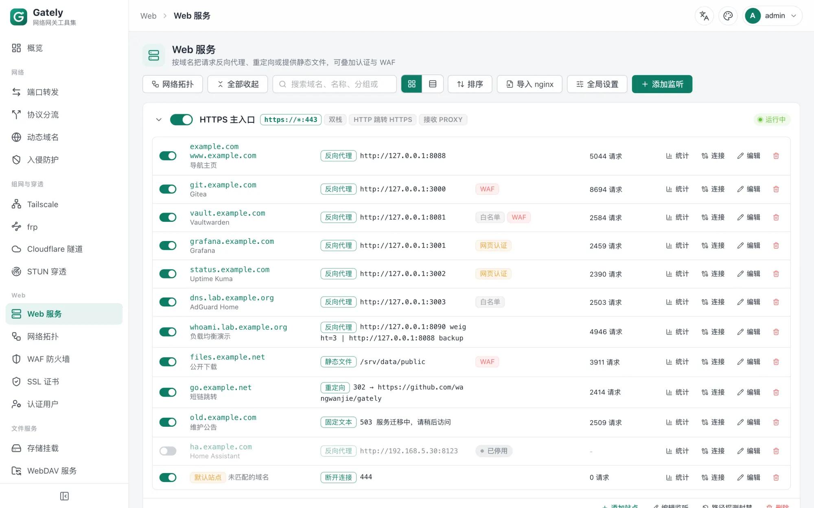

<p><b>站点统计</b> — 按分钟统计请求数、错误、后端健康状态，以及来源 IP 与国家排行。</p>

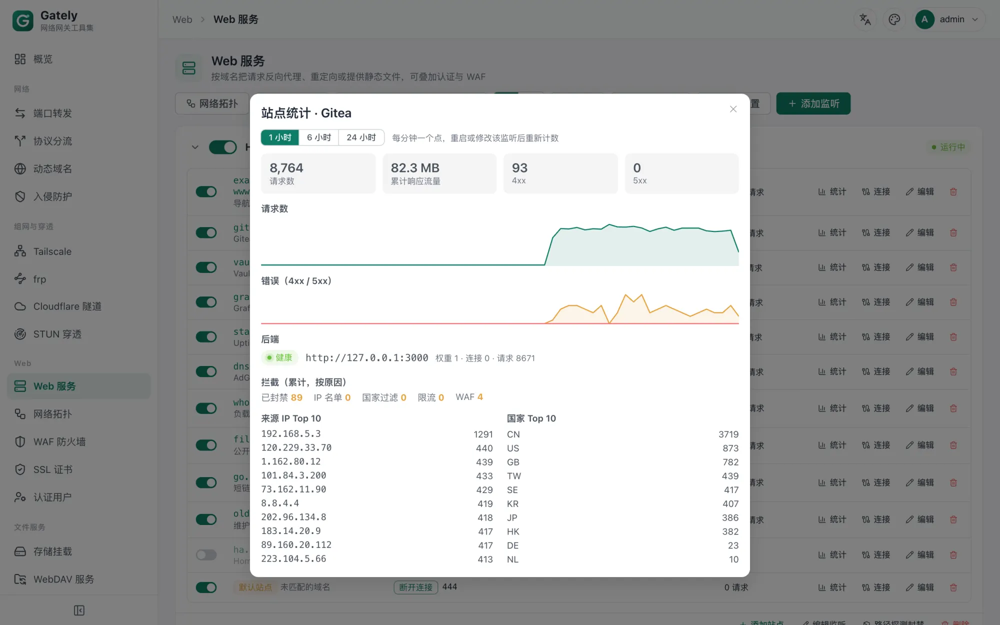

### 网络拓扑

实时查看流量从访客经监听、站点到后端的走向。点选节点看 QPS、流量与活跃 IP，按访客 IP 过滤，七种布局随意切换，截图分享前还能一键打码。

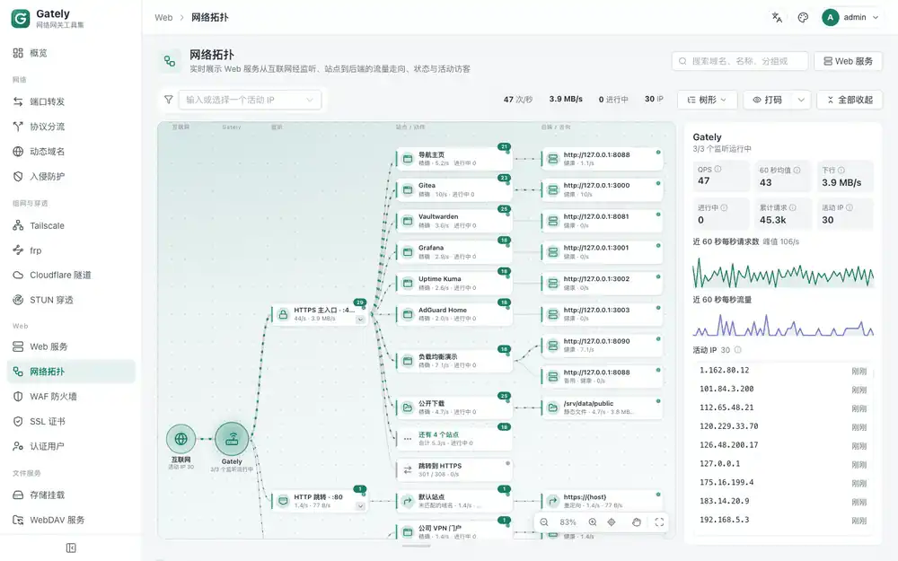

### 一个 443 端口，给所有服务用

协议分流按域名或协议把多个服务放在同一个端口上，TLS 原样透传，再用 PROXY 协议保留真实客户端地址。

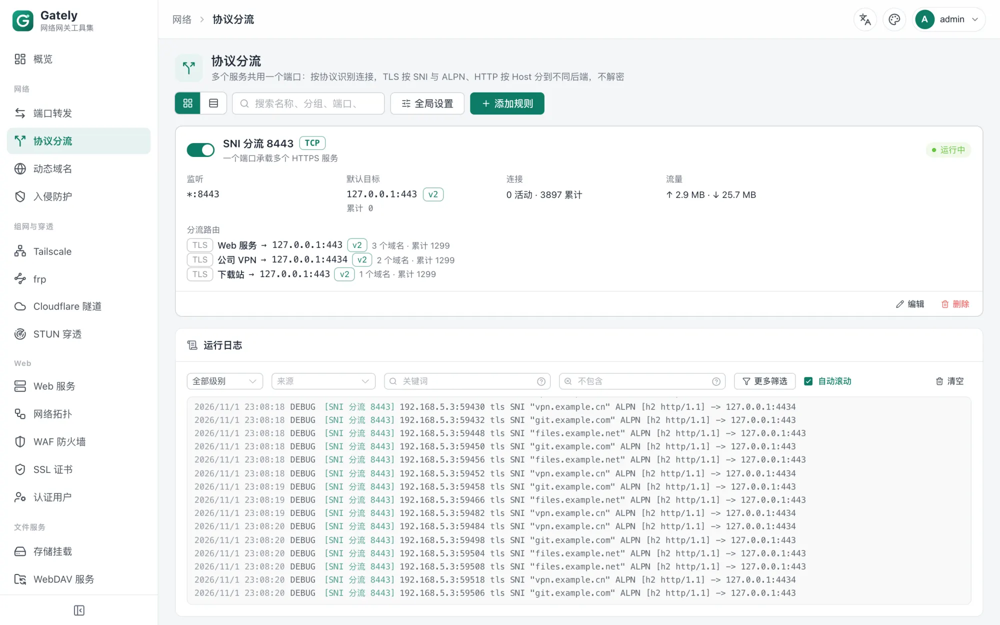

### 动态域名，主流服务商都支持

Cloudflare、阿里云、DNSPod、Route 53 等都能用。IPv4 与 IPv6，IP 可以从 URL、网卡或命令获取，地址一变就发通知。

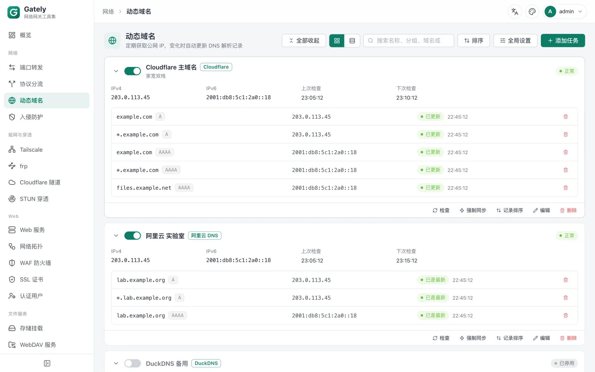

### 入侵防护

类 fail2ban 的规则读取日志文件、journald 和容器日志，诱饵端口与扫描检测抓出探测行为。封禁同步到 nftables，直接在内核里丢包。

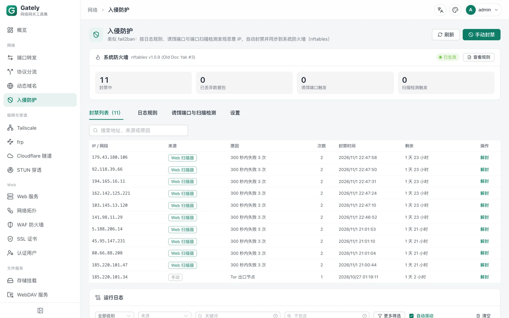

### frp、Tailscale 与 Cloudflare 隧道

多个 frpc、frps 实例并行运行，和 Tailscale、cloudflared 隧道放在一起管理。这些程序的安装、更新和回滚都由 Gately 代劳。

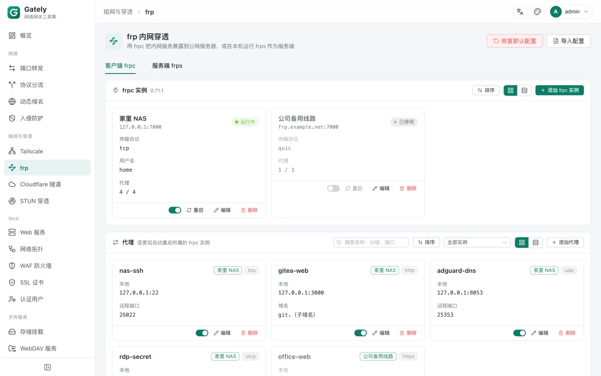

### 还有这些

<table>
<tr>
<td width="50%" valign="top">

**Docker**<br>容器、Compose、日志与终端，镜像一键升级，失败自动回滚。

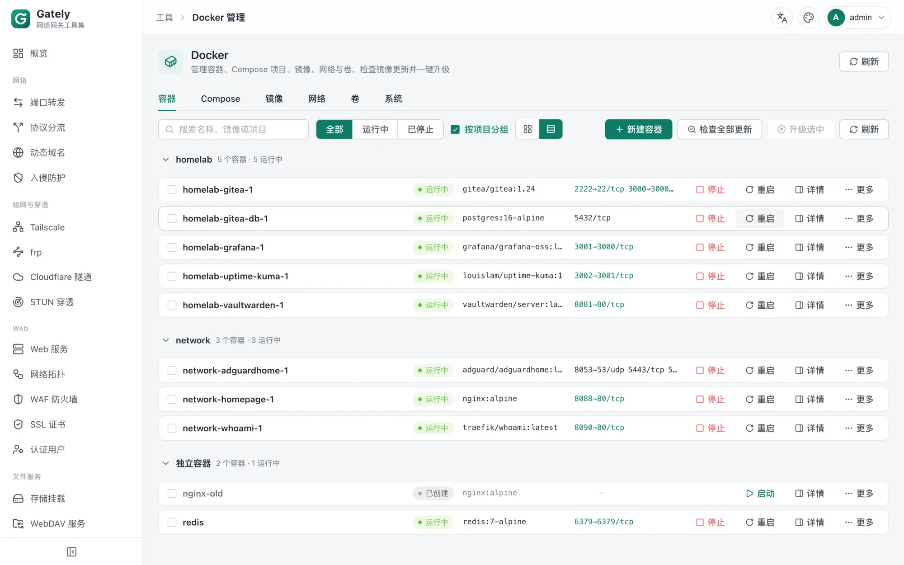

</td>
<td width="50%" valign="top">

**Web 终端**<br>在浏览器里用 SSH、Telnet 和本机 Shell，支持 SFTP 与分屏。

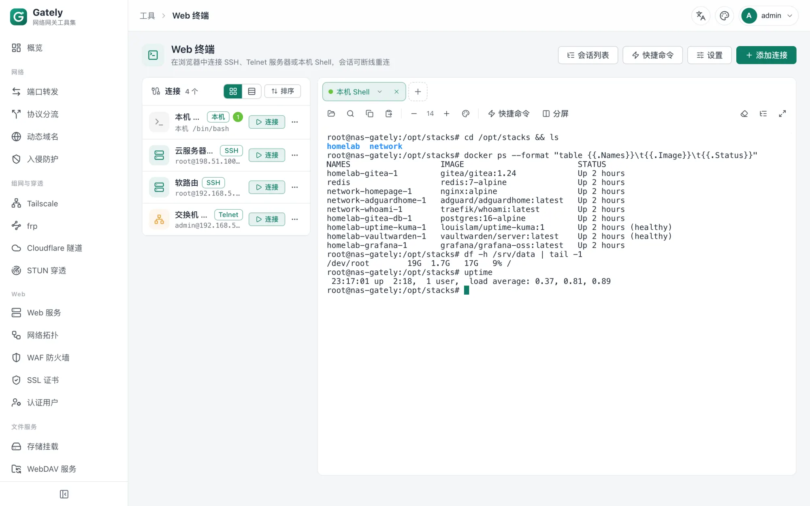

</td>
</tr>
</table>

<table>
<tr>
<td width="50%" valign="top">

**配置历史**<br>每次修改都保留旧版本，可以对比差异、一键回滚。

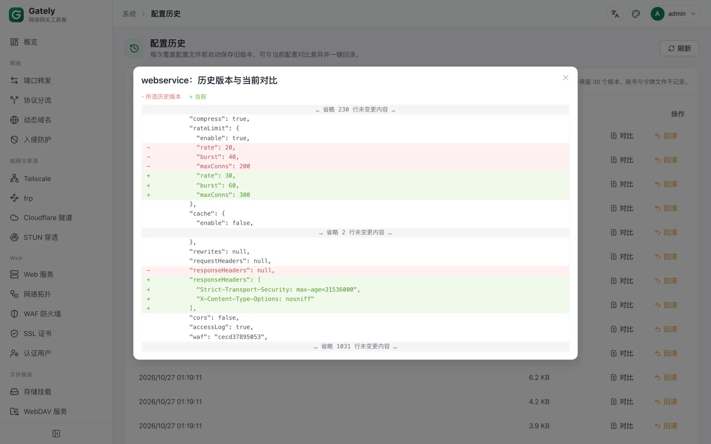

</td>
<td width="50%" valign="top">

**API、命令行与 MCP**<br>按模块授权的 API 令牌、内置 OpenAPI 文档、`gately ctl`，以及接入 AI 助手的 MCP 服务。

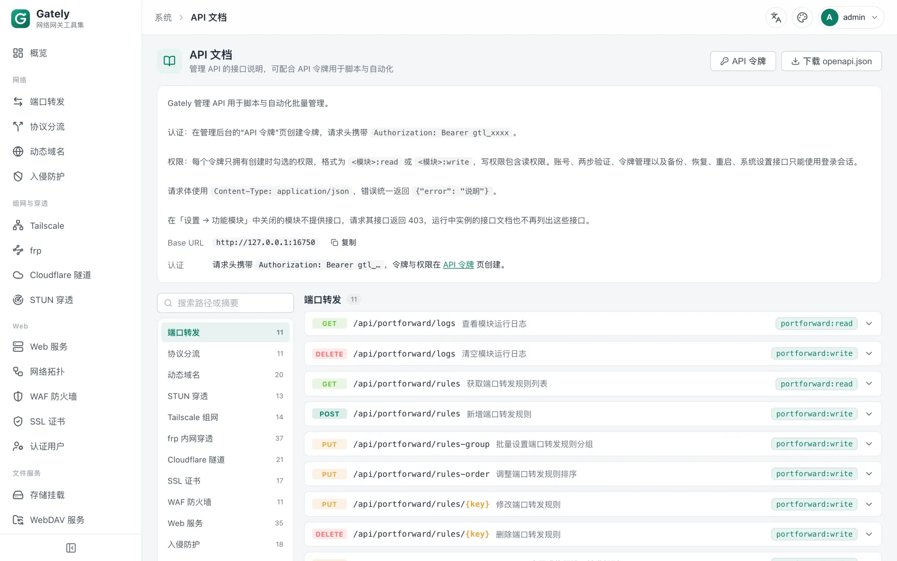

</td>
</tr>
</table>

<details>
<summary><b>完整功能清单</b></summary>

几个模块共用同样的基础能力：STUN 穿透、端口转发、协议分流支持来源 IP 白名单 / 黑名单与优先拒绝名单（可引用订阅 IP 列表），并自动在本机防火墙放行各自的端口。Tailscale、NetBird、EasyTier、frp、Cloudflare 隧道与 File Browser 运行外部程序，由 Gately 在线安装、更新、回滚与卸载，并且都带「恢复默认配置」。

| 模块 | 能力 |
| --- | --- |
| 动态域名 | 阿里云、Cloudflare、腾讯云、DNSPod、华为云、GoDaddy、Porkbun、dynv6、DuckDNS、Amazon Route 53、OVHcloud、Gandi、NS1、Bunny DNS、Namecheap、腾讯云 EdgeOne、阿里云 ESA、百度智能云、火山引擎、DNS.LA、雨云、时代互联（Now.cn）、新网互联（Eranet）、Tnet.hk、HiPM DNSMgr、Vercel、NameSilo、Dynadot、Spaceship、Name.com、Gcore、ClouDNS、deSEC、DynDNS2（No-IP、Dynu 等）、自定义回调 |
| 动态域名：任务 | URL / 网卡 / 命令取 IP；IPv4/IPv6；Webhook；分组、排序与搜索；备注写入服务商；删除任务时可同时删除服务商处的解析 |
| STUN 穿透 | TCP/UDP、保活、UPnP/NAT-PMP、内置转发、地址变化时触发 Webhook 与脚本 |
| 端口转发 | TCP/UDP、IPv4/IPv6、端口段、多目标故障转移、连接数限制、流量统计、PROXY 协议（v1/v2）；分组、排序与搜索 |
| 协议分流 | 多个服务共用 443 等同一个端口：按协议识别连接并透传、不解密，TLS 按 SNI 与 ALPN、HTTP 按 Host，Minecraft 按服务器地址，另可识别 SSH、RDP、SOCKS、OpenVPN、RTSP、SIP、XMPP、MQTT、AMQP、PostgreSQL、Redis、SMB、Git、IRC、ADB、BitTorrent，VNC 等服务端先发言的协议走等待超时路由；默认目标、每条路由单独设置 PROXY 协议 |
| SSL 证书 | ACME 自动签发与续期，支持 DNS-01（通配符；委派子域名按 SOA 自动识别 DNS 区域）与 HTTP-01（无需 DNS 服务商）；EAB、上传、读取文件、映射到目录并执行脚本 |
| SSL 证书：IP 与短期证书 | 短期证书与公网 IP 地址证书（Let's Encrypt shortlived 配置） |
| SSL 证书：分发 | 证书更新后经 SSH 推送到其他主机并执行命令，或重启使用证书的 Docker 容器 |
| Tailscale | 托管 tailscaled（用户态网络，容器友好）或接入系统已有守护进程；认证密钥/登录链接、Headscale、子网路由、出口节点、节点列表、SOCKS5 代理、固定端口、额外参数与环境变量；Linux 上可在线安装 |
| NetBird | 加入 NetBird 官方云或自建管理服务；托管 netbird 守护进程（用户态网络，可让其他节点访问本机服务）或接入系统已有服务；设置密钥/登录链接、接受路由、作为路由节点、接受 DNS、拒绝入站、节点列表（直连/中继、延迟）、SOCKS5 代理；Linux、macOS、Windows 可在线安装 |
| EasyTier | 托管 easytier-core：P2P 打洞优先，支持自建或选择中继节点，用户态网络、端口转发、子网代理、出口节点、KCP/QUIC 代理 |
| frp | 可同时运行多个 frpc 与 frps 实例：frpc（tcp/udp/http/https/stcp/xtcp 代理，增删即生效，代理访问地址可点击、复制）与 frps（端口白名单、子域名、控制台、按来源 IP 限制 frpc 登录）；可一键导入旧版 ini / 新版 toml 配置 |
| Cloudflare 隧道 | cloudflared 令牌隧道与 trycloudflare 临时隧道，多隧道、自动重启、公网地址展示；令牌隧道可通过 Cloudflare API 编辑路由规则并创建 DNS 记录 |
| WAF 防火墙 | Coraza + OWASP CRS v4，可按文件启用规则、自定义 SecLang、拦截/仅检测；还可接入自行部署的雷池（SafeLine）检测引擎；本实例管理员会话不经过 WAF；可信任已登录用户 |
| WAF：大请求 | 请求体检查上限可调，超限时只检查前段或按路径跳过，网盘、WebDAV 等上传站点也能挂 WAF |
| 入侵防护：日志规则 | 类 fail2ban 的日志规则（日志文件、systemd 日志、命令输出、Docker 容器日志、管理后台登录失败、WAF 拦截、端口敲门被拒绝），内置 SSH、Nginx、Vaultwarden 等模板 |
| 入侵防护：探测检测 | 诱饵端口与端口扫描检测（自动识别 Gately 各模块的开放端口，含 frpc 申请的远程端口；IPv6 严格模式按 /64 封禁；封禁原因含命中端口）；Web 路径探测封禁：按监听统计诱饵路径（/.env、/.git 等）、未知域名扫描与连续 404；TLS 握手失败封禁：按失败类型（中途断开、重置、超时、非 TLS 等）与监听统计 |
| 入侵防护：封禁 | 统一封禁表，支持手动网段与永久封禁、递增时长与白名单；封禁同步到系统防火墙（nftables / iptables + ipset）在内核层丢弃，没有 nftables 的平台对 Gately 自身的服务生效 |
| 端口敲门 | 兼容 fwknop 客户端的单包敲门（SPA）：AES-256 加密、HMAC 认证、防重放与时间窗口；受保护端口在系统防火墙（nftables / iptables + ipset）中拦截，敲门成功的地址在限定时间内放行，已建立的连接不受影响 |
| 端口敲门：联动 | 端口转发、协议分流（可按路由）与 STUN 可选“需要敲门”，无需防火墙权限；协议分流可接收经 TCP 发来的敲门包，对外只开一个端口；Web 登录后放行：访客在 Web 站点登录后其 IP 获得授权（IPv6 按 /64，可写入系统防火墙），无需客户端；被拒绝的敲门可交给入侵防护封禁 |
| Docker 管理 | 容器创建与编辑、日志与终端、Compose、镜像更新检查与一键升级（失败自动回滚）、网络与卷；拉取、构建、Compose、批量升级等后台任务可中途停止 |
| Docker：升级自身 | 升级 Gately 自身所在的容器（经临时辅助容器，失败时恢复旧容器） |
| Web 终端 | SSH（主机密钥首次信任）、Telnet、本机 Shell（默认关闭）；代理、持久会话、SFTP 文件管理、2FA 与协议确认、快捷命令、分屏；手机上长按选择复制、粘贴面板与剪贴板记录 |
| 网络诊断 | Ping、路由追踪、端口探测、DNS 查询、测速、局域网扫描 |
| 通知中心 | Webhook、Telegram、Bark、ntfy、Gotify、Pushover、Discord、Slack、Server酱、PushPlus、企业微信、钉钉、飞书、邮件；级别、通配与静默去重规则；全局或按渠道的代理（HTTP 与 SOCKS5）；内置规则模板（关键故障、证书到期、地址变化、登录、配置变更、版本更新）；管理后台新地址登录提醒 |
| 配置备份 | 加密备份（scrypt + AES-GCM）、保留策略、定时备份到本地目录或存储挂载点 |
| 命令行与 MCP | `gately ctl` 调用运行中的实例，`gately mcp` 以 stdio 提供 MCP 服务（默认只读） |
| 网络唤醒 | 魔术包广播、在线探测；巴法云语音控制（小爱同学、小度、Google Assistant） |
| 网络唤醒：关机 | 远程关机、重启与睡眠：设备上的客户端（Windows/Linux/macOS/OpenWrt，主动连接，无需开放端口）、Web 终端 SSH 命令或 HTTP 请求 |
| WebDAV、FTP、SMB | 多用户、独立目录、只读，三个服务共用一份共享用户；FTP 另有 FTPS 与被动端口范围；SMB 另有按用户共享多个目录、SMB 2/3、加密与 Bonjour 发现 |
| File Browser | 托管 FileBrowser Quantum 网页文件管理器：多实例、多个共享目录与只读、账号密码或反向代理认证 |
| 存储挂载 | 本地目录、远程 WebDAV 与 SMB 共享挂载，在线文件管理 |
| 计划任务 | cron 表达式，命令或 HTTP 请求，执行记录 |
| 列表管理 | 规则、实例、证书、解析记录、终端连接与 API 令牌等列表统一支持分组、手动排序（拖动或箭头，可多选批量移动）与搜索，多选后可批量启停、删除；多数列表可切换卡片/紧凑视图；调整顺序与分组不重启服务，手机上也能操作；多数条目可复制为副本再修改，密码等密钥沿用原条目 |
| 管理员登录 | Passkey（WebAuthn）登录、两步验证（TOTP）、只读账号、登录失败限流（递增锁定）、陌生来源失败预算（抵御分散爆破）、弱口令检测与强制改密、关闭密码登录（只用 Passkey）、安全评分 |
| 管理端访问 | 安全入口、仅内网访问、可自定义未授权访问的响应以隐藏管理端口（普通 404、空白页、断开连接、不响应或自定义页面）、管理界面 HTTPS、信任本机反向代理传来的真实客户端地址 |
| 系统设置 | 多 API 令牌（按模块读写授权）、已保存的密码与密钥可按需显示（需写权限）、自定义 DNS（支持 DoH）、时区、配置备份与恢复、按需开关功能模块（关闭的模块不启动服务、不提供接口） |
| 更新检查 | 自动检查新版本与安全公告（匿名访问 GitHub，可关闭），受已公开安全问题影响时醒目提示并发送通知 |
| 飞牛原生应用 | 离线 `.fpk` 安装包（x86 / ARM）；接入飞牛统一网关，从飞牛桌面图标打开，远程域名同样可用；飞牛管理员可凭飞牛登录态直接登录（默认关闭）；以 root 运行，可监听 80/443 并管理 Docker |
| 审计与历史 | 操作审计日志：登录、配置变更、访问敏感内容（不记录请求体与任何密钥）；每次覆盖配置文件前保留旧版本，可对比差异并一键回滚；声明式配置目录（`-apply`），便于 GitOps |
| 监控 | 性能面板：主机、Gately 进程与站点的 60 秒 / 1 小时 / 24 小时趋势，含首字节延迟 P50 / P95；托管进程（frp、Tailscale、NetBird、cloudflared、File Browser）的 CPU 与内存；阈值告警（指标 + 阈值 + 持续时长），触发与恢复经通知中心发送 |
| 指标与自检 | 全局 Prometheus 指标 `/api/metrics`（证书、DDNS、STUN、端口转发、Web 服务），附 Grafana 面板；一键网络自检（公网 IP、运营商 NAT、系统时间、80/443 端口、DDNS 解析、证书到期、HTTPS 站点缺少证书、frp 代理冲突） |
| 迁移 | 导入 nginx 配置（支持 `nginx -T` 输出）：反向代理与 upstream、静态目录、跳转、分路径后端、访问控制，`auth_request` 转换为转发认证 |

#### Web 服务

各项功能的细节见[Web 服务文档](https://gately.cn/docs/modules/web)。

| 方面 | 能力 |
| --- | --- |
| 站点类型 | 反向代理、重定向、静态文件（无扩展名地址、自定义 404 页）、固定文本、断开连接（相当于 nginx `return 444`）、导航面板 |
| 监听与协议 | HTTPS、HTTP/3（QUIC）、HTTP 与 HTTPS 共用同一端口（跳转或直接服务）、监听可附加 HTTP 端口（如 443 再开 80，跳转或直接服务）、WebSocket、http:// 后端用明文 HTTP/2（h2c）反代 gRPC、PROXY 协议收发、监听自动放行本机防火墙端口 |
| 后端 | 按路径分流后端、按登录用户分流到不同后端（类似 nginx `map $remote_user`，也适用于重定向/静态文件/导航面板/固定文本站点）、后端权重/备用/负载均衡策略、主动与被动健康检查、建连失败自动重试下一个后端、后端连接/TLS 握手/响应头超时、访客读写空闲超时、HTTPS 后端按访问域名发送 SNI、路径重写与去前缀 |
| 登录认证 | 基本认证、网页认证、GitHub/Google/QQ/OIDC 登录、带 TOTP 二次验证与 Passkey 并可自助修改密码的共享用户、跨子域名单点登录、内置 OIDC 身份提供方（让 Gitea、Grafana 等应用用共享用户登录）、转发认证到 Authelia 等外部服务、公网 Gately 把登录 Cookie 转发给内网 Gately、向后端传递登录用户的用户名、邮箱、显示名与分组请求头、后台登录免认证（已登录管理后台的管理员访问站点无需再认证，支持跨父域）、信任已登录用户（跳过 WAF 与路径探测） |
| 访问控制 | IP 黑白名单与定时刷新的订阅 IP 列表（如省市 IP 段）、先于白名单判断的优先拒绝名单（适合放恶意 IP 情报列表）、GeoIP 国家过滤、路径规则、临时分享链接、认证失败自动封禁、敲门准入（未敲门放行的来源无法访问站点）与登录后放行（站点认证通过后为访客 IP 授权敲门规则）、访问被拒绝时直接断开连接而不返回 403 |
| 性能 | 压缩、限流、响应缓存（按路径缓存规则：不缓存/单独时长/强制缓存）与清空缓存 |
| 错误页 | 404 与 5xx 错误页可选 10 种内置风格或自己的 HTML（上传或服务器文件，经安全检查并在沙箱中显示），可拦截后端返回的错误页（类似 nginx `proxy_intercept_errors`） |
| 可观测 | 分钟级访问统计与 Prometheus 指标、按站点查看实时连接并可断开或封禁、拓扑视图实时展示监听 → 站点 → 后端的 QPS、流量与活动 IP（按 IP 高亮链路、打码地址、「聚焦活动」、回放：快照按容量保留在内存中，默认关闭）、按地址的访客审计（站点、路径、身份、被拦截占比、保留期限）、访问日志按天压缩归档与导出 |
| 导航面板 | 作为站点提供的链接页：内网访客看到内网地址、内置图标、其他访问方式、与管理界面相同的换肤、搜索引擎、背景图片、登录后可见的链接、大小卡片、访客语言切换、自定义页脚 |
| 运维 | 修改站点不会断开已有连接、站点分组、排序与搜索、从可信代理（CDN、WAF）的请求头取访客真实 IP、域名可点击、复制完整地址 |

</details>

## 安装

Docker 最快（见[一分钟跑起来](#一分钟跑起来)），其他方式如下：

<details>
<summary><b>二进制</b></summary>

从 [Releases](https://github.com/wangwanjie/gately/releases) 下载对应平台的压缩包（Linux amd64/arm64/arm/mips/mipsle/riscv64、macOS、Windows、FreeBSD），解压后运行：

```bash
./gately -c /etc/gately
```

参数：`-c` 配置目录（也可用环境变量 `GATELY_CONFIG_DIR`），`-listen` 覆盖管理界面监听地址，`-apply` 每次启动把目录中的 `<名称>.json` 覆盖到配置目录（环境变量 `GATELY_APPLY_DIR`，适合 GitOps 与 Kubernetes；账号与令牌文件不允许覆盖），`-version` 输出版本。无人值守安装时可设置环境变量 `GATELY_INITIAL_PASSWORD` 指定管理员初始密码，代替默认密码 `gately.cn`。

开机自启：解压后执行 `sudo ./gately service install`（Windows 在管理员终端执行 `.\gately.exe service install`）。Linux 会注册 systemd 服务，macOS 注册 launchd 守护进程（加 `-user` 可免 sudo 注册为登录项），Windows 注册为系统服务，安装后立即启动并在异常退出后自动拉起；配置目录默认为 `/etc/gately`、`/usr/local/etc/gately` 或 `%ProgramData%\Gately`，可用 `-c`、`-listen` 指定。服务引用的是当前可执行文件的路径，请先把程序放到最终位置。之后用 `gately service uninstall|start|stop|restart|status` 管理，卸载时保留配置目录。

服务模板：[systemd](deploy/systemd/gately.service)、[OpenWrt procd](deploy/openwrt/gately.init)。校验下载的压缩包与镜像（cosign 签名、构建来源证明、SBOM）见[校验发布产物](docs/VERIFY.md)。

</details>

<details>
<summary><b>飞牛原生应用</b></summary>

每个 Release 附带飞牛 fnOS 的离线安装包 `gately_<版本>_fnos_x86.fpk`（Intel/AMD）与 `gately_<版本>_fnos_arm.fpk`（ARM）。它们没有上架官方应用中心，需要手动安装：打开 **应用中心 → 手动安装**（左下角按钮），选择文件并完成向导。

- **支持飞牛统一网关**：点击飞牛桌面上的 Gately 图标，管理界面经飞牛统一网关在 `/app/gately/` 下打开，与飞牛共用同一个访问入口。局域网地址、远程访问飞牛的域名都能直接使用，无需额外开放或映射 16680 端口。经网关访问时由飞牛负责访问控制（只有飞牛管理员能打开），安全入口与“仅允许内网访问”只约束直接访问 16680 端口。
- **支持飞牛管理员登录态直接登录**：在 **设置 → 访问控制 → 飞牛登录态自动登录** 开启后，已登录飞牛的管理员点击桌面图标即可进入 Gately，无需密码与两步验证码；普通飞牛用户仍需登录。主动退出后，登录页会显示“使用飞牛账号 &lt;用户名&gt; 登录”按钮，不会静默重新登录。该开关默认关闭，只在飞牛安装包中显示。
- 局域网内也可直接访问 `http://<NAS 地址>:16680`。默认账号 `admin`，默认密码 `gately.cn`。
- 应用以 `root` 身份运行，因此可以监听 80/443、通过 `docker.sock` 管理 Docker、使用真实的 Web 终端。请只安装在自己掌控的 NAS 上。
- 配置保存在应用的 `var` 目录，卸载时默认保留；在卸载向导里选择“全部删除”才会清除。升级时手动安装新版 `.fpk` 即可。
- 安装包同时提供命令行入口 `gately`（`/usr/local/bin/gately`），可使用 `gately ctl` 与 `gately mcp`。
- 16680 端口与 Docker 镜像相同，启动原生应用前请先停止 `gately` 容器。
- 下载后可按[校验发布产物](docs/VERIFY.md)校验，`.fpk` 的 SHA-256 同样列在 `checksums.txt`。

</details>

<details>
<summary><b>OpenWrt</b></summary>

每个 Release 附带 OpenWrt 安装包：`gately_<版本>_openwrt_<架构>.ipk` 用于 OpenWrt 24.10 及以前（含 iStoreOS），执行 `opkg install` 安装；`.apk` 用于 OpenWrt 25.12 起，执行 `apk add --allow-untrusted` 安装。架构有 amd64 / arm64 / arm / mipsle / mips / riscv64，按 `/etc/openwrt_release` 中的 `DISTRIB_ARCH` 选择，对照表见[安装文档](https://gately.cn/docs/guide/install#openwrt)。

- 安装后自动启用开机自启并启动，管理界面为 `http://<路由器地址>:16680`，默认账号 `admin`，默认密码 `gately.cn`。
- 配置在 `/etc/gately`，升级、卸载与刷写固件（sysupgrade）时都会保留。升级时安装新版安装包即可，「关于」页的在线升级会提示改用包管理器。
- 程序约 32 MB，适合 x86 OpenWrt boxes、ARM64 盒子等存储较大的设备；arm 安装包需要 ARMv7 且带硬件浮点。
- 另附 LuCI 插件 `luci-app-gately_<版本>_openwrt_all.ipk` / `.apk`（与架构无关），安装后在 LuCI「服务 → Gately」中查看运行状态、启停服务、设置开机自启与管理界面端口，并一键打开管理界面。

</details>

## 运维

监控、API 与托管程序在[文档](https://gately.cn/docs/guide/introduction)里各有专页，这里留下要点。

<details>
<summary><b>监控</b></summary>

创建一个只有 `metrics:read` 权限的 API 令牌，让 Prometheus 抓取 `/api/metrics`。指标列表、告警示例与 Grafana 面板见[监控指标](docs/MONITORING.md)。

</details>

<details>
<summary><b>API 调用</b></summary>

在管理后台“API 令牌”页创建令牌（可建多个，按模块分别授予只读或读写，可设过期时间，创建后明文只显示一次），脚本即可批量调用管理接口：

```bash
curl -H "Authorization: Bearer gtl_xxxx" http://localhost:16680/api/ddns/tasks
```

账号、两步验证、令牌管理以及备份、恢复、重启、系统设置接口只能使用登录会话。全部接口、所需权限与数据结构见管理后台“API 文档”页，也可以用 `make api-docs` 导出到 [docs/api](docs/api)（`openapi.json` 与 `API.md`），官网 https://gately.cn 发布时直接引用。

从旧版升级时，原来的全局 API 令牌会自动变成一条“遗留令牌”（值不变，拥有全部模块权限），建议在 API 令牌页收紧权限或换成新令牌。

</details>

<details>
<summary><b>Tailscale、NetBird、EasyTier、frp、cloudflared</b></summary>

这五个模块托管官方的外部程序（自动重启、日志汇总到界面），Gately 本体不内置它们。各模块页面的「在线安装」卡片从上游下载最新正式版或指定版本，校验 SHA-256 后安装到配置目录的 `bin/`，并重启使用它的进程；可以为每个程序单独设置下载代理，留空时使用设置中的更新代理。替换下来的版本保留最近 3 个，新版本有问题时可一键回滚；不再需要时可以卸载程序。页头的「恢复默认配置」与卸载分开，会停止进程、清空模块设置并删除 Gately 为它生成的文件（frp 配置文件、File Browser 实例数据、Tailscale 与 NetBird 登录状态），旧配置可在配置历史中恢复。Tailscale 官方只为 Linux 提供可直接运行的程序包，其他系统请用官方安装程序并填写路径。程序按以下顺序查找：模块设置中填写的路径、配置目录下的 `bin/`、`PATH`。也可以自行把二进制放进配置目录，Docker 部署时例如 `./gately-data/bin/frpc`；Tailscale 需要同时提供 `tailscale` 与 `tailscaled`。配置文件中的令牌与密钥以 0600 权限保存，cloudflared 的令牌通过环境变量传递，不会出现在进程列表中。

File Browser 模块托管 [FileBrowser Quantum](https://github.com/gtsteffaniak/filebrowser)（原版 filebrowser 已归档、不再修复安全问题），查找顺序与在线安装、更新、回滚同上，安装位置为 `bin/filebrowser`。管理员密码通过环境变量传递，不写入配置文件。

</details>

## 性能

按 SNI 的协议分流加 Web 服务，可以替代常见的 haproxy（按 SNI 做 TCP 分流）+ nginx（TLS 与反向代理）组合。下表在同一台机器上、按一台真实服务器的配置对比两者：90 个域名按 SNI 分流，两跳之间使用 PROXY 协议 v2，ECDSA P-256 证书，TLS 1.3。

| 场景 | haproxy + nginx | Gately |
| --- | --- | --- |
| HTTPS 反向代理，长连接，1 KB 响应，64 并发 | 14,767 req/s（p99 35.9 ms） | **26,434 req/s**（p99 5.7 ms） |
| 同上，HTTP/2 | 未测试（nginx 配置使用 HTTP/1.1） | 27,795 req/s |
| 每个请求新建 TLS 连接，32 并发 | 2,557 req/s | **3,448 req/s** |
| 1 MB 响应，16 并发 | 1,053 MB/s | **1,585 MB/s** |
| SNI 透传 TLS 数据流，4 连接 | 2,927 MB/s | **4,962 MB/s** |
| SNI 透传，每秒新建连接数，64 并发 | 6,334 /s | 6,266 /s（持平） |
| 负载下的内存 | haproxy ≈ 21 MB + nginx ≈ 21 MB | ≈ 110 MB（包含全部模块的单个进程） |

<details>
<summary><b>测试方法</b></summary>

- 机器：Intel Core i5-13500T。为贴近小型云服务器，每套方案限制在 2 个 CPU 核心（haproxy 与 nginx 在 Docker 中用 `--cpuset-cpus`，Gately 用 `taskset` 绑核），后端与压测程序运行在其他核心。
- haproxy 使用 `mode tcp`、`req_ssl_sni` 规则与 `send-proxy-v2`。nginx 使用 `worker_processes 2` 与生产站点的代理设置，其中 `Connection: upgrade` 会让每个请求新建一条后端连接；开启上游 keep-alive 的 nginx 在小响应上会缩小差距。
- Gately 的路径是 SNI 规则、PROXY v2、再到 Web 服务监听，跳数与 haproxy → nginx 相同。
- 每个场景运行 10 秒，重复测试的场景差异在 3% 以内。在真实的 2 vCPU 云主机上，静态站点为 5.5k req/s 对 3.4k req/s；客户端使用 X25519 时新建 TLS 连接持平（双方都约每秒 480–550 个），使用 Go 客户端与新版浏览器默认提供的后量子混合密钥交换时，Gately 在该次测试中完成的握手少约 13%。
- 结果受硬件、配置与流量影响，仅用于确认 Gately 能跟上 haproxy 与 nginx，请用自己的业务负载实测。

</details>

## 开发

依赖：Go 1.26+、Node.js 24+、pnpm。

```bash
make web      # 构建前端（输出到 web/dist，由 go:embed 嵌入）
make build    # 编译 bin/gately
make test     # go test -race ./...
make lint     # gofmt、go vet、前端类型检查
```

定制构建标签、需要额外环境的测试、模块开发要求与多语言流程见 [CONTRIBUTING.md](CONTRIBUTING.md)（英文）和[官网贡献指南](https://gately.cn/docs/guide/contributing)。目录结构与技术选型见 [docs/ROADMAP.md](docs/ROADMAP.md)。官网（[gately.cn](https://gately.cn)）源码在 `website/`，基于 VitePress：`cd website && pnpm install && pnpm dev`。

## 发版说明

- Gately 处于 1.0 之前。版本号最多四段（例如 `v0.6.6.6`），某个小版本的后续修复发布时最后一段递增。
- 每个 `v*` 标签都会运行[发布流程](.github/workflows/release.yml)：构建各平台二进制、OpenWrt 与飞牛安装包、多架构 Docker 镜像，并对产物签名。镜像带版本标签和 `latest`，`latest` 始终指向最新版本。
- 发版频繁：2026 年 10 月 17 日到 11 月 15 日共 55 个版本标签。[GitHub Releases](https://github.com/wangwanjie/gately/releases) 的说明按模块分节并标出升级提示，官网[更新日志](https://gately.cn/news/)有版本公告。
- 安全修复只发布在最新版本上（[SECURITY.md](SECURITY.md)）。生产环境建议固定镜像标签，例如 `ghcr.io/wangwanjie/gately:v0.6.6.6`，升级前先读发布说明，配置改动可在配置历史中回滚。

## 贡献

欢迎提 Issue 与 Pull Request。代码、模块、测试与翻译的要求见 [CONTRIBUTING.md](CONTRIBUTING.md)，参与者共同遵守[行为准则](CODE_OF_CONDUCT.md)。

## 交流群

提问和分享配置请到 [GitHub Discussions](https://github.com/wangwanjie/gately/discussions)；日常交流在 Telegram 群：[t.me/gately_chat](https://t.me/gately_chat)，也可以用手机扫描二维码加入：

<a href="https://t.me/gately_chat"></a>

Bug 请提交到 [GitHub Issues](https://github.com/wangwanjie/gately/issues)，并附上[诊断包](docs/DIAGNOSTICS.md)（设置 → 诊断）；诊断包在本机生成，不含密码、令牌、域名和真实 IP。安全问题请按 [SECURITY.md](SECURITY.md) 私下报告。

## 赞助

Gately 的全部功能免费开放。如果它帮到了你，欢迎通过 [爱发电](https://ifdian.net/a/gately)、微信或 USDT 赞助，收款码与地址见[官网赞助页](https://gately.cn/sponsor)。

## 许可证

[Apache License 2.0](LICENSE)
