<p align="center">
  <a href="https://gately.cn/de/"></a>
</p>

<p align="center">
  <a href="https://gately.cn/de/">Website</a> · <a href="https://gately.cn/de/docs/guide/quick-start">Doku</a> · <a href="https://github.com/wangwanjie/gately/releases/latest">Download</a> · <a href="https://gately.cn/de/news/">Änderungsprotokoll</a> · <a href="https://github.com/user-attachments/assets/ae5b60a4-9402-4a66-86a1-48e40038b4d0">2-Minuten-Rundgang</a> · <a href="https://github.com/wangwanjie/gately/discussions">Discussions</a> · <a href="https://t.me/gately_chat">Telegram</a><br>
  <a href="../../README.md">English</a> | <a href="../../README.zh-CN.md">简体中文</a> | <a href="README.zh-TW.md">繁體中文</a> | <a href="README.ja.md">日本語</a> | <a href="README.ko.md">한국어</a> | <a href="README.es.md">Español</a> | <a href="README.fr.md">Français</a> | <b>Deutsch</b> | <a href="README.ru.md">Русский</a> | <a href="README.pt-BR.md">Português (Brasil)</a>
</p>

<p align="center">
  <a href="https://github.com/wangwanjie/gately/releases/latest"></a>
  <a href="../../LICENSE"></a>
  <a href="https://hub.docker.com/r/vanjayak/gately"></a>
</p>

# Gately

**Ein selbst gehostetes Gateway mit Web-Oberfläche: Reverse-Proxy, automatisches HTTPS, dynamisches DNS, NAT-Traversal, WAF und Sperren im fail2ban-Stil in einer einzigen Binärdatei.**

Gately sitzt am Rand eines Heimnetzes oder Servers und übernimmt den Weg vom Internet zu Ihren Diensten: Es hält Ihre Domain auf eine sich ändernde IP gerichtet, besorgt und erneuert Zertifikate, führt alle Dienste über einen Port 443, schaltet Anmeldung und WAF davor und sperrt Adressen, die Ihr System abtasten. Alles wird im Browser eingerichtet. Apache-2.0, keine Telemetrie, die Konfiguration liegt als reines JSON auf Ihrem eigenen Gerät.

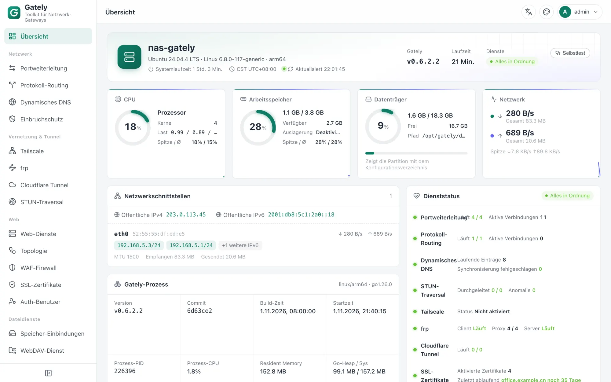

## Was Gately ersetzt

| Sie betreiben heute | In Gately |
| --- | --- |
| nginx oder Nginx Proxy Manager | Web-Dienste: Reverse-Proxy, statische Sites, Weiterleitungen, HTTP/3, Zugriffsregeln je Site; importiert nginx-Konfigurationen |
| certbot / acme.sh | ACME-Zertifikate mit DNS-01 und HTTP-01, Wildcard, automatische Erneuerung und Verteilung |
| ddns-go oder DDNS-Skripte | Dynamisches DNS für über 30 Anbieter, IPv4 und IPv6 |
| haproxy-SNI-Routing / sslh | Protokoll-Routing: HTTPS, SSH, RDP und mehr teilen sich einen Port |
| fail2ban | Protokollregeln, Köderports und Scan-Erkennung, Sperren werden in nftables oder iptables umgesetzt |
| ModSecurity / eine separate WAF | Coraza mit OWASP CRS v4, je Site |
| Authelia-artige Anmeldung vor Anwendungen | Integrierte Anmeldung, TOTP, Passkeys und ein OIDC-Anbieter; Forward-Auth wird ebenfalls unterstützt |
| Von Hand betriebene frpc / cloudflared / tailscaled | Verwaltete Programme frp, Cloudflare Tunnel, Tailscale, NetBird und EasyTier mit Installation, Update und Rollback |
| Weiterleitungs-Umwege ohne öffentliche IPv4 | STUN-Traversal: TCP- / UDP-Hole-Punching, Adressänderungen werden mit DNS-Einträgen, Webhooks und Skripten abgeglichen |

Module, die Sie nicht brauchen, lassen sich abschalten, oder Sie bauen unter [build.gately.cn](https://build.gately.cn) eine Binärdatei nur mit den gewählten Modulen.

## Ausprobieren

```bash
docker run -d --name gately --network host --cap-add NET_ADMIN \
  -v ./gately-data:/etc/gately \
  ghcr.io/wangwanjie/gately:latest
```

Öffnen Sie `http://<Geräte-IP>:16680`, melden Sie sich als `admin` / `gately.cn` an und vergeben Sie auf Aufforderung Ihr eigenes Passwort. Mit Host-Netzwerk kann Gately auf den von Ihnen konfigurierten Ports lauschen; `NET_ADMIN` lässt Sperren die Host-Firewall erreichen (ohne gelten Sperren weiterhin für Gatelys eigene Dienste). Fügen Sie `-v /var/run/docker.sock:/var/run/docker.sock` hinzu, wenn Sie das Docker-Modul nutzen möchten. Images für amd64, arm64 und arm/v7 gibt es auf GHCR und auf Docker Hub als `vanjayak/gately` (gleiches Image; nutzen Sie es, wenn GHCR schwer erreichbar ist).

Weitere Installationswege: [Binärdatei und Systemdienst](#installation) · [OpenWrt](#installation) · [fnOS](#installation) · [Docker Compose](../../deploy/docker-compose.yml) · [alle Varianten](https://gately.cn/de/docs/guide/install)

Passwort vergessen oder Authenticator verloren? Führen Sie auf dem Server `gately reset-password` bzw. `gately reset-totp` aus (bei Docker `docker exec -it gately gately reset-password`); siehe [Passwort und Zwei-Faktor-Authentifizierung zurücksetzen](https://gately.cn/de/docs/guide/install#reset). Wenig Speicherplatz, etwa auf einem Router? [build.gately.cn](https://build.gately.cn) erzeugt eine Binärdatei, ein OpenWrt- oder fnOS-Paket oder ein Multi-Arch-Docker-Image nur mit den Modulen und Oberflächensprachen, die Sie auswählen.

## Warum Sie ihm am Netzwerkrand vertrauen können

- **Lesbar und unauffällig**: Apache-2.0, standardmäßig keine Verbindung zu Servern des Projekts und keine Übermittlung von Geräteinformationen; alle externen Adressen (IP-Abfrage, STUN, Update-Prüfung) sind sichtbar, änderbar und abschaltbar. Die Anmeldung über Drittanbieter nutzt Ihre eigenen OAuth-Anwendungen ohne Zwischenstation.
- **Überprüfbare Releases**: cosign-Signaturen, Build-Provenienz und SBOM für jedes Artefakt ([so prüfen Sie](../de/VERIFY.md)); Sicherheitskorrekturen werden als [GitHub-Sicherheitshinweise](https://github.com/wangwanjie/gately/security/advisories) veröffentlicht.
- **Jede Änderung wird festgehalten**: Audit-Log, Konfigurationsverlauf mit Diff und Rollback per Klick, reines JSON, das Sie in git ablegen können.
- **Hält mit haproxy + nginx mit**: 26k req/s gegenüber 14,7k auf denselben 2 Kernen in einem Vergleich unter gleichen Bedingungen ([Zahlen und Methode](#leistung)).

## Funktionen

Ein kurzer Rundgang durch die Verwaltungsoberfläche. Die vollständige Modulliste steht am Ende dieses Abschnitts.

### Alles auf einen Blick

Die Übersicht zeigt CPU, Arbeitsspeicher, Festplatte und Traffic, die Netzwerkschnittstellen mit ihrer öffentlichen IPv4 und IPv6 sowie den Status jedes Moduls. So sehen Sie in Sekunden, ob etwas Aufmerksamkeit braucht.


### Web-Dienste, die nginx ersetzen können

Reverse-Proxy, statische Dateien und Weiterleitungen je Domain, mit HTTPS und HTTP/3. Jede Site bekommt eigene WAF, IP-Regeln und Anmeldung, und Änderungen greifen, ohne Verbindungen zu trennen.

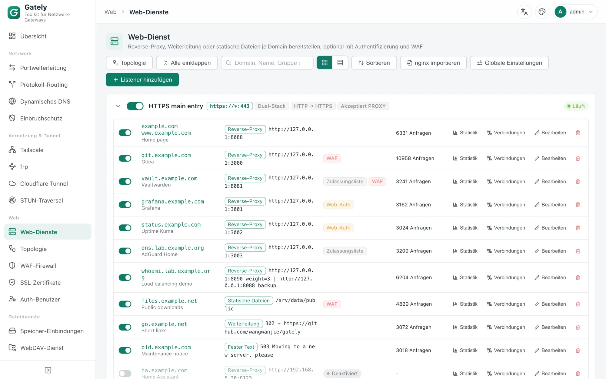

<p><b>Statistik je Site</b> — Anfragen, Fehler, Backend-Zustand, häufigste Client-IPs und Länder, minutengenau.</p>

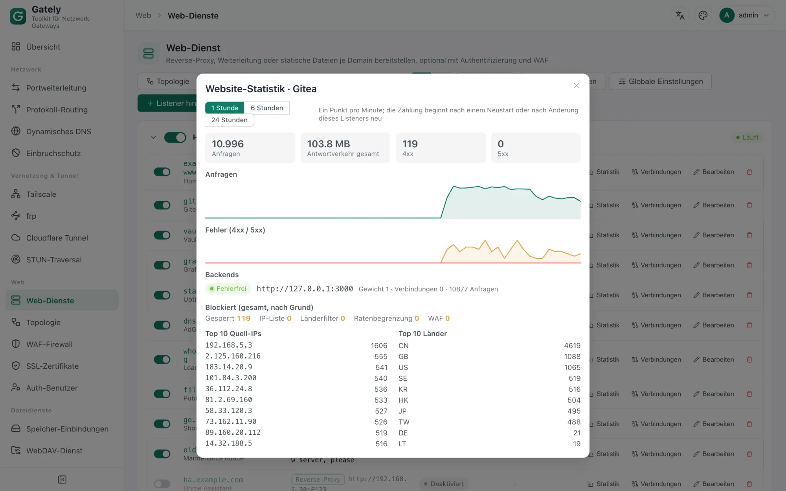

### Netzwerktopologie

Verfolgen Sie live, wie der Datenverkehr von den Besuchern über Listener und Sites zu den Backends fließt. Ein Klick auf einen Knoten zeigt QPS, Traffic und aktive IPs; Sie können nach Besucher-IP filtern, zwischen sieben Layouts wechseln und Adressen vor dem Teilen eines Screenshots maskieren.

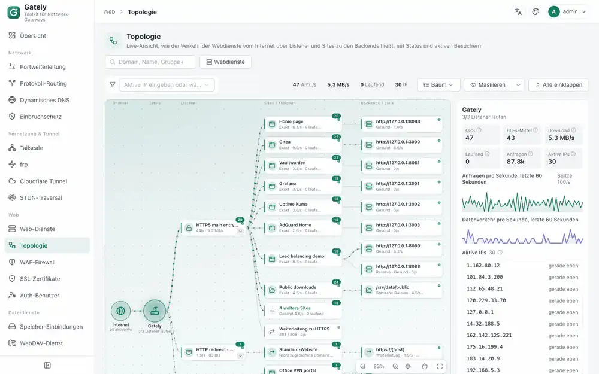

### Ein Port 443 für alle Dienste

Mit dem Protokoll-Routing teilen sich mehrere Dienste einen Port nach Domain oder Protokoll. TLS wird unverändert durchgereicht, das PROXY-Protokoll bewahrt die echte Client-Adresse.

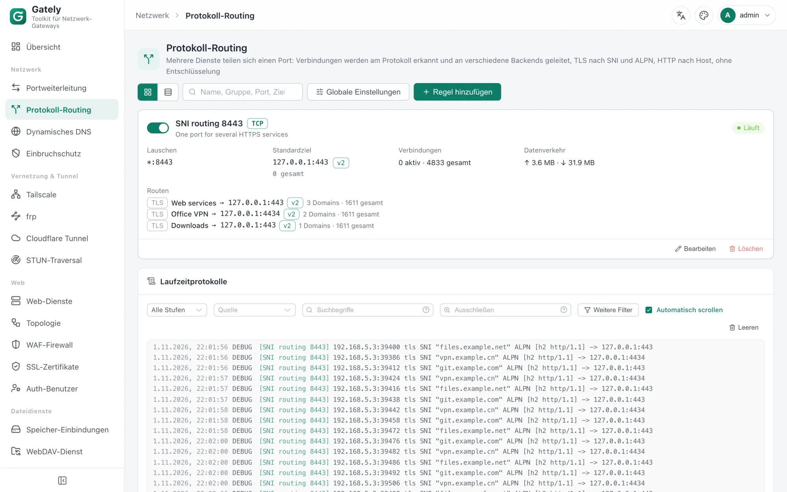

### Dynamisches DNS für alle großen Anbieter

Cloudflare, Alibaba Cloud, DNSPod, Route 53 und weitere. IPv4 und IPv6, Adressen per URL, Netzwerkschnittstelle oder Befehl, und eine Benachrichtigung bei jeder Änderung.

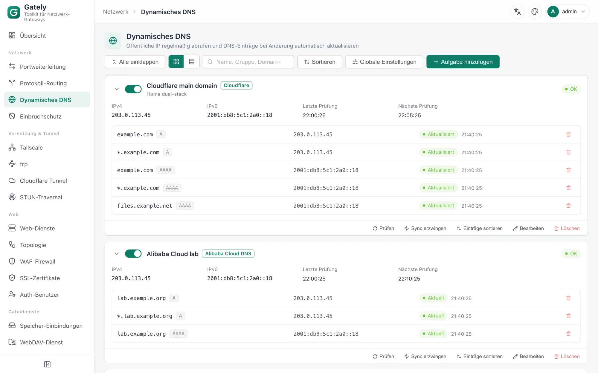

### Einbruchschutz

Regeln wie bei fail2ban lesen Protokolle aus Dateien, journald und Containern, Köderports und Portscan-Erkennung fangen Sondierungen ab. Sperren werden mit nftables synchronisiert und direkt im Kernel verworfen.

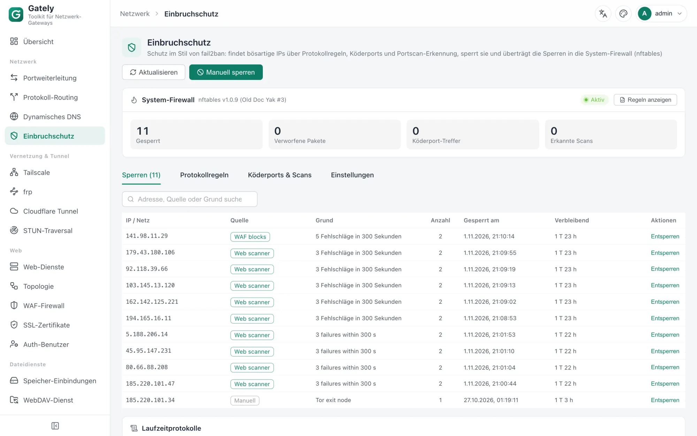

### frp, Tailscale und Cloudflare Tunnel

Mehrere frpc- und frps-Instanzen laufen parallel, neben Tailscale und cloudflared-Tunneln. Installation, Updates und Rollbacks dieser Programme übernimmt Gately.

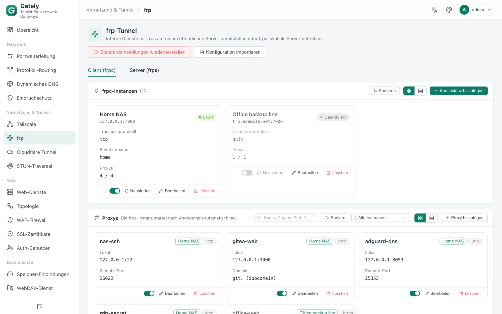

### Außerdem

<table>
<tr>
<td width="50%" valign="top">

**Docker**<br>Container, Compose, Logs und Terminals, Image-Upgrades per Klick mit automatischem Rollback bei Fehlern.

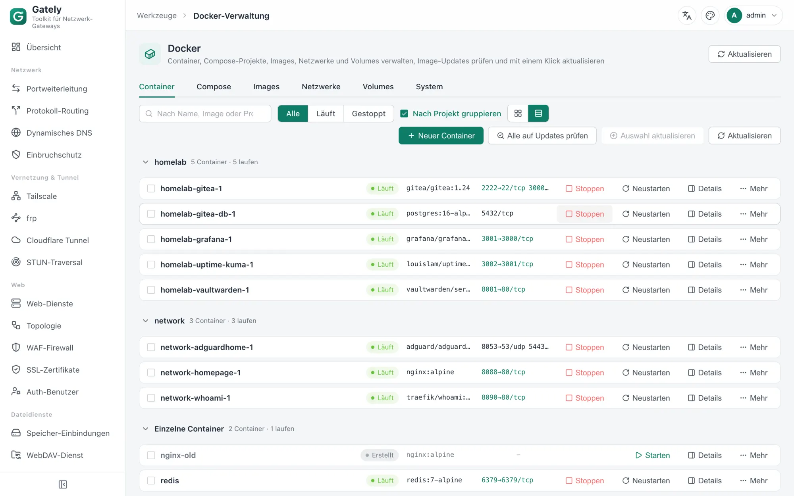

</td>
<td width="50%" valign="top">

**Web-Terminal**<br>SSH, Telnet und die lokale Shell im Browser, mit SFTP und geteilter Ansicht.

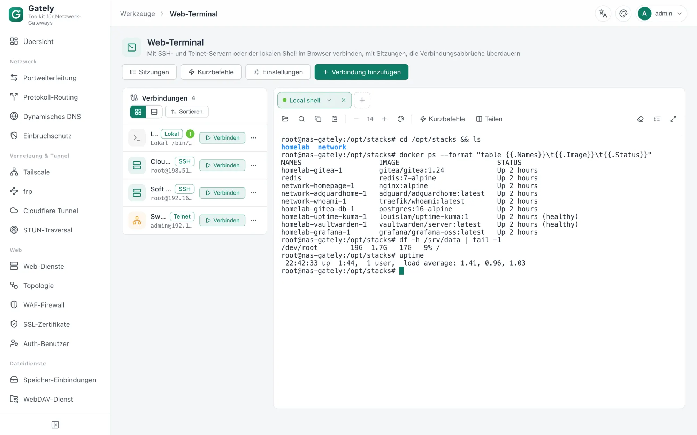

</td>
</tr>
</table>

<table>
<tr>
<td width="50%" valign="top">

**Konfigurationsverlauf**<br>Jede Änderung bewahrt die vorherige Version, mit Diff-Ansicht und Rollback per Klick.

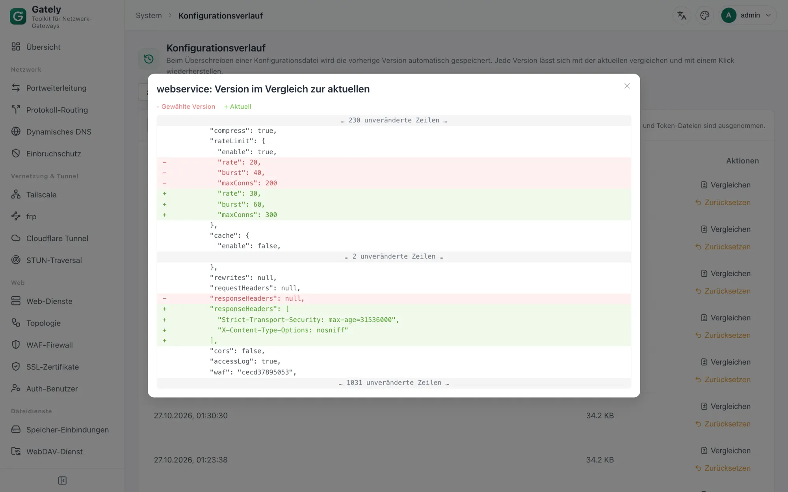

</td>
<td width="50%" valign="top">

**API, Kommandozeile und MCP**<br>API-Tokens pro Modul, integrierte OpenAPI-Doku, `gately ctl` und ein MCP-Server für KI-Assistenten.

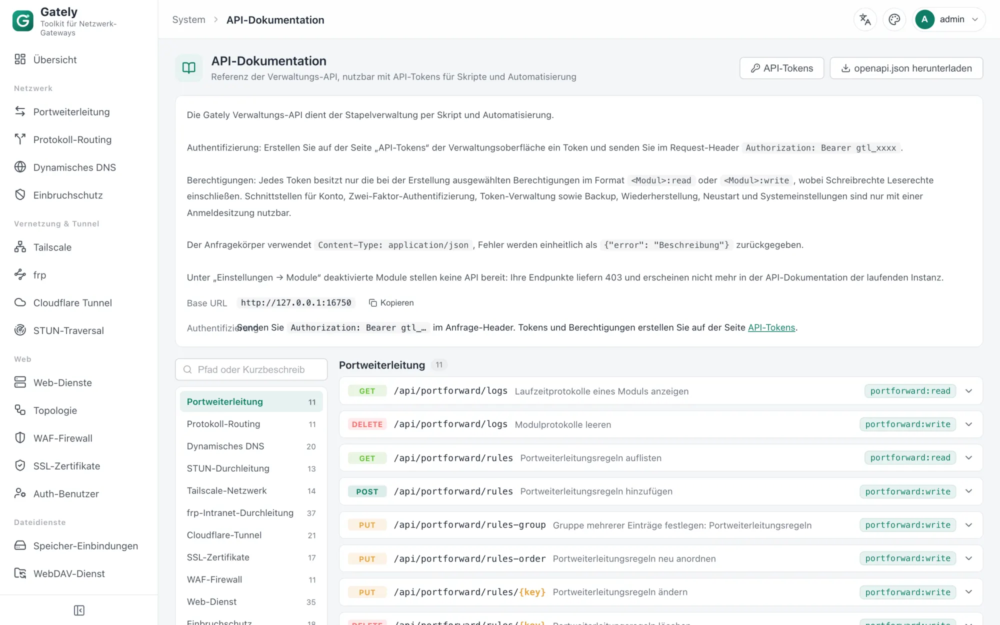

</td>
</tr>
</table>

<details>
<summary><b>Vollständige Funktionsliste</b></summary>

Mehrere Module teilen sich dieselben Bausteine. STUN-Traversal, Portweiterleitung und Protokoll-Routing unterstützen eine Quell-IP-Zulassungs- / Sperrliste und eine vorrangige Sperrliste (die auf abonnierte IP-Listen verweisen kann) und geben ihre Ports automatisch in der lokalen Firewall frei. Tailscale, NetBird, EasyTier, frp, Cloudflare Tunnel und File Browser betreiben externe Programme, die Gately online installiert, aktualisiert, zurücksetzt und deinstalliert; jedes davon hat die Aktion „Standardeinstellungen wiederherstellen“.

| Modul | Funktionen |
| --- | --- |
| Dynamisches DNS | Alibaba Cloud, Cloudflare, Tencent Cloud, DNSPod, Huawei Cloud, GoDaddy, Porkbun, dynv6, DuckDNS, Amazon Route 53, OVHcloud, Gandi, NS1, Bunny DNS, Namecheap, Tencent Cloud EdgeOne, Alibaba Cloud ESA, Baidu AI Cloud, Volcano Engine, DNS.LA, Rainyun, Now.cn, Eranet, Tnet.hk, HiPM DNSMgr, Vercel, NameSilo, Dynadot, Spaceship, Name.com, Gcore, ClouDNS, deSEC, DynDNS2 (No-IP, Dynu, …), benutzerdefinierter Callback |
| Dynamisches DNS: Aufgaben | IP per URL, Netzwerkschnittstelle oder Befehl ermitteln; IPv4/IPv6; Webhook; Gruppen, Sortierung und Suche; Notizen werden beim Anbieter gespeichert; beim Löschen einer Aufgabe lässt sich der Eintrag beim Anbieter mitlöschen |
| STUN-Traversal | TCP/UDP, Keepalive, UPnP/NAT-PMP, integrierte Weiterleitung; Webhook und Skript bei Adressänderung |
| Portweiterleitung | TCP/UDP, IPv4/IPv6, Portbereiche, Failover mit mehreren Zielen, Verbindungslimit, Traffic-Statistik, PROXY-Protokoll v1/v2; Gruppen, Sortierung und Suche |
| Protokoll-Routing | Mehrere Dienste teilen sich einen Port wie 443 und werden ohne Entschlüsselung durchgereicht: TLS nach SNI und ALPN, HTTP nach Host, Minecraft nach Serveradresse, außerdem SSH, RDP, SOCKS, OpenVPN, RTSP, SIP, XMPP, MQTT, AMQP, PostgreSQL, Redis, SMB, Git, IRC, ADB, BitTorrent sowie eine Warte-Timeout-Route für Protokolle, bei denen der Server zuerst sendet, etwa VNC; Standardziel und PROXY-Protokoll pro Route |
| SSL-Zertifikate | Automatische Ausstellung und Erneuerung per ACME über DNS-01 (Wildcard; DNS-Zone delegierter Subdomains per SOA erkannt) oder HTTP-01 (ohne DNS-Anbieter); EAB, Upload, Dateien einlesen, in ein Verzeichnis abbilden und Skript ausführen |
| SSL-Zertifikate: IP und kurzlebig | Kurzlebige Zertifikate und Zertifikate für öffentliche IP-Adressen (Let's-Encrypt-Profil shortlived) |
| SSL-Zertifikate: Verteilung | Nach einer Erneuerung per SSH auf andere Hosts übertragen und dort einen Befehl ausführen oder die Docker-Container neu starten, die das Zertifikat nutzen |
| Tailscale | Verwaltet tailscaled (Userspace-Netzwerk, containerfreundlich) oder nutzt einen vorhandenen System-Daemon; Auth-Key/Login-Link, Headscale, Subnetz-Routen, Exit-Node, Knotenliste, SOCKS5-Proxy, fester Port, zusätzliche Argumente und Umgebungsvariablen; Online-Installation unter Linux |
| NetBird | NetBird Cloud oder selbst gehosteter Management-Server; verwalteter netbird-Daemon (Userspace-Netzwerk, andere Peers erreichen lokale Dienste) oder vorhandener Systemdienst; Setup-Keys / Anmeldelinks, Routen, Routing-Peer, DNS, eingehend blockieren, Peer-Liste (direkt / Relay, Latenz), SOCKS5-Proxy; Online-Installation unter Linux, macOS und Windows |
| EasyTier | Verwalteter easytier-core: P2P-Hole-Punching zuerst, selbst betriebene oder frei gewählte Relay-Knoten, Userspace-Netzwerk mit Portweiterleitung, Subnetz-Proxy, Exit-Nodes, KCP- / QUIC-Proxy |
| frp | Mehrere frpc- und frps-Instanzen: frpc (tcp/udp/http/https/stcp/xtcp-Proxys, Änderungen wirken sofort, Zugriffsadressen zum Anklicken und Kopieren) und frps (Port-Whitelist, Subdomains, Dashboard, Quell-IP-Beschränkung für frpc-Anmeldungen); Konfigurationen im alten ini- und im neuen toml-Format mit einem Klick importieren |
| Cloudflare Tunnel | cloudflared-Token-Tunnel und temporäre trycloudflare-Tunnel, mehrere Tunnel, automatischer Neustart, Anzeige der öffentlichen Adresse; Routen von Token-Tunneln über die Cloudflare-API bearbeiten und DNS-Einträge anlegen |
| WAF | Coraza + OWASP CRS v4, Regeln dateiweise aktivierbar, eigenes SecLang, Blockieren oder nur Erkennen; kann zusätzlich eine selbst betriebene SafeLine-Erkennungs-Engine nutzen; Admin-Sitzungen dieser Instanz umgehen die WAF; kann angemeldeten Benutzern vertrauen |
| WAF: große Anfragen | Einstellbares Prüflimit für Request-Bodys, bei Überschreitung nur den Anfang prüfen oder Pfade ausnehmen, damit auch Cloud-Speicher, WebDAV und andere Upload-Sites hinter der WAF laufen |
| Einbruchschutz: Regeln | Protokollregeln im fail2ban-Stil (Protokolldateien, systemd-Journal, Befehlsausgabe, Docker-Container-Protokolle, fehlgeschlagene Anmeldungen an der Oberfläche, WAF-Blockierungen, abgelehnte Port-Knocks) mit Vorlagen für SSH, Nginx, Vaultwarden und mehr |
| Einbruchschutz: Sondierungen | Köderports und Portscan-Erkennung (erkennt die offenen Ports der Gately-Module, auch von frpc angeforderte Remote-Ports; IPv6-Strengmodus sperrt je /64; Sperrgründe nennen die getroffenen Ports); Sperren bei Web-Pfad-Sondierung je Listener (Köderpfade wie /.env und /.git, Scans unbekannter Domains, wiederholte 404); Sperren bei TLS-Handshake-Fehlern nach Fehlerart (Abbruch, Reset, Timeout, kein TLS u. a.) und Listener |
| Einbruchschutz: Sperren | Eine Sperrliste mit manuellen CIDR- und Dauersperren, steigender Dauer und Whitelist; wird in die System-Firewall (nftables / iptables + ipset) übertragen und im Kernel verworfen, oder gilt ohne nftables für Gatelys eigene Dienste |
| Port-Knocking | Single Packet Authorization (SPA), kompatibel mit fwknop-Clients: AES-256-Verschlüsselung, HMAC-Authentifizierung, Replay-Schutz und Zeitfenster; geschützte Ports werden in der System-Firewall (nftables / iptables + ipset) blockiert, eine klopfende Adresse wird für begrenzte Zeit freigegeben, bestehende Verbindungen bleiben unberührt |
| Port-Knocking: Integrationen | Portweiterleitung, Protokoll-Routing (pro Route) und STUN können „Knock erforderlich“ wählen, ohne Firewall-Rechte; das Protokoll-Routing kann Knock-Pakete über TCP annehmen, sodass nur ein Port offen ist; die Freigabe nach Web-Anmeldung gibt die IP des Besuchers frei (IPv6 je /64, auch in die System-Firewall schreibbar), ganz ohne Client; abgelehnte Knocks können dem Einbruchschutz übergeben werden |
| Docker-Verwaltung | Container erstellen und bearbeiten, Logs und Terminal, Compose, Prüfung auf Image-Updates und Upgrade per Klick (bei Fehlern automatischer Rollback), Netzwerke und Volumes; Hintergrundaufgaben wie Pull, Build, Compose und Batch-Upgrades lassen sich unterwegs abbrechen |
| Docker: Selbst-Upgrade | Upgrade des Containers, in dem Gately selbst läuft, über einen temporären Hilfscontainer; bei Fehlern wird der alte Container wiederhergestellt |
| Web-Terminal | SSH (Hostschlüssel beim ersten Mal bestätigen), Telnet, lokale Shell (standardmäßig deaktiviert); Proxy, persistente Sitzungen, SFTP-Dateiverwaltung, 2FA und Protokollbestätigung, Schnellbefehle, geteilte Ansicht; Auswählen und Kopieren per langem Drücken auf dem Handy, Einfügefeld und Zwischenablage-Verlauf |
| Netzwerkdiagnose | Ping, Traceroute, Portprüfung, DNS-Abfrage, Geschwindigkeitstest, LAN-Scan |
| Benachrichtigungszentrale | Webhook, Telegram, Bark, ntfy, Gotify, Pushover, Discord, Slack, ServerChan, PushPlus, WeCom, DingTalk, Feishu, E-Mail; Stufen sowie Regeln für Wildcards und Stummschaltung/Deduplizierung; Proxy global oder je Kanal (HTTP und SOCKS5); integrierte Regelvorlagen (kritische Ausfälle, Zertifikatsablauf, Adressänderungen, Anmeldungen, Konfigurationsänderungen, Versionsupdates); Hinweis bei Anmeldungen an der Verwaltungsoberfläche von neuen Adressen |
| Konfigurationsbackup | Verschlüsselte Backups (scrypt + AES-GCM), Aufbewahrungsrichtlinie, zeitgesteuerte Backups in ein lokales Verzeichnis oder einen Speicher-Mountpunkt |
| Kommandozeile und MCP | `gately ctl` steuert die laufende Instanz, `gately mcp` stellt einen MCP-Dienst über stdio bereit (standardmäßig schreibgeschützt) |
| Wake-on-LAN | Magic-Packet-Broadcast, Online-Erkennung; Bemfa-Sprachsteuerung (Xiao AI, Xiaodu, Google Assistant) |
| Wake-on-LAN: Herunterfahren | Fern-Herunterfahren, Neustart und Ruhezustand über einen Agent auf dem Gerät (Windows/Linux/macOS/OpenWrt, Gerät baut die Verbindung selbst auf, kein offener Port nötig), einen SSH-Befehl des Web-Terminals oder eine HTTP-Anfrage |
| WebDAV, FTP, SMB | Mehrere Benutzer, eigene Verzeichnisse, schreibgeschützt; gemeinsame Benutzer für die drei Dienste; FTP bietet zusätzlich FTPS und passive Portbereiche; SMB bietet zusätzlich Freigaben je Benutzer aus einem oder mehreren Verzeichnissen, SMB 2/3, Verschlüsselung und Bonjour-Erkennung |
| File Browser | Betreibt den Web-Dateimanager FileBrowser Quantum: mehrere Instanzen, mehrere freigegebene Verzeichnisse mit Schreibschutz, Anmeldung per Passwort oder Reverse Proxy |
| Speicher-Einbindungen | Lokale Verzeichnisse, entfernte WebDAV-Mounts und SMB-Freigaben, Dateiverwaltung online |
| Geplante Aufgaben | cron-Ausdrücke, Befehle oder HTTP-Anfragen, Ausführungsprotokoll |
| Listenverwaltung | Regeln, Instanzen, Zertifikate, DNS-Einträge, Terminal-Verbindungen, API-Tokens und weitere Listen unterstützen einheitlich Gruppen, manuelle Sortierung (Ziehen oder Pfeile, mit Mehrfachauswahl) und Suche, dazu Aktivieren, Deaktivieren und Löschen im Stapel; Sites der Web-Dienste können außerdem Domains im Stapel hinzufügen, entfernen oder ersetzen, Optionen gesammelt ändern und per Bearbeiten, Stapel oder Ziehen in einen anderen Listener wechseln; die meisten Listen wechseln zwischen Karten- und Kompaktansicht; Umsortieren oder Gruppieren startet keinen Dienst neu und funktioniert auch auf dem Handy; die meisten Einträge lassen sich als Vorlage duplizieren, gespeicherte Geheimnisse werden übernommen |
| Anmeldung an der Verwaltung | Anmeldung per Passkey (WebAuthn), Zwei-Faktor-Authentifizierung (TOTP), schreibgeschützte Konten, Ratenbegrenzung bei fehlgeschlagenen Anmeldungen (steigende Sperrdauer), Fehlerbudget für unbekannte Adressen (gegen verteilten Brute-Force), Erkennung schwacher Passwörter und erzwungene Passwortänderung, Passwortanmeldung deaktivierbar (nur Passkey), Sicherheitsbewertung |
| Zugriff auf die Verwaltung | Sicherheitseinstieg, Zugriff nur aus dem internen Netz, einstellbare Antwort auf unbefugte Anfragen zum Verbergen des Verwaltungsports (einfache 404-Seite, leere Seite, Verbindung schließen, keine Antwort oder eigene Seite), HTTPS für die Verwaltungsoberfläche, echte Client-Adresse von vertrauenswürdigen lokalen Reverse-Proxys |
| Einstellungen | Mehrere API-Tokens (Lese-/Schreibrechte je Modul), gespeicherte Passwörter und Schlüssel bei Bedarf anzeigen (Schreibrechte erforderlich), benutzerdefiniertes DNS (mit DoH-Unterstützung), Zeitzone, Konfigurationsbackup und -wiederherstellung, Funktionsmodule ein- und ausschalten (deaktivierte Module starten keine Dienste und stellen keine API bereit) |
| Update-Prüfung | Automatische Prüfung auf neue Versionen und Sicherheitshinweise (anonyme Anfragen an GitHub, abschaltbar) mit deutlichem Hinweis und Benachrichtigung, wenn ein veröffentlichtes Sicherheitsproblem die laufende Version betrifft |
| Native fnOS-App | Offline-`.fpk`-Pakete (x86 / ARM); in das einheitliche fnOS-Gateway eingebunden, Start über das Symbol auf dem fnOS-Desktop, auch über Ihre Remote-Domain von fnOS erreichbar; fnOS-Administratoren können sich mit ihrer fnOS-Sitzung anmelden (standardmäßig aus); läuft als root, um auf 80/443 zu lauschen und Docker zu verwalten |
| Audit und Verlauf | Audit-Log für Anmeldungen, Konfigurationsänderungen und Zugriffe auf sensible Inhalte (Request-Bodys und Geheimnisse werden nie protokolliert); jede überschriebene Konfigurationsdatei behält ihre früheren Versionen mit Diff und Rollback per Klick; deklaratives Konfigurationsverzeichnis (`-apply`) für GitOps |
| Monitoring | Leistungsübersicht mit Verläufen über 60 Sekunden / 1 Stunde / 24 Stunden für Host, Gately-Prozess und Sites, einschließlich Zeit bis zum ersten Byte P50 / P95; CPU und Speicher verwalteter Prozesse (frp, Tailscale, NetBird, cloudflared, File Browser); Schwellwert-Warnungen (Messwert + Schwellwert + Dauer) mit Warnung und Entwarnung über die Benachrichtigungszentrale |
| Metriken und Selbsttest | Globaler Prometheus-Endpunkt `/api/metrics` (Zertifikate, DDNS, STUN, Portweiterleitung, Web-Dienste) mit fertigem Grafana-Dashboard; Netzwerk-Selbsttest per Klick (öffentliche IP, CGNAT, Uhrzeit, Ports 80/443, DDNS-Auflösung, Zertifikatsablauf, HTTPS-Sites ohne Zertifikat, frp-Proxy-Konflikte) |
| Migration | Import von nginx-Konfigurationen (auch die Ausgabe von `nginx -T`): Reverse-Proxy und upstream, statische Verzeichnisse, Weiterleitungen, Backends pro Pfad, Zugriffskontrolle, `auth_request` wird zu Forward-Auth |

#### Web-Dienste

Details zu den einzelnen Funktionen stehen in der [Dokumentation der Web-Dienste](https://gately.cn/de/docs/modules/web).

| Bereich | Funktionen |
| --- | --- |
| Site-Typen | Reverse-Proxy, Weiterleitung, statische Dateien (URLs ohne Endung, eigene 404-Seite), Festtext, Verbindung schließen (wie nginx `return 444`), Navigationspanel |
| Listener und Protokolle | HTTPS, HTTP/3 (QUIC), HTTP und HTTPS auf demselben Port (Umleitung oder Auslieferung), zusätzlicher HTTP-Port je Listener (etwa 80 neben 443), WebSocket, unverschlüsselte HTTP/2-Backends (h2c) für gRPC, PROXY-Protokoll senden und empfangen, Ports werden automatisch in der lokalen Firewall freigegeben |
| Backends | Backends pro Pfad, Backends je angemeldetem Benutzer (wie nginx `map $remote_user`, auch für Weiterleitungs-, statische Datei-, Navigationspanel- und Festtext-Sites), Gewichtung / Backup / Lastverteilungsstrategien, aktive und passive Health-Checks, Wiederholung mit dem nächsten Backend bei Verbindungsfehlern, Timeouts für Verbindung / TLS-Handshake / Antwort-Header, Leerlauf-Timeouts für Lesen/Schreiben der Besucher, HTTPS-Backends, die die aufgerufene Domain als SNI erhalten, Pfad-Rewrite und Entfernen von Präfixen |
| Anmeldung | Basic-Authentifizierung, Web-Authentifizierung, Anmeldung über GitHub / Google / QQ / OIDC, gemeinsame Benutzer mit TOTP-Zwei-Faktor-Prüfung, Passkeys und eigener Passwortänderung, Single Sign-on über Subdomains hinweg, integrierter OIDC-Identitätsanbieter für Gitea, Grafana und andere OpenID-Connect-Anwendungen, Forward-Auth an einen externen Dienst wie Authelia, ein öffentliches Gately kann seine Anmelde-Cookies an ein Gately im LAN weiterreichen, Request-Header mit Benutzername, E-Mail, Anzeigename und Gruppen des angemeldeten Benutzers, Authentifizierung per Verwaltungsanmeldung überspringen (an der Verwaltung angemeldete Administratoren rufen Sites ohne erneute Authentifizierung auf, auch über verschiedene übergeordnete Domains hinweg), angemeldeten Benutzern vertrauen (WAF und Pfad-Probing überspringen) |
| Zugriffskontrolle | IP-Zulassungs- / Sperrlisten, regelmäßig aktualisierte abonnierte IP-Listen (etwa IP-Bereiche von Provinzen und Städten), eine vorrangige Sperrliste, die vor der Zulassungsliste geprüft wird (geeignet für Feeds mit bösartigen IPs), GeoIP-Länderfilter, Pfadregeln, temporäre Freigabelinks, automatische Sperre nach fehlgeschlagenen Anmeldungen, Klopf-Zugang (Quellen ohne Port-Knocking-Freigabe erreichen die Site nicht) und Freigabe nach Anmeldung, Verbindung schließen statt 403 zu antworten, wenn der Zugriff verweigert wird |
| Leistung | Kompression, Ratenbegrenzung, Antwort-Cache mit Cache-Regeln pro Pfad (aus / eigene Dauer / erzwingen) und Leeren des Caches |
| Fehlerseiten | 404- und 5xx-Seiten in 10 eingebauten Stilen oder als eigenes HTML (hochgeladen oder Datei auf dem Server, geprüft und in einer Sandbox angezeigt), auf Wunsch auch für Fehler des Backends (wie nginx `proxy_intercept_errors`) |
| Sichtbarkeit | Minutengenaue Zugriffsstatistik und Prometheus-Metriken, Live-Verbindungen pro Site mit Trennen oder Sperren, Topologieansicht mit Live-QPS, Traffic und aktiven IPs von Listenern über Sites bis zu Backends (Pfadhervorhebung pro IP, Adressmaskierung, Fokus „Nur aktive“, Wiedergabe aufgezeichneter Momentaufnahmen, die im Arbeitsspeicher nach Größe begrenzt gehalten werden, standardmäßig aus), Besucherprüfung pro Adresse (Sites, Pfade, Identitäten, Anteil blockierter Anfragen, Aufbewahrung), tägliche komprimierte Archive und Export der Zugriffsprotokolle |
| Navigationspanels | Eine als Site ausgelieferte Linkseite: Besucher im LAN erhalten LAN-Adressen, integrierte Symbole, weitere Zugriffswege, Designs wie in der Verwaltungsoberfläche, Suchmaschinen, Hintergrundbild, Links nur nach Anmeldung, Kartengrößen, Sprachmenü für Besucher, eigene Fußzeile |
| Betrieb | Änderungen greifen, ohne offene Verbindungen zu trennen, Site-Gruppen, Sortierung und Suche, echte Besucher-IP aus den Headern vertrauenswürdiger Proxys (CDN, WAF), Domains anklickbar und als vollständige Adresse kopierbar |

</details>

## Installation

Docker ist der schnellste Weg (siehe [Ausprobieren](#ausprobieren)). Die anderen Wege:

<details>
<summary><b>Binärdatei</b></summary>

Laden Sie von [Releases](https://github.com/wangwanjie/gately/releases) das Archiv für Ihre Plattform herunter (Linux amd64/arm64/arm/mips/mipsle/riscv64, macOS, Windows, FreeBSD), entpacken Sie es und starten Sie:

```bash
./gately -c /etc/gately
```

Parameter: `-c` Konfigurationsverzeichnis (alternativ die Umgebungsvariable `GATELY_CONFIG_DIR`), `-listen` überschreibt die Listen-Adresse der Verwaltungsoberfläche, `-apply` wendet bei jedem Start die `<name>.json`-Dateien eines Verzeichnisses auf das Konfigurationsverzeichnis an (`GATELY_APPLY_DIR`, praktisch für GitOps und Kubernetes; Konto- und Token-Dateien können nicht überschrieben werden), `-version` gibt die Version aus. Für unbeaufsichtigte Installationen legen Sie mit `GATELY_INITIAL_PASSWORD` das initiale Admin-Passwort anstelle des Standardpassworts `gately.cn` fest.

Start beim Hochfahren: Nach dem Entpacken `sudo ./gately service install` ausführen (Windows: `.\gately.exe service install` in einem Terminal mit Administratorrechten). Das registriert unter Linux eine systemd-Unit, unter macOS einen launchd-Daemon (mit `-user` als Anmeldeobjekt ohne sudo) und unter Windows einen Dienst, startet Gately sofort und startet es nach einem Absturz neu. Das Konfigurationsverzeichnis ist standardmäßig `/etc/gately`, `/usr/local/etc/gately` oder `%ProgramData%\Gately`; `-c` und `-listen` überschreiben es. Der Dienst verweist auf den Pfad der Programmdatei, legen Sie sie daher vorher am endgültigen Ort ab. Danach verwalten Sie ihn mit `gately service uninstall|start|stop|restart|status`; beim Deinstallieren bleibt das Konfigurationsverzeichnis erhalten.

Dienstvorlagen: [systemd](../../deploy/systemd/gately.service) und [OpenWrt procd](../../deploy/openwrt/gately.init). Wie Sie heruntergeladene Archive und Images prüfen (cosign-Signaturen, Build-Provenienz, SBOM), beschreibt [Release-Artefakte verifizieren](../de/VERIFY.md).

</details>

<details>
<summary><b>Native fnOS-App</b></summary>

Jedes Release enthält Offline-`.fpk`-Pakete für fnOS: `gately_<version>_fnos_x86.fpk` (Intel/AMD) und `gately_<version>_fnos_arm.fpk` (ARM). Sie stehen nicht im offiziellen App Center und werden daher manuell installiert: Öffnen Sie **App Center → Manuelle Installation** (Schaltfläche unten links), wählen Sie die Datei aus und schließen Sie den Assistenten ab.

- **Funktioniert mit dem einheitlichen fnOS-Gateway**: Ein Klick auf das Gately-Symbol auf dem fnOS-Desktop öffnet die Verwaltungsoberfläche über das einheitliche fnOS-Gateway unter `/app/gately/` – über denselben Zugang, den Sie bereits für fnOS nutzen. Sowohl die LAN-Adresse als auch Ihre Remote-Domain von fnOS funktionieren, ohne Port 16680 freizugeben oder weiterzuleiten. Den Zugriff über das Gateway kontrolliert fnOS (nur fnOS-Administratoren können es öffnen); „Sicherer Einstieg“ und „Nur LAN-Zugriff“ gelten deshalb nur für den direkten Zugriff auf Port 16680.
- **Meldet fnOS-Administratoren mit ihrer fnOS-Sitzung an**: Aktivieren Sie **Einstellungen → Zugriffskontrolle → Mit fnOS anmelden**, dann gelangen bei fnOS angemeldete Administratoren über das Desktop-Symbol ohne Passwort und Bestätigungscode in Gately; normale fnOS-Benutzer melden sich weiterhin an. Nach dem Abmelden zeigt die Anmeldeseite eine Schaltfläche „Als fnOS-Benutzer &lt;Name&gt; anmelden“, statt Sie stillschweigend wieder anzumelden. Die Einstellung ist standardmäßig aus und wird nur im fnOS-Paket angezeigt.
- Im LAN ist die Verwaltungsoberfläche außerdem unter `http://<NAS-Adresse>:16680` erreichbar. Standardkonto `admin`, Standardpasswort `gately.cn`.
- Die App läuft als `root`, damit sie auf 80/443 lauschen, Docker über `docker.sock` verwalten und ein echtes Web-Terminal öffnen kann. Installieren Sie sie nur auf einem NAS, das Sie selbst kontrollieren.
- Die Konfiguration liegt im `var`-Verzeichnis der App und bleibt bei der Deinstallation erhalten, sofern Sie im Deinstallationsassistenten nicht „Alles löschen“ wählen. Ein Upgrade ist eine erneute manuelle Installation der neueren `.fpk`.
- Das Paket installiert außerdem einen Befehl `gately` (`/usr/local/bin/gately`) für `gately ctl` und `gately mcp`.
- Port 16680 wird mit dem Docker-Image geteilt. Stoppen Sie den `gately`-Container, bevor Sie die native App starten.
- Prüfen Sie den Download wie in [Release-Artefakte verifizieren](../de/VERIFY.md) beschrieben; `.fpk`-Dateien sind in `checksums.txt` aufgeführt.

</details>

<details>
<summary><b>OpenWrt</b></summary>

Jedes Release enthält OpenWrt-Pakete: `gately_<version>_openwrt_<Architektur>.ipk` für OpenWrt 24.10 und älter (einschließlich iStoreOS), installiert mit `opkg install`, und `.apk` für OpenWrt 25.12 und neuer, installiert mit `apk add --allow-untrusted`. Pakete gibt es für amd64 / arm64 / arm / mipsle / mips / riscv64; die Auswahl richtet sich nach `DISTRIB_ARCH` in `/etc/openwrt_release` (siehe Tabelle in der [Installationsanleitung](https://gately.cn/de/docs/guide/install#openwrt)).

- Der Dienst wird bei der Installation aktiviert und gestartet; die Verwaltungsoberfläche ist unter `http://<Router-Adresse>:16680` erreichbar, Standardkonto `admin`, Standardpasswort `gately.cn`.
- Die Konfiguration liegt in `/etc/gately` und bleibt bei Upgrades, Deinstallation und Firmware-Upgrades (sysupgrade) erhalten. Für ein Upgrade installieren Sie das neuere Paket; das Online-Upgrade auf der Seite „Über“ verweist dann auf den Paketmanager.
- Die Binärdatei ist etwa 32 MB groß; die Pakete eignen sich daher für x86-OpenWrt-Boxen, ARM64-Boxen und andere Geräte mit reichlich Speicher. Das arm-Paket erfordert ARMv7 mit Hardware-Gleitkommaeinheit.
- Eine architekturunabhängige LuCI-App, `luci-app-gately_<Version>_openwrt_all.ipk` / `.apk`, ergänzt LuCI um **Dienste → Gately**: Dienststatus, Starten / Stoppen, Autostart, Port der Verwaltungsoberfläche und ein Direktlink zur Oberfläche.

</details>

## Betrieb

Monitoring, API und die verwalteten Programme haben eigene Seiten in der [Dokumentation](https://gately.cn/de/docs/guide/introduction); das Wichtigste steht hier.

<details>
<summary><b>Monitoring</b></summary>

Erstellen Sie ein API-Token nur mit der Berechtigung `metrics:read` und lassen Sie Prometheus `/api/metrics` abfragen. Metriken, Alarmbeispiele und das Grafana-Dashboard beschreibt [Monitoring](../de/MONITORING.md).

</details>

<details>
<summary><b>API-Aufrufe</b></summary>

Erstellen Sie auf der Seite „API-Tokens“ der Verwaltungsoberfläche ein Token (mehrere sind möglich, je Modul mit Lese- oder Lese-/Schreibrechten, mit optionalem Ablaufdatum; der Klartext wird nur einmal nach der Erstellung angezeigt). Damit können Skripte die Verwaltungs-API in großem Umfang aufrufen:

```bash
curl -H "Authorization: Bearer gtl_xxxx" http://localhost:16680/api/ddns/tasks
```

Konto, Zwei-Faktor-Authentifizierung, Token-Verwaltung sowie die Schnittstellen für Backup, Wiederherstellung, Neustart und Systemeinstellungen sind nur mit einer Anmeldesitzung zugänglich. Alle Schnittstellen, erforderlichen Berechtigungen und Datenstrukturen finden Sie auf der Seite „API-Dokumentation“ der Verwaltungsoberfläche; mit `make api-docs` lassen sie sich nach [docs/api](../api/de) exportieren (`openapi.json` und `API.md`), auf die die Website https://gately.cn bei der Veröffentlichung direkt verweist.

Beim Upgrade von einer älteren Version wird das bisherige globale API-Token automatisch zu einem „Altbestand“-Token (der Wert bleibt gleich, mit Rechten für alle Module). Es empfiehlt sich, auf der Seite „API-Tokens“ die Rechte einzuschränken oder es durch ein neues Token zu ersetzen.

</details>

<details>
<summary><b>Tailscale, NetBird, EasyTier, frp, cloudflared</b></summary>

Diese fünf Module verwalten offizielle externe Programme (automatischer Neustart, Logs werden in der Oberfläche gesammelt). Gately selbst enthält sie nicht. Die Karte „Online installieren“ auf jeder Modulseite lädt die neueste stabile Version oder eine bestimmte Version vom Upstream-Projekt herunter, prüft die SHA-256-Prüfsumme, installiert sie nach `bin/` im Konfigurationsverzeichnis und startet die Prozesse neu, die sie nutzen; für jedes Programm lässt sich ein eigener Download-Proxy festlegen, leer bleibt der Update-Proxy aus den Einstellungen in Kraft. Die letzten 3 ersetzten Versionen bleiben erhalten, sodass Sie bei Problemen mit einem Klick zurücksetzen können; ein nicht mehr benötigtes Programm lässt sich deinstallieren. „Standardeinstellungen wiederherstellen“ im Seitenkopf ist davon getrennt: Es stoppt die Prozesse, leert die Moduleinstellungen und löscht die Dateien, die Gately für das Modul erzeugt hat (frp-Konfigurationsdateien, File-Browser-Instanzdaten, Anmeldestatus von Tailscale und NetBird); die alte Konfiguration lässt sich aus dem Konfigurationsverlauf wiederherstellen. Tailscale stellt direkt lauffähige Pakete nur für Linux bereit; auf anderen Systemen verwenden Sie den offiziellen Installer und tragen den Pfad ein. Die Programme werden in dieser Reihenfolge gesucht: der in den Moduleinstellungen angegebene Pfad, `bin/` im Konfigurationsverzeichnis, `PATH`. Sie können die Binärdatei auch selbst in das Konfigurationsverzeichnis legen, bei Docker-Deployments z. B. `./gately-data/bin/frpc`; für Tailscale müssen `tailscale` und `tailscaled` bereitgestellt werden. Token und Schlüssel in den Konfigurationsdateien werden mit Berechtigung 0600 gespeichert; das cloudflared-Token wird über eine Umgebungsvariable übergeben und taucht nicht in der Prozessliste auf.

Das Modul File Browser betreibt [FileBrowser Quantum](https://github.com/gtsteffaniak/filebrowser) (das ursprüngliche filebrowser ist archiviert und erhält keine Sicherheitskorrekturen mehr); Suchreihenfolge sowie Online-Installation, Update und Zurücksetzen funktionieren wie oben beschrieben, installiert wird nach `bin/filebrowser`. Das Admin-Passwort wird über eine Umgebungsvariable übergeben und nie in die Konfigurationsdatei geschrieben.

</details>

## Leistung

Protokoll-Routing nach SNI plus Web-Dienste kann das verbreitete Paar aus haproxy (TCP-Routing nach SNI) und nginx (TLS und Reverse-Proxy) ersetzen. Die folgenden Zahlen vergleichen beide auf demselben Rechner mit der Konfiguration eines echten Servers: 90 per SNI geroutete Domains, PROXY-Protokoll v2 zwischen den beiden Stufen und ein ECDSA-P-256-Zertifikat mit TLS 1.3.

| Szenario | haproxy + nginx | Gately |
| --- | --- | --- |
| HTTPS-Reverse-Proxy, Keep-Alive, 1-KB-Antworten, 64 Verbindungen | 14.767 req/s (p99 35,9 ms) | **26.434 req/s** (p99 5,7 ms) |
| Dasselbe über HTTP/2 | nicht getestet (die nginx-Konfiguration nutzte HTTP/1.1) | 27.795 req/s |
| Für jede Anfrage eine neue TLS-Verbindung, 32 gleichzeitig | 2.557 req/s | **3.448 req/s** |
| 1-MB-Antworten, 16 Verbindungen | 1.053 MB/s | **1.585 MB/s** |
| SNI-Durchleitung eines TLS-Streams, 4 Verbindungen | 2.927 MB/s | **4.962 MB/s** |
| SNI-Durchleitung, neue Verbindungen pro Sekunde, 64 gleichzeitig | 6.334 /s | 6.266 /s (gleichauf) |
| Arbeitsspeicher unter Last | haproxy ≈ 21 MB + nginx ≈ 21 MB | ≈ 110 MB (ein Prozess mit allen Modulen) |

<details>
<summary><b>So wurde gemessen</b></summary>

- Host: Intel Core i5-13500T. Jeder Stack war auf 2 CPU-Kerne begrenzt (haproxy und nginx in Docker mit `--cpuset-cpus`, Gately mit `taskset` festgepinnt), um einen kleinen Cloud-Server nachzubilden. Backends und Lastgenerator liefen auf anderen Kernen.
- haproxy nutzte `mode tcp` mit `req_ssl_sni`-Regeln und `send-proxy-v2`. nginx nutzte `worker_processes 2` und die Proxy-Einstellungen der Produktiv-Site, die `Connection: upgrade` senden und daher pro Anfrage eine neue Backend-Verbindung öffnen; ein abgestimmter nginx mit Upstream-Keep-Alive würde den Abstand bei kleinen Antworten verringern.
- Der Weg bei Gately war die SNI-Regel, PROXY v2 und dann ein Web-Dienste-Listener, also genauso viele Stufen wie haproxy → nginx.
- Jeder Fall lief 10 Sekunden, und wiederholte Fälle stimmten auf 3 % genau überein. Auf einem echten Cloud-Host mit 2 vCPU lieferte die statische Site 5,5k req/s gegenüber 3,4k req/s. Neue TLS-Verbindungen lagen gleichauf (bei beiden etwa 480–550 pro Sekunde), wenn der Client X25519 nutzte; mit dem hybriden Post-Quanten-Schlüsselaustausch, den Go-Clients und aktuelle Browser anbieten, schloss Gately in diesem Lauf etwa 13 % weniger Handshakes ab.
- Die Ergebnisse hängen von Hardware, Konfiguration und Datenverkehr ab. Verstehen Sie sie als Plausibilitätsprüfung, dass Gately mit haproxy und nginx mithält, und messen Sie mit Ihrer eigenen Last.

</details>

## Entwicklung

Voraussetzungen: Go 1.26+, Node.js 24+, pnpm.

```bash
make web      # Frontend bauen (Ausgabe in web/dist, per go:embed eingebettet)
make build    # bin/gately kompilieren
make test     # go test -race ./...
make lint     # gofmt, go vet, Typprüfung des Frontends
```

Eigene Build-Tags, Tests mit zusätzlichen Voraussetzungen, Anforderungen an Module und der i18n-Ablauf stehen in [CONTRIBUTING.md](../../CONTRIBUTING.md) (englisch). Verzeichnisstruktur und Technologieauswahl siehe [docs/de/ROADMAP.md](../de/ROADMAP.md). Der Quellcode der Website ([gately.cn](https://gately.cn)) liegt in `website/` und basiert auf VitePress: `cd website && pnpm install && pnpm dev`.

## Release-Richtlinie

- Gately ist unter Version 1.0. Versionsnummern haben bis zu vier Teile (zum Beispiel `v0.6.6.6`); der letzte Teil steigt bei Folge-Releases einer Nebenversion.
- Jedes `v*`-Tag startet den [Release-Workflow](../../.github/workflows/release.yml), der die Binärdateien, OpenWrt- und fnOS-Pakete sowie das Multi-Arch-Docker-Image baut und die Artefakte signiert. Images tragen die Version und `latest`; `latest` zeigt immer auf das neueste Release.
- Releases erscheinen häufig: 55 Versions-Tags zwischen dem 17. Oktober und dem 15. November 2026. Die Notizen in den [GitHub Releases](https://github.com/wangwanjie/gately/releases) sind nach Modulen gegliedert und weisen auf Upgrade-Hinweise hin; das [Änderungsprotokoll](https://gately.cn/de/news/) auf der Website enthält die Ankündigungen.
- Sicherheitskorrekturen erscheinen nur für die neueste Version ([SECURITY.md](../../SECURITY.md)). Für den Produktivbetrieb empfiehlt sich ein fester Image-Tag wie `ghcr.io/wangwanjie/gately:v0.6.6.6`; lesen Sie vor dem Upgrade die Release-Notes und setzen Sie Einstellungen über den Konfigurationsverlauf zurück.

## Mitwirken

Issues und Pull Requests sind willkommen. Die Checkliste für Code, Module, Tests und Übersetzungen steht in [CONTRIBUTING.md](../../CONTRIBUTING.md); alle Beteiligten halten sich an den [Verhaltenskodex](../../CODE_OF_CONDUCT.md).

## Community

Fragen stellen Sie bitte in [GitHub Discussions Q&A](https://github.com/wangwanjie/gately/discussions/categories/q-a), wo Antworten durchsuchbar bleiben, und Ihr Setup zeigen Sie ebenfalls in den Discussions; für den direkten Austausch gibt es die Telegram-Gruppe [t.me/gately_chat](https://t.me/gately_chat) statt.

Fehler bitte in den [GitHub Issues](https://github.com/wangwanjie/gately/issues) melden und ein [Diagnosepaket](../de/DIAGNOSTICS.md) (Einstellungen → Diagnose) anhängen. Es wird lokal erzeugt und enthält keine Passwörter, Tokens, Domains oder echten IP-Adressen. Sicherheitsprobleme melden Sie bitte vertraulich, wie in [SECURITY.md](../../SECURITY.md) beschrieben.

## Unterstützen

Alle Funktionen von Gately sind kostenlos. Wenn es Ihnen hilft, können Sie die Entwicklung mit USDT, [Afdian](https://ifdian.net/a/gately) oder WeChat Pay unterstützen; Adressen und QR-Codes finden Sie auf der [Unterstützungsseite](https://gately.cn/de/sponsor).

## Lizenz

[Apache License 2.0](../../LICENSE)
