<p align="center">
  <a href="https://gately.cn/es/"></a>
</p>

<p align="center">
  <a href="https://gately.cn/es/">Sitio web</a> · <a href="https://gately.cn/es/docs/guide/quick-start">Documentación</a> · <a href="https://github.com/wangwanjie/gately/releases/latest">Descargas</a> · <a href="https://gately.cn/es/news/">Registro de cambios</a> · <a href="https://github.com/user-attachments/assets/ae5b60a4-9402-4a66-86a1-48e40038b4d0">Tour de 2 min</a> · <a href="https://github.com/wangwanjie/gately/discussions">Discussions</a> · <a href="https://t.me/gately_chat">Telegram</a><br>
  <a href="../../README.md">English</a> | <a href="../../README.zh-CN.md">简体中文</a> | <a href="README.zh-TW.md">繁體中文</a> | <a href="README.ja.md">日本語</a> | <a href="README.ko.md">한국어</a> | <b>Español</b> | <a href="README.fr.md">Français</a> | <a href="README.de.md">Deutsch</a> | <a href="README.ru.md">Русский</a> | <a href="README.pt-BR.md">Português (Brasil)</a>
</p>

<p align="center">
  <a href="https://github.com/wangwanjie/gately/releases/latest"></a>
  <a href="../../LICENSE"></a>
  <a href="https://hub.docker.com/r/vanjayak/gately"></a>
</p>

# Gately

**Una pasarela autoalojada con interfaz web: proxy inverso, HTTPS automático, DNS dinámico, traversal de NAT, WAF y bloqueos al estilo fail2ban en un solo binario.**

Gately se sitúa en el borde de una red doméstica o de un servidor y se encarga del camino que va desde internet hasta tus servicios: mantiene tu dominio apuntando a una IP cambiante, obtiene y renueva certificados, enruta todos los servicios por un único puerto 443, pone inicio de sesión y un WAF delante de ellos y bloquea las direcciones que sondean. Todo se configura en el navegador. Apache-2.0, sin telemetría, con la configuración guardada como JSON en texto plano en tu propio dispositivo.

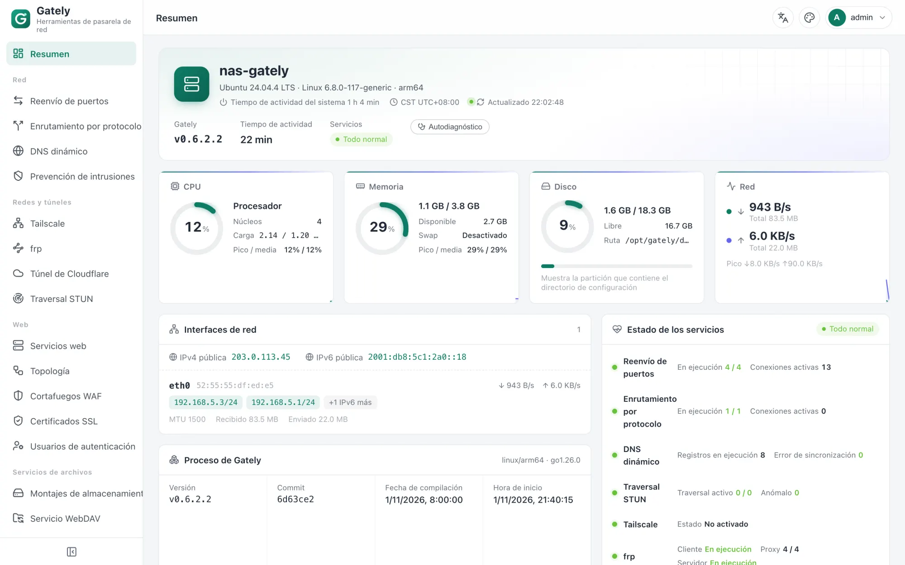

## Qué sustituye

| Lo que ejecutas hoy | En Gately |
| --- | --- |
| nginx o Nginx Proxy Manager | Servicio web: proxy inverso, sitios estáticos, redirecciones, HTTP/3, reglas de acceso por sitio; importa la configuración de nginx |
| certbot / acme.sh | Certificados ACME con DNS-01 y HTTP-01, comodín, renovación y distribución automáticas |
| ddns-go o scripts de DDNS | DNS dinámico con más de 30 proveedores, IPv4 e IPv6 |
| Enrutamiento SNI de haproxy / sslh | Enrutamiento por protocolo: HTTPS, SSH, RDP y más comparten un puerto |
| fail2ban | Reglas de registros, puertos trampa y detección de escaneos, con bloqueos aplicados en nftables o iptables |
| ModSecurity / un WAF aparte | Coraza con OWASP CRS v4, por sitio |
| Pasarelas de inicio de sesión tipo Authelia delante de las aplicaciones | Inicio de sesión integrado, TOTP, Passkeys y un proveedor OIDC; también admite autenticación delegada (forward auth) |
| frpc / cloudflared / tailscaled gestionados a mano | frp, Túnel Cloudflare, Tailscale, NetBird y EasyTier gestionados, con instalación, actualización y reversión |
| Soluciones alternativas para abrir puertos sin IPv4 pública | Túnel STUN: hole punching TCP / UDP; los cambios de dirección se sincronizan con registros DNS, webhooks y scripts |

Puedes desactivar cualquier módulo que no necesites, o generar un binario solo con los módulos que elijas en [build.gately.cn](https://build.gately.cn).

## Pruébalo

```bash
docker run -d --name gately --network host --cap-add NET_ADMIN \
  -v ./gately-data:/etc/gately \
  ghcr.io/wangwanjie/gately:latest
```

Abre `http://<IP del dispositivo>:16680`, inicia sesión como `admin` / `gately.cn` y establece tu propia contraseña cuando se te pida. `--network host` permite que Gately escuche los puertos que configures; `NET_ADMIN` permite que los bloqueos lleguen al cortafuegos del host (sin él, los bloqueos siguen aplicándose a los servicios de Gately). Añade `-v /var/run/docker.sock:/var/run/docker.sock` si quieres el módulo de Docker. Hay imágenes para amd64, arm64 y arm/v7 en GHCR y en Docker Hub como `vanjayak/gately` (misma imagen; úsala si GHCR te resulta difícil de alcanzar).

Otras formas de instalarlo: [binario y servicio del sistema](#instalación) · [OpenWrt](#instalación) · [fnOS](#instalación) · [Docker Compose](../../deploy/docker-compose.yml) · [todas las opciones](https://gately.cn/es/docs/guide/install)

¿Has olvidado la contraseña o has perdido el autenticador? Ejecuta `gately reset-password` o `gately reset-totp` en el servidor (`docker exec -it gately gately reset-password` en Docker); consulta [Restablecer la contraseña y la verificación en dos pasos](https://gately.cn/es/docs/guide/install#reset). ¿Tienes poco almacenamiento, por ejemplo en un router? [build.gately.cn](https://build.gately.cn) genera un binario, un paquete de OpenWrt o fnOS, o una imagen Docker multiarquitectura solo con los módulos e idiomas de la interfaz que elijas.

## Por qué confiar en él en el borde de tu red

- **Legible y silencioso**: Apache-2.0, por defecto no se conecta a ningún servidor del proyecto ni reporta información del dispositivo; todas las direcciones externas (consulta de IP, STUN, comprobación de actualizaciones) son visibles, editables y se pueden desactivar. El inicio de sesión de terceros usa tus propias aplicaciones OAuth, sin intermediarios.
- **Versiones verificables**: firmas cosign, procedencia de compilación y SBOM para cada artefacto ([cómo verificarlos](../es/VERIFY.md)); las correcciones de seguridad se publican como [avisos de GitHub](https://github.com/wangwanjie/gately/security/advisories). `checksums.txt` también va firmado con minisign, y las actualizaciones en línea comprueban esa firma antes de instalar.
- **Cada cambio queda registrado**: registro de auditoría, historial de configuración con comparación de diferencias y reversión con un clic, JSON en texto plano que puedes guardar en git.
- **Sigue el ritmo de haproxy + nginx**: 26k req/s frente a 14,7k en los mismos 2 núcleos con una configuración equivalente ([cifras y método](#rendimiento)).

## Funciones

Un recorrido rápido por la interfaz de administración. La lista completa de módulos está al final de esta sección.

### Todo de un vistazo

El resumen muestra CPU, memoria, disco y tráfico, las interfaces de red con su IPv4 e IPv6 públicas y el estado de cada módulo, para que veas en segundos si algo requiere atención.


### Servicios web que pueden sustituir a nginx

Proxy inverso, archivos estáticos y redirecciones por dominio, con HTTPS y HTTP/3. Cada sitio tiene su propio WAF, reglas de IP e inicio de sesión, y los cambios se aplican sin cortar conexiones.

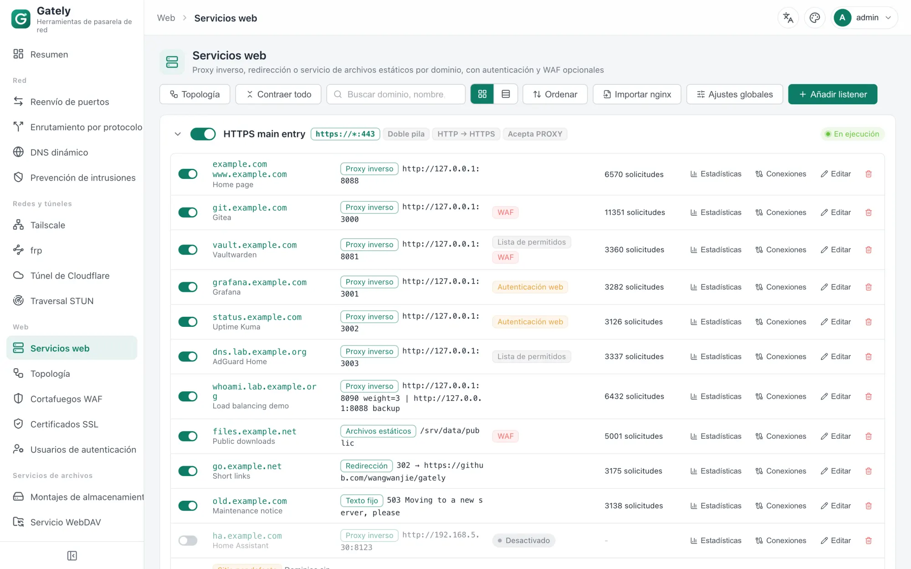

<p><b>Estadísticas por sitio</b> — solicitudes, errores, estado de los backends y principales IP y países de origen, minuto a minuto.</p>

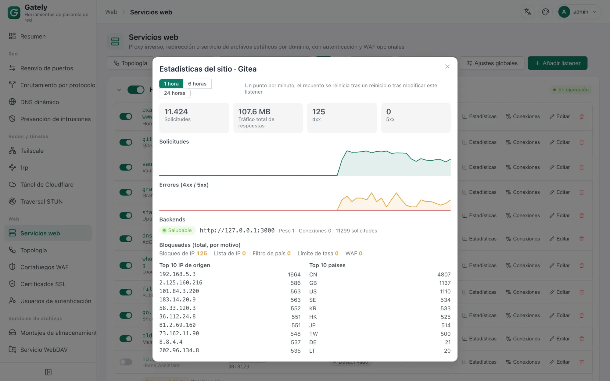

### Topología de red

Mira en directo cómo fluye el tráfico desde los visitantes, pasando por los listeners y los sitios, hasta los backends. Elige un nodo para ver QPS, tráfico e IP activas, filtra por IP de visitante, cambia entre siete diseños y oculta direcciones antes de compartir una captura.

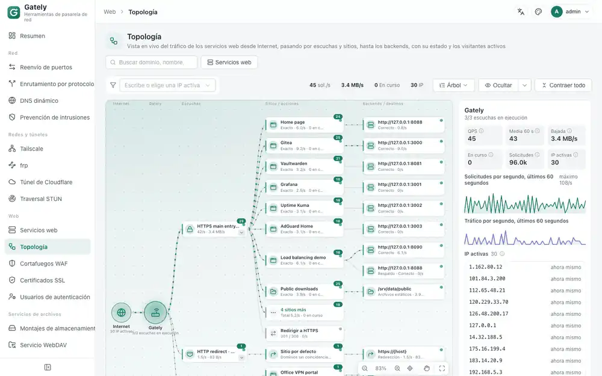

### Un solo puerto 443 para todos tus servicios

El enrutamiento por protocolo permite que varios servicios compartan un mismo puerto según el dominio o el protocolo: el TLS pasa tal cual y el protocolo PROXY conserva la dirección real del cliente.

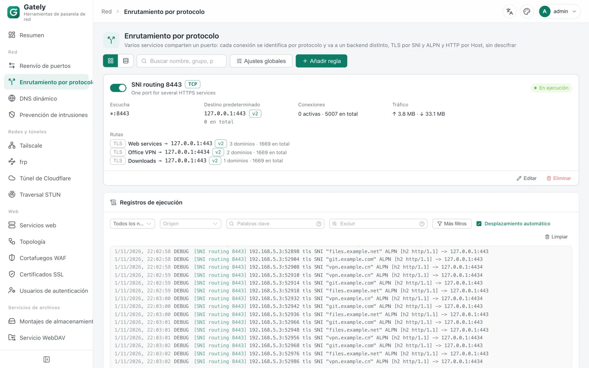

### DNS dinámico con los principales proveedores

Cloudflare, Alibaba Cloud, DNSPod, Route 53 y más. IPv4 e IPv6, direcciones obtenidas de una URL, una interfaz de red o un comando, y un aviso cada vez que algo cambia.

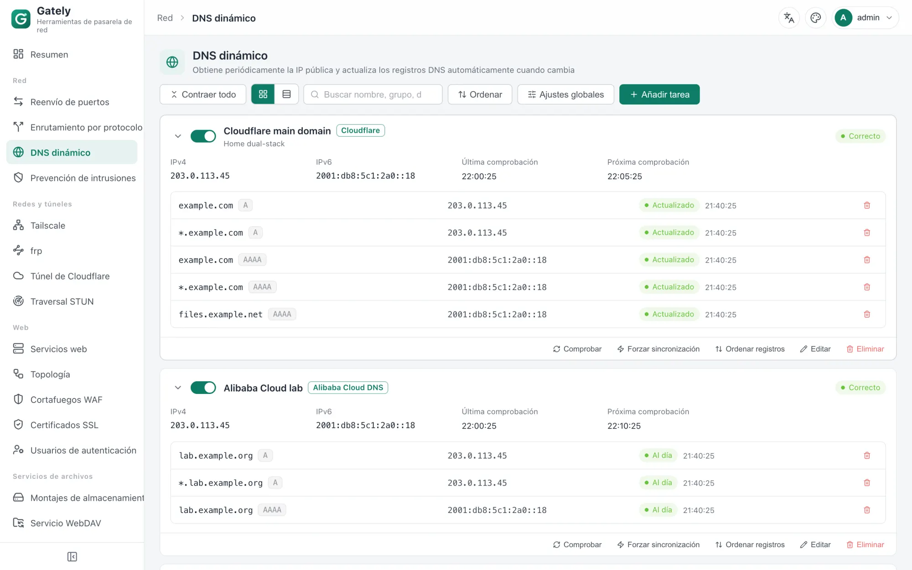

### Prevención de intrusiones

Reglas al estilo de fail2ban leen registros de archivos, journald y contenedores, mientras los puertos trampa y la detección de escaneos atrapan los sondeos. Los bloqueos se sincronizan con nftables y el kernel descarta el tráfico.

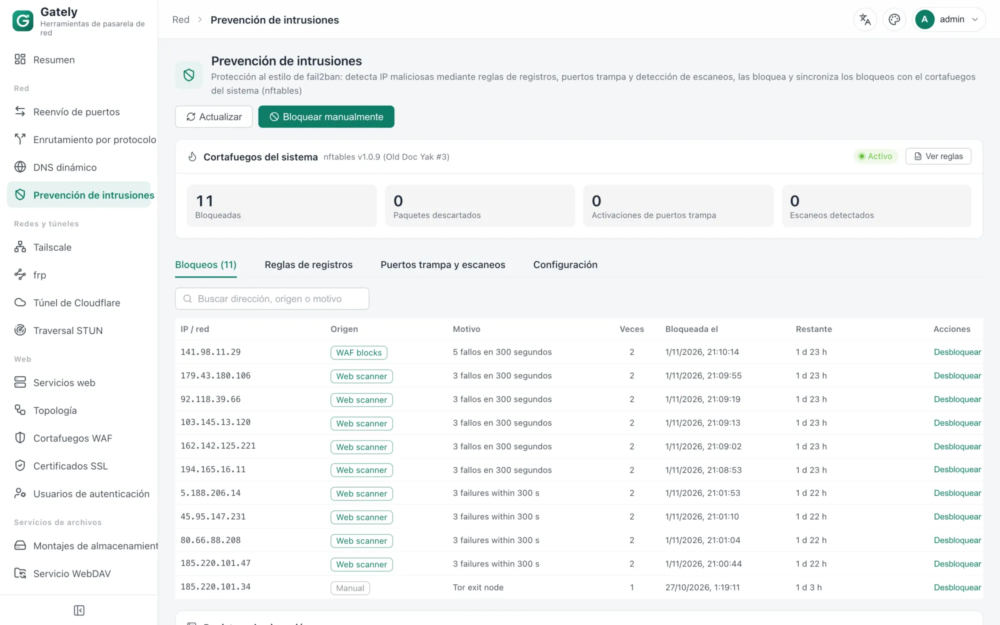

### frp, Tailscale y túneles de Cloudflare

Varias instancias de frpc y frps en paralelo, junto a Tailscale y los túneles de cloudflared. Gately instala, actualiza y revierte estos programas por ti.

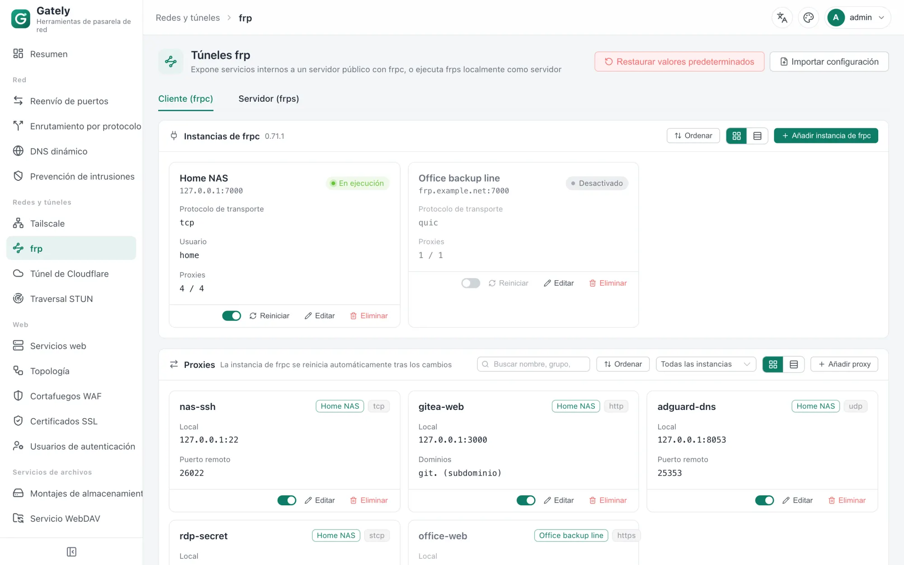

### Y además

<table>
<tr>
<td width="50%" valign="top">

**Docker**<br>Contenedores, Compose, registros y terminales, con actualización de imágenes en un clic y reversión automática si falla.

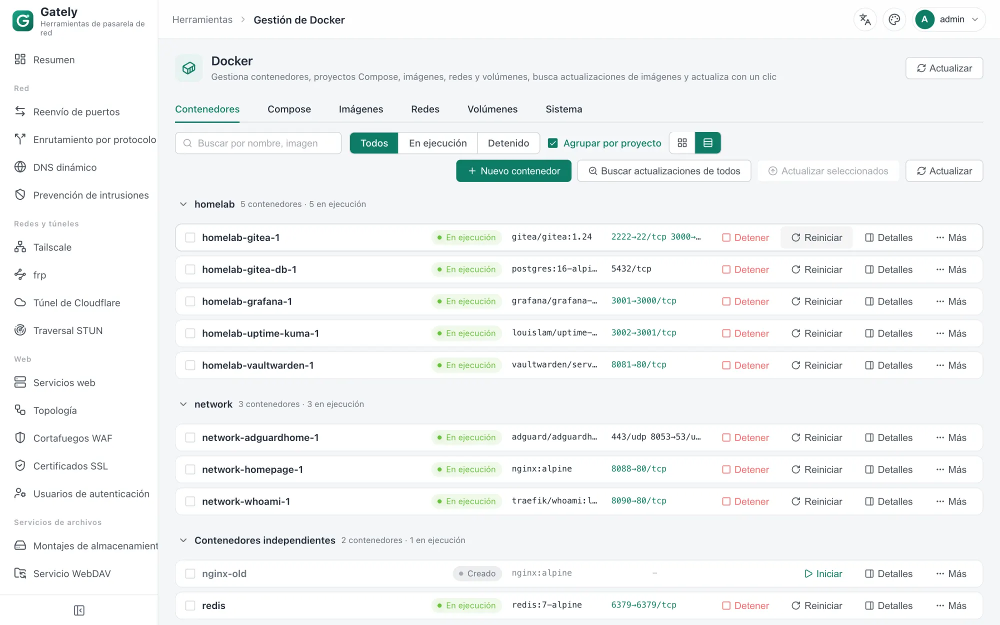

</td>
<td width="50%" valign="top">

**Terminal web**<br>SSH, Telnet y la shell local en el navegador, con SFTP y paneles divididos.

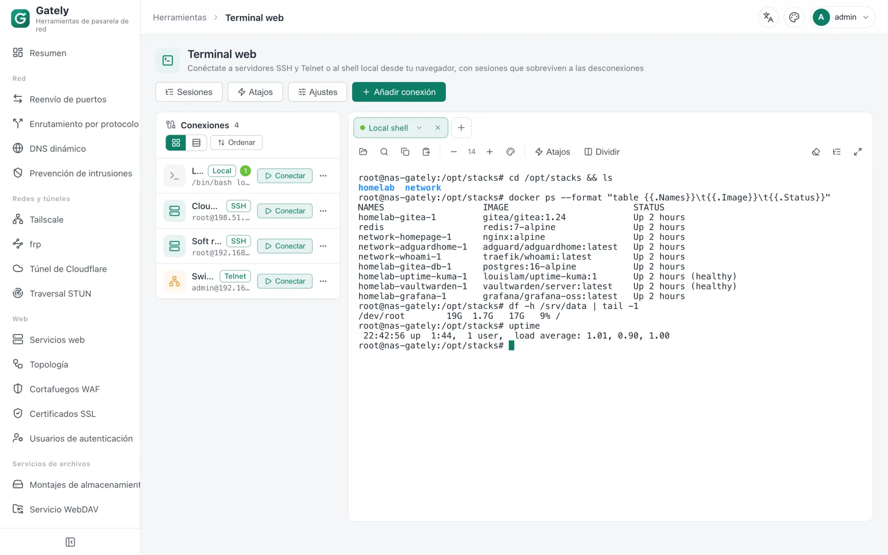

</td>
</tr>
</table>

<table>
<tr>
<td width="50%" valign="top">

**Historial de configuración**<br>Cada cambio conserva la versión anterior, con comparación de diferencias y reversión en un clic.

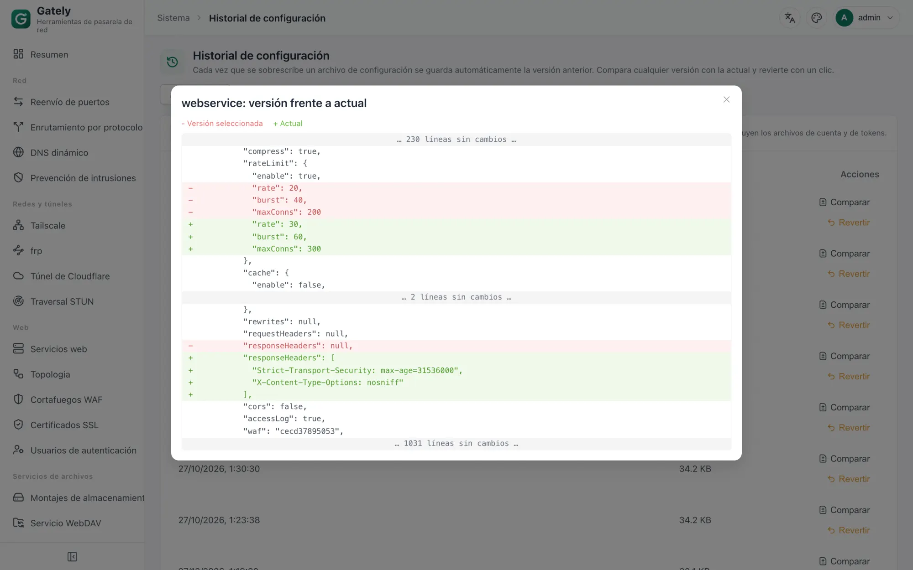

</td>
<td width="50%" valign="top">

**API, línea de comandos y MCP**<br>Tokens de API por módulo, documentación OpenAPI integrada, `gately ctl` y un servidor MCP para asistentes de IA.

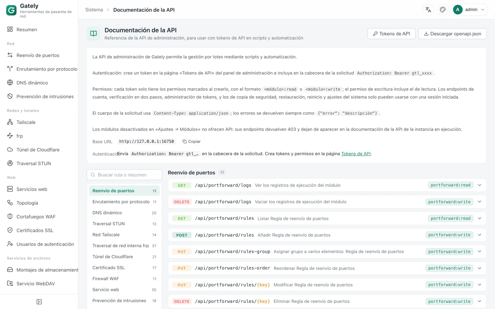

</td>
</tr>
</table>

<details>
<summary><b>Lista completa de funciones</b></summary>

Varios módulos comparten los mismos componentes. El Túnel STUN, el Reenvío de puertos y el Enrutamiento por protocolo aceptan listas de IP de origen permitidas / bloqueadas y una lista de denegación prioritaria (que puede usar listas de IP suscritas) y abren sus puertos en el cortafuegos local automáticamente. Tailscale, NetBird, EasyTier, frp, Túnel Cloudflare y File Browser ejecutan programas externos que Gately instala, actualiza, revierte y desinstala en línea, y todos tienen una acción de «restaurar valores predeterminados».

| Módulo | Capacidades |
| --- | --- |
| DNS dinámico | Alibaba Cloud, Cloudflare, Tencent Cloud, DNSPod, Huawei Cloud, GoDaddy, Porkbun, dynv6, DuckDNS, Amazon Route 53, OVHcloud, Gandi, NS1, Bunny DNS, Namecheap, Tencent Cloud EdgeOne, Alibaba Cloud ESA, Baidu AI Cloud, Volcano Engine, DNS.LA, Rainyun, Now.cn, Eranet, Tnet.hk, HiPM DNSMgr, Vercel, NameSilo, Dynadot, Spaceship, Name.com, Gcore, ClouDNS, deSEC, DynDNS2 (No-IP, Dynu, …), callback personalizado |
| DNS dinámico: tareas | Obtención de IP por URL, interfaz de red o comando; IPv4/IPv6; Webhook; grupos, orden y búsqueda; notas escritas en el proveedor; al eliminar una tarea se pueden eliminar también los registros del proveedor |
| Túnel STUN | TCP/UDP, keep-alive, UPnP/NAT-PMP, reenvío integrado; Webhook y scripts al cambiar la dirección |
| Reenvío de puertos | TCP/UDP, IPv4/IPv6, rangos de puertos, conmutación por error con varios destinos, límite de conexiones, estadísticas de tráfico, protocolo PROXY v1/v2; grupos, orden y búsqueda; límite de conexiones simultáneas por origen y tiempo de espera para conexiones que no envían datos |
| Enrutamiento por protocolo | Varios servicios comparten un mismo puerto como el 443 y pasan sin descifrar: TLS por SNI y ALPN, HTTP por Host, Minecraft por dirección del servidor, además de SSH, RDP, SOCKS, OpenVPN, RTSP, SIP, XMPP, MQTT, AMQP, PostgreSQL, Redis, SMB, Git, IRC, ADB, BitTorrent y una ruta de tiempo de espera para protocolos en los que el servidor habla primero, como VNC; un destino predeterminado y protocolo PROXY por ruta |
| Certificados SSL | Emisión y renovación automáticas con ACME mediante DNS-01 (comodín; zona DNS de subdominios delegados detectada mediante SOA) o HTTP-01 (sin proveedor DNS); EAB, carga manual, lectura desde archivo, mapeo a un directorio y ejecución de scripts |
| Certificados SSL: IP y corta duración | Certificados de corta duración y para direcciones IP públicas (perfil shortlived de Let's Encrypt) |
| Certificados SSL: distribución | Tras la renovación, envío de los certificados por SSH a otros hosts con ejecución de comandos, o reinicio de los contenedores Docker que los usan |
| Tailscale | Gestiona tailscaled (red en espacio de usuario, apta para contenedores) o se conecta a un demonio existente del sistema; claves de autenticación/enlaces de inicio de sesión, Headscale, rutas de subred, nodos de salida, lista de nodos, proxy SOCKS5, puerto fijo, argumentos adicionales y variables de entorno; instalación en línea en Linux |
| NetBird | NetBird Cloud o un servidor de gestión autoalojado; demonio netbird gestionado (red en espacio de usuario, permite que otros pares lleguen a los servicios locales) o un servicio existente del sistema; claves de configuración / enlaces de inicio de sesión, rutas, par de enrutamiento, DNS, bloquear entrantes, lista de pares (directo / relé, latencia), proxy SOCKS5; instalación en línea en Linux, macOS y Windows |
| EasyTier | easytier-core gestionado: hole punching P2P primero, nodos de retransmisión autoalojados o a elección, red en espacio de usuario con reenvío de puertos, proxy de subred, nodos de salida, proxy KCP / QUIC |
| frp | Varias instancias de frpc y frps: frpc (proxies tcp/udp/http/https/stcp/xtcp, los cambios se aplican al instante, direcciones de acceso que se pueden abrir y copiar) y frps (lista blanca de puertos, subdominios, panel de control, límites por IP de origen para el inicio de sesión de frpc); importación con un clic de configuraciones ini antiguas y toml nuevas; puertos KCP y QUIC en frps, ajuste de QUIC en ambos extremos y apertura automática de los puertos de frps en el cortafuegos local |
| Túnel Cloudflare | Túneles con token de cloudflared y túneles temporales de trycloudflare, varios túneles, reinicio automático, visualización de la dirección pública; edición de las rutas de los túneles con token mediante la API de Cloudflare y creación de sus registros DNS |
| WAF | Coraza + OWASP CRS v4, activación de reglas por archivo, SecLang personalizado, modo de bloqueo o solo detección; también puede usar un motor de detección SafeLine autoalojado; las sesiones de administrador de esta instancia no pasan por el WAF; puede confiar en usuarios con sesión iniciada |
| WAF: solicitudes grandes | Límite de inspección del cuerpo de la solicitud ajustable, con inspección solo de la primera parte u omisión por ruta, para poder proteger con WAF también nubes personales, WebDAV y otros sitios de subida |
| Prevención de intrusiones: reglas | Reglas de registros al estilo fail2ban (archivos de registro, diario de systemd, salida de comandos, registros de contenedores Docker, inicios de sesión fallidos en el panel, bloqueos del WAF, knocks rechazados) con plantillas para SSH, Nginx, Vaultwarden y más |
| Prevención de intrusiones: sondeos | Puertos trampa y detección de escaneos de puertos (reconoce los puertos abiertos de los módulos de Gately, incluidos los puertos remotos que solicita frpc; el modo estricto IPv6 bloquea por /64; los motivos de bloqueo incluyen los puertos alcanzados); bloqueo por sondeo de rutas web por escucha (rutas señuelo como /.env y /.git, escaneos de dominios desconocidos, 404 repetidos); bloqueo por fallos del handshake TLS según el tipo de fallo (corte a mitad, restablecimiento, tiempo agotado, no TLS, etc.) y por escucha |
| Prevención de intrusiones: bloqueos | Una lista de bloqueos con bloqueos manuales de redes CIDR y permanentes, duraciones progresivas y lista blanca; se sincroniza con el cortafuegos del sistema (nftables / iptables + ipset) y se descarta en el kernel, o se aplica a los servicios de Gately donde no hay nftables |
| Port Knocking | Autorización de paquete único (SPA) compatible con clientes fwknop: cifrado AES-256, autenticación HMAC, protección contra repetición y ventana de tiempo; los puertos protegidos se bloquean en el cortafuegos del sistema (nftables / iptables + ipset) y la dirección que llama con éxito se abre durante un tiempo limitado, sin afectar a las conexiones ya establecidas |
| Port Knocking: integraciones | Reenvío de puertos, Enrutamiento por protocolo (por ruta) y STUN pueden elegir «Requerir llamada» sin permisos de cortafuegos; el Enrutamiento por protocolo puede recibir paquetes de llamada por TCP para exponer un solo puerto; el permiso tras iniciar sesión web concede la IP del visitante (IPv6 por /64, también puede escribirse en el cortafuegos del sistema), sin necesidad de cliente; las llamadas rechazadas pueden pasar a Prevención de intrusiones |
| Gestión de Docker | Creación y edición de contenedores, registros y terminal, Compose, comprobación de actualizaciones de imágenes y actualización con un clic (reversión automática si falla), redes y volúmenes; las tareas en segundo plano, como descargas, compilaciones, Compose y actualizaciones por lotes, se pueden detener a mitad |
| Docker: actualización propia | Actualización del contenedor en el que se ejecuta el propio Gately mediante un contenedor auxiliar temporal, restaurando el anterior si falla |
| Terminal web | SSH (confianza en la clave del host en el primer uso), Telnet, shell local (desactivado por defecto); proxy, sesiones persistentes, gestión de archivos SFTP, 2FA y confirmación de protocolo, comandos rápidos, paneles divididos; selección y copia con pulsación larga en el móvil, panel de pegado e historial del portapapeles |
| Diagnóstico de red | Ping, traceroute, sondeo de puertos, consultas DNS, prueba de velocidad, escaneo de la red local |
| Centro de notificaciones | Webhook, Telegram, Bark, ntfy, Gotify, Pushover, Discord, Slack, ServerChan, PushPlus, WeCom, DingTalk, Feishu, correo electrónico; niveles, comodines y reglas de silencio y deduplicación; proxy global o por canal (HTTP y SOCKS5); plantillas de reglas integradas (fallos críticos, vencimiento de certificados, cambios de dirección, inicios de sesión, cambios de configuración, actualizaciones de versión); aviso de inicio de sesión en la interfaz de administración desde una dirección nueva |
| Copia de seguridad de la configuración | Copias cifradas (scrypt + AES-GCM), política de retención, copias programadas a un directorio local o a un punto de montaje de almacenamiento |
| Línea de comandos y MCP | `gately ctl` invoca una instancia en ejecución; `gately mcp` ofrece un servicio MCP por stdio (solo lectura por defecto) |
| Wake-on-LAN | Difusión de paquetes mágicos, detección de estado en línea; control por voz con Bemfa (Xiao AI, Xiaodu, Google Assistant) |
| Wake-on-LAN: apagado | Apagado, reinicio y suspensión remotos mediante un agente en el dispositivo (Windows/Linux/macOS/OpenWrt, conexión iniciada por el dispositivo, sin abrir puertos), un comando SSH del terminal web o una petición HTTP |
| WebDAV, FTP, SMB | Multiusuario, directorio independiente por usuario, solo lectura; usuarios compartidos comunes a los tres servicios; FTP añade FTPS y rango de puertos pasivos; SMB añade recursos compartidos por usuario con uno o varios directorios, SMB 2/3, cifrado y descubrimiento Bonjour |
| File Browser | Aloja el gestor de archivos web FileBrowser Quantum: varias instancias, varios directorios compartidos con solo lectura, autenticación por contraseña o por proxy inverso |
| Montajes de almacenamiento | Directorios locales, montajes WebDAV remotos y recursos compartidos SMB, gestión de archivos en línea |
| Tareas programadas | Expresiones cron, comandos o solicitudes HTTP, historial de ejecuciones |
| Gestión de listas | Reglas, instancias, certificados, registros DNS, conexiones de terminal, tokens de API y otras listas comparten grupos, orden manual (arrastrar o flechas, con selección múltiple) y búsqueda, con activación, desactivación y eliminación en lote; los sitios del Servicio web también permiten añadir, quitar o reemplazar dominios, cambiar opciones en lote y moverse a otro listener (al editar, en lote o arrastrando); la mayoría alterna entre vista de tarjetas y compacta; reordenar o agrupar no reinicia ningún servicio y funciona en el móvil; la mayoría de los elementos se pueden duplicar como punto de partida, reutilizando sus secretos guardados |
| Inicio de sesión de administración | Inicio de sesión con passkey (WebAuthn), verificación en dos pasos (TOTP), cuentas de solo lectura, limitación de intentos de inicio de sesión (bloqueo progresivo), presupuesto de fallos de direcciones desconocidas (frena la fuerza bruta distribuida), detección de contraseñas débiles y cambio de contraseña obligatorio, desactivación del inicio de sesión con contraseña (solo Passkey), puntuación de seguridad |
| Acceso de administración | Entrada de seguridad, acceso solo desde la red interna, respuesta configurable a solicitudes no autorizadas para ocultar el puerto de administración (404 simple, página en blanco, cerrar la conexión, sin respuesta o página personalizada), HTTPS para la interfaz de administración, dirección real del cliente desde proxies inversos locales de confianza |
| Ajustes | Varios tokens de API (permisos de lectura/escritura por módulo), contraseñas y claves guardadas visibles bajo demanda (requiere permiso de escritura), DNS personalizado (compatible con DoH), zona horaria, copia de seguridad y restauración de la configuración, activación o desactivación de módulos de funciones (los módulos desactivados no inician servicios ni ofrecen API), nivel de registro (`GATELY_LOG_LEVEL`) |
| Interfaz de administración | Búsqueda global (Ctrl/⌘+K) de páginas, pestañas, dominios de sitios, reglas de reenvío de puertos, registros DDNS y certificados; elección del escenario de uso en el primer arranque con una lista de primeros pasos; asistente de sitio rápido en tres pasos que prueba la dirección del backend; plantillas de escenarios en las listas vacías de reenvío de puertos y DDNS; modo de demostración pública de solo lectura (`-demo`) |
| Comprobación de actualizaciones | Comprobación automática de versiones nuevas y avisos de seguridad (solicitudes anónimas a GitHub, desactivable), con un aviso destacado y una notificación cuando un problema de seguridad publicado afecta a la versión en uso |
| Aplicación nativa para fnOS | Paquetes `.fpk` sin conexión (x86 / ARM); integrada en la pasarela unificada de fnOS, se abre desde el icono del escritorio de fnOS y funciona a través de tu dominio remoto de fnOS; los administradores de fnOS pueden iniciar sesión con su sesión de fnOS (desactivado por defecto); se ejecuta como root para escuchar en 80/443 y gestionar Docker |
| Auditoría e historial | Registro de auditoría de inicios de sesión, cambios de configuración y accesos a contenido sensible (nunca registra cuerpos de petición ni secretos); cada archivo de configuración sobrescrito conserva sus versiones anteriores con comparación de diferencias y reversión con un clic; directorio de configuración declarativa (`-apply`) para GitOps |
| Monitorización | Panel de rendimiento con tendencias de 60 segundos / 1 hora / 24 horas del host, el proceso de Gately y los sitios, incluido el tiempo hasta el primer byte P50 / P95; CPU y memoria de los procesos gestionados (frp, Tailscale, NetBird, cloudflared, File Browser); alertas por umbral (métrica + umbral + duración) con avisos de activación y recuperación por el centro de notificaciones |
| Métricas y autodiagnóstico | Endpoint global de Prometheus `/api/metrics` (certificados, DDNS, STUN, reenvío de puertos, servicios web) con un panel de Grafana listo para usar; autodiagnóstico de red con un clic (IP pública, CGNAT, reloj, puertos 80/443, resolución DDNS, vencimiento de certificados, sitios HTTPS sin certificado, conflictos de proxies frp) |
| Migración | Importación de configuración de nginx (admite la salida de `nginx -T`): proxy inverso y upstream, directorios estáticos, redirecciones, backends por ruta, control de acceso, con `auth_request` convertido en autenticación delegada; importa directamente configuraciones de Nginx Proxy Manager (variables `set` sustituidas en `proxy_pass`); convierte exportaciones de Sun-Panel 1.x / 2.x en paneles de navegación |

#### Servicio web

Los detalles de cada función están en la [documentación del Servicio web](https://gately.cn/es/docs/modules/web).

| Área | Capacidades |
| --- | --- |
| Tipos de sitio | Proxy inverso, redirección, archivos estáticos (URL limpias, página 404 personalizada), texto fijo, cerrar conexión (como `return 444` de nginx), panel de navegación |
| Listeners y protocolos | HTTPS, HTTP/3 (QUIC), HTTP y HTTPS en el mismo puerto (redirección o servicio directo), un puerto HTTP adicional por listener (como 80 junto a 443), WebSocket, backends HTTP/2 en claro (h2c) para gRPC, protocolo PROXY de entrada y salida, puertos abiertos automáticamente en el cortafuegos local |
| Backends | Backends por ruta, backends por usuario con sesión iniciada (como `map $remote_user` de nginx, también para sitios de redirección, archivos estáticos, panel de navegación y texto fijo), pesos / respaldo / políticas de balanceo de carga, comprobaciones de salud activas y pasivas, reintento en el siguiente backend si falla la conexión, tiempos de espera de conexión / negociación TLS / cabeceras de respuesta, tiempos de inactividad de lectura/escritura del visitante, backends HTTPS que reciben como SNI el dominio visitado, reescritura de rutas y eliminación de prefijos |
| Inicio de sesión | Autenticación básica, autenticación web, inicio de sesión con GitHub / Google / QQ / OIDC, usuarios compartidos con verificación en dos pasos TOTP, Passkeys y cambio de contraseña por sí mismos, inicio de sesión único entre subdominios, proveedor OIDC integrado para Gitea, Grafana y otras aplicaciones OpenID Connect, autenticación delegada (forward auth) a un servicio externo como Authelia, un Gately público que reenvía sus cookies de inicio de sesión a un Gately de la red local, cabeceras de petición con el usuario, el correo, el nombre visible y los grupos del usuario conectado, omitir la autenticación con sesión de administración (los administradores con sesión en la consola acceden a los sitios sin volver a autenticarse, también entre dominios padre), confiar en usuarios con sesión iniciada (omiten el WAF y el sondeo de rutas) |
| Control de acceso | Listas de IP permitidas / denegadas, listas de IP suscritas con actualización periódica (como rangos de IP por provincia o ciudad), una lista de denegación prioritaria que se evalúa antes de la lista de permitidos (útil para listas de IP maliciosas), filtrado de países con GeoIP, reglas por ruta, enlaces temporales para compartir, bloqueo automático tras fallos de autenticación, admisión por llamada (los orígenes sin permiso de port knocking no pueden acceder al sitio) y permiso tras iniciar sesión, cerrar la conexión en vez de responder 403 al denegar el acceso |
| Rendimiento | Compresión, limitación de tasa, caché de respuestas con reglas por ruta (sin caché / duración propia / forzar) y vaciado de la caché |
| Páginas de error | Páginas 404 y 5xx con 10 estilos integrados o tu propio HTML (subido o un archivo del servidor, revisado y aislado en sandbox), con opción de reemplazar los errores del backend (como `proxy_intercept_errors` de nginx) |
| Visibilidad | Estadísticas de acceso por minuto y métricas de Prometheus, conexiones en vivo por sitio con cierre o bloqueo, vista de topología con QPS, tráfico e IP activas en tiempo real de listeners a sitios y backends (resaltado de la ruta por IP, enmascarado de direcciones, enfoque «Solo activos», reproducción de instantáneas grabadas guardadas en memoria según tamaño, desactivada por defecto), auditoría de visitantes por dirección (sitios, rutas, identidades, proporción bloqueada, retención), archivado diario comprimido y exportación de los registros de acceso |
| Paneles de navegación | Una página de enlaces servida como sitio: los visitantes de la LAN reciben direcciones de la LAN, iconos integrados, otras formas de acceso, temas iguales a los de la interfaz de administración, buscadores, imagen de fondo, enlaces visibles tras iniciar sesión, tamaños de tarjeta, menú de idioma para visitantes, pie de página propio; estilos de enlace (tarjetas o iconos de app) y diseño (tamaño de icono, enlaces por fila, espaciado, ancho); selector de dirección para enlaces con varias direcciones; contador por grupo e insignia de direcciones opcionales |
| Operación | Los cambios se aplican sin cortar las conexiones abiertas, grupos de sitios, ordenación y búsqueda, IP real del visitante tomada de los encabezados de proxies de confianza (CDN, WAF), dominios que se abren con un clic y copian la dirección completa, las filas de sitios HTTPS muestran el certificado que coincide y los días que le quedan |

</details>

## Instalación

Docker es la forma más rápida (consulta [Pruébalo](#pruébalo)). Las demás formas:

<details>
<summary><b>Binario</b></summary>

Descarga el paquete de tu plataforma desde [Releases](https://github.com/wangwanjie/gately/releases) (Linux amd64/arm64/arm/mips/mipsle/riscv64, macOS, Windows, FreeBSD), descomprímelo y ejecuta:

```bash
./gately -c /etc/gately
```

Parámetros: `-c` directorio de configuración (también se puede usar la variable de entorno `GATELY_CONFIG_DIR`), `-listen` sobrescribe la dirección de escucha de la interfaz de administración, `-apply` aplica en cada arranque los archivos `<nombre>.json` de un directorio al directorio de configuración (`GATELY_APPLY_DIR`, útil para GitOps y Kubernetes; los archivos de cuentas y tokens no se pueden sobrescribir), `-version` muestra la versión. En instalaciones desatendidas, define `GATELY_INITIAL_PASSWORD` para elegir la contraseña inicial del administrador en lugar de la contraseña predeterminada `gately.cn`.

Inicio con el sistema: tras descomprimir, ejecuta `sudo ./gately service install` (en Windows, `.\gately.exe service install` en un terminal de administrador). Registra una unidad systemd en Linux, un daemon launchd en macOS (con `-user` como elemento de inicio de sesión, sin sudo) y un servicio en Windows, inicia Gately y lo vuelve a levantar tras un fallo. El directorio de configuración es por defecto `/etc/gately`, `/usr/local/etc/gately` o `%ProgramData%\Gately`, y `-c` y `-listen` lo cambian. El servicio apunta a la ruta del ejecutable, así que colócalo antes en su ubicación definitiva. Después se gestiona con `gately service uninstall|start|stop|restart|status`; al desinstalar se conserva el directorio de configuración.

Plantillas de servicio: [systemd](../../deploy/systemd/gately.service) y [OpenWrt procd](../../deploy/openwrt/gately.init). Para verificar los archivos e imágenes descargados (firmas cosign, procedencia de compilación, SBOM), consulta [Verificar los artefactos publicados](../es/VERIFY.md).

</details>

<details>
<summary><b>Aplicación nativa para fnOS</b></summary>

Cada versión (Release) incluye paquetes `.fpk` sin conexión para fnOS: `gately_<version>_fnos_x86.fpk` (Intel/AMD) y `gately_<version>_fnos_arm.fpk` (ARM). No están en el Centro de aplicaciones oficial, así que debes instalarlos manualmente: abre **Centro de aplicaciones → Instalación manual** (el botón de la esquina inferior izquierda), elige el archivo y completa el asistente.

- **Funciona con la pasarela unificada de fnOS**: haz clic en el icono de Gately en el escritorio de fnOS y la interfaz de administración se abre a través de la pasarela unificada de fnOS en `/app/gately/`, compartiendo el punto de entrada que ya usas para fnOS. Funcionan tanto la dirección de la red interna como tu dominio remoto de fnOS, sin necesidad de abrir ni redirigir el puerto 16680. El acceso a través de la pasarela lo controla fnOS (solo los administradores de fnOS pueden abrirla), por lo que la entrada de seguridad y el acceso solo desde la red interna se aplican únicamente al acceso directo por el puerto 16680.
- **Inicia la sesión de los administradores de fnOS con su sesión de fnOS**: activa **Ajustes → Control de acceso → Iniciar sesión con fnOS** y los administradores de fnOS que tengan la sesión iniciada en fnOS entrarán en Gately desde el icono del escritorio sin contraseña ni código de verificación en dos pasos; los usuarios normales de fnOS siguen iniciando sesión. Tras cerrar la sesión, la página de inicio de sesión muestra el botón «Iniciar sesión como usuario de fnOS &lt;nombre&gt;» y espera a que lo pulses para volver a entrar. Este ajuste está desactivado por defecto y solo aparece en el paquete de fnOS.
- En la red interna, la interfaz de administración también está disponible en `http://<dirección del NAS>:16680`. El usuario predeterminado es `admin` y la contraseña predeterminada, `gately.cn`.
- La aplicación se ejecuta como `root`, de modo que puede escuchar en 80/443, gestionar Docker mediante `docker.sock` y abrir un terminal web real. Instálala solo en un NAS que controles.
- La configuración se guarda en el directorio `var` de la aplicación y se conserva al desinstalar, salvo que elijas «Eliminar todo» en el asistente de desinstalación. Para actualizar, instala manualmente el `.fpk` más reciente.
- El paquete también añade el comando `gately` (`/usr/local/bin/gately`) para `gately ctl` y `gately mcp`.
- El puerto 16680 se comparte con la imagen de Docker. Detén el contenedor `gately` antes de iniciar la aplicación nativa.
- Verifica la descarga como se describe en [Verificar los artefactos publicados](../es/VERIFY.md); los archivos `.fpk` figuran en `checksums.txt`.

</details>

<details>
<summary><b>OpenWrt</b></summary>

Cada versión (Release) incluye paquetes para OpenWrt: `gately_<version>_openwrt_<arch>.ipk` para OpenWrt 24.10 y anteriores (incluido iStoreOS), que se instala con `opkg install`, y `.apk` para OpenWrt 25.12 y posteriores, que se instala con `apk add --allow-untrusted`. Hay paquetes para amd64 / arm64 / arm / mipsle / mips / riscv64; elige uno según `DISTRIB_ARCH` en `/etc/openwrt_release` (consulta la tabla de la [guía de instalación](https://gately.cn/es/docs/guide/install#openwrt)).

- El servicio se activa en el arranque y se inicia al instalar; la interfaz de administración está en `http://<dirección del router>:16680`, con el usuario predeterminado `admin` y la contraseña predeterminada `gately.cn`.
- La configuración se guarda en `/etc/gately` y se conserva al actualizar, al desinstalar y al actualizar el firmware (sysupgrade). Para actualizar, instala el paquete más reciente; la actualización en línea de la página Acerca de te remite al gestor de paquetes.
- El binario ocupa unos 32 MB, así que los paquetes son adecuados para equipos OpenWrt x86, equipos ARM64 y otros dispositivos con almacenamiento amplio; el paquete arm requiere ARMv7 con coma flotante por hardware.
- Una aplicación LuCI independiente de la arquitectura, `luci-app-gately_<versión>_openwrt_all.ipk` / `.apk`, añade **Servicios → Gately** a LuCI: estado del servicio, iniciar / detener, inicio automático, puerto de administración y un enlace directo a la interfaz.

</details>

## Operación

La monitorización, la API y los programas gestionados tienen sus propias páginas en la [documentación](https://gately.cn/es/docs/guide/introduction); aquí está lo esencial.

<details>
<summary><b>Monitorización</b></summary>

Crea un token de API con solo el permiso `metrics:read` y apunta Prometheus a `/api/metrics`. Las métricas, los ejemplos de alertas y el panel de Grafana se describen en [Monitorización](../es/MONITORING.md).

</details>

<details>
<summary><b>Uso de la API</b></summary>

Crea un token en la página «Tokens de API» del panel de administración (puedes crear varios, conceder solo lectura o lectura y escritura por módulo, definir una fecha de caducidad; el texto del token se muestra una sola vez tras crearlo) y tus scripts podrán llamar en lote a la API de administración:

```bash
curl -H "Authorization: Bearer gtl_xxxx" http://localhost:16680/api/ddns/tasks
```

Las API de cuenta, verificación en dos pasos y gestión de tokens, así como las de copia de seguridad, restauración, reinicio y ajustes del sistema, solo admiten sesiones iniciadas. Todas las API, los permisos necesarios y las estructuras de datos están en la página «Documentación de la API» del panel de administración; también puedes exportarlos con `make api-docs` a [docs/api](../api/es) (`openapi.json` y `API.md`), que el sitio web https://gately.cn referencia directamente al publicarse.

Al actualizar desde una versión anterior, el token de API global original se convierte automáticamente en un «token heredado» (el valor no cambia y conserva todos los permisos de módulo). Se recomienda restringir sus permisos o sustituirlo por un token nuevo en la página de tokens de API.

</details>

<details>
<summary><b>Tailscale, NetBird, EasyTier, frp, cloudflared</b></summary>

Estos cinco módulos gestionan programas externos oficiales (reinicio automático, registros agregados en la interfaz). Gately no los incluye. La tarjeta «Instalación en línea» de cada página de módulo descarga del proyecto original la última versión estable o una versión concreta, verifica su SHA-256, la instala en `bin/` dentro del directorio de configuración y reinicia los procesos que la usan; cada programa puede tener su propio proxy de descarga y, si se deja vacío, se usa el proxy de actualización de los ajustes. Se conservan las 3 últimas versiones sustituidas, para revertir con un clic si la nueva falla, y el programa se puede desinstalar cuando ya no se necesita. El botón «Restaurar valores predeterminados» de la cabecera es independiente de la desinstalación: detiene los procesos, borra los ajustes del módulo y elimina los archivos que Gately generó para él (archivos de configuración de frp, datos de las instancias de File Browser, estado de sesión de Tailscale y NetBird); la configuración anterior se puede recuperar en el historial de configuración. Tailscale solo publica paquetes listos para ejecutar en Linux; en otros sistemas usa el instalador oficial e indica la ruta. Los programas se buscan en este orden: la ruta indicada en la configuración del módulo, `bin/` en el directorio de configuración y `PATH`. También puedes colocar el binario tú mismo en el directorio de configuración, en Docker por ejemplo `./gately-data/bin/frpc`; Tailscale requiere proporcionar tanto `tailscale` como `tailscaled`. Los tokens y claves de los archivos de configuración se guardan con permisos 0600, y el token de cloudflared se pasa mediante una variable de entorno, por lo que no aparece en la lista de procesos.

El módulo File Browser aloja [FileBrowser Quantum](https://github.com/gtsteffaniak/filebrowser) (el filebrowser original está archivado y ya no recibe correcciones de seguridad) con el mismo orden de búsqueda y la misma instalación, actualización y reversión en línea; se instala en `bin/filebrowser`. La contraseña del administrador se pasa mediante una variable de entorno y nunca se escribe en el archivo de configuración.

</details>

## Rendimiento

El enrutamiento por protocolo según SNI junto con el servicio web puede sustituir la pareja habitual haproxy (enrutamiento TCP por SNI) + nginx (TLS y proxy inverso). Las cifras siguientes comparan ambas soluciones en la misma máquina con la configuración de un servidor real: 90 dominios enrutados por SNI, protocolo PROXY v2 entre los dos saltos y un certificado ECDSA P-256 con TLS 1.3.

| Escenario | haproxy + nginx | Gately |
| --- | --- | --- |
| Proxy inverso HTTPS, keep-alive, respuestas de 1 KB, 64 conexiones | 14.767 req/s (p99 35,9 ms) | **26.434 req/s** (p99 5,7 ms) |
| Lo mismo sobre HTTP/2 | no probado (la configuración de nginx usaba HTTP/1.1) | 27.795 req/s |
| Una conexión TLS nueva por cada petición, 32 a la vez | 2.557 req/s | **3.448 req/s** |
| Respuestas de 1 MB, 16 conexiones | 1.053 MB/s | **1.585 MB/s** |
| Paso directo SNI de un flujo TLS, 4 conexiones | 2.927 MB/s | **4.962 MB/s** |
| Paso directo SNI, conexiones nuevas por segundo, 64 a la vez | 6.334 /s | 6.266 /s (a la par) |
| Memoria bajo carga | haproxy ≈ 21 MB + nginx ≈ 21 MB | ≈ 110 MB (un único proceso con todos los módulos) |

<details>
<summary><b>Cómo se midió</b></summary>

- Equipo: Intel Core i5-13500T. Cada pila se limitó a 2 núcleos de CPU (haproxy y nginx en Docker con `--cpuset-cpus`, Gately fijado con `taskset`) para equipararse a un servidor en la nube pequeño. Los backends y el generador de carga se ejecutaron en otros núcleos.
- haproxy usó `mode tcp` con reglas `req_ssl_sni` y `send-proxy-v2`. nginx usó `worker_processes 2` y los ajustes de proxy del sitio de producción, que envían `Connection: upgrade` y por tanto abren una conexión nueva al backend por cada petición; un nginx optimizado con keep-alive hacia el upstream reduciría la diferencia en respuestas pequeñas.
- El recorrido de Gately fue la regla SNI, PROXY v2 y después un listener del servicio web, con el mismo número de saltos que haproxy → nginx.
- Cada caso se ejecutó durante 10 segundos, y los casos repetidos coincidieron con una diferencia de hasta el 3 %. En un servidor en la nube real de 2 vCPU, el sitio estático sirvió 5,5k req/s frente a 3,4k req/s. Las conexiones TLS nuevas quedaron a la par (unas 480–550 por segundo en ambos) cuando el cliente usaba X25519; con el intercambio de claves híbrido poscuántico que ofrecen los clientes Go y los navegadores recientes, Gately completó en esa prueba un 13 % menos de handshakes.
- Los resultados dependen del hardware, la configuración y el tráfico. Tómalos como una comprobación de que Gately sigue el ritmo de haproxy y nginx, y mide con tu propia carga de trabajo.

</details>

## Desarrollo

Requisitos: Go 1.26+, Node.js 24+, pnpm.

```bash
make web      # compila el frontend (salida en web/dist, incrustado con go:embed)
make build    # compila bin/gately
make test     # go test -race ./...
make lint     # gofmt, go vet, comprobación de tipos del frontend
```

Las etiquetas de compilación personalizada, las pruebas que requieren una configuración adicional, los requisitos para los módulos y el flujo de i18n están en [CONTRIBUTING.md](../../CONTRIBUTING.md). La estructura de directorios y la selección tecnológica están en [docs/es/ROADMAP.md](../es/ROADMAP.md). El código del sitio web ([gately.cn](https://gately.cn)) está en `website/` y se basa en VitePress: `cd website && pnpm install && pnpm dev`.

## Política de versiones

- Gately está por debajo de la 1.0. Los números de versión tienen hasta cuatro partes (por ejemplo `v0.6.6.6`); la última parte aumenta en las versiones de seguimiento de una versión menor.
- Cada etiqueta `v*` ejecuta el [flujo de publicación](../../.github/workflows/release.yml), que compila los binarios, los paquetes de OpenWrt y fnOS y la imagen Docker multiarquitectura, y firma los artefactos. Las imágenes se etiquetan con la versión y con `latest`, que siempre apunta a la versión más reciente.
- Las versiones son frecuentes: 57 etiquetas de versión entre el 17 de octubre y el 17 de noviembre de 2026. Las [versiones de GitHub](https://github.com/wangwanjie/gately/releases) agrupan las notas por módulo e indican los avisos de actualización; el [registro de cambios](https://gately.cn/es/news/) del sitio web recoge los anuncios.
- Las correcciones de seguridad se publican solo para la última versión ([SECURITY.md](../../SECURITY.md)). En producción, fija una etiqueta de imagen como `ghcr.io/wangwanjie/gately:v0.6.8.1`, lee las notas de la versión antes de actualizar y usa el historial de configuración para revertir un ajuste.

## Contribuir

Las incidencias y los pull requests son bienvenidos. La lista de comprobación para código, módulos, pruebas y traducciones está en [CONTRIBUTING.md](../../CONTRIBUTING.md), y todas las personas que participan siguen el [Código de conducta](../../CODE_OF_CONDUCT.md).

## Comunidad

Haz tus preguntas en [GitHub Discussions Q&A](https://github.com/wangwanjie/gately/discussions/categories/q-a), donde las respuestas quedan consultables, y comparte tu configuración en Discussions; para charlar al momento está el grupo de Telegram [t.me/gately_chat](https://t.me/gately_chat).

Los errores se reportan en [GitHub Issues](https://github.com/wangwanjie/gately/issues); adjunta un [paquete de diagnóstico](../es/DIAGNOSTICS.md) (Ajustes → Diagnóstico). Se genera localmente y no contiene contraseñas, tokens, dominios ni IP reales. Los problemas de seguridad se reportan en privado como se describe en [SECURITY.md](../../SECURITY.md).

## Patrocinar

Todas las funciones de Gately son gratuitas. Si te resulta útil, puedes apoyar el desarrollo con USDT, [Afdian](https://ifdian.net/a/gately) o WeChat Pay; las direcciones y los códigos QR están en la [página de patrocinio](https://gately.cn/es/sponsor).

## Licencia

[Apache License 2.0](../../LICENSE)
