<p align="center">
  <a href="https://gately.cn/fr/"></a>
</p>

<p align="center">
  <a href="https://gately.cn/fr/">Site officiel</a> · <a href="https://gately.cn/fr/docs/guide/quick-start">Documentation</a> · <a href="https://github.com/wangwanjie/gately/releases/latest">Télécharger</a> · <a href="https://gately.cn/fr/news/">Journal des modifications</a> · <a href="https://github.com/user-attachments/assets/ae5b60a4-9402-4a66-86a1-48e40038b4d0">Visite en 2 min</a> · <a href="https://github.com/wangwanjie/gately/discussions">Discussions</a> · <a href="https://t.me/gately_chat">Telegram</a><br>
  <a href="../../README.md">English</a> | <a href="../../README.zh-CN.md">简体中文</a> | <a href="README.zh-TW.md">繁體中文</a> | <a href="README.ja.md">日本語</a> | <a href="README.ko.md">한국어</a> | <a href="README.es.md">Español</a> | <b>Français</b> | <a href="README.de.md">Deutsch</a> | <a href="README.ru.md">Русский</a> | <a href="README.pt-BR.md">Português (Brasil)</a>
</p>

<p align="center">
  <a href="https://github.com/wangwanjie/gately/releases/latest"></a>
  <a href="../../LICENSE"></a>
  <a href="https://hub.docker.com/r/vanjayak/gately"></a>
</p>

# Gately

**Une passerelle auto-hébergée avec interface web : reverse proxy, HTTPS automatique, DNS dynamique, traversée de NAT, WAF et bannissements à la fail2ban dans un seul binaire.**

Gately se place en frontal d'un réseau domestique ou d'un serveur et prend en charge tout le chemin entre Internet et vos services : il garde votre domaine pointé sur une IP qui change, obtient et renouvelle les certificats, fait passer tous les services par un seul port 443, place connexion et WAF devant eux et bannit les adresses qui sondent. Tout se configure dans le navigateur. Apache-2.0, aucune télémétrie, configuration en JSON lisible sur votre propre appareil.

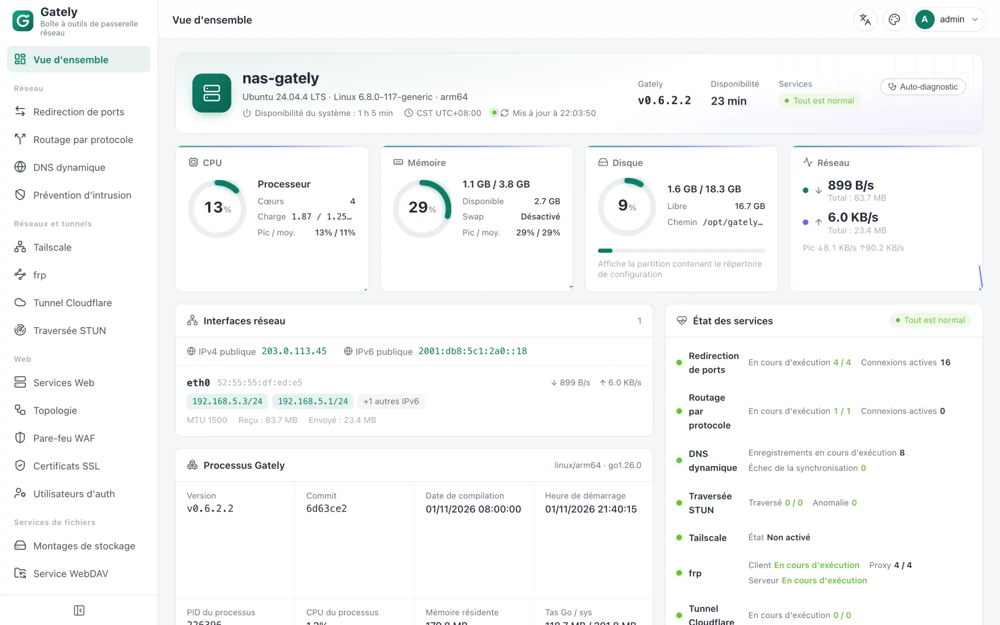

## Ce que Gately remplace

| Ce que vous utilisez aujourd'hui | Dans Gately |
| --- | --- |
| nginx ou Nginx Proxy Manager | Service web : reverse proxy, sites statiques, redirections, HTTP/3, règles d'accès par site ; importe la configuration nginx |
| certbot / acme.sh | Certificats ACME avec DNS-01 et HTTP-01, wildcard, renouvellement et déploiement automatiques |
| ddns-go ou scripts DDNS | DNS dynamique pour plus de 30 fournisseurs, IPv4 et IPv6 |
| Routage SNI haproxy / sslh | Routage par protocole : HTTPS, SSH, RDP et d'autres partagent un même port |
| fail2ban | Règles de journaux, ports pièges et détection de scan, bannissements rejetés dans nftables ou iptables |
| ModSecurity / un WAF séparé | Coraza avec OWASP CRS v4, par site |
| Une connexion de type Authelia devant les applications | Connexion intégrée, TOTP, Passkeys et fournisseur OIDC ; authentification déléguée également prise en charge |
| frpc / cloudflared / tailscaled lancés à la main | frp, Tunnel Cloudflare, Tailscale, NetBird et EasyTier gérés, avec installation, mise à jour et retour arrière |
| Contournements de redirection de ports sans IPv4 publique | Traversée STUN : hole punching TCP / UDP, les changements d'adresse se synchronisent avec les enregistrements DNS, des Webhooks et des scripts |

Vous pouvez désactiver tout module inutile, ou compiler un binaire avec seulement les modules choisis sur [build.gately.cn](https://build.gately.cn).

## Essayez-le

```bash
docker run -d --name gately --network host --cap-add NET_ADMIN \
  -v ./gately-data:/etc/gately \
  ghcr.io/wangwanjie/gately:latest
```

Ouvrez `http://<IP de l'appareil>:16680`, connectez-vous avec `admin` / `gately.cn` et définissez votre propre mot de passe lorsque l'on vous le demande. Le réseau hôte permet à Gately d'écouter sur les ports que vous configurez ; `NET_ADMIN` permet aux bannissements d'atteindre le pare-feu de l'hôte (sans lui, les bannissements s'appliquent toujours aux services de Gately). Ajoutez `-v /var/run/docker.sock:/var/run/docker.sock` si vous voulez le module Docker. Les images existent pour amd64, arm64 et arm/v7 sur GHCR et sur Docker Hub sous `vanjayak/gately` (même image ; utilisez-la si GHCR est difficile d'accès).

Autres méthodes d'installation : [binaire et service système](#installation) · [OpenWrt](#installation) · [fnOS](#installation) · [Docker Compose](../../deploy/docker-compose.yml) · [toutes les options](https://gately.cn/fr/docs/guide/install)

Mot de passe oublié ou application d'authentification perdue ? Exécutez `gately reset-password` ou `gately reset-totp` sur le serveur (`docker exec -it gately gately reset-password` avec Docker) ; consultez [Réinitialiser le mot de passe et l'authentification à deux facteurs](https://gately.cn/fr/docs/guide/install#reset). Peu de stockage, par exemple sur un routeur ? [build.gately.cn](https://build.gately.cn) génère un binaire, un paquet OpenWrt ou fnOS, ou une image Docker multi-architecture ne contenant que les modules et les langues d'interface que vous choisissez.

## Pourquoi lui faire confiance en bordure de réseau

- **Lisible et discret** : Apache-2.0, aucune connexion par défaut aux serveurs du projet et aucune information sur l'appareil transmise ; toutes les adresses externes (interrogation de l'IP, STUN, vérification des mises à jour) sont visibles, modifiables et désactivables. La connexion via un tiers utilise vos propres applications OAuth, sans intermédiaire.
- **Versions vérifiables** : signatures cosign, provenance de build et SBOM pour chaque artefact ([comment vérifier](../fr/VERIFY.md)) ; les correctifs de sécurité sont publiés sous forme d'[avis GitHub](https://github.com/wangwanjie/gately/security/advisories). `checksums.txt` est aussi signé avec minisign, et les mises à jour en ligne vérifient cette signature avant d'installer.
- **Chaque changement est consigné** : journal d'audit, historique de configuration avec diff et retour arrière en un clic, JSON lisible que vous pouvez garder dans git.
- **À la hauteur de haproxy + nginx** : 26k req/s contre 14,7k sur les mêmes 2 cœurs dans une configuration comparable ([chiffres et méthode](#performances)).

## Fonctionnalités

Un aperçu rapide de l'interface d'administration. La liste complète des modules se trouve à la fin de cette section.

### Tout en un coup d'œil

La vue d'ensemble affiche CPU, mémoire, disque et trafic, les interfaces réseau avec leurs IPv4 et IPv6 publiques, et l'état de chaque module : en quelques secondes, vous voyez si quelque chose demande votre attention.


### Des services web capables de remplacer nginx

Reverse proxy, fichiers statiques et redirections par domaine, avec HTTPS et HTTP/3. Chaque site a son propre WAF, ses règles d'IP et sa connexion, et les modifications s'appliquent sans couper les connexions.

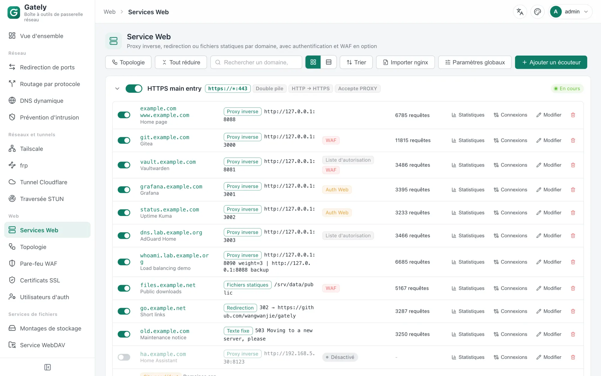

<p><b>Statistiques par site</b> — requêtes, erreurs, santé des backends, principales IP et pays d'origine, minute par minute.</p>

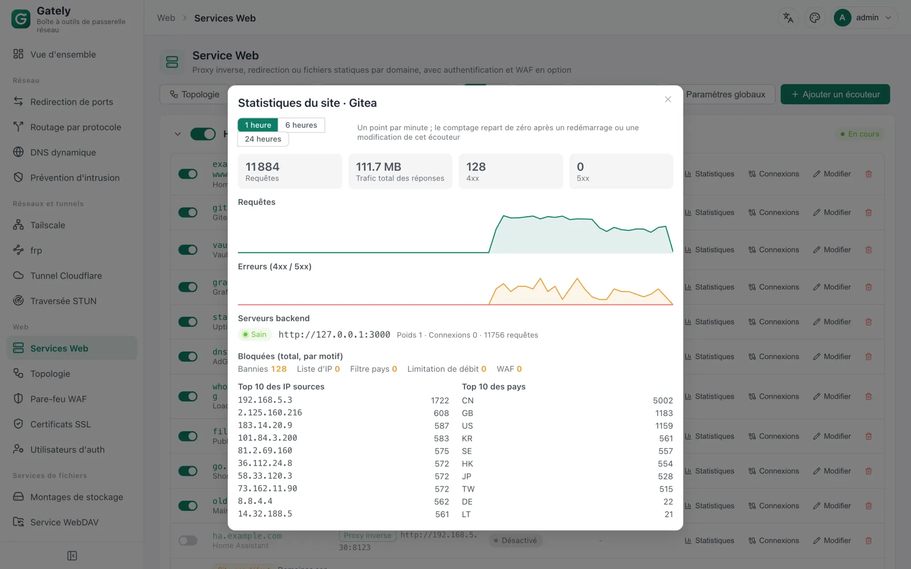

### Topologie réseau

Suivez en direct le trafic des visiteurs vers les backends, en passant par les écoutes et les sites. Sélectionnez un nœud pour voir le QPS, le trafic et les IP actives, filtrez par IP de visiteur, passez d'une disposition à l'autre parmi sept et masquez les adresses avant de partager une capture.

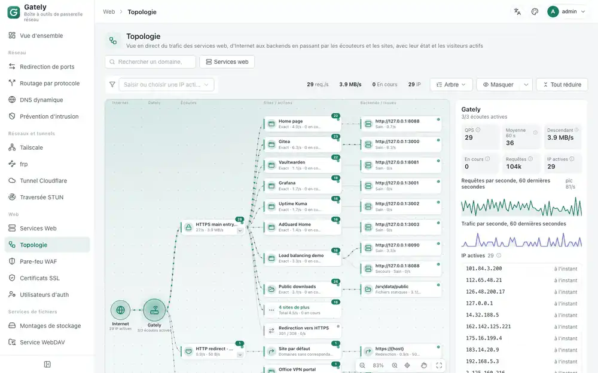

### Un seul port 443 pour tous vos services

Le routage par protocole permet à plusieurs services de partager un même port selon le domaine ou le protocole : le TLS passe tel quel et le protocole PROXY conserve l'adresse réelle du client.

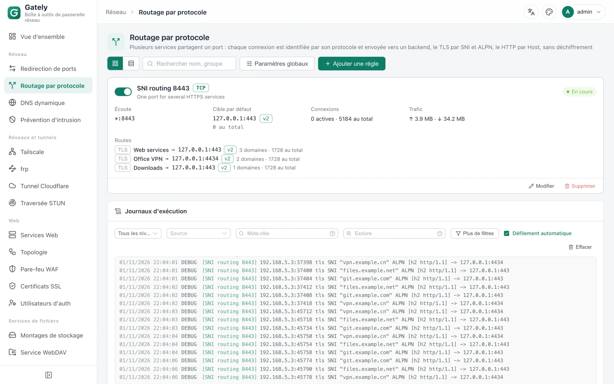

### DNS dynamique avec les principaux fournisseurs

Cloudflare, Alibaba Cloud, DNSPod, Route 53 et d'autres. IPv4 et IPv6, adresse obtenue depuis une URL, une interface réseau ou une commande, et une notification à chaque changement.

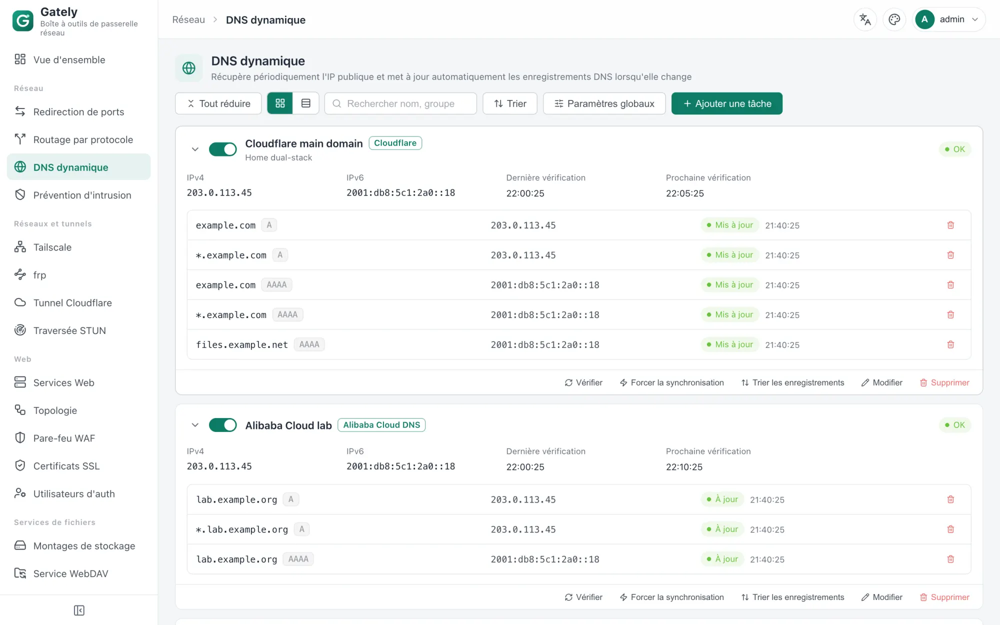

### Prévention d'intrusion

Des règles à la fail2ban lisent les journaux de fichiers, de journald et des conteneurs, tandis que les ports pièges et la détection de scans repèrent les sondages. Les bannissements sont synchronisés avec nftables et le trafic est rejeté dans le noyau.

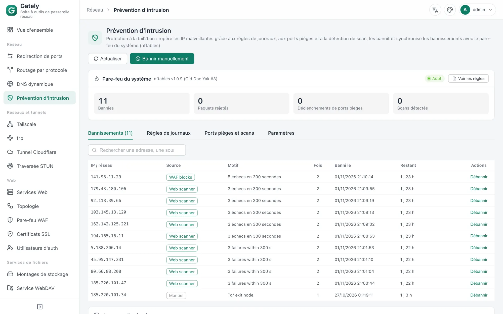

### frp, Tailscale et tunnels Cloudflare

Plusieurs instances frpc et frps côte à côte, à côté de Tailscale et des tunnels cloudflared. Gately installe, met à jour et restaure ces programmes pour vous.

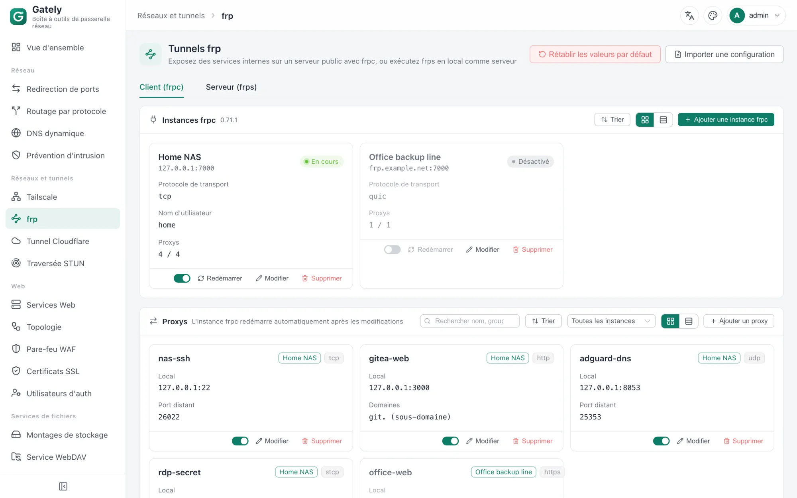

### Et aussi

<table>
<tr>
<td width="50%" valign="top">

**Docker**<br>Conteneurs, Compose, journaux et terminaux, avec mise à niveau des images en un clic et retour arrière automatique en cas d'échec.

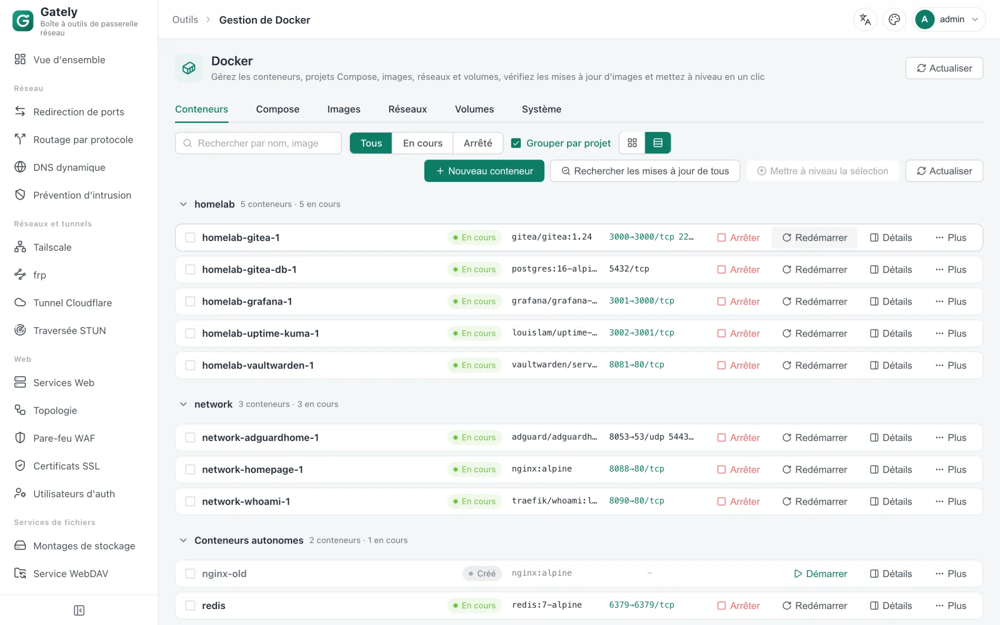

</td>
<td width="50%" valign="top">

**Terminal web**<br>SSH, Telnet et shell local dans le navigateur, avec SFTP et écran partagé.

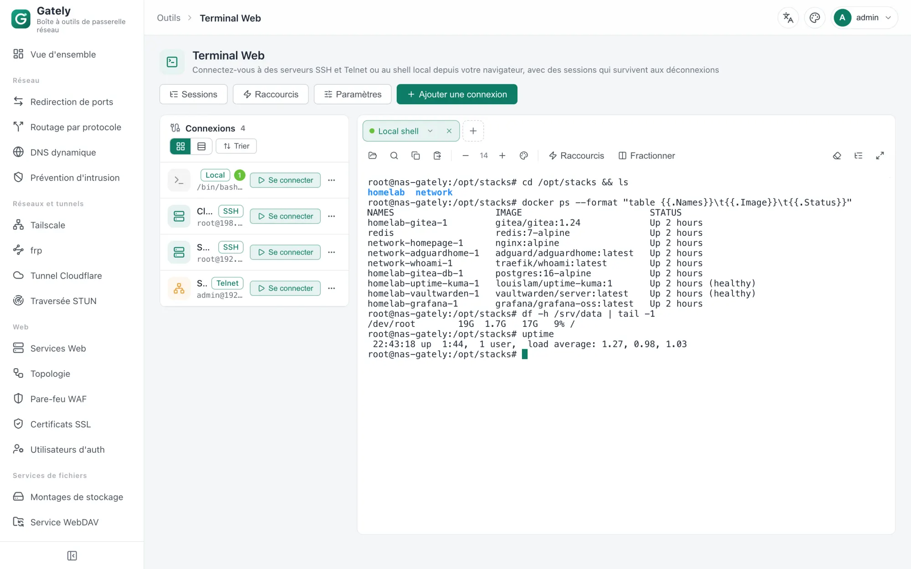

</td>
</tr>
</table>

<table>
<tr>
<td width="50%" valign="top">

**Historique de configuration**<br>Chaque modification conserve la version précédente, avec comparaison des différences et retour arrière en un clic.

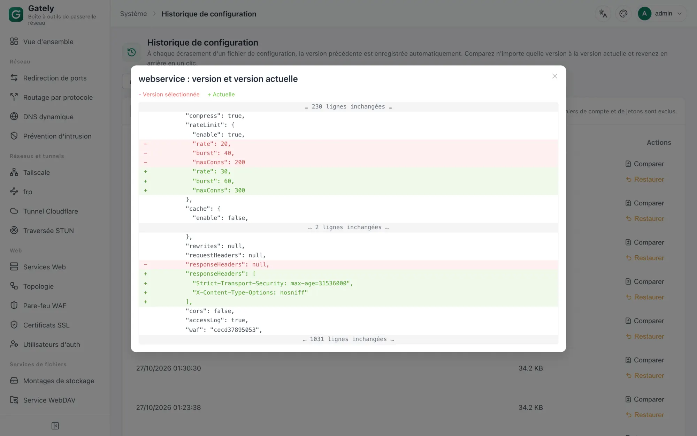

</td>
<td width="50%" valign="top">

**API, ligne de commande et MCP**<br>Jetons d'API par module, documentation OpenAPI intégrée, `gately ctl` et un serveur MCP pour les assistants IA.

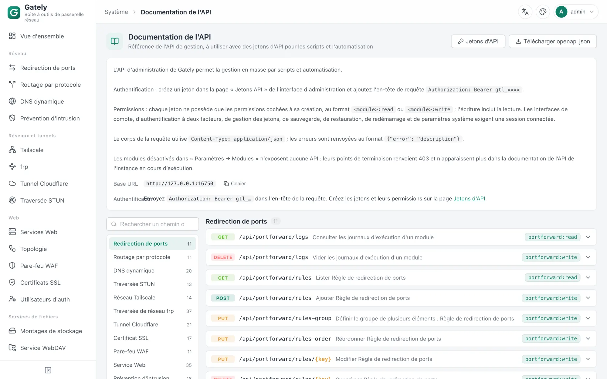

</td>
</tr>
</table>

<details>
<summary><b>Liste complète des fonctionnalités</b></summary>

Plusieurs modules partagent les mêmes briques. La traversée STUN, la redirection de ports et le routage par protocole acceptent une liste d'autorisation / de blocage par IP source et une liste de refus prioritaire (qui peut référencer des listes d'IP abonnées) et ouvrent automatiquement leurs ports dans le pare-feu local. Tailscale, NetBird, EasyTier, frp, Tunnel Cloudflare et File Browser exécutent des programmes externes que Gately installe, met à jour, restaure et désinstalle en ligne, et chacun dispose d'une action « rétablir les valeurs par défaut ».

| Module | Capacités |
| --- | --- |
| DNS dynamique | Alibaba Cloud, Cloudflare, Tencent Cloud, DNSPod, Huawei Cloud, GoDaddy, Porkbun, dynv6, DuckDNS, Amazon Route 53, OVHcloud, Gandi, NS1, Bunny DNS, Namecheap, Tencent Cloud EdgeOne, Alibaba Cloud ESA, Baidu AI Cloud, Volcano Engine, DNS.LA, Rainyun, Now.cn, Eranet, Tnet.hk, HiPM DNSMgr, Vercel, NameSilo, Dynadot, Spaceship, Name.com, Gcore, ClouDNS, deSEC, DynDNS2 (No-IP, Dynu, …), rappel personnalisé |
| DNS dynamique : tâches | Récupération de l'IP par URL, interface réseau ou commande ; IPv4/IPv6 ; Webhook ; groupes, tri et recherche ; notes écrites chez le fournisseur ; la suppression d'une tâche peut aussi supprimer l'enregistrement chez le fournisseur |
| Traversée STUN | TCP/UDP, keep-alive, UPnP/NAT-PMP, redirection intégrée ; Webhook et scripts déclenchés lors d'un changement d'adresse |
| Redirection de ports | TCP/UDP, IPv4/IPv6, plages de ports, basculement multi-cibles, limite de connexions, statistiques de trafic, protocole PROXY v1/v2 ; groupes, tri et recherche ; limite de connexions simultanées par source et délai pour les connexions qui n'envoient aucune donnée |
| Routage par protocole | Plusieurs services partagent un même port comme le 443, transmis sans déchiffrement : TLS par SNI et ALPN, HTTP par Host, Minecraft par adresse du serveur, plus SSH, RDP, SOCKS, OpenVPN, RTSP, SIP, XMPP, MQTT, AMQP, PostgreSQL, Redis, SMB, Git, IRC, ADB, BitTorrent, et une route Délai d'attente pour les protocoles où le serveur parle en premier comme VNC ; cible par défaut et protocole PROXY par route |
| Certificats SSL | Émission et renouvellement automatiques ACME via DNS-01 (wildcard ; zone DNS des sous-domaines délégués détectée par SOA) ou HTTP-01 (sans fournisseur DNS) ; EAB, téléversement, lecture depuis un fichier, copie vers un répertoire avec exécution de scripts |
| Certificats SSL : IP et courte durée | Certificats de courte durée et certificats pour adresses IP publiques (profil shortlived de Let's Encrypt) |
| Certificats SSL : déploiement | Après un renouvellement, envoi des certificats par SSH vers d'autres hôtes avec exécution d'une commande, ou redémarrage des conteneurs Docker qui les utilisent |
| Tailscale | Gère tailscaled (réseau en espace utilisateur, adapté aux conteneurs) ou se connecte à un démon système existant ; clés d'authentification/liens de connexion, Headscale, routes de sous-réseau, nœuds de sortie, liste des nœuds, proxy SOCKS5, port fixe, arguments supplémentaires et variables d'environnement ; installation en ligne sous Linux |
| NetBird | NetBird Cloud ou un serveur de gestion auto-hébergé ; démon netbird géré (réseau en espace utilisateur, permet aux autres pairs d'atteindre les services locaux) ou service système existant ; clés de configuration / liens de connexion, routes, pair de routage, DNS, blocage de l'entrant, liste des pairs (direct / relayé, latence), proxy SOCKS5 ; installation en ligne sous Linux, macOS et Windows |
| EasyTier | easytier-core géré : hole punching P2P en premier, nœuds relais auto-hébergés ou au choix, réseau en espace utilisateur avec redirection de ports, proxy de sous-réseau, nœuds de sortie, proxy KCP / QUIC |
| frp | Plusieurs instances frpc et frps : frpc (proxys tcp/udp/http/https/stcp/xtcp, modifications prises en compte immédiatement, adresses d'accès cliquables et copiables) et frps (liste blanche de ports, sous-domaines, tableau de bord, limites par IP source pour les connexions de frpc) ; import en un clic des configurations ini anciennes et toml récentes ; ports KCP et QUIC pour frps, réglages QUIC des deux côtés et ouverture automatique des ports de frps dans le pare-feu local |
| Tunnel Cloudflare | Tunnels à jeton cloudflared et tunnels temporaires trycloudflare, plusieurs tunnels, redémarrage automatique, affichage de l'adresse publique ; modification des routes des tunnels à jeton via l'API Cloudflare et création de leurs enregistrements DNS |
| Pare-feu WAF | Coraza + OWASP CRS v4, activation des règles par fichier, SecLang personnalisé, blocage/détection seule ; peut aussi utiliser un moteur de détection SafeLine auto-hébergé ; les sessions administrateur de cette instance contournent le WAF ; peut faire confiance aux utilisateurs connectés |
| Pare-feu WAF : requêtes volumineuses | Limite d'inspection du corps de requête réglable, avec inspection du seul début ou exemption par chemin, pour protéger aussi les sites de cloud personnel, WebDAV ou d'envoi de fichiers |
| Prévention d'intrusion : règles de journaux | Règles de journaux à la fail2ban (fichiers journaux, journal systemd, sortie de commande, journaux de conteneurs Docker, échecs de connexion à la console, blocages du WAF, knocks refusés) avec des modèles pour SSH, Nginx, Vaultwarden et d'autres |
| Prévention d'intrusion : sondages | Ports pièges et détection de scan de ports (reconnaît les ports ouverts des modules de Gately, y compris les ports distants demandés par frpc ; mode strict IPv6 avec blocage par /64 ; le motif du bannissement indique les ports touchés) ; bannissement des sondages de chemins web par écoute (chemins leurres comme /.env et /.git, scans de domaines inconnus, 404 répétés) ; bannissement des échecs de poignée de main TLS par type d'échec (coupure en cours de route, réinitialisation, délai dépassé, non TLS, etc.) et par écoute |
| Prévention d'intrusion : bannissements | Une liste de bannissement avec bannissements manuels de réseaux CIDR et permanents, durées progressives et liste blanche ; synchronisée avec le pare-feu du système (nftables / iptables + ipset) et rejetée dans le noyau, ou appliquée aux services de Gately là où nftables est absent |
| Port Knocking | Single Packet Authorization (SPA) compatible avec les clients fwknop : chiffrement AES-256, authentification HMAC, protection contre le rejeu et fenêtre de temps ; les ports protégés sont bloqués dans le pare-feu du système (nftables / iptables + ipset) et l'adresse ayant frappé est autorisée pour une durée limitée, sans affecter les connexions déjà établies |
| Port Knocking : intégrations | La redirection de ports, le routage par protocole (par route) et STUN peuvent choisir « Exiger un knock » sans privilèges de pare-feu ; le routage par protocole peut recevoir des paquets de knock en TCP pour n'exposer qu'un seul port ; l'autorisation après connexion web accorde l'IP du visiteur (par /64 en IPv6, inscriptible dans le pare-feu du système), sans client ; les knocks refusés peuvent être transmis à la prévention d'intrusion |
| Gestion Docker | Création et édition de conteneurs, journaux et terminal, Compose, vérification des mises à jour d'images et mise à niveau en un clic (retour arrière automatique en cas d'échec), réseaux et volumes ; les tâches en arrière-plan comme les récupérations, constructions, Compose et mises à niveau groupées peuvent être arrêtées en cours de route |
| Docker : mise à niveau de Gately | Mise à jour du conteneur où tourne Gately lui-même via un conteneur auxiliaire temporaire, avec restauration de l'ancien conteneur en cas d'échec |
| Terminal web | SSH (confiance dans la clé d'hôte à la première connexion), Telnet, shell local (désactivé par défaut) ; proxy, sessions persistantes, gestion de fichiers SFTP, 2FA et confirmation du protocole, commandes rapides, écran partagé ; sélection et copie par appui long sur mobile, panneau de collage et historique du presse-papiers |
| Diagnostic réseau | Ping, traceroute, sondage de ports, requêtes DNS, test de débit, scan du réseau local |
| Centre de notifications | Webhook, Telegram, Bark, ntfy, Gotify, Pushover, Discord, Slack, ServerChan, PushPlus, WeCom, DingTalk, Feishu, e-mail ; niveaux, jokers et règles de mise en sourdine et de déduplication ; proxy global ou par canal (HTTP et SOCKS5) ; modèles de règles intégrés (pannes critiques, expiration des certificats, changements d'adresse, connexions, modifications de configuration, mises à jour de version) ; alerte de connexion à l'interface d'administration depuis une nouvelle adresse |
| Sauvegarde de la configuration | Sauvegardes chiffrées (scrypt + AES-GCM), politique de rétention, sauvegardes planifiées vers un répertoire local ou un point de montage de stockage |
| Ligne de commande et MCP | `gately ctl` interroge une instance en cours d'exécution ; `gately mcp` fournit un service MCP via stdio (lecture seule par défaut) |
| Wake-on-LAN | Diffusion de paquets magiques, détection de présence en ligne ; commande vocale Bemfa (Xiao AI, Xiaodu, Google Assistant) |
| Wake-on-LAN : arrêt | Arrêt, redémarrage et mise en veille à distance via un agent sur l'appareil (Windows/Linux/macOS/OpenWrt, connexion initiée par l'appareil, aucun port à ouvrir), une commande SSH du terminal Web ou une requête HTTP |
| WebDAV, FTP, SMB | Multi-utilisateur, répertoire indépendant par utilisateur, lecture seule ; utilisateurs partagés communs aux trois services ; FTP ajoute FTPS et une plage de ports passifs ; SMB ajoute des partages par utilisateur sur un ou plusieurs répertoires, SMB 2/3, le chiffrement et la découverte Bonjour |
| File Browser | Héberge le gestionnaire de fichiers web FileBrowser Quantum : plusieurs instances, plusieurs répertoires partagés avec lecture seule, authentification par mot de passe ou par proxy inverse |
| Montages de stockage | Répertoires locaux, montages WebDAV distants et partages SMB, gestion de fichiers en ligne |
| Tâches planifiées | Expressions cron, commandes ou requêtes HTTP, historique d'exécution |
| Gestion des listes | Règles, instances, certificats, enregistrements DNS, connexions de terminal, jetons d'API et autres listes partagent groupes, tri manuel (glisser-déposer ou flèches, avec sélection multiple) et recherche, avec activation, désactivation et suppression en lot ; les sites du Service web permettent aussi d'ajouter, retirer ou remplacer des domaines, de modifier des options en lot et de passer à un autre écouteur (en modification, en lot ou par glisser-déposer) ; la plupart basculent entre vue en cartes et vue compacte ; réordonner ou regrouper ne redémarre aucun service et fonctionne sur mobile ; la plupart des éléments peuvent être dupliqués comme point de départ, en reprenant leurs secrets enregistrés |
| Connexion à l'administration | Connexion par passkey (WebAuthn), authentification à deux facteurs (TOTP), comptes en lecture seule, limitation des échecs de connexion (verrouillage progressif), budget d'échecs des adresses inconnues (contre la force brute répartie), détection des mots de passe faibles et changement de mot de passe obligatoire, désactivation de la connexion par mot de passe (Passkey uniquement), score de sécurité |
| Accès à l'administration | Point d'entrée sécurisé, accès réservé au réseau interne, réponse configurable aux requêtes non autorisées pour masquer le port d'administration (404 simple, page vide, fermeture de la connexion, aucune réponse ou page personnalisée), HTTPS pour l'interface d'administration, adresse réelle du client depuis les proxys inverses locaux de confiance |
| Paramètres | Plusieurs jetons d'API (autorisations en lecture/écriture par module), mots de passe et clés enregistrés affichables à la demande (permission d'écriture requise), DNS personnalisé (DoH pris en charge), fuseau horaire, sauvegarde et restauration de la configuration, activation ou désactivation des modules fonctionnels (un module désactivé ne démarre aucun service et n'expose aucune API), niveau de journalisation (`GATELY_LOG_LEVEL`) |
| Interface d'administration | Recherche globale (Ctrl/⌘+K) des pages, onglets, domaines de sites, règles de redirection de ports, enregistrements DDNS et certificats ; choix du scénario d'usage au premier démarrage avec une liste de premiers pas ; assistant de site rapide en trois étapes qui teste l'adresse du backend ; modèles de scénarios sur les listes vides de redirection de ports et de DDNS ; mode démo public en lecture seule (`-demo`) |
| Vérification des mises à jour | Vérification automatique des nouvelles versions et des avis de sécurité (requêtes anonymes vers GitHub, désactivable), avec une alerte bien visible et une notification quand un problème de sécurité publié affecte la version en cours d'exécution |
| Application native fnOS | Paquets `.fpk` hors ligne (x86 / ARM) ; intégrée à la passerelle unifiée fnOS, s'ouvre depuis l'icône du bureau fnOS et fonctionne via votre domaine fnOS distant ; les administrateurs fnOS peuvent se connecter avec leur session fnOS (désactivé par défaut) ; s'exécute en root pour écouter sur 80/443 et gérer Docker |
| Audit et historique | Journal d'audit des connexions, des modifications de configuration et des accès aux contenus sensibles (n'enregistre jamais les corps de requête ni les secrets) ; chaque fichier de configuration écrasé conserve ses versions précédentes, avec diff et restauration en un clic ; répertoire de configuration déclarative (`-apply`) pour le GitOps |
| Supervision | Tableau de bord des performances avec tendances sur 60 secondes / 1 heure / 24 heures de l'hôte, du processus Gately et des sites, y compris le temps jusqu'au premier octet P50 / P95 ; CPU et mémoire des processus gérés (frp, Tailscale, NetBird, cloudflared, File Browser) ; alertes par seuil (métrique + seuil + durée) avec avis de déclenchement et de rétablissement via le centre de notifications |
| Métriques et autodiagnostic | Point de terminaison Prometheus global `/api/metrics` (certificats, DDNS, STUN, redirection de ports, services web) avec un tableau de bord Grafana prêt à l'emploi ; autodiagnostic réseau en un clic (IP publique, CGNAT, horloge, ports 80/443, résolution DDNS, expiration des certificats, sites HTTPS sans certificat, conflits de proxys frp) |
| Migration | Import de configuration nginx (sortie de `nginx -T` acceptée) : reverse proxy et upstream, répertoires statiques, redirections, backends par chemin, contrôle d'accès, `auth_request` converti en authentification déléguée ; import direct des configurations Nginx Proxy Manager (variables `set` substituées dans `proxy_pass`) ; conversion des exports Sun-Panel 1.x / 2.x en panneaux de navigation |

#### Service web

Le détail de chaque fonctionnalité se trouve dans la [documentation du service web](https://gately.cn/fr/docs/modules/web).

| Domaine | Capacités |
| --- | --- |
| Types de sites | Reverse proxy, redirection, fichiers statiques (URL sans extension, page 404 personnalisée), texte fixe, fermeture de connexion (comme `return 444` de nginx), panneau de navigation |
| Écouteurs et protocoles | HTTPS, HTTP/3 (QUIC), HTTP et HTTPS sur le même port (redirection ou service direct), port HTTP supplémentaire par écouteur (par exemple 80 à côté de 443), WebSocket, backends HTTP/2 en clair (h2c) pour gRPC, protocole PROXY en entrée et en sortie, ports ouverts automatiquement dans le pare-feu local |
| Backends | Backends par chemin, backends par utilisateur connecté (comme `map $remote_user` de nginx, aussi pour les sites de redirection, fichiers statiques, panneau de navigation et texte fixe), poids/secours/politiques d'équilibrage de charge, contrôles de santé actifs et passifs, nouvel essai sur le backend suivant en cas d'échec de connexion, délais de connexion / négociation TLS / en-têtes de réponse, délais d'inactivité en lecture/écriture côté visiteur, backends HTTPS recevant le domaine visité comme SNI, réécriture de chemins et retrait de préfixe |
| Connexion | Authentification de base, authentification web, connexion GitHub / Google / QQ / OIDC, utilisateurs partagés avec vérification en deux étapes TOTP, Passkeys et changement de mot de passe en libre-service, authentification unique entre sous-domaines, fournisseur d'identité OIDC intégré pour Gitea, Grafana et d'autres applications OpenID Connect, authentification déléguée à un service externe comme Authelia, un Gately public qui transmet ses cookies de connexion à un Gately du réseau local, en-têtes transmettant au backend le nom d'utilisateur, l'e-mail, le nom affiché et les groupes de l'utilisateur connecté, accès sans authentification pour les administrateurs (les administrateurs connectés à la console accèdent aux sites sans s'authentifier à nouveau, y compris entre domaines parents), confiance aux utilisateurs connectés (sans WAF ni détection de chemins) |
| Contrôle d'accès | Listes d'IP autorisées / refusées, listes d'IP abonnées actualisées périodiquement (par exemple les plages d'IP par province ou ville), liste de refus prioritaire évaluée avant la liste blanche (adaptée aux listes de renseignement sur les IP malveillantes), filtrage par pays GeoIP, règles par chemin, liens de partage temporaires, bannissement automatique après échecs d'authentification, admission par port knocking (les sources sans autorisation ne peuvent pas atteindre le site) et autorisation après connexion, fermeture de la connexion au lieu de répondre 403 en cas de refus |
| Performances | Compression, limitation de débit, cache des réponses avec règles par chemin (désactivé / durée propre / forcé) et vidage du cache |
| Pages d'erreur | Pages 404 et 5xx en 10 styles intégrés ou votre propre HTML (téléversé ou fichier du serveur, vérifié et isolé dans un bac à sable), avec remplacement possible des erreurs du backend (comme `proxy_intercept_errors` de nginx) |
| Visibilité | Statistiques d'accès à la minute et métriques Prometheus, connexions en direct par site avec fermeture ou bannissement, vue topologique en direct des QPS, du trafic et des IP actives des écouteurs aux sites et aux backends (mise en évidence du chemin par IP, masquage des adresses, focus « Actifs uniquement », relecture d'instantanés enregistrés conservés en mémoire selon une taille, désactivée par défaut), audit des visiteurs par adresse (sites, chemins, identités, part bloquée, rétention), archives quotidiennes compressées et export des journaux d'accès |
| Panneaux de navigation | Une page de liens servie comme site : les visiteurs du LAN reçoivent les adresses LAN, icônes intégrées, autres moyens d'accès, thèmes identiques à l'interface d'administration, moteurs de recherche, image d'arrière-plan, liens visibles après connexion, tailles de carte, menu de langue pour les visiteurs, pied de page personnalisé ; styles de lien (cartes ou icônes d'application) et mise en page (taille des icônes, liens par ligne, espacement, largeur) ; choix de l'adresse pour les liens qui en ont plusieurs ; nombre de liens par groupe et badge d'adresses en option |
| Exploitation | Les modifications s'appliquent sans couper les connexions ouvertes, groupes, tri et recherche de sites, IP réelle des visiteurs lue dans les en-têtes des proxys de confiance (CDN, WAF), domaines cliquables avec copie de l'adresse complète, les lignes des sites HTTPS indiquent le certificat correspondant et ses jours restants |

</details>

## Installation

Docker est le plus rapide (voir [Essayez-le](#essayez-le)). Les autres méthodes :

<details>
<summary><b>Binaire</b></summary>

Téléchargez l'archive correspondant à votre plateforme depuis [Releases](https://github.com/wangwanjie/gately/releases) (Linux amd64/arm64/arm/mips/mipsle/riscv64, macOS, Windows, FreeBSD), décompressez-la puis exécutez :

```bash
./gately -c /etc/gately
```

Paramètres : `-c` répertoire de configuration (la variable d'environnement `GATELY_CONFIG_DIR` fonctionne aussi), `-listen` remplace l'adresse d'écoute de l'interface d'administration, `-apply` applique à chaque démarrage les fichiers `<nom>.json` d'un répertoire au répertoire de configuration (`GATELY_APPLY_DIR`, pratique pour le GitOps et Kubernetes ; les fichiers de comptes et de jetons ne peuvent pas être écrasés), `-version` affiche la version. Pour une installation sans intervention, définissez `GATELY_INITIAL_PASSWORD` afin de choisir le mot de passe administrateur initial à la place du mot de passe par défaut `gately.cn`.

Démarrage au boot : après extraction, exécutez `sudo ./gately service install` (Windows : `.\gately.exe service install` dans un terminal administrateur). Cela enregistre une unité systemd sous Linux, un démon launchd sous macOS (avec `-user`, un élément d'ouverture de session sans sudo) et un service sous Windows, démarre Gately et le relance après un plantage. Le répertoire de configuration vaut par défaut `/etc/gately`, `/usr/local/etc/gately` ou `%ProgramData%\Gately` ; `-c` et `-listen` le remplacent. Le service pointe vers le chemin de l'exécutable, placez-le donc d'abord à son emplacement définitif. Ensuite, gérez-le avec `gately service uninstall|start|stop|restart|status` ; la désinstallation conserve le répertoire de configuration.

Modèles de service : [systemd](../../deploy/systemd/gately.service) et [OpenWrt procd](../../deploy/openwrt/gately.init). Pour vérifier les archives et images téléchargées (signatures cosign, provenance de build, SBOM), consultez [Vérifier les artefacts publiés](../fr/VERIFY.md).

</details>

<details>
<summary><b>Application native fnOS</b></summary>

Chaque Release fournit des paquets `.fpk` hors ligne pour fnOS : `gately_<version>_fnos_x86.fpk` (Intel/AMD) et `gately_<version>_fnos_arm.fpk` (ARM). Ils ne figurent pas dans le Centre d'applications officiel ; installez-les donc manuellement : ouvrez **Centre d'applications → Installation manuelle** (le bouton en bas à gauche), sélectionnez le fichier et terminez l'assistant.

- **Intégrée à la passerelle unifiée fnOS** : cliquez sur l'icône Gately du bureau fnOS et l'interface d'administration s'ouvre via la passerelle unifiée fnOS sous `/app/gately/`, sur le même point d'entrée que celui que vous utilisez déjà pour fnOS. L'adresse du réseau local comme votre domaine fnOS distant fonctionnent, sans avoir à ouvrir ni rediriger le port 16680. L'accès via la passerelle est contrôlé par fnOS (seuls les administrateurs fnOS peuvent l'ouvrir) ; les réglages « Entrée sécurisée » et « Accès réseau local uniquement » s'appliquent donc uniquement à l'accès direct sur le port 16680.
- **Connexion des administrateurs fnOS avec leur session fnOS** : activez **Paramètres → Contrôle d'accès → Connexion via fnOS** et les administrateurs fnOS déjà connectés à fnOS entrent dans Gately depuis l'icône du bureau, sans mot de passe ni code à deux facteurs ; les utilisateurs fnOS ordinaires doivent toujours se connecter. Après une déconnexion, la page de connexion propose un bouton « Se connecter avec le compte fnOS &lt;nom&gt; » au lieu de vous reconnecter silencieusement. Ce réglage est désactivé par défaut et n'apparaît que dans le paquet fnOS.
- Sur le réseau local, l'interface d'administration est aussi accessible à `http://<adresse du NAS>:16680`. Le compte par défaut est `admin`, avec le mot de passe par défaut `gately.cn`.
- L'application s'exécute en `root` afin de pouvoir écouter sur 80/443, gérer Docker via `docker.sock` et ouvrir un vrai terminal Web. Installez-la uniquement sur un NAS que vous contrôlez.
- La configuration se trouve dans le répertoire `var` de l'application et est conservée lors de la désinstallation, sauf si vous choisissez « tout supprimer » dans l'assistant de désinstallation. Pour mettre à niveau, installez manuellement le `.fpk` plus récent.
- Le paquet ajoute aussi une commande `gately` (`/usr/local/bin/gately`) pour `gately ctl` et `gately mcp`.
- Le port 16680 est partagé avec l'image Docker. Arrêtez le conteneur `gately` avant de démarrer l'application native.
- Vérifiez le téléchargement selon [Vérifier les artefacts publiés](../fr/VERIFY.md) ; les fichiers `.fpk` figurent dans `checksums.txt`.

</details>

<details>
<summary><b>OpenWrt</b></summary>

Chaque Release fournit des paquets OpenWrt : `gately_<version>_openwrt_<architecture>.ipk` pour OpenWrt 24.10 et antérieur (y compris iStoreOS), à installer avec `opkg install`, et `.apk` pour OpenWrt 25.12 et ultérieur, à installer avec `apk add --allow-untrusted`. Les paquets couvrent amd64 / arm64 / arm / mipsle / mips / riscv64 ; choisissez selon `DISTRIB_ARCH` dans `/etc/openwrt_release` (voir le tableau du [guide d'installation](https://gately.cn/fr/docs/guide/install#openwrt)).

- Le service est activé et démarré dès l'installation ; l'interface d'administration est accessible à `http://<adresse du routeur>:16680`, avec le compte par défaut `admin` et le mot de passe par défaut `gately.cn`.
- La configuration se trouve dans `/etc/gately` et est conservée lors des mises à niveau, des désinstallations et des mises à jour du firmware (sysupgrade). Pour mettre à niveau, installez le paquet plus récent ; la mise à niveau en ligne de la page À propos vous oriente alors vers le gestionnaire de paquets.
- Le binaire pèse environ 32 Mo : les paquets conviennent donc aux machines OpenWrt x86, aux boîtiers ARM64 et aux autres appareils dotés d'un stockage confortable ; le paquet arm nécessite un ARMv7 avec virgule flottante matérielle.
- Une application LuCI indépendante de l'architecture, `luci-app-gately_<version>_openwrt_all.ipk` / `.apk`, ajoute **Services → Gately** à LuCI : état du service, démarrage / arrêt, démarrage automatique, port d'administration et lien direct vers l'interface.

</details>

## Exploitation

La supervision, l'API et les programmes gérés ont leurs propres pages dans la [documentation](https://gately.cn/fr/docs/guide/introduction) ; l'essentiel est ici.

<details>
<summary><b>Supervision</b></summary>

Créez un jeton d'API disposant uniquement de l'autorisation `metrics:read` et pointez Prometheus vers `/api/metrics`. Les métriques, les exemples d'alertes et le tableau de bord Grafana sont décrits dans [Supervision](../fr/MONITORING.md).

</details>

<details>
<summary><b>Appels d'API</b></summary>

Créez un jeton dans la page « Jetons d'API » de la console d'administration (plusieurs jetons possibles, avec lecture seule ou lecture-écriture par module, date d'expiration configurable ; la valeur en clair n'est affichée qu'une seule fois après la création), puis vos scripts peuvent appeler l'API d'administration en masse :

```bash
curl -H "Authorization: Bearer gtl_xxxx" http://localhost:16680/api/ddns/tasks
```

Les API de compte, d'authentification à deux facteurs, de gestion des jetons, ainsi que celles de sauvegarde, de restauration, de redémarrage et de paramètres système ne fonctionnent qu'avec une session connectée. L'ensemble des API, les autorisations requises et les structures de données sont décrits dans la page « Documentation de l'API » de la console d'administration ; vous pouvez aussi les exporter avec `make api-docs` vers [docs/api](../api/fr) (`openapi.json` et `API.md`), que le site https://gately.cn référence directement lors de sa publication.

Lors d'une mise à niveau depuis une ancienne version, l'ancien jeton d'API global devient automatiquement un « jeton hérité » (valeur inchangée, avec toutes les autorisations de module). Il est recommandé de restreindre ses autorisations ou de le remplacer par un nouveau jeton dans la page des jetons d'API.

</details>

<details>
<summary><b>Tailscale, NetBird, EasyTier, frp, cloudflared</b></summary>

Ces cinq modules gèrent des programmes externes officiels (redémarrage automatique, journaux regroupés dans l'interface). Gately ne les embarque pas. La carte « Installation en ligne » de chaque page de module télécharge depuis l'amont la dernière version stable ou une version précise, vérifie son SHA-256, l'installe dans `bin/` sous le répertoire de configuration et redémarre les processus qui l'utilisent ; chaque programme peut avoir son propre proxy de téléchargement, et à défaut le proxy de mise à jour des paramètres est utilisé. Les 3 dernières versions remplacées sont conservées pour revenir en arrière en un clic si la nouvelle pose problème, et le programme peut être désinstallé quand il ne sert plus. Le bouton « Rétablir les valeurs par défaut » de l'en-tête est distinct de la désinstallation : il arrête les processus, efface les paramètres du module et supprime les fichiers que Gately a générés pour lui (fichiers de configuration frp, données des instances File Browser, état de connexion Tailscale et NetBird) ; l'ancienne configuration reste récupérable dans l'historique de configuration. Tailscale ne publie des paquets directement exécutables que pour Linux ; sur les autres systèmes, utilisez l'installateur officiel et indiquez le chemin. Les programmes sont recherchés dans cet ordre : le chemin indiqué dans les paramètres du module, `bin/` sous le répertoire de configuration, puis `PATH`. Vous pouvez aussi placer le binaire vous-même dans le répertoire de configuration, avec Docker par exemple `./gately-data/bin/frpc` ; Tailscale nécessite de fournir à la fois `tailscale` et `tailscaled`. Les jetons et clés des fichiers de configuration sont enregistrés avec les permissions 0600, et le jeton de cloudflared est transmis par variable d'environnement, il n'apparaît donc pas dans la liste des processus.

Le module File Browser héberge [FileBrowser Quantum](https://github.com/gtsteffaniak/filebrowser) (le filebrowser d’origine est archivé et ne reçoit plus de correctifs de sécurité) avec le même ordre de recherche et la même installation, mise à jour et retour arrière en ligne ; il est installé dans `bin/filebrowser`. Le mot de passe administrateur est transmis par une variable d’environnement et n’est jamais écrit dans le fichier de configuration.

</details>

## Performances

Le routage par protocole selon le SNI, associé au service web, peut remplacer le duo courant haproxy (routage TCP par SNI) + nginx (TLS et reverse proxy). Les chiffres ci-dessous comparent les deux sur la même machine avec la configuration d'un vrai serveur : 90 domaines routés par SNI, protocole PROXY v2 entre les deux sauts et un certificat ECDSA P-256 avec TLS 1.3.

| Scénario | haproxy + nginx | Gately |
| --- | --- | --- |
| Reverse proxy HTTPS, keep-alive, réponses de 1 Ko, 64 connexions | 14 767 req/s (p99 35,9 ms) | **26 434 req/s** (p99 5,7 ms) |
| Idem en HTTP/2 | non testé (la configuration nginx utilisait HTTP/1.1) | 27 795 req/s |
| Une nouvelle connexion TLS pour chaque requête, 32 à la fois | 2 557 req/s | **3 448 req/s** |
| Réponses de 1 Mo, 16 connexions | 1 053 Mo/s | **1 585 Mo/s** |
| Passage SNI direct d'un flux TLS, 4 connexions | 2 927 Mo/s | **4 962 Mo/s** |
| Passage SNI direct, nouvelles connexions par seconde, 64 à la fois | 6 334 /s | 6 266 /s (à égalité) |
| Mémoire sous charge | haproxy ≈ 21 Mo + nginx ≈ 21 Mo | ≈ 110 Mo (un seul processus avec tous les modules) |

<details>
<summary><b>Méthode de mesure</b></summary>

- Hôte : Intel Core i5-13500T. Chaque pile était limitée à 2 cœurs de processeur (haproxy et nginx dans Docker avec `--cpuset-cpus`, Gately épinglé avec `taskset`) pour imiter un petit serveur cloud. Les backends et le générateur de charge tournaient sur d'autres cœurs.
- haproxy utilisait `mode tcp` avec des règles `req_ssl_sni` et `send-proxy-v2`. nginx utilisait `worker_processes 2` et les paramètres de proxy du site de production, qui envoient `Connection: upgrade` et ouvrent donc une nouvelle connexion backend par requête ; un nginx optimisé avec keep-alive vers l'amont réduirait l'écart sur les petites réponses.
- Le chemin de Gately était la règle SNI, PROXY v2, puis un écouteur du service web, soit le même nombre de sauts que haproxy → nginx.
- Chaque cas a duré 10 secondes, et les cas répétés concordaient à 3 % près. Sur un vrai hôte cloud à 2 vCPU, le site statique a servi 5,5k req/s contre 3,4k req/s. Les nouvelles connexions TLS étaient à égalité (environ 480–550 par seconde pour les deux) quand le client utilisait X25519 ; avec l'échange de clés hybride post-quantique que proposent les clients Go et les navigateurs récents, Gately a terminé environ 13 % de poignées de main en moins lors de cette mesure.
- Les résultats dépendent du matériel, de la configuration et du trafic. Voyez-y un contrôle de cohérence montrant que Gately tient la comparaison avec haproxy et nginx, et mesurez avec votre propre charge.

</details>

## Développement

Prérequis : Go 1.26+, Node.js 24+, pnpm.

```bash
make web      # compile le frontend (sortie dans web/dist, intégré via go:embed)
make build    # compile bin/gately
make test     # go test -race ./...
make lint     # gofmt, go vet, vérification des types du frontend
```

Les tags de compilation personnalisée, les tests nécessitant une configuration supplémentaire, les exigences pour les modules et le processus de traduction sont décrits dans [CONTRIBUTING.md](../../CONTRIBUTING.md). La structure des répertoires et les choix techniques sont décrits dans [docs/fr/ROADMAP.md](../fr/ROADMAP.md). Le code source du site web ([gately.cn](https://gately.cn)) se trouve dans `website/` et repose sur VitePress : `cd website && pnpm install && pnpm dev`.

## Politique de publication

- Gately est en dessous de la version 1.0. Les numéros de version comptent jusqu'à quatre parties (par exemple `v0.6.6.6`) ; la dernière partie augmente pour les versions de suivi d'une version mineure.
- Chaque tag `v*` lance le [workflow de publication](../../.github/workflows/release.yml), qui compile les binaires, les paquets OpenWrt et fnOS et l'image Docker multi-architecture, puis signe les artefacts. Les images portent le tag de la version et `latest`, qui pointe toujours vers la dernière version.
- Les publications sont fréquentes : 56 tags de version entre le 17 octobre et le 17 novembre 2026. Les [Releases GitHub](https://github.com/wangwanjie/gately/releases) regroupent les notes par module et signalent les remarques de mise à niveau ; le [journal des modifications](https://gately.cn/fr/news/) du site contient les annonces.
- Les correctifs de sécurité ne sont publiés que pour la dernière version ([SECURITY.md](../../SECURITY.md)). En production, fixez un tag d'image comme `ghcr.io/wangwanjie/gately:v0.6.8`, lisez les notes de version avant de mettre à niveau et utilisez l'historique de configuration pour annuler un réglage.

## Contribuer

Les issues et les pull requests sont les bienvenues. La liste de contrôle pour le code, les modules, les tests et les traductions se trouve dans [CONTRIBUTING.md](../../CONTRIBUTING.md), et toute personne qui participe respecte le [Code de conduite](../../CODE_OF_CONDUCT.md).

## Communauté

Posez vos questions dans [GitHub Discussions Q&A](https://github.com/wangwanjie/gately/discussions/categories/q-a), où les réponses restent consultables, et partagez votre installation dans Discussions ; pour échanger en direct, rejoignez le groupe Telegram [t.me/gately_chat](https://t.me/gately_chat).

Les bugs se signalent dans [GitHub Issues](https://github.com/wangwanjie/gately/issues), avec un [paquet de diagnostic](../fr/DIAGNOSTICS.md) en pièce jointe (Paramètres → Diagnostic). Il est généré localement et ne contient ni mots de passe, ni jetons, ni domaines, ni IP réelles. Signalez les problèmes de sécurité en privé, comme décrit dans [SECURITY.md](../../SECURITY.md).

## Soutenir

Toutes les fonctionnalités de Gately sont gratuites. S'il vous est utile, vous pouvez soutenir son développement avec USDT, [Afdian](https://ifdian.net/a/gately) ou WeChat Pay ; les adresses et QR codes se trouvent sur la [page de soutien](https://gately.cn/fr/sponsor).

## Licence

[Apache License 2.0](../../LICENSE)
