<p align="center">
  <a href="https://gately.cn/ja/"></a>
</p>

<p align="center">
  <a href="https://gately.cn/ja/">公式サイト</a> · <a href="https://gately.cn/ja/docs/guide/quick-start">ドキュメント</a> · <a href="https://github.com/wangwanjie/gately/releases/latest">ダウンロード</a> · <a href="https://gately.cn/ja/news/">更新履歴</a> · <a href="https://github.com/user-attachments/assets/ae5b60a4-9402-4a66-86a1-48e40038b4d0">2 分ツアー</a> · <a href="https://github.com/wangwanjie/gately/discussions">Discussions</a> · <a href="https://t.me/gately_chat">Telegram</a><br>
  <a href="../../README.md">English</a> | <a href="../../README.zh-CN.md">简体中文</a> | <a href="README.zh-TW.md">繁體中文</a> | <b>日本語</b> | <a href="README.ko.md">한국어</a> | <a href="README.es.md">Español</a> | <a href="README.fr.md">Français</a> | <a href="README.de.md">Deutsch</a> | <a href="README.ru.md">Русский</a> | <a href="README.pt-BR.md">Português (Brasil)</a>
</p>

<p align="center">
  <a href="https://github.com/wangwanjie/gately/releases/latest"></a>
  <a href="../../LICENSE"></a>
  <a href="https://hub.docker.com/r/vanjayak/gately"></a>
</p>

# Gately

**Web UI を備えたセルフホスト型ゲートウェイ。リバースプロキシ、自動 HTTPS、ダイナミック DNS、NAT 越え、WAF、fail2ban 風のブロックを 1 つのバイナリにまとめました。**

Gately は自宅ネットワークやサーバーの入口に置かれ、インターネットからサービスまでの道のりを引き受けます。変わり続ける IP にドメインを追従させ、証明書を取得・更新し、すべてのサービスを 1 つの 443 番ポートで振り分け、各サイトの前にログインと WAF を置き、探りを入れてくるアドレスをブロックします。設定はすべてブラウザーで行います。Apache-2.0、テレメトリーなし、設定はあなたのデバイス上のプレーンな JSON として保存されます。

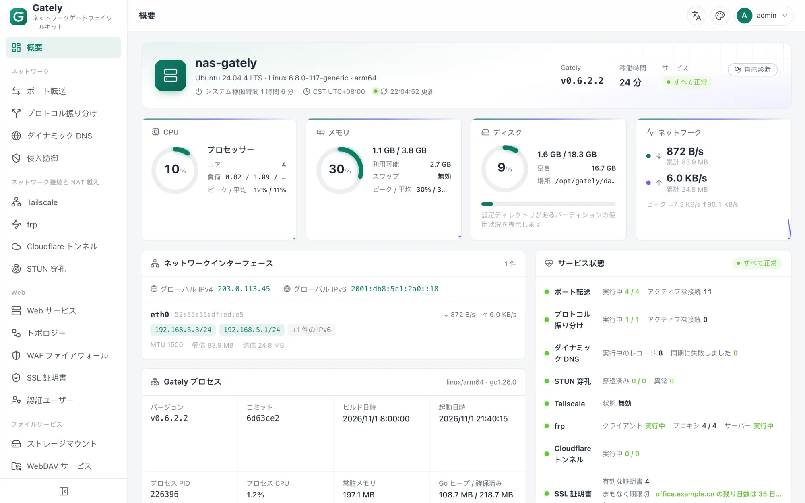

## 置き換えられるツール

| 今使っているもの | Gately での対応 |
| --- | --- |
| nginx、Nginx Proxy Manager | Web サービス：リバースプロキシ、静的サイト、リダイレクト、HTTP/3、サイトごとのアクセス制御。nginx 設定のインポートに対応 |
| certbot、acme.sh | SSL 証明書：DNS-01 / HTTP-01、ワイルドカード、自動更新と配布 |
| ddns-go、DDNS スクリプト | ダイナミック DNS：30 以上のプロバイダー、IPv4 / IPv6 |
| haproxy の SNI 振り分け、sslh | プロトコル振り分け：HTTPS、SSH、RDP などで 1 つのポートを共用 |
| fail2ban | 侵入防御：ログルール、おとりポート、スキャン検知。ブロックは nftables / iptables に書き込み |
| 単体の WAF（ModSecurity など） | Coraza + OWASP CRS v4、サイトごとに切り替え |
| アプリの前段に置くログインゲートウェイ（Authelia など） | 内蔵の Web 認証、2 段階認証、パスキー、OIDC プロバイダー。フォワード認証にも対応 |
| 手動で管理する frpc、cloudflared、tailscaled | frp、Cloudflare Tunnel、Tailscale、NetBird、EasyTier を管理。インストール、更新、ロールバックに対応 |
| パブリック IPv4 がないときのポート開放の回避策 | STUN 穿孔：TCP / UDP のホールパンチ。アドレス変更は DNS レコード、Webhook、スクリプトに反映 |

不要なモジュールは無効にできます。[build.gately.cn](https://build.gately.cn) で選んだモジュールだけを含むバイナリをビルドすることもできます。

## 試してみる

```bash
docker run -d --name gately --network host --cap-add NET_ADMIN \
  -v ./gately-data:/etc/gately \
  ghcr.io/wangwanjie/gately:latest
```

`http://<デバイスのIP>:16680` を開き、`admin` / `gately.cn` でログインして、求められたら自分のパスワードを設定します。ホストネットワークにより、Gately は設定したポートで待ち受けられます。`NET_ADMIN` はブロックをホストのファイアウォールに反映するためのもので、付けない場合もブロックは Gately 自身のサービスに適用されます。Docker モジュールを使う場合は `-v /var/run/docker.sock:/var/run/docker.sock` を追加してください。イメージは amd64、arm64、arm/v7 に対応し、GHCR と Docker Hub の `vanjayak/gately` に公開しています（同じイメージです。GHCR にアクセスしにくい場合はこちらを使ってください）。

そのほかのインストール方法：[バイナリとシステムサービス](#インストール) · [OpenWrt](#インストール) · [fnOS](#インストール) · [Docker Compose](../../deploy/docker-compose.yml) · [すべての方法](https://gately.cn/ja/docs/guide/install)

パスワードを忘れた、または認証アプリを紛失した場合は、サーバー上で `gately reset-password` または `gately reset-totp` を実行します（Docker では `docker exec -it gately gately reset-password`）。詳しくは[パスワードと 2 段階認証のリセット](https://gately.cn/ja/docs/guide/install#reset)を参照してください。ルーターなどストレージが限られた機器では、[build.gately.cn](https://build.gately.cn) で必要なモジュールと画面の言語だけを選び、より小さなバイナリ、OpenWrt や fnOS のパッケージ、マルチアーキテクチャの Docker イメージをオンラインで生成できます。

## ネットワークの入口に置く理由

- **読めて、静か**：Apache-2.0。既定ではプロジェクト側のサーバーに一切接続せず、デバイス情報も送信しません。外部へのアドレス（IP 取得、STUN、更新確認）はすべて確認・変更・無効化できます。サードパーティログインにはご自身の OAuth アプリを使用し、中継は経由しません。
- **検証できるリリース**：すべての成果物に cosign 署名、ビルドの来歴証明、SBOM を付与（[検証方法](../ja/VERIFY.md)）。セキュリティ修正は [GitHub のアドバイザリー](https://github.com/wangwanjie/gately/security/advisories)として公開されます。
- **すべての変更を記録**：監査ログ、差分表示とワンクリックロールバック付きの設定履歴、git で管理できるプレーンな JSON。
- **haproxy + nginx に引けを取らない性能**：同じ 2 コアでの同条件比較で 26k req/s 対 14.7k req/s（[数値と測定方法](#パフォーマンス)）。

## 機能

まずは管理画面のスクリーンショットをいくつか。全機能の一覧はこのセクションの最後にあります。

### 全体をひと目で

概要ページには CPU、メモリー、ディスク、トラフィック、各ネットワークインターフェースとそのパブリック IPv4 / IPv6、全モジュールの稼働状態が並びます。対応が必要な箇所はすぐにわかります。


### nginx の代わりになる Web サービス

ドメインごとにリバースプロキシ、静的ファイル、リダイレクトを設定でき、HTTPS と HTTP/3 に対応。サイトごとに WAF、IP ルール、ログイン認証を有効にでき、設定を変えても既存の接続は切れません。

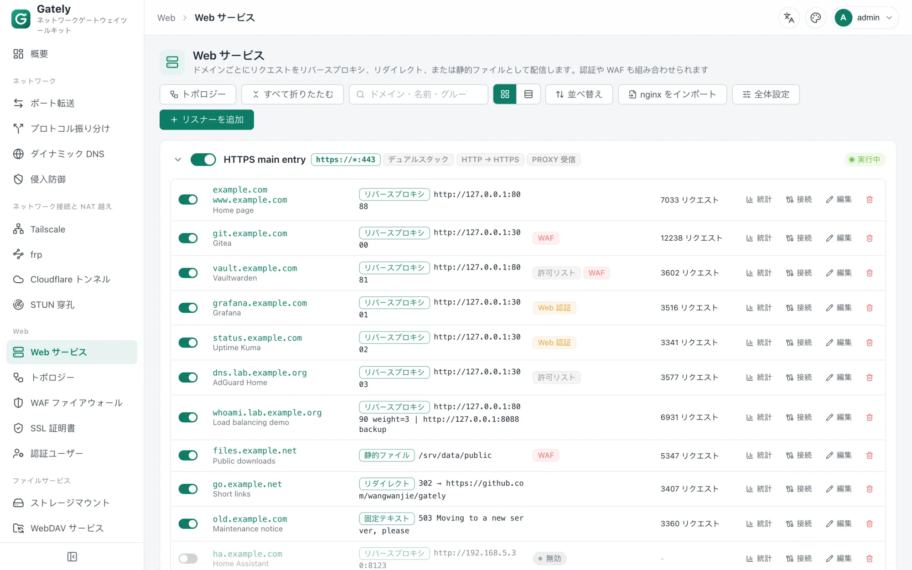

<p><b>サイト統計</b> — リクエスト数、エラー、バックエンドの状態、アクセス元 IP と国のランキングを分単位で集計します。</p>

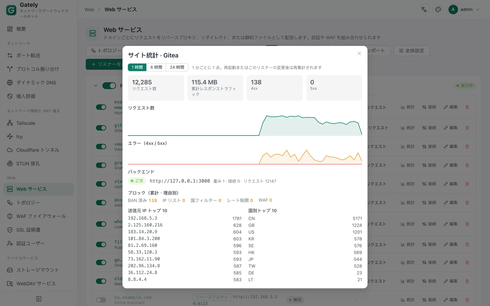

### ネットワークトポロジー

訪問者からリスナー、サイト、バックエンドへ流れるトラフィックをリアルタイムで確認できます。ノードを選ぶと QPS、通信量、アクティブ IP が表示され、訪問者 IP での絞り込み、7 種類のレイアウトの切り替え、スクリーンショットを共有する前のアドレスのマスキングにも対応します。

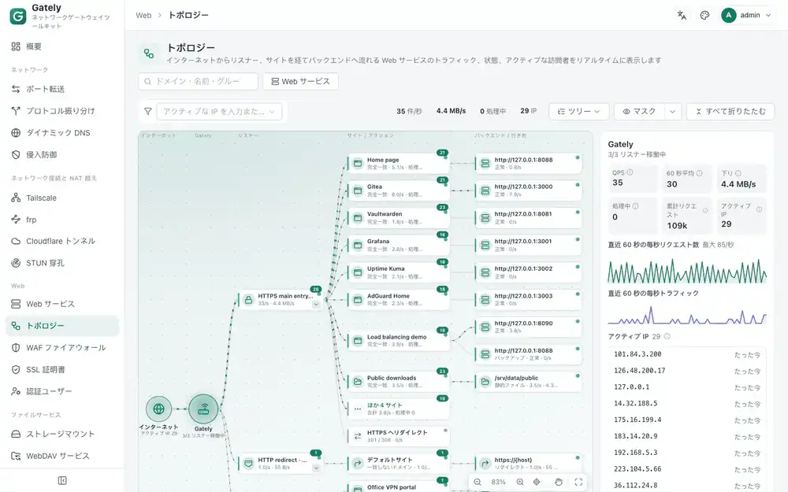

### 443 番ポートひとつを全サービスで共有

プロトコル振り分けで、複数のサービスをドメインやプロトコルごとに同じポートへ振り分けます。TLS はそのままパススルーし、PROXY プロトコルで実際のクライアントアドレスを渡します。

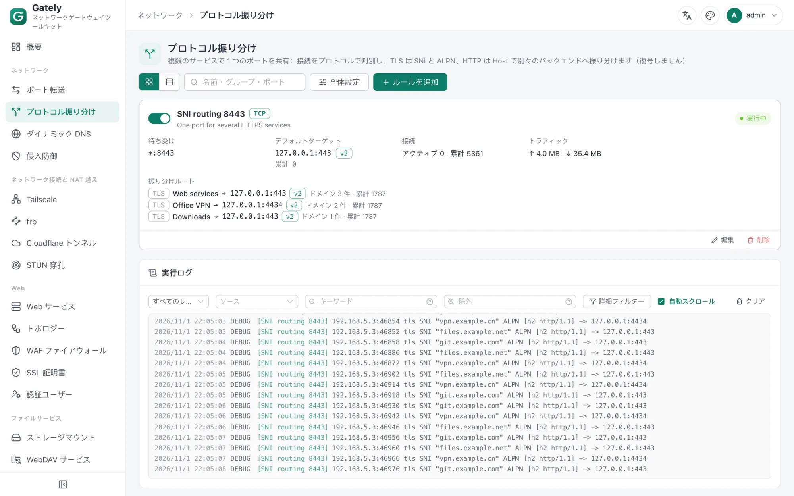

### 主要プロバイダーに対応したダイナミック DNS

Cloudflare、Alibaba Cloud、DNSPod、Route 53 などに対応。IPv4 と IPv6 の両方を扱い、IP は URL、ネットワークインターフェース、コマンドから取得できます。アドレスが変わればすぐに通知します。

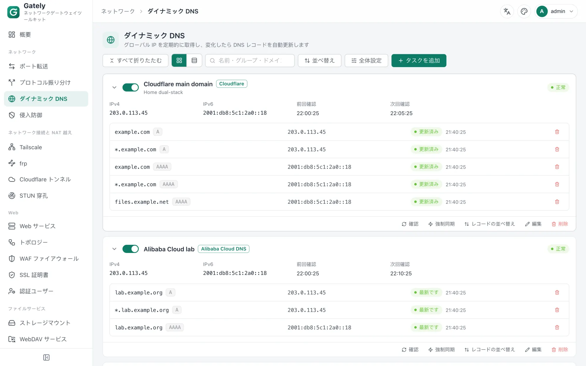

### 侵入防御

fail2ban 風のルールがログファイル、journald、コンテナのログを読み取り、トラップポートとスキャン検知で探索行為を捕まえます。ブロックは nftables に同期され、カーネルでパケットを破棄します。

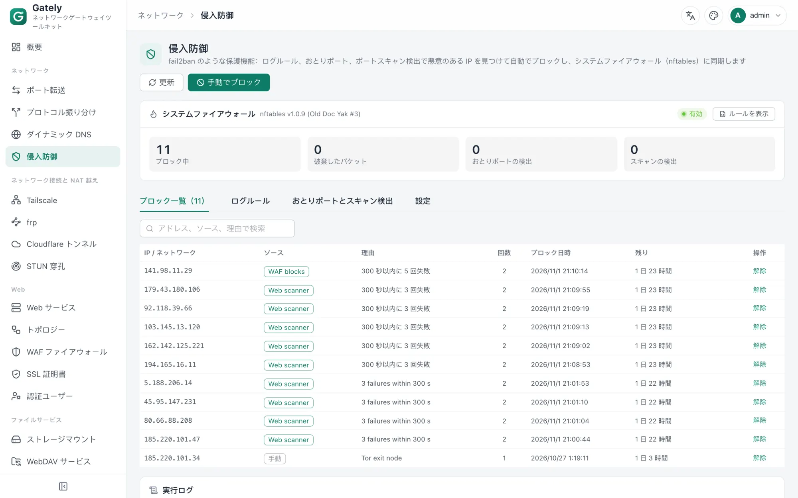

### frp、Tailscale、Cloudflare トンネル

複数の frpc・frps インスタンスを並行して動かし、Tailscale や cloudflared のトンネルと同じ画面で管理できます。これらのプログラムのインストール、更新、ロールバックは Gately が引き受けます。

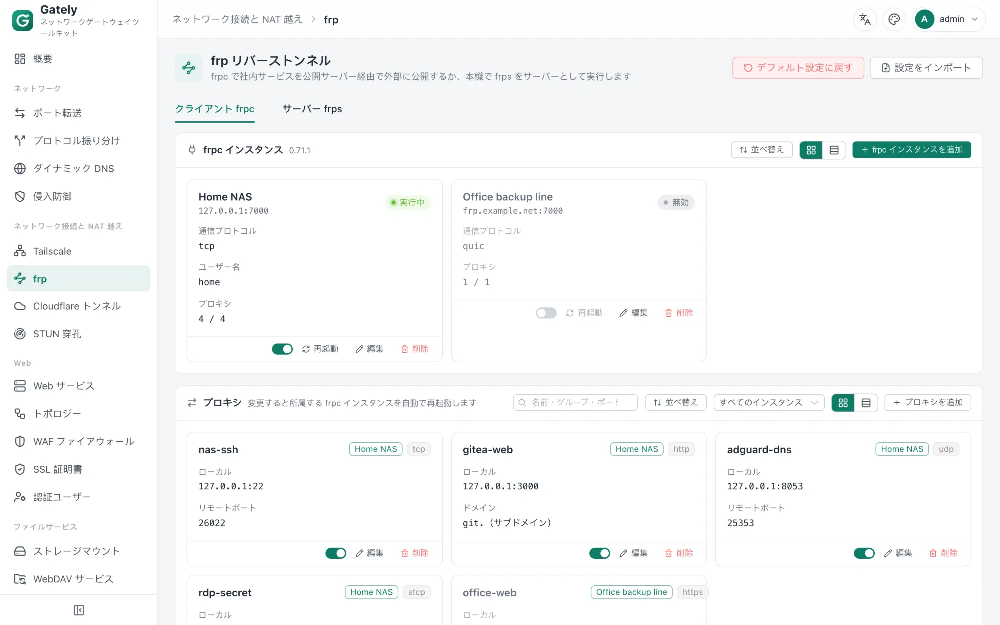

### ほかにも

<table>
<tr>
<td width="50%" valign="top">

**Docker**<br>コンテナ、Compose、ログ、ターミナル。イメージはワンクリックで更新でき、失敗すれば自動でロールバックします。

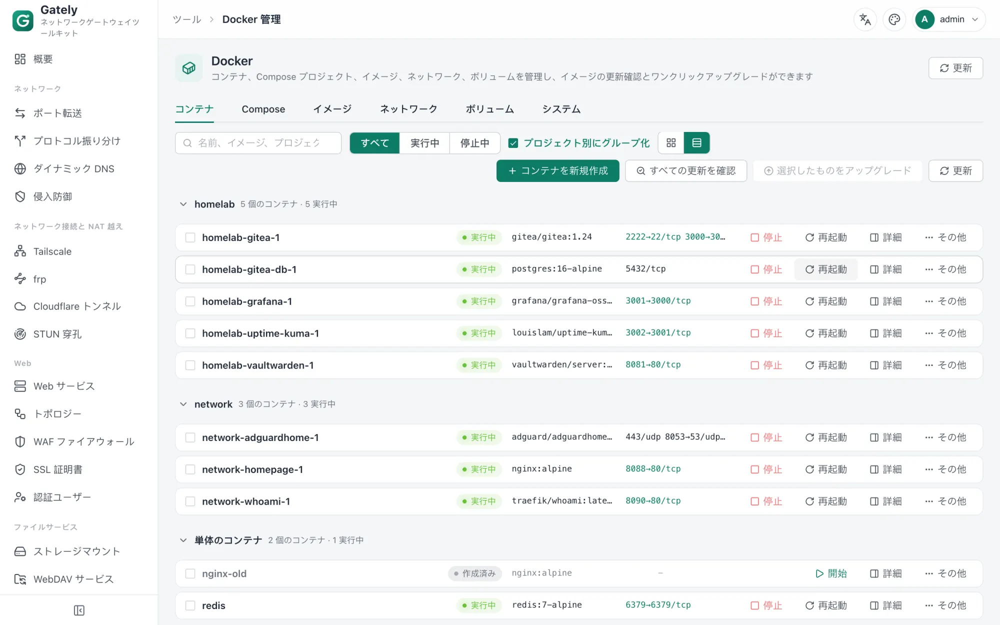

</td>
<td width="50%" valign="top">

**Web ターミナル**<br>ブラウザーで SSH、Telnet、ローカルシェルを使えます。SFTP と画面分割にも対応。

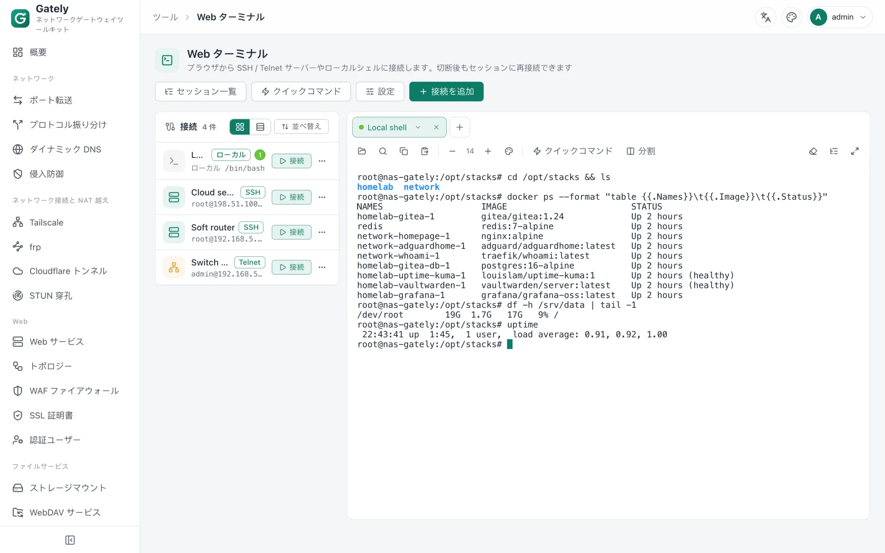

</td>
</tr>
</table>

<table>
<tr>
<td width="50%" valign="top">

**設定履歴**<br>変更のたびに以前のバージョンを保存。差分を確認して、ワンクリックで戻せます。

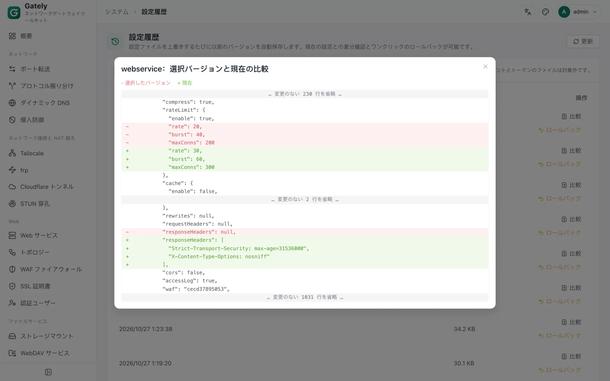

</td>
<td width="50%" valign="top">

**API、CLI、MCP**<br>モジュール単位で権限を付けられる API トークン、組み込みの OpenAPI ドキュメント、`gately ctl`、AI アシスタントから使える MCP サーバー。

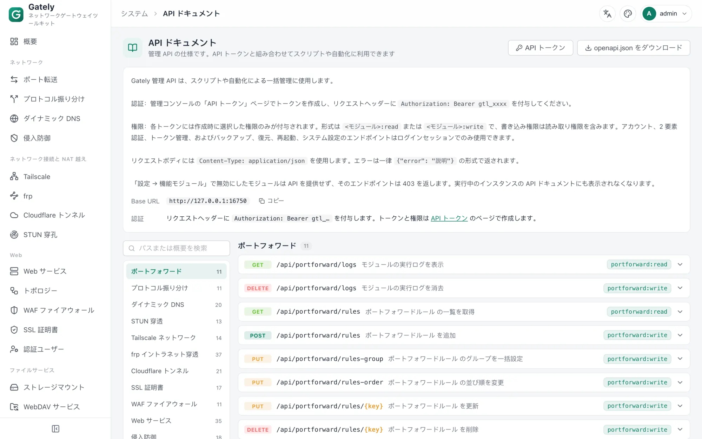

</td>
</tr>
</table>

<details>
<summary><b>全機能一覧</b></summary>

複数のモジュールが同じ部品を共有しています。STUN 穿孔、ポート転送、プロトコル振り分けは、送信元 IP の許可リスト／拒否リストと優先拒否リスト（購読 IP リストを参照可）に対応し、それぞれのポートをローカルのファイアウォールで自動開放します。Tailscale、NetBird、EasyTier、frp、Cloudflare トンネル、File Browser は外部プログラムを実行し、Gately がオンラインでインストール、更新、ロールバック、アンインストールを行います。いずれにも「デフォルト設定に戻す」操作があります。

| モジュール | 機能 |
| --- | --- |
| ダイナミック DNS | Alibaba Cloud、Cloudflare、Tencent Cloud、DNSPod、Huawei Cloud、GoDaddy、Porkbun、dynv6、DuckDNS、Amazon Route 53、OVHcloud、Gandi、NS1、Bunny DNS、Namecheap、Tencent Cloud EdgeOne、Alibaba Cloud ESA、Baidu AI Cloud、Volcano Engine、DNS.LA、Rainyun、Now.cn、Eranet、Tnet.hk、HiPM DNSMgr、Vercel、NameSilo、Dynadot、Spaceship、Name.com、Gcore、ClouDNS、deSEC、DynDNS2（No-IP、Dynu など）、カスタムコールバック |
| ダイナミック DNS：タスク | URL／ネットワークインターフェース／コマンドによる IP 取得、IPv4/IPv6、Webhook；グループ分け・並べ替え・検索；メモをプロバイダーに書き込み、タスク削除時にプロバイダー側のレコードも削除可能 |
| STUN 穿孔 | TCP/UDP、キープアライブ、UPnP/NAT-PMP、内蔵フォワーディング、アドレス変更時の Webhook・スクリプト実行 |
| ポート転送 | TCP/UDP、IPv4/IPv6、ポート範囲、複数ターゲットのフェイルオーバー、接続数制限、トラフィック統計、PROXY プロトコル（v1/v2）；グループ分け・並べ替え・検索 |
| プロトコル振り分け | 443 などの 1 つのポートを複数のサービスで共用し、復号せずにそのまま中継：TLS は SNI と ALPN、HTTP は Host、Minecraft はサーバーアドレスで振り分け、SSH、RDP、SOCKS、OpenVPN、RTSP、SIP、XMPP、MQTT、AMQP、PostgreSQL、Redis、SMB、Git、IRC、ADB、BitTorrent も判別し、VNC のようにサーバーが先に送るプロトコルは待機タイムアウトのルートへ；デフォルトターゲット、ルートごとの PROXY プロトコル設定 |
| SSL 証明書 | ACME による自動発行・更新（DNS-01 はワイルドカード対応で、委任されたサブドメインの DNS ゾーンを SOA で自動判別、HTTP-01 は DNS プロバイダー不要）；EAB、アップロード、ファイル読み込み、ディレクトリへのマッピングとスクリプト実行 |
| SSL 証明書：IP と短期証明書 | 短期証明書とグローバル IP アドレス証明書（Let's Encrypt の shortlived プロファイル） |
| SSL 証明書：配布 | 更新後に SSH で他のホストへ証明書を送ってコマンドを実行、または証明書を使う Docker コンテナを再起動 |
| Tailscale | tailscaled の管理（ユーザー空間ネットワーク、コンテナ対応）またはシステム既存のデーモンへの接続；認証キー／ログインリンク、Headscale、サブネットルート、出口ノード、ノード一覧、SOCKS5 プロキシ、固定ポート、追加引数と環境変数；Linux でオンラインインストール |
| NetBird | NetBird クラウドまたはセルフホストの管理サーバーに参加；netbird デーモンの管理（ユーザー空間ネットワーク、他のピアからローカルサービスへアクセス可能）または既存のシステムサービスへの接続；セットアップキー／ログインリンク、ルート、ルーティングピア、DNS、受信拒否、ピア一覧（直接／リレー、遅延）、SOCKS5 プロキシ；Linux・macOS・Windows でオンラインインストール |
| EasyTier | easytier-core の管理：P2P ホールパンチ優先、自前またはお好みのリレーノードに対応、ユーザー空間ネットワークとポート転送、サブネットプロキシ、出口ノード、KCP / QUIC プロキシ |
| frp | 複数の frpc / frps インスタンス：frpc（tcp/udp/http/https/stcp/xtcp プロキシ、変更は即時反映、アクセスアドレスをクリックで開く・コピー）と frps（ポート許可リスト、サブドメイン、ダッシュボード、送信元 IP による frpc ログインの制限）；旧形式の ini／新形式の toml 設定をワンクリックでインポート |
| Cloudflare トンネル | cloudflared のトークントンネルと trycloudflare の一時トンネル、複数トンネル、自動再起動、パブリックアドレス表示；トークントンネルのルートを Cloudflare API で編集し DNS レコードを作成 |
| WAF | Coraza + OWASP CRS v4、ファイル単位のルール有効化、カスタム SecLang、ブロック／検知のみ；自前で構築した SafeLine（雷池）検知エンジンにも接続可能；このインスタンスの管理者セッションは WAF を通らず、ログイン済みユーザーを信頼する設定も可能 |
| WAF：大きなリクエスト | リクエストボディの検査上限を調整でき、上限超過時は先頭部分のみ検査またはパス単位で省略できるため、クラウドドライブや WebDAV などのアップロード用サイトにも WAF を適用可能 |
| 侵入防御：ジェイル | fail2ban 風のログルール（ログファイル、systemd ジャーナル、コマンド出力、Docker コンテナのログ、管理画面のログイン失敗、WAF ブロック、拒否されたポートノック）と、SSH・Nginx・Vaultwarden などのテンプレート |
| 侵入防御：探索検知 | おとりポートとポートスキャン検出（Gately の各モジュールの開放ポート（frpc が申請するリモートポートを含む）を自動認識、IPv6 厳格モードは /64 単位でブロック、ブロック理由にヒットしたポートを記録）；Web パス探索のブロック：リスナーごとにおとりパス（/.env、/.git など）、未知ドメインのスキャン、連続する 404 を集計；TLS ハンドシェイク失敗のブロック：失敗の種類（途中切断、リセット、タイムアウト、非 TLS など）とリスナーごとに集計 |
| 侵入防御：ブロック | 手動のネットワーク・永久ブロック、段階的な期間、ホワイトリストを備えた統一ブロック一覧；システムファイアウォール（nftables / iptables + ipset）に同期してカーネルで破棄、nftables のない環境では Gately 自身のサービスに適用 |
| ポートノッキング | fwknop クライアント互換のシングルパケットノック（SPA）：AES-256 暗号化、HMAC 認証、リプレイ防止、時間窓；保護対象ポートはシステムファイアウォール（nftables / iptables + ipset）でブロックし、ノックに成功したアドレスだけを限られた時間許可、確立済みの接続は影響を受けません |
| ポートノッキング：連携 | ポート転送、プロトコル振り分け（ルートごとに指定可）、STUN は「ノックが必要」を選べ、ファイアウォール権限は不要；プロトコル振り分けは TCP で届いたノックパケットを受け付け、外部に開放するポートは 1 つで済みます；Web ログイン後に許可：訪問者が Web サイトにログインするとその IP に許可を付与（IPv6 は /64 単位、システムファイアウォールにも書き込み可）、クライアントは不要；拒否されたノックは侵入防御でブロック可能 |
| Docker 管理 | コンテナの作成と編集、ログとターミナル、Compose、イメージ更新チェックとワンクリックアップグレード（失敗時は自動ロールバック）、ネットワークとボリューム；pull、ビルド、Compose、一括アップグレードなどのバックグラウンドタスクは途中で停止可能 |
| Docker：自己アップグレード | Gately 自身が動作するコンテナを一時ヘルパーコンテナ経由で更新し、失敗時は旧コンテナを復元 |
| Web ターミナル | SSH（ホストキーは初回接続時に信頼）、Telnet、ローカルシェル（既定は無効）；プロキシ、永続セッション、SFTP ファイル管理、2FA とプロトコル確認、クイックコマンド、画面分割；スマートフォンでの長押し選択とコピー、貼り付けパネルとクリップボード履歴 |
| ネットワーク診断 | Ping、トレースルート、ポート探査、DNS 照会、速度測定、LAN スキャン |
| 通知センター | Webhook、Telegram、Bark、ntfy、Gotify、Pushover、Discord、Slack、ServerChan、PushPlus、WeCom、DingTalk、Feishu、メール；レベル、ワイルドカード、サイレント・重複排除ルール；全体またはチャネルごとのプロキシ（HTTP と SOCKS5）；組み込みルールテンプレート（重大な障害、証明書の期限、アドレス変更、ログイン、設定変更、バージョン更新）；管理画面への新しいアドレスからのログイン通知 |
| 設定バックアップ | 暗号化バックアップ（scrypt + AES-GCM）、保持ポリシー、ローカルディレクトリやストレージのマウントポイントへの定期バックアップ |
| コマンドラインと MCP | `gately ctl` で稼働中のインスタンスを操作、`gately mcp` で stdio 経由の MCP サービスを提供（既定は読み取り専用） |
| Wake-on-LAN | マジックパケットのブロードキャスト、オンライン検出；Bemfa 音声操作（Xiao AI、Xiaodu、Google Assistant） |
| Wake-on-LAN：シャットダウン | デバイス上のエージェント（Windows/Linux/macOS/OpenWrt、デバイス側から接続するためポート開放は不要）、Web ターミナルの SSH コマンド、HTTP リクエストによるリモートのシャットダウン・再起動・スリープ |
| WebDAV、FTP、SMB | 複数ユーザー、ユーザーごとのディレクトリ、読み取り専用；3 つのサービスで共通の共有ユーザー；FTP は FTPS とパッシブポート範囲、SMB はユーザーごとに複数ディレクトリを共有、SMB 2/3・暗号化・Bonjour 検出にも対応 |
| File Browser | Web ファイルマネージャー FileBrowser Quantum をホスト：複数インスタンス、複数の共有ディレクトリと読み取り専用、パスワードまたはリバースプロキシ認証 |
| ストレージマウント | ローカルディレクトリ、リモート WebDAV、SMB 共有のマウント、オンラインファイル管理 |
| スケジュールタスク | cron 式、コマンドまたは HTTP リクエスト、実行履歴 |
| リスト管理 | ルール、インスタンス、証明書、DNS レコード、ターミナル接続、API トークンなどのリストで、グループ化・手動並べ替え（ドラッグまたは矢印、複数選択で一括移動）・検索に共通対応し、複数選択して一括で有効化・無効化・削除が可能；Web サービスのサイトはドメインの一括追加・削除・置換とオプションの一括変更、編集・一括・ドラッグによる別リスナーへの移動にも対応；多くのリストはカード表示とコンパクト表示を切り替え可能；並べ替えやグループ変更でサービスは再起動せず、スマートフォンでも操作可能；多くの項目を複製して編集でき、保存済みの秘密情報は引き継がれる |
| 管理者ログイン | パスキー（WebAuthn）ログイン、2 段階認証（TOTP）、読み取り専用アカウント、ログイン失敗のレート制限（段階的なロックアウト）、未知のアドレスの失敗上限（分散した総当たり攻撃への対策）、脆弱なパスワードの検出とパスワード変更の強制、パスワードログインの無効化（Passkey のみ）、セキュリティスコア |
| 管理画面へのアクセス | セキュアエントリー、内部ネットワークのみのアクセス、管理ポートを隠すための未認可アクセスへの応答設定（通常の 404・空白ページ・接続切断・無応答・カスタムページ）、管理画面の HTTPS、ローカルのリバースプロキシから実際のクライアントアドレスを取得 |
| 設定 | 複数の API トークン（モジュール単位の読み書き権限）、保存済みのパスワードやキーの表示（書き込み権限が必要）、カスタム DNS（DoH 対応）、タイムゾーン、設定のバックアップと復元、機能モジュールの個別オン／オフ（無効にしたモジュールはサービスを起動せず、API も提供しません） |
| 更新チェック | 新しいバージョンとセキュリティアドバイザリーの自動チェック（GitHub に匿名でアクセス、無効化可能）。公開済みのセキュリティ問題の影響を受ける場合は目立つ表示と通知でお知らせ |
| fnOS ネイティブアプリ | オフライン `.fpk` パッケージ（x86 / ARM）；fnOS 統一ゲートウェイに統合され、fnOS デスクトップのアイコンから開け、fnOS のリモートドメインでも利用可能；fnOS 管理者は fnOS のログイン状態でそのままログイン可能（既定は無効）；root で動作し、80/443 の待ち受けと Docker の管理が可能 |
| 監査と履歴 | ログイン、設定変更、機密情報へのアクセスを記録する監査ログ（リクエスト本文やシークレットは一切記録しません）；上書きされた設定ファイルは以前のバージョンを保持し、差分表示とワンクリックでのロールバックが可能；GitOps 向けの宣言的設定ディレクトリ（`-apply`） |
| 監視 | パフォーマンスパネル：ホスト、Gately プロセス、サイトの 60 秒 / 1 時間 / 24 時間の推移（最初のバイトまでの時間 P50 / P95 を含む）；管理対象プロセス（frp、Tailscale、NetBird、cloudflared、File Browser）の CPU とメモリ；しきい値アラート（指標 + しきい値 + 継続時間）の発報と復旧を通知センターから送信 |
| メトリクスとセルフチェック | グローバルな Prometheus エンドポイント `/api/metrics`（証明書、DDNS、STUN、ポート転送、Web サービス）とすぐに使える Grafana ダッシュボード；ワンクリックのネットワークセルフチェック（グローバル IP、CGNAT、時刻、80/443 ポート、DDNS の名前解決、証明書の期限、HTTPS サイトの証明書不足、frp プロキシの競合） |
| 移行 | nginx 設定のインポート（`nginx -T` の出力に対応）: リバースプロキシと upstream、静的ディレクトリ、リダイレクト、パスごとのバックエンド、アクセス制御、`auth_request` はフォワード認証に変換 |

#### Web サービス

各機能の詳細は [Web サービスのドキュメント](https://gately.cn/ja/docs/modules/web)を参照してください。

| 項目 | 機能 |
| --- | --- |
| サイトの種類 | リバースプロキシ、リダイレクト、静的ファイル（拡張子なし URL、カスタム 404 ページ）、固定テキスト、接続を切断（nginx の `return 444` 相当）、ナビゲーションパネル |
| リスナーとプロトコル | HTTPS、HTTP/3（QUIC）、同一ポートでの HTTP と HTTPS の共存（リダイレクトまたはそのまま提供）、リスナーごとの追加 HTTP ポート（443 に加えて 80 など）、WebSocket、gRPC 向けの平文 HTTP/2（h2c）バックエンド、PROXY プロトコルの送受信、ローカルのファイアウォールでポートを自動開放 |
| バックエンド | パスごとのバックエンド、ログインユーザーごとのバックエンド（nginx の `map $remote_user` 相当。リダイレクト／静的ファイル／ナビゲーションパネル／固定テキストのサイトにも適用）、重み・スタンバイ・負荷分散ポリシー、アクティブ／パッシブのヘルスチェック、接続失敗時の次のバックエンドへの自動リトライ、接続・TLS ハンドシェイク・レスポンスヘッダーのタイムアウト、訪問者の読み書きアイドルタイムアウト、アクセスされたドメインを SNI として送る HTTPS バックエンド、パスの書き換えとプレフィックスの除去 |
| ログイン認証 | Basic 認証、Web 認証、GitHub / Google / QQ / OIDC ログイン、TOTP による 2 段階認証・パスキー・自分でのパスワード変更に対応した共有ユーザー、サブドメイン間のシングルサインオン、共有ユーザーで Gitea や Grafana などの OpenID Connect アプリにログインできる内蔵 OIDC プロバイダー、Authelia などの外部サービスへのフォワード認証、公開側の Gately から LAN 内の Gately へのログイン Cookie の転送、ログインユーザーのユーザー名・メール・表示名・グループをバックエンドへ渡すリクエストヘッダー、管理画面ログインによる認証省略（管理画面にログイン済みの管理者は再認証なしでサイトにアクセスでき、親ドメインをまたいでも有効）、ログイン済みユーザーを信頼（WAF とパス探索を省略） |
| アクセス制御 | IP 許可・拒否リストと定期更新される購読 IP リスト（中国の省・市の IP 範囲など）、許可リストより先に判定する優先拒否リスト（悪意ある IP のフィード向き）、GeoIP による国別フィルタ、パスルール、一時共有リンク、認証失敗時の自動ブロック、ノック許可（ノックで許可されていない接続元はサイトに到達できません）とログイン後の許可、拒否時に 403 を返さず接続を切断 |
| パフォーマンス | 圧縮、レート制限、レスポンスキャッシュ（パスごとのルール：オフ／独自の保持時間／強制）とキャッシュの消去 |
| エラーページ | 404 と 5xx のページを 10 種類の組み込みスタイルまたは独自の HTML（アップロードまたはサーバー上のファイル、検査済みでサンドボックス内に表示）から選択、バックエンドのエラーの置き換えも可能（nginx の `proxy_intercept_errors` 相当） |
| 可視化 | 分単位のアクセス統計と Prometheus メトリクス、サイトごとのリアルタイム接続（切断やブロックが可能）、リスナーからサイト、バックエンドへの QPS・通信量・アクティブ IP をリアルタイムで示すトポロジービュー（IP ごとのパスのハイライト、アドレスのマスキング、「アクティブのみ」へのフォーカス、メモリ上に容量ベースで保持する記録済みスナップショットのリプレイ（既定は無効））、アドレスごとの訪問者監査（サイト、パス、ID、ブロック率、保持期間）、日次の圧縮アクセスログアーカイブとエクスポート |
| ナビゲーションパネル | サイトとして提供するリンクページ：LAN 内の訪問者には LAN アドレスを表示、組み込みアイコン、そのほかのアクセス方法、管理画面と同じテーマ、検索エンジン、背景画像、ログイン時のみ表示するリンク、カードサイズ、訪問者の言語メニュー、カスタムフッター |
| 運用 | 変更しても開いている接続は切れません、サイトのグループ化・並べ替え・検索、信頼できるプロキシ（CDN、WAF）のヘッダーから訪問者の実 IP を取得、ドメインはクリックで開き、完全なアドレスとしてコピー可能 |

</details>

## インストール

最も手軽なのは Docker です（[試してみる](#試してみる)を参照）。そのほかの方法：

<details>
<summary><b>バイナリ</b></summary>

[Releases](https://github.com/wangwanjie/gately/releases) からお使いのプラットフォーム向けのアーカイブ（Linux amd64/arm64/arm/mips/mipsle/riscv64、macOS、Windows、FreeBSD）をダウンロードし、展開して実行します。

```bash
./gately -c /etc/gately
```

オプション: `-c` は設定ディレクトリ（環境変数 `GATELY_CONFIG_DIR` でも指定可能）、`-listen` は管理画面の待ち受けアドレスの上書き、`-apply` は起動のたびにディレクトリ内の `<name>.json` を設定ディレクトリに適用（`GATELY_APPLY_DIR`、GitOps や Kubernetes に便利。アカウントとトークンのファイルは上書き不可）、`-version` はバージョン表示です。無人インストールでは `GATELY_INITIAL_PASSWORD` を設定すると、デフォルトのパスワード `gately.cn` の代わりに管理者の初期パスワードを指定できます。

起動時の自動実行: 展開後に `sudo ./gately service install` を実行します（Windows では管理者権限のターミナルで `.\gately.exe service install`）。Linux では systemd サービス、macOS では launchd デーモン（`-user` を付けると sudo なしでログイン項目として登録）、Windows ではサービスとして登録し、すぐに起動してクラッシュ後は自動で再起動します。設定ディレクトリの既定値は `/etc/gately`、`/usr/local/etc/gately`、`%ProgramData%\Gately` で、`-c` と `-listen` で変更できます。サービスは実行ファイルのパスを参照するため、先に最終的な場所へ配置してください。以降は `gately service uninstall|start|stop|restart|status` で管理でき、アンインストールしても設定ディレクトリは残ります。

サービステンプレート: [systemd](../../deploy/systemd/gately.service)、[OpenWrt procd](../../deploy/openwrt/gately.init)。ダウンロードしたアーカイブやイメージの検証（cosign 署名、ビルド来歴、SBOM）は[リリース成果物の検証](../ja/VERIFY.md)を参照してください。

</details>

<details>
<summary><b>fnOS ネイティブアプリ</b></summary>

各 Release には fnOS 向けのオフラインパッケージ `gately_<version>_fnos_x86.fpk`（Intel/AMD）と `gately_<version>_fnos_arm.fpk`（ARM）が含まれます。公式のアプリセンターには掲載されていないため、手動でインストールします。**アプリセンター → 手動インストール**（左下のボタン）を開き、ファイルを選んでウィザードを完了してください。

- **fnOS 統一ゲートウェイに対応**：fnOS デスクトップの Gately アイコンをクリックすると、管理画面が fnOS 統一ゲートウェイ経由で `/app/gately/` 配下に開き、fnOS と同じアクセス入口を共用します。LAN のアドレスでも fnOS のリモートドメインでもそのまま使え、16680 ポートを開放・転送する必要はありません。ゲートウェイ経由のアクセスは fnOS が制御する（fnOS 管理者だけが開けます）ため、セキュアエントリーと「LAN 内からのみ許可」は 16680 ポートへの直接アクセスにのみ適用されます。
- **fnOS 管理者は fnOS のログイン状態でそのままログイン**：**設定 → アクセス制御 → fnOS のログイン状態で自動ログイン** を有効にすると、fnOS にログイン済みの管理者はデスクトップのアイコンからパスワードや 2 段階認証コードなしで Gately に入れます。一般の fnOS ユーザーは引き続きログインが必要です。ログアウトした後は、自動で再ログインせず、ログイン画面に「fnOS アカウント &lt;ユーザー名&gt; でログイン」ボタンが表示されます。この設定は既定で無効で、fnOS パッケージでのみ表示されます。
- LAN 内では `http://<NAS のアドレス>:16680` でも管理画面にアクセスできます。デフォルトのアカウントは `admin`、パスワードは `gately.cn` です。
- アプリは `root` で動作するため、80/443 の待ち受け、`docker.sock` を通じた Docker の管理、実際の Web ターミナルが利用できます。自分で管理している NAS にのみインストールしてください。
- 設定はアプリの `var` ディレクトリに保存され、アンインストール時も保持されます。アンインストールウィザードで「すべて削除」を選んだ場合のみ消去されます。アップグレードは新しい `.fpk` を再度手動インストールするだけです。
- パッケージには `gately` コマンド（`/usr/local/bin/gately`）も含まれ、`gately ctl` と `gately mcp` を使えます。
- 16680 ポートは Docker イメージと共通です。ネイティブアプリを起動する前に `gately` コンテナを停止してください。
- ダウンロードしたファイルは [リリース成果物の検証](../ja/VERIFY.md) の手順で検証できます。`.fpk` ファイルも `checksums.txt` に記載されています。

</details>

<details>
<summary><b>OpenWrt</b></summary>

各 Release には OpenWrt 向けパッケージが含まれます。`gately_<version>_openwrt_<arch>.ipk` は OpenWrt 24.10 以前（iStoreOS を含む）向けで `opkg install` で、`.apk` は OpenWrt 25.12 以降向けで `apk add --allow-untrusted` でインストールします。アーキテクチャは amd64 / arm64 / arm / mipsle / mips / riscv64 で、`/etc/openwrt_release` の `DISTRIB_ARCH` に合わせて選びます（対応表は[インストールガイド](https://gately.cn/ja/docs/guide/install#openwrt)を参照）。

- インストール時に自動起動が有効になり、サービスが起動します。管理画面は `http://<ルーターのアドレス>:16680` で、デフォルトのアカウントは `admin`、パスワードは `gately.cn` です。
- 設定は `/etc/gately` に保存され、アップグレード、アンインストール、ファームウェアの更新（sysupgrade）でも保持されます。アップグレードは新しいパッケージをインストールするだけです。「バージョン情報」ページのオンラインアップグレードでは、パッケージマネージャーを使うよう案内されます。
- バイナリは約 32 MB のため、x86 の OpenWrt 機器や ARM64 ボックスなどストレージに余裕のあるデバイス向けです。arm パッケージにはハードウェア浮動小数点に対応した ARMv7 が必要です。
- アーキテクチャに依存しない LuCI アプリ `luci-app-gately_<バージョン>_openwrt_all.ipk` / `.apk` も用意しています。LuCI の「サービス → Gately」で実行状態の確認、開始・停止、自動起動と管理画面ポートの設定、管理画面へのワンクリック移動ができます。

</details>

## 運用

監視、API、管理対象プログラムにはそれぞれ[ドキュメント](https://gately.cn/ja/docs/guide/introduction)に専用ページがあります。ここでは要点だけをまとめます。

<details>
<summary><b>監視</b></summary>

`metrics:read` 権限だけを持つ API トークンを作成し、Prometheus から `/api/metrics` をスクレイプします。メトリクス、アラート例、Grafana ダッシュボードは[監視](../ja/MONITORING.md)で説明しています。

</details>

<details>
<summary><b>API の利用</b></summary>

管理コンソールの「API トークン」ページでトークンを作成します（複数作成可能で、モジュールごとに読み取り専用または読み書きを付与でき、有効期限も設定できます。平文は作成直後に一度だけ表示されます）。スクリプトから管理 API を一括で呼び出せます。

```bash
curl -H "Authorization: Bearer gtl_xxxx" http://localhost:16680/api/ddns/tasks
```

アカウント、2 段階認証、トークン管理、およびバックアップ、復元、再起動、システム設定の API はログインセッションでのみ利用できます。すべての API、必要な権限、データ構造は管理コンソールの「API ドキュメント」ページで確認できます。`make api-docs` で [docs/api](../api/ja)（`openapi.json` と `API.md`）にエクスポートすることもでき、公式サイト https://gately.cn の公開時にそのまま参照されます。

旧バージョンからアップグレードすると、従来のグローバル API トークンは自動的に「レガシートークン」になります（値は同じで、全モジュールの権限を持ちます）。API トークンページで権限を絞るか、新しいトークンに切り替えることを推奨します。

</details>

<details>
<summary><b>Tailscale、NetBird、EasyTier、frp、cloudflared</b></summary>

この 5 つのモジュールは公式の外部プログラムを管理します（自動再起動、ログは画面に集約）。Gately 本体には同梱していません。各モジュールページの「オンラインインストール」カードは上流から最新の安定版または指定バージョンをダウンロードし、SHA-256 を検証して設定ディレクトリの `bin/` にインストールし、それを使うプロセスを再起動します。プログラムごとにダウンロードプロキシを設定でき、空欄の場合は「設定」の更新プロキシを使います。置き換えられたバージョンは直近 3 個まで保持され、新バージョンに問題があればワンクリックでロールバックできます。不要になったプログラムはアンインストールできます。ページヘッダーの「デフォルト設定に戻す」はアンインストールとは別の操作で、プロセスを停止し、モジュール設定をリセットし、Gately が生成したファイル（frp の設定ファイル、File Browser のインスタンスデータ、Tailscale と NetBird のログイン状態）を削除します。以前の設定は設定履歴から復元できます。Tailscale がそのまま実行できるパッケージを公式に提供しているのは Linux のみのため、他のシステムでは公式インストーラーを使ってパスを入力してください。プログラムは次の順に探索されます: モジュール設定で指定したパス、設定ディレクトリ配下の `bin/`、`PATH`。バイナリを自分で設定ディレクトリに置くこともできます（Docker 環境の例: `./gately-data/bin/frpc`）。Tailscale には `tailscale` と `tailscaled` の両方が必要です。設定ファイル内のトークンとキーは 0600 のパーミッションで保存され、cloudflared のトークンは環境変数で渡されるため、プロセス一覧には現れません。

File Browser モジュールは [FileBrowser Quantum](https://github.com/gtsteffaniak/filebrowser) をホストします（元の filebrowser はアーカイブされ、セキュリティ修正が行われません）。探索順とオンラインでのインストール・更新・ロールバックは上記と同じで、インストール先は `bin/filebrowser` です。管理者パスワードは環境変数で渡され、設定ファイルには書き込まれません。

</details>

## パフォーマンス

SNI によるプロトコル振り分けと Web サービスを組み合わせると、よくある haproxy（SNI による TCP 振り分け）+ nginx（TLS とリバースプロキシ）の構成を置き換えられます。下の表は、実際のサーバーに近い設定で、同じマシン上の両者を比較したものです。90 個のドメインを SNI で振り分け、2 つのホップ間は PROXY プロトコル v2、証明書は ECDSA P-256、TLS 1.3 を使用しています。

| シナリオ | haproxy + nginx | Gately |
| --- | --- | --- |
| HTTPS リバースプロキシ、Keep-Alive、1 KB のレスポンス、64 接続 | 14,767 req/s（p99 35.9 ms） | **26,434 req/s**（p99 5.7 ms） |
| 同条件で HTTP/2 | 未テスト（使用した nginx の設定は HTTP/1.1） | 27,795 req/s |
| リクエストごとに新しい TLS 接続、32 並列 | 2,557 req/s | **3,448 req/s** |
| 1 MB のレスポンス、16 接続 | 1,053 MB/s | **1,585 MB/s** |
| TLS ストリームの SNI パススルー、4 接続 | 2,927 MB/s | **4,962 MB/s** |
| SNI パススルー、1 秒あたりの新規接続数、64 並列 | 6,334 /s | 6,266 /s（ほぼ同等） |
| 負荷時のメモリ | haproxy ≈ 21 MB + nginx ≈ 21 MB | ≈ 110 MB（全モジュールを含む単一プロセス） |

<details>
<summary><b>測定方法</b></summary>

- ホスト：Intel Core i5-13500T。小規模なクラウドサーバーに合わせて、各構成を CPU 2 コアに制限しました（haproxy と nginx は Docker の `--cpuset-cpus`、Gately は `taskset` で固定）。バックエンドと負荷生成ツールは別のコアで動かしました。
- haproxy は `mode tcp`、`req_ssl_sni` ルール、`send-proxy-v2` を使用しました。nginx は `worker_processes 2` と本番サイトのプロキシ設定を使用しており、この設定では `Connection: upgrade` を送るため、リクエストごとにバックエンドへの新しい接続が作られます。アップストリームの Keep-Alive を有効にしてチューニングした nginx であれば、小さなレスポンスでの差は縮まります。
- Gately の経路は、SNI ルール、PROXY v2、Web サービスのリスナーの順で、haproxy → nginx と同じホップ数です。
- 各ケースは 10 秒間実行し、繰り返したケースの結果は 3% 以内で一致しました。実際の 2 vCPU のクラウドホストでは、静的サイトは 5.5k req/s 対 3.4k req/s でした。クライアントが X25519 を使うと、新規 TLS 接続は同等（どちらも毎秒約 480〜550）でした。Go のクライアントや最近のブラウザが提供するポスト量子ハイブリッド鍵交換を使うと、この測定では Gately のハンドシェイク完了数は約 13% 少なくなりました。
- 結果はハードウェア、設定、トラフィックによって変わります。Gately が haproxy と nginx に引けを取らないことの目安として捉え、実際のワークロードで測定してください。

</details>

## 開発

必要環境: Go 1.26+、Node.js 24+、pnpm。

```bash
make web      # フロントエンドをビルド（web/dist に出力、go:embed で埋め込み）
make build    # bin/gately をコンパイル
make test     # go test -race ./...
make lint     # gofmt、go vet、フロントエンドの型チェック
```

カスタムビルドのタグ、追加の環境が必要なテスト、モジュールの要件、i18n の手順は [CONTRIBUTING.md](../../CONTRIBUTING.md)（英語）にまとめています。ディレクトリ構成と技術選定は [docs/ja/ROADMAP.md](../ja/ROADMAP.md) を参照してください。公式サイト（[gately.cn](https://gately.cn)）のソースは `website/` にあり、VitePress で構築されています: `cd website && pnpm install && pnpm dev`。

## リリースポリシー

- Gately は 1.0 未満です。バージョン番号は最大 4 つの数字で構成され（例: `v0.6.6.6`）、マイナーバージョンの後続リリースでは最後の数字が増えます。
- `v*` タグごとに[リリースワークフロー](../../.github/workflows/release.yml)が実行され、バイナリ、OpenWrt と fnOS のパッケージ、マルチアーキテクチャの Docker イメージをビルドし、成果物に署名します。イメージにはバージョンタグと `latest` が付き、`latest` は常に最新リリースを指します。
- リリースは頻繁です。2026 年 10 月 17 日から 11 月 15 日までに 55 個のバージョンタグがありました。[GitHub Releases](https://github.com/wangwanjie/gately/releases) はノートをモジュールごとにまとめ、アップグレード時の注意点を明記しています。お知らせは公式サイトの[更新履歴](https://gately.cn/ja/news/)にあります。
- セキュリティ修正は最新バージョンにのみ提供されます（[SECURITY.md](../../SECURITY.md)）。本番環境では `ghcr.io/wangwanjie/gately:v0.6.6.6` のようにイメージタグを固定し、アップグレード前にリリースノートを読み、設定履歴で設定を元に戻せます。

## コントリビューション

Issue と Pull Request を歓迎します。コード、モジュール、テスト、翻訳のチェックリストは [CONTRIBUTING.md](../../CONTRIBUTING.md) にあり、参加者全員が[行動規範](../../CODE_OF_CONDUCT.md)に従います。

## コミュニティ

質問は [GitHub Discussions Q&A](https://github.com/wangwanjie/gately/discussions/categories/q-a) へ（回答は検索できます）。セットアップの共有も Discussions へ。すぐに話したいときは Telegram グループ [t.me/gately_chat](https://t.me/gately_chat) で行っています。

不具合は [GitHub Issues](https://github.com/wangwanjie/gately/issues) に報告し、[診断パッケージ](../ja/DIAGNOSTICS.md)（設定 → 診断）を添付してください。診断パッケージはローカルで生成され、パスワード、トークン、ドメイン、実際の IP は含まれません。セキュリティ上の問題は [SECURITY.md](../../SECURITY.md) の手順に従って非公開で報告してください。

## スポンサー

Gately のすべての機能は無料です。役に立ったと感じたら、USDT、[愛発電](https://ifdian.net/a/gately)、WeChat Pay で開発を支援できます。アドレスと QR コードは[スポンサーページ](https://gately.cn/ja/sponsor)にあります。

## ライセンス

[Apache License 2.0](../../LICENSE)
