<p align="center">
  <a href="https://gately.cn/ko/"></a>
</p>

<p align="center">
  <a href="https://gately.cn/ko/">공식 사이트</a> · <a href="https://gately.cn/ko/docs/guide/quick-start">문서</a> · <a href="https://github.com/wangwanjie/gately/releases/latest">다운로드</a> · <a href="https://gately.cn/ko/news/">변경 내역</a> · <a href="https://github.com/user-attachments/assets/ae5b60a4-9402-4a66-86a1-48e40038b4d0">2분 투어</a> · <a href="https://github.com/wangwanjie/gately/discussions">Discussions</a> · <a href="https://t.me/gately_chat">Telegram</a><br>
  <a href="../../README.md">English</a> | <a href="../../README.zh-CN.md">简体中文</a> | <a href="README.zh-TW.md">繁體中文</a> | <a href="README.ja.md">日本語</a> | <b>한국어</b> | <a href="README.es.md">Español</a> | <a href="README.fr.md">Français</a> | <a href="README.de.md">Deutsch</a> | <a href="README.ru.md">Русский</a> | <a href="README.pt-BR.md">Português (Brasil)</a>
</p>

<p align="center">
  <a href="https://github.com/wangwanjie/gately/releases/latest"></a>
  <a href="../../LICENSE"></a>
  <a href="https://hub.docker.com/r/vanjayak/gately"></a>
</p>

# Gately

**웹 UI를 갖춘 셀프 호스팅 게이트웨이: 리버스 프록시, 자동 HTTPS, 동적 DNS, NAT 통과, WAF, fail2ban 방식 차단을 바이너리 하나에 담았습니다.**

Gately는 홈 네트워크나 서버의 입구에 놓여 인터넷에서 내 서비스까지 이어지는 경로를 맡습니다. 도메인이 바뀌는 IP를 따라가게 하고, 인증서를 발급·갱신하고, 모든 서비스를 443 포트 하나로 라우팅하고, 그 앞에 로그인과 WAF를 두고, 탐색하는 주소는 차단합니다. 설정은 모두 브라우저에서 합니다. Apache-2.0, 텔레메트리 없음, 설정은 내 기기에 평문 JSON으로 저장됩니다.

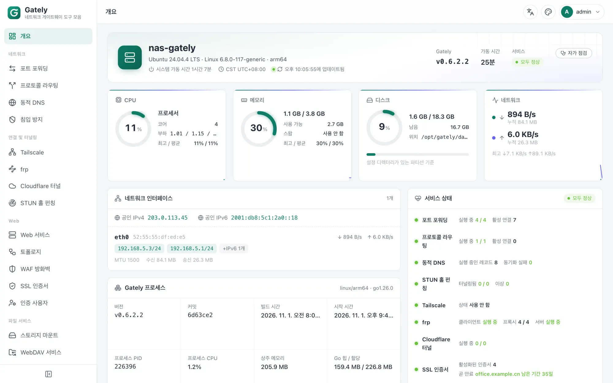

## 무엇을 대체하나

| 지금 쓰는 도구 | Gately에서는 |
| --- | --- |
| nginx 또는 Nginx Proxy Manager | 웹 서비스: 리버스 프록시, 정적 사이트, 리디렉션, HTTP/3, 사이트별 접근 규칙. nginx 설정 가져오기 지원 |
| certbot / acme.sh | DNS-01·HTTP-01 방식의 ACME 인증서, 와일드카드, 자동 갱신과 배포 |
| ddns-go 또는 DDNS 스크립트 | 30개 이상 제공업체의 동적 DNS, IPv4와 IPv6 |
| haproxy SNI 라우팅 / sslh | 프로토콜 라우팅: HTTPS, SSH, RDP 등이 포트 하나를 공유 |
| fail2ban | 로그 규칙, 미끼 포트, 스캔 탐지. 차단은 nftables 또는 iptables에서 처리 |
| ModSecurity / 별도 WAF | 사이트별 Coraza + OWASP CRS v4 |
| 앱 앞에 두는 Authelia 방식 로그인 | 내장 로그인, TOTP, 패스키, OIDC 공급자. 포워드 인증도 지원 |
| 직접 관리하는 frpc / cloudflared / tailscaled | frp, Cloudflare Tunnel, Tailscale, NetBird, EasyTier를 관리하며 설치, 업데이트, 롤백 제공 |
| 공인 IPv4가 없을 때의 포트 포워딩 우회책 | STUN 터널링: TCP / UDP 홀 펀칭, 주소 변경을 DNS 레코드, Webhook, 스크립트로 동기화 |

필요 없는 모듈은 끌 수 있고, [build.gately.cn](https://build.gately.cn)에서 고른 모듈만 담은 바이너리를 빌드할 수도 있습니다.

## 바로 써 보기

```bash
docker run -d --name gately --network host --cap-add NET_ADMIN \
  -v ./gately-data:/etc/gately \
  ghcr.io/wangwanjie/gately:latest
```

`http://<기기 IP>:16680`을 열고 `admin` / `gately.cn`으로 로그인한 뒤, 안내에 따라 나만의 비밀번호를 설정하세요. 호스트 네트워크 모드는 Gately가 설정한 포트를 수신하게 하고, `NET_ADMIN`은 차단이 호스트 방화벽에 반영되게 합니다(빼더라도 차단은 Gately 자체 서비스에 적용됩니다). Docker 모듈을 쓰려면 `-v /var/run/docker.sock:/var/run/docker.sock`을 추가하세요. 이미지는 amd64, arm64, arm/v7을 지원하며 GHCR과 Docker Hub의 `vanjayak/gately`에 게시합니다(같은 이미지이며, GHCR에 접속하기 어렵다면 이쪽을 사용하세요).

다른 설치 방법: [바이너리와 시스템 서비스](#설치) · [OpenWrt](#설치) · [fnOS](#설치) · [Docker Compose](../../deploy/docker-compose.yml) · [모든 방법](https://gately.cn/ko/docs/guide/install)

비밀번호를 잊었거나 2단계 인증기를 잃어버렸다면 서버에서 `gately reset-password` 또는 `gately reset-totp`를 실행하세요(Docker는 `docker exec -it gately gately reset-password`). 자세한 내용은 [비밀번호와 2단계 인증 재설정](https://gately.cn/ko/docs/guide/install#reset)을 참고하세요. 라우터처럼 저장 공간이 부족한 기기라면 [build.gately.cn](https://build.gately.cn)에서 필요한 모듈과 UI 언어만 골라 더 작은 바이너리, OpenWrt 또는 fnOS 패키지, 멀티 아키텍처 Docker 이미지를 생성할 수 있습니다.

## 네트워크 입구에 두어도 믿을 수 있는 이유

- **읽을 수 있고 조용함**: Apache-2.0이며, 기본적으로 프로젝트 측 서버에 연결하지 않고 기기 정보도 전송하지 않습니다. 모든 외부 주소(IP 조회, STUN, 업데이트 확인)를 확인하고 변경하고 끌 수 있습니다. 서드파티 로그인은 직접 만든 OAuth 앱을 사용하며 중계 서버를 거치지 않습니다.
- **검증 가능한 릴리스**: 모든 산출물에 cosign 서명, 빌드 출처 증명, SBOM이 포함됩니다([검증 방법](../ko/VERIFY.md)). 보안 수정은 [GitHub 보안 권고](https://github.com/wangwanjie/gately/security/advisories)로 공개합니다. `checksums.txt`에는 minisign 서명도 있으며, 온라인 업그레이드는 설치 전에 이 서명을 확인합니다.
- **모든 변경이 기록됨**: 감사 로그, 차이 비교와 원클릭 롤백을 갖춘 설정 이력, git에 넣어 둘 수 있는 평문 JSON.
- **haproxy + nginx를 따라가는 성능**: 같은 2코어에서 동일 조건으로 26k req/s 대 14.7k req/s입니다([수치와 측정 방법](#성능)).

## 기능

먼저 관리 UI 스크린숏 몇 장을 보세요. 전체 기능 목록은 이 섹션 끝에 있습니다.

### 한눈에 보는 전체 상황

개요 화면에서 CPU, 메모리, 디스크, 트래픽과 네트워크 인터페이스별 공인 IPv4 / IPv6, 모든 모듈의 상태를 한 번에 보여 주므로 손봐야 할 곳을 바로 알 수 있습니다.


### nginx를 대신하는 웹 서비스

도메인별 리버스 프록시, 정적 파일, 리디렉션을 HTTPS와 HTTP/3로 제공합니다. 사이트마다 WAF, IP 규칙, 로그인 인증을 따로 켤 수 있고, 설정을 바꿔도 기존 연결이 끊기지 않습니다.

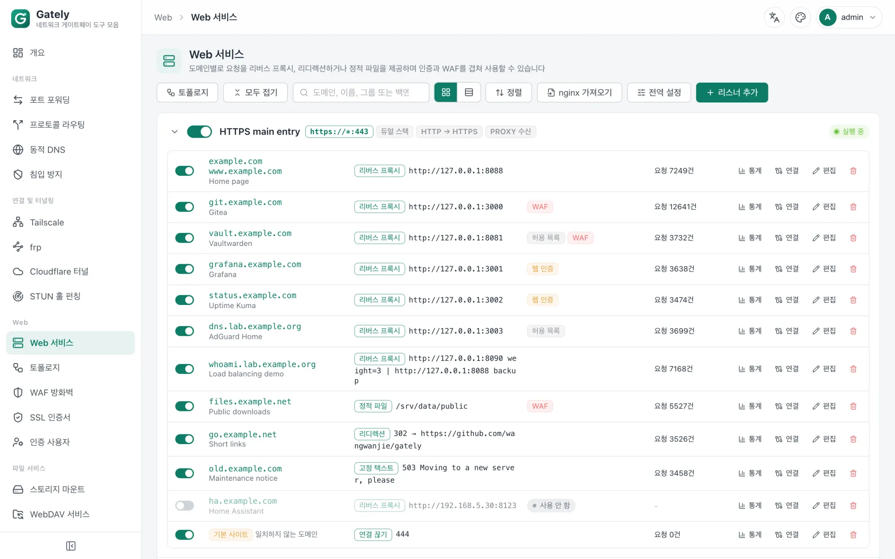

<p><b>사이트 통계</b> — 요청 수, 오류, 백엔드 상태, 접속 IP와 국가 순위를 분 단위로 집계합니다.</p>

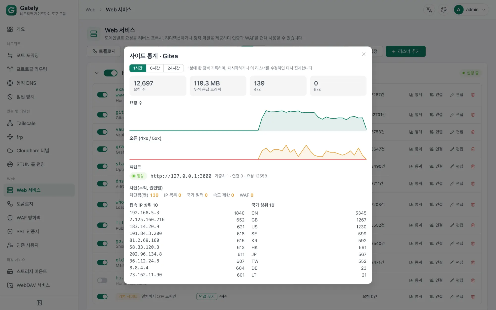

### 네트워크 토폴로지

방문자에서 리스너, 사이트, 백엔드로 이어지는 트래픽 흐름을 실시간으로 확인합니다. 노드를 선택하면 QPS, 트래픽, 활성 IP를 볼 수 있고, 방문자 IP로 필터링하고 7가지 레이아웃을 전환하며, 스크린샷을 공유하기 전에 주소를 가릴 수 있습니다.

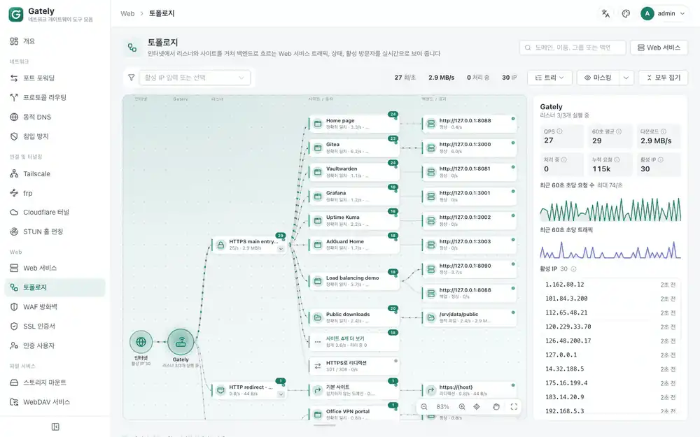

### 443 포트 하나로 모든 서비스를

프로토콜 라우팅으로 여러 서비스를 도메인이나 프로토콜별로 같은 포트에 둡니다. TLS는 그대로 통과시키고 PROXY 프로토콜로 실제 클라이언트 주소를 전달합니다.

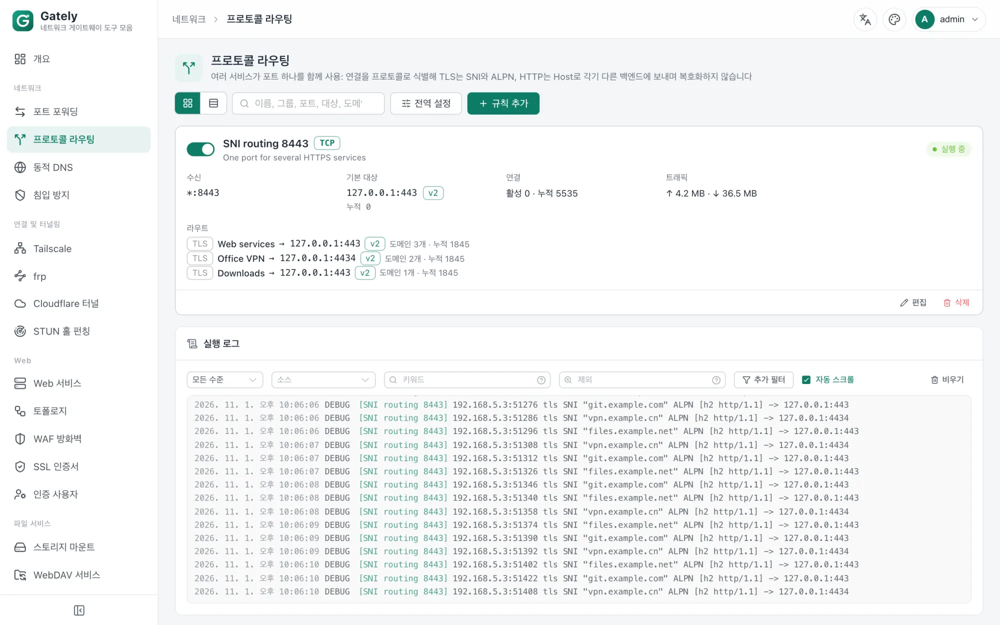

### 주요 제공업체를 모두 지원하는 동적 도메인

Cloudflare, Alibaba Cloud, DNSPod, Route 53 등을 지원합니다. IPv4와 IPv6 모두 다루고, IP는 URL, 네트워크 인터페이스, 명령으로 가져오며, 주소가 바뀌면 바로 알림을 보냅니다.

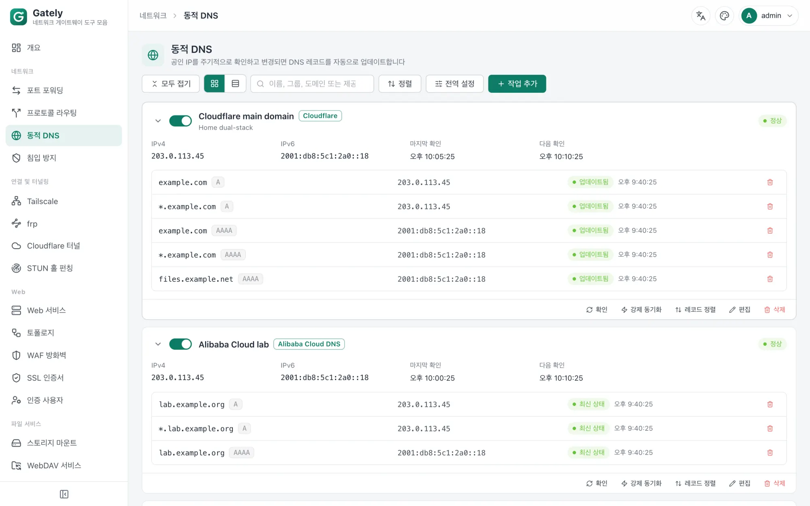

### 침입 방지

fail2ban 방식 규칙이 로그 파일, journald, 컨테이너 로그를 읽고, 미끼 포트와 스캔 탐지가 탐색 행위를 잡아냅니다. 차단 목록은 nftables에 동기화되어 커널에서 바로 패킷을 버립니다.

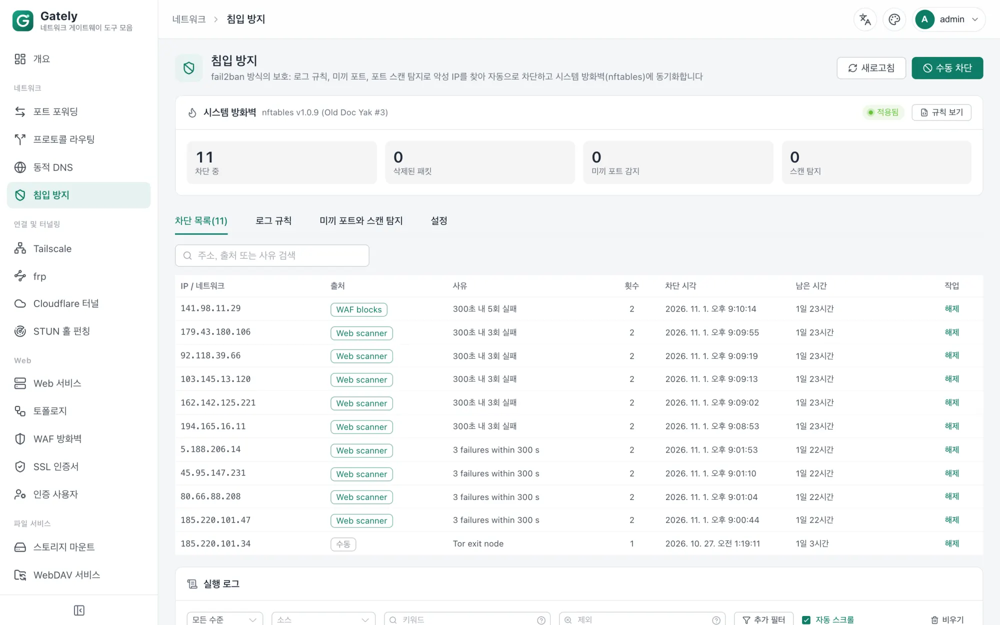

### frp, Tailscale, Cloudflare 터널

여러 frpc·frps 인스턴스를 나란히 실행하고 Tailscale, cloudflared 터널과 함께 관리합니다. 이 프로그램들의 설치, 업데이트, 롤백은 Gately가 맡습니다.

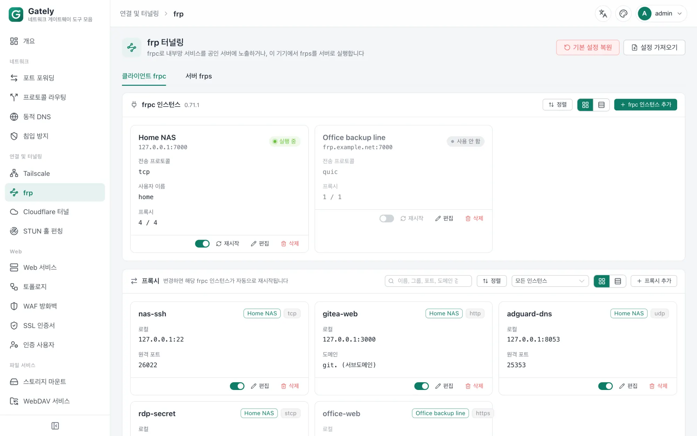

### 그 밖에도

<table>
<tr>
<td width="50%" valign="top">

**Docker**<br>컨테이너, Compose, 로그, 터미널. 이미지는 클릭 한 번으로 업그레이드하고, 실패하면 자동으로 롤백합니다.

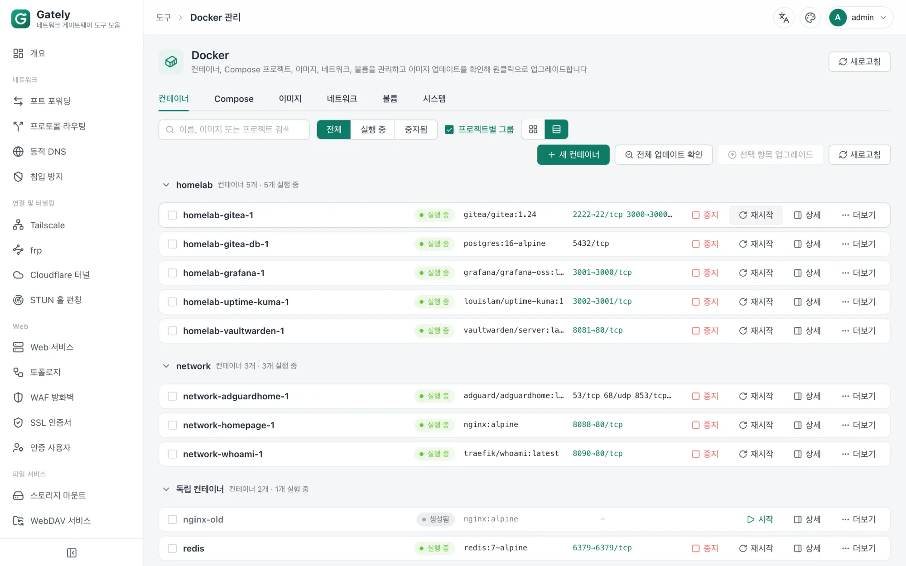

</td>
<td width="50%" valign="top">

**웹 터미널**<br>브라우저에서 SSH, Telnet, 로컬 셸을 쓰고 SFTP와 화면 분할도 지원합니다.

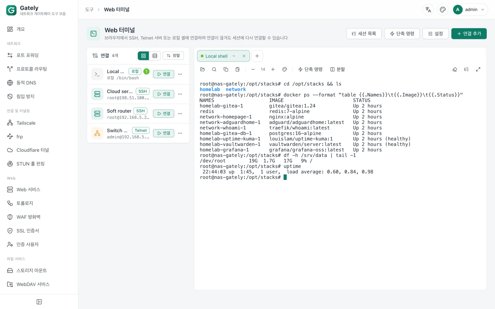

</td>
</tr>
</table>

<table>
<tr>
<td width="50%" valign="top">

**설정 이력**<br>변경할 때마다 이전 버전을 남겨 두어 차이를 비교하고 클릭 한 번으로 되돌릴 수 있습니다.

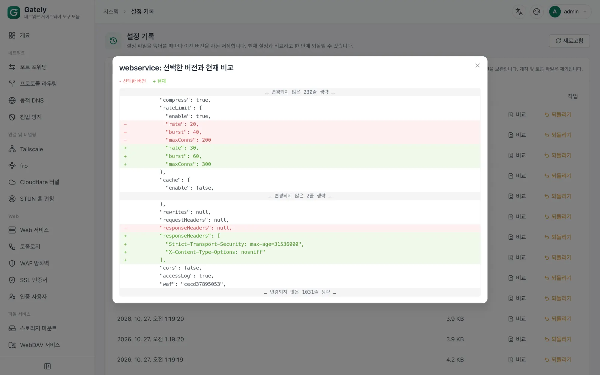

</td>
<td width="50%" valign="top">

**API, CLI, MCP**<br>모듈별 권한을 주는 API 토큰, 내장 OpenAPI 문서, `gately ctl`, AI 어시스턴트가 연결하는 MCP 서버.

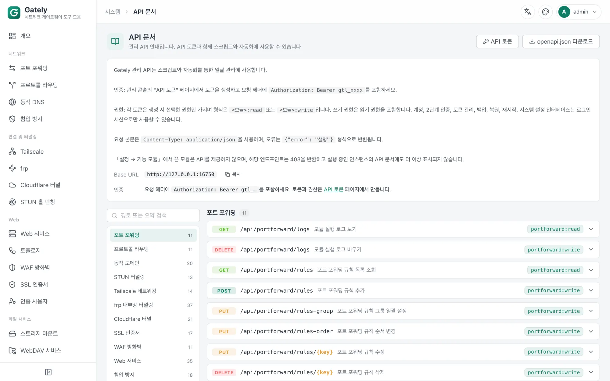

</td>
</tr>
</table>

<details>
<summary><b>전체 기능 목록</b></summary>

여러 모듈이 같은 기본 기능을 공유합니다. STUN 터널링, 포트 포워딩, 프로토콜 라우팅은 출발지 IP 허용 목록 / 차단 목록과 우선 차단 목록(구독 IP 목록 참조 가능)을 지원하고 로컬 방화벽의 해당 포트를 자동으로 허용합니다. Tailscale, NetBird, EasyTier, frp, Cloudflare Tunnel, File Browser는 Gately가 온라인으로 설치, 업데이트, 롤백, 제거하는 외부 프로그램을 실행하며, 모두 "기본 설정 복원" 기능이 있습니다.

| 모듈 | 기능 |
| --- | --- |
| 동적 도메인 | Alibaba Cloud, Cloudflare, Tencent Cloud, DNSPod, Huawei Cloud, GoDaddy, Porkbun, dynv6, DuckDNS, Amazon Route 53, OVHcloud, Gandi, NS1, Bunny DNS, Namecheap, Tencent Cloud EdgeOne, Alibaba Cloud ESA, Baidu AI Cloud, Volcano Engine, DNS.LA, Rainyun, Now.cn, Eranet, Tnet.hk, HiPM DNSMgr, Vercel, NameSilo, Dynadot, Spaceship, Name.com, Gcore, ClouDNS, deSEC, DynDNS2(No-IP, Dynu 등), 사용자 지정 콜백 |
| 동적 도메인: 작업 | URL/네트워크 인터페이스/명령으로 IP 조회, IPv4/IPv6, Webhook, 그룹·정렬·검색, 메모를 제공업체에 기록, 작업 삭제 시 제공업체의 레코드도 함께 삭제 가능 |
| STUN 터널링 | TCP/UDP, keep-alive, UPnP/NAT-PMP, 내장 포워딩, 주소 변경 시 Webhook 및 스크립트 실행 |
| 포트 포워딩 | TCP/UDP, IPv4/IPv6, 포트 범위, 다중 대상 장애 조치, 연결 수 제한, 트래픽 통계, PROXY 프로토콜(v1/v2), 그룹·정렬·검색; 출발지별 동시 연결 수 제한, 데이터를 보내지 않는 연결의 시간 초과 |
| 프로토콜 라우팅 | 여러 서비스가 443 같은 포트 하나를 공유하며 복호화 없이 그대로 전달: TLS는 SNI와 ALPN, HTTP는 Host, Minecraft는 서버 주소로 구분하고 SSH, RDP, SOCKS, OpenVPN, RTSP, SIP, XMPP, MQTT, AMQP, PostgreSQL, Redis, SMB, Git, IRC, ADB, BitTorrent도 식별하며, VNC처럼 서버가 먼저 보내는 프로토콜은 대기 시간 초과 라우트로 처리. 기본 대상과 라우트별 PROXY 프로토콜 설정 |
| SSL 인증서 | DNS-01(와일드카드, 위임된 서브도메인의 DNS 영역은 SOA로 자동 인식) 또는 HTTP-01(DNS 제공업체 불필요) 방식의 ACME 자동 발급 및 갱신, EAB, 업로드, 파일 읽기, 디렉터리 매핑 및 스크립트 실행 |
| SSL 인증서: IP와 단기 인증서 | 단기 인증서와 공인 IP 주소 인증서(Let's Encrypt shortlived 프로필) |
| SSL 인증서: 배포 | 인증서가 갱신되면 SSH로 다른 호스트에 업로드하고 명령 실행, 또는 인증서를 쓰는 Docker 컨테이너 재시작 |
| Tailscale | tailscaled 관리(유저스페이스 네트워킹, 컨테이너 친화적) 또는 시스템에 이미 있는 데몬 연결. 인증 키/로그인 링크, Headscale, 서브넷 라우트, 출구 노드, 노드 목록, SOCKS5 프록시, 고정 포트, 추가 인수 및 환경 변수. Linux에서 온라인 설치 |
| NetBird | NetBird 클라우드 또는 자체 호스팅 관리 서버. netbird 데몬 관리(유저스페이스 네트워킹, 다른 피어가 로컬 서비스에 접근 가능) 또는 기존 시스템 서비스 연결. 설정 키/로그인 링크, 경로, 라우팅 피어, DNS, 인바운드 차단, 피어 목록(직접/릴레이, 지연), SOCKS5 프록시. Linux·macOS·Windows에서 온라인 설치 |
| EasyTier | easytier-core 관리: P2P 홀 펀칭 우선, 자체 운영 또는 선택한 릴레이 노드, 포트 포워딩을 지원하는 유저스페이스 네트워킹, 서브넷 프록시, 출구 노드, KCP / QUIC 프록시 |
| frp | 여러 frpc / frps 인스턴스: frpc(tcp/udp/http/https/stcp/xtcp 프록시, 추가·삭제 즉시 적용, 접속 주소 클릭·복사)와 frps(포트 허용 목록, 서브도메인, 대시보드, 출발지 IP로 frpc 로그인 제한). 기존 ini / 신규 toml 설정을 한 번에 가져오기; frps KCP / QUIC 포트, 양쪽의 QUIC 조정, frps 포트 방화벽 자동 허용 |
| Cloudflare 터널 | cloudflared 토큰 터널과 trycloudflare 임시 터널, 다중 터널, 자동 재시작, 공개 주소 표시. 토큰 터널의 라우팅 규칙을 Cloudflare API로 편집하고 DNS 레코드 생성 |
| WAF 방화벽 | Coraza + OWASP CRS v4, 파일 단위 규칙 활성화, 사용자 지정 SecLang, 차단/탐지 전용. 직접 구축한 SafeLine(雷池) 탐지 엔진에도 연결 가능. 이 인스턴스의 관리자 세션은 WAF를 거치지 않으며 로그인한 사용자를 신뢰하도록 설정 가능 |
| WAF: 대용량 요청 | 요청 본문 검사 한도를 조정할 수 있고 한도 초과 시 앞부분만 검사하거나 경로별로 건너뛸 수 있어 클라우드 드라이브, WebDAV 같은 업로드 사이트에도 WAF 적용 가능 |
| 침입 방지: 규칙 | fail2ban 방식 로그 규칙(로그 파일, systemd 저널, 명령 출력, Docker 컨테이너 로그, 관리 콘솔 로그인 실패, WAF 차단, 거부된 포트 노크)과 SSH·Nginx·Vaultwarden 등 템플릿 |
| 침입 방지: 탐지 | 미끼 포트와 포트 스캔 탐지(Gately 각 모듈의 열린 포트와 frpc가 요청한 원격 포트 자동 인식, IPv6 엄격 모드는 /64 단위 차단, 차단 사유에 적중한 포트 표시). 리스너별 웹 경로 탐색 차단(/.env, /.git 등 미끼 경로, 알 수 없는 도메인 스캔, 연속 404). 실패 유형(중도 끊김, 리셋, 시간 초과, 비 TLS 등)과 리스너별 TLS 핸드셰이크 실패 차단 |
| 침입 방지: 차단 | 수동 네트워크·영구 차단·점진적 시간·화이트리스트를 갖춘 통합 차단 목록. 시스템 방화벽(nftables / iptables + ipset)에 동기화되어 커널에서 삭제되며, nftables가 없는 환경에서는 Gately 자체 서비스에 적용 |
| 포트 노킹 | fwknop 클라이언트와 호환되는 단일 패킷 노킹(SPA): AES-256 암호화, HMAC 인증, 재전송 방지와 시간 창. 보호 대상 포트는 시스템 방화벽(nftables / iptables + ipset)에서 차단되고 노크에 성공한 주소만 정해진 시간 동안 허용되며 이미 맺어진 연결은 영향이 없음 |
| 포트 노킹: 연동 | 포트 포워딩, 프로토콜 라우팅(라우트별 가능), STUN은 방화벽 권한 없이 「노크 필요」를 선택 가능. 프로토콜 라우팅은 TCP로 온 노크 패킷을 받아 외부에 포트 하나만 개방. 웹 로그인 후 허용은 방문자 IP에 허용을 부여(IPv6는 /64 단위, 시스템 방화벽에 기록 가능)하며 클라이언트가 필요 없음. 거부된 노크는 침입 방지에서 차단 가능 |
| Docker 관리 | 컨테이너 생성 및 편집, 로그와 터미널, Compose, 이미지 업데이트 확인 및 원클릭 업그레이드(실패 시 자동 롤백), 네트워크와 볼륨. 풀, 빌드, Compose, 일괄 업그레이드 같은 백그라운드 작업을 도중에 중지 가능 |
| Docker: 자체 업그레이드 | Gately 자신이 실행 중인 컨테이너를 임시 도우미 컨테이너로 업그레이드하며, 실패 시 기존 컨테이너 복원 |
| 웹 터미널 | SSH(호스트 키 최초 신뢰), Telnet, 로컬 셸(기본 비활성). 프록시, 지속 세션, SFTP 파일 관리, 2FA 및 프로토콜 확인, 빠른 명령, 화면 분할. 휴대폰에서 길게 눌러 선택·복사, 붙여넣기 패널과 클립보드 기록 |
| 네트워크 진단 | Ping, 경로 추적, 포트 탐색, DNS 조회, 속도 측정, LAN 스캔 |
| 알림 센터 | Webhook, Telegram, Bark, ntfy, Gotify, Pushover, Discord, Slack, ServerChan, PushPlus, WeCom, DingTalk, Feishu, 이메일. 수준, 와일드카드, 무음 및 중복 제거 규칙. 전역 또는 채널별 프록시(HTTP와 SOCKS5). 기본 제공 규칙 템플릿(심각한 장애, 인증서 만료, 주소 변경, 로그인, 설정 변경, 버전 업데이트). 관리 콘솔 새 주소 로그인 알림 |
| 설정 백업 | 암호화 백업(scrypt + AES-GCM), 보존 정책, 로컬 디렉터리 또는 스토리지 마운트 지점으로 예약 백업 |
| 명령줄 및 MCP | `gately ctl`로 실행 중인 인스턴스를 호출하고, `gately mcp`로 stdio MCP 서비스를 제공(기본 읽기 전용) |
| Wake-on-LAN | 매직 패킷 브로드캐스트, 온라인 탐지, Bemfa 음성 제어(Xiao AI, Xiaodu, Google Assistant) |
| Wake-on-LAN: 종료 | 장치의 에이전트(Windows/Linux/macOS/OpenWrt, 장치가 먼저 연결하므로 포트 개방 불필요), 웹 터미널 SSH 명령 또는 HTTP 요청으로 원격 종료·재부팅·절전 |
| WebDAV, FTP, SMB | 다중 사용자, 사용자별 디렉터리, 읽기 전용. 세 서비스가 공유 사용자를 공통으로 사용. FTP는 FTPS와 패시브 포트 범위, SMB는 사용자별 여러 디렉터리 공유, SMB 2/3, 암호화, Bonjour 검색을 추가 지원 |
| File Browser | 웹 파일 관리자 FileBrowser Quantum 호스팅: 다중 인스턴스, 여러 공유 디렉터리와 읽기 전용, 비밀번호 또는 리버스 프록시 인증 |
| 스토리지 마운트 | 로컬 디렉터리, 원격 WebDAV 마운트, SMB 공유, 온라인 파일 관리 |
| 예약 작업 | cron 표현식, 명령 또는 HTTP 요청, 실행 기록 |
| 목록 관리 | 규칙, 인스턴스, 인증서, DNS 레코드, 터미널 연결, API 토큰 등 목록에서 그룹화, 수동 정렬(드래그 또는 화살표, 다중 선택 일괄 이동), 검색을 공통 지원하고 일괄 사용·사용 안 함·삭제가 가능. 웹 서비스 사이트는 도메인 일괄 추가·제거·교체, 옵션 일괄 변경, 편집·일괄·드래그로 다른 리스너로 이동도 지원. 대부분 카드/간결 보기 전환 가능. 순서·그룹 변경 시 서비스를 재시작하지 않으며 휴대폰에서도 사용 가능. 대부분의 항목을 복제해 수정할 수 있으며 저장된 비밀 값은 그대로 사용 |
| 관리자 로그인 | 패스키(WebAuthn) 로그인, 2단계 인증(TOTP), 읽기 전용 계정, 로그인 실패 속도 제한(점진적 잠금), 낯선 주소 실패 예산(분산 무차별 대입 방어), 취약한 비밀번호 감지와 비밀번호 강제 변경, 비밀번호 로그인 끄기(패스키만 사용), 보안 점수 |
| 관리 접근 | 보안 진입점, 내부망 전용 접속, 관리 포트를 숨기는 미승인 접근 응답 설정(일반 404, 빈 페이지, 연결 끊기, 응답 안 함, 사용자 지정 페이지), 관리 UI의 HTTPS, 로컬 리버스 프록시가 전달한 실제 클라이언트 주소 신뢰 |
| 설정 | 다중 API 토큰(모듈별 읽기/쓰기 권한), 저장된 비밀번호와 키를 필요할 때 표시(쓰기 권한 필요), 사용자 지정 DNS(DoH 지원), 시간대, 설정 백업 및 복원, 기능 모듈 켜기/끄기(비활성 모듈은 서비스를 시작하지 않고 API도 제공하지 않음), 로그 수준(`GATELY_LOG_LEVEL`) |
| 관리 화면 | 페이지, 탭, 사이트 도메인, 포트 포워딩 규칙, DDNS 레코드, 인증서 전역 검색(Ctrl/⌘+K); 첫 실행 시 사용 시나리오 선택과 시작하기 체크리스트; 백엔드 연결을 확인하는 3단계 빠른 사이트 만들기; 빈 포트 포워딩·DDNS 목록의 시나리오 템플릿; 읽기 전용 공개 데모 모드(`-demo`) |
| 업데이트 확인 | 새 버전과 보안 공지 자동 확인(GitHub에 익명 접속, 끌 수 있음). 공개된 보안 문제의 영향을 받으면 눈에 띄게 표시하고 알림 전송 |
| fnOS 네이티브 앱 | 오프라인 `.fpk` 패키지(x86 / ARM). fnOS 통합 게이트웨이와 연동되어 fnOS 바탕 화면 아이콘으로 열고 fnOS 원격 도메인으로도 접속. fnOS 관리자는 fnOS 로그인 상태로 로그인 가능(기본 비활성). 80/443 수신과 Docker 관리를 위해 root로 실행 |
| 감사 및 이력 | 로그인, 설정 변경, 민감한 콘텐츠 접근을 기록하는 감사 로그(요청 본문과 비밀 값은 기록하지 않음). 덮어쓴 설정 파일마다 이전 버전을 보관하며 차이 비교와 원클릭 롤백 지원. GitOps용 선언적 설정 디렉터리(`-apply`) |
| 모니터링 | 성능 패널: 호스트, Gately 프로세스, 사이트의 60초 / 1시간 / 24시간 추이(첫 바이트 지연 P50 / P95 포함). 관리 프로세스(frp, Tailscale, NetBird, cloudflared, File Browser)의 CPU와 메모리. 임계값 경보(지표 + 임계값 + 지속 시간)의 발생과 복구를 알림 센터로 전송 |
| 메트릭과 자가 점검 | 전역 Prometheus 엔드포인트 `/api/metrics`(인증서, DDNS, STUN, 포트 포워딩, 웹 서비스)와 바로 쓸 수 있는 Grafana 대시보드. 원클릭 네트워크 자가 점검(공인 IP, CGNAT, 시스템 시간, 80/443 포트, DDNS 해석, 인증서 만료, 인증서가 없는 HTTPS 사이트, frp 프록시 충돌) |
| 마이그레이션 | nginx 설정 가져오기(`nginx -T` 출력 지원): 리버스 프록시와 upstream, 정적 디렉터리, 리디렉션, 경로별 백엔드, 접근 제어, `auth_request`는 포워드 인증으로 변환; Nginx Proxy Manager 설정 직접 가져오기(`set` 변수를 `proxy_pass`에 대입); Sun-Panel 1.x / 2.x 내보내기를 내비게이션 패널로 변환 |

#### 웹 서비스

기능별 자세한 내용은 [웹 서비스 문서](https://gately.cn/ko/docs/modules/web)를 참고하세요.

| 영역 | 기능 |
| --- | --- |
| 사이트 유형 | 리버스 프록시, 리디렉션, 정적 파일(확장자 없는 URL, 사용자 지정 404 페이지), 고정 텍스트, 연결 끊기(nginx `return 444`와 같음), 내비게이션 패널 |
| 리스너와 프로토콜 | HTTPS, HTTP/3(QUIC), 같은 포트에서 HTTP와 HTTPS 함께 사용(리디렉션 또는 그대로 제공), 리스너별 추가 HTTP 포트(443 옆에 80 등), WebSocket, gRPC용 평문 HTTP/2(h2c) 백엔드, PROXY 프로토콜 송수신, 로컬 방화벽 포트 자동 허용 |
| 백엔드 | 경로별 백엔드, 로그인한 사용자별 백엔드(nginx `map $remote_user`와 같음, 리디렉션/정적 파일/내비게이션 패널/고정 텍스트 사이트에도 적용), 가중치/백업/로드 밸런싱 정책, 능동·수동 헬스 체크, 연결 실패 시 다음 백엔드로 재시도, 연결·TLS 핸드셰이크·응답 헤더 시간 초과, 방문자 읽기/쓰기 유휴 시간 초과, 방문한 도메인을 SNI로 보내는 HTTPS 백엔드, 경로 재작성과 접두사 제거 |
| 로그인 | 기본 인증, 웹 인증, GitHub/Google/QQ/OIDC 로그인, TOTP 2단계 인증·패스키·셀프 서비스 비밀번호 변경을 지원하는 공유 사용자, 하위 도메인 간 통합 로그인(SSO), Gitea·Grafana 등 OpenID Connect 앱용 내장 OIDC 공급자, Authelia 같은 외부 서비스로의 포워드 인증, 공인망 Gately에서 내부망 Gately로 로그인 쿠키 전달, 로그인 사용자의 사용자 이름·이메일·표시 이름·그룹을 요청 헤더로 백엔드에 전달, 관리 콘솔 로그인 시 인증 생략(관리 콘솔에 로그인한 관리자는 사이트에서 다시 인증할 필요 없음, 상위 도메인 간 지원), 로그인한 사용자 신뢰(WAF와 경로 탐색 건너뜀) |
| 접근 제어 | IP 허용/차단 목록, 주기적으로 갱신되는 구독 IP 목록(예: 지역별 IP 대역), 허용 목록보다 먼저 판단하는 우선 차단 목록(악성 IP 위협 정보 목록에 적합), GeoIP 국가 필터링, 경로 규칙, 임시 공유 링크, 인증 실패 시 자동 차단, 노크 입장 제한(노크로 허용되지 않은 출발지는 사이트에 접근 불가)과 로그인 후 허용, 접근 거부 시 403 대신 연결 끊기 |
| 성능 | 압축, 속도 제한, 경로별 규칙(캐시 안 함/개별 시간/강제 캐시)을 지원하는 응답 캐시와 캐시 비우기 |
| 오류 페이지 | 404·5xx 페이지를 내장 스타일 10종 또는 직접 만든 HTML(업로드 또는 서버 파일, 안전성 검사 후 샌드박스로 표시)로 지정하고 백엔드 오류도 교체 가능(nginx `proxy_intercept_errors`와 같음) |
| 가시성 | 분 단위 접속 통계와 Prometheus 메트릭, 사이트별 실시간 연결 보기와 끊기·차단, 리스너 → 사이트 → 백엔드의 QPS·트래픽·활성 IP를 실시간으로 보여 주는 토폴로지 보기(IP별 경로 강조, 주소 가리기, 「활성만 보기」, 기록한 스냅샷을 용량 기준으로 메모리에 보관하는 재생, 기본값은 꺼짐), 주소별 방문자 감사(사이트, 경로, 신원, 차단 비율, 보관 기간), 접근 로그 일별 압축 보관과 내보내기 |
| 내비게이션 패널 | 사이트로 제공하는 링크 페이지: LAN 방문자에게는 LAN 주소, 내장 아이콘, 기타 접속 방법, 관리 화면과 같은 테마, 검색 엔진, 배경 이미지, 로그인 후 표시 링크, 카드 크기, 방문자 언어 전환, 사용자 지정 푸터; 링크 스타일(카드 또는 앱 아이콘)과 레이아웃(아이콘 크기, 줄당 개수, 간격, 너비); 주소가 여러 개인 링크는 클릭 시 주소 선택; 선택적인 그룹 개수와 주소 수 배지 |
| 운영 | 사이트를 수정해도 기존 연결이 끊기지 않음, 사이트 그룹·정렬·검색, 신뢰 프록시(CDN, WAF) 헤더에서 방문자 실제 IP 확인, 도메인 클릭 및 전체 주소 복사, HTTPS 사이트 행에 일치한 인증서와 남은 일수 표시 |

</details>

## 설치

Docker가 가장 빠릅니다([바로 써 보기](#바로-써-보기) 참고). 다른 방법은 다음과 같습니다.

<details>
<summary><b>바이너리</b></summary>

[Releases](https://github.com/wangwanjie/gately/releases)에서 플랫폼에 맞는 압축 파일(Linux amd64/arm64/arm/mips/mipsle/riscv64, macOS, Windows, FreeBSD)을 내려받아 압축을 풀고 실행합니다.

```bash
./gately -c /etc/gately
```

인수: `-c` 설정 디렉터리(환경 변수 `GATELY_CONFIG_DIR`로도 지정 가능), `-listen` 관리 UI 수신 주소 덮어쓰기, `-apply` 시작할 때마다 디렉터리의 `<name>.json` 파일을 설정 디렉터리에 적용(`GATELY_APPLY_DIR`, GitOps와 Kubernetes에 유용. 계정 및 토큰 파일은 덮어쓸 수 없음), `-version` 버전 출력. 무인 설치 시 `GATELY_INITIAL_PASSWORD`를 설정하면 기본 비밀번호 `gately.cn` 대신 사용할 관리자 초기 비밀번호를 지정할 수 있습니다.

부팅 시 자동 실행: 압축을 푼 뒤 `sudo ./gately service install`을 실행합니다(Windows는 관리자 권한 터미널에서 `.\gately.exe service install`). Linux는 systemd 서비스, macOS는 launchd 데몬(`-user`를 붙이면 sudo 없이 로그인 항목으로 등록), Windows는 서비스로 등록하고 즉시 시작하며 비정상 종료 후 자동으로 다시 시작합니다. 설정 디렉터리 기본값은 `/etc/gately`, `/usr/local/etc/gately`, `%ProgramData%\Gately`이며 `-c`, `-listen`으로 바꿀 수 있습니다. 서비스는 실행 파일 경로를 참조하므로 먼저 최종 위치에 두세요. 이후 `gately service uninstall|start|stop|restart|status`로 관리하며, 제거해도 설정 디렉터리는 남습니다.

서비스 템플릿: [systemd](../../deploy/systemd/gately.service), [OpenWrt procd](../../deploy/openwrt/gately.init). 다운로드한 압축 파일과 이미지 검증(cosign 서명, 빌드 출처 증명, SBOM)은 [릴리스 산출물 검증](../ko/VERIFY.md)을 참고하세요.

</details>

<details>
<summary><b>fnOS 네이티브 앱</b></summary>

각 Release에는 fnOS용 오프라인 `.fpk` 패키지 `gately_<version>_fnos_x86.fpk`(Intel/AMD)와 `gately_<version>_fnos_arm.fpk`(ARM)가 포함됩니다. 공식 앱 센터에는 등록되어 있지 않으므로 직접 설치해야 합니다. **앱 센터 → 수동 설치**(왼쪽 아래 버튼)를 열고 파일을 선택한 뒤 마법사를 완료하세요.

- **fnOS 통합 게이트웨이 연동**: fnOS 바탕 화면의 Gately 아이콘을 클릭하면 fnOS 통합 게이트웨이를 거쳐 `/app/gately/` 아래에서 관리 UI가 열리며, fnOS에 이미 사용하는 진입점을 함께 씁니다. 내부망 주소와 fnOS 원격 도메인 모두 사용할 수 있고 16680 포트를 열거나 포워딩할 필요가 없습니다. 게이트웨이를 통한 접근은 fnOS가 제어하므로(fnOS 관리자만 열 수 있음) 보안 진입 경로와 내부망 전용 접근 설정은 16680 포트로 직접 접속할 때만 적용됩니다.
- **fnOS 로그인 상태로 관리자 자동 로그인**: **설정 → 접근 제어 → fnOS 로그인 상태로 자동 로그인**을 켜면 fnOS에 로그인한 fnOS 관리자는 바탕 화면 아이콘에서 비밀번호나 2단계 인증 코드 없이 Gately에 들어갑니다. 일반 fnOS 사용자는 여전히 로그인해야 합니다. 로그아웃한 뒤에는 조용히 다시 로그인시키지 않고 로그인 페이지에 "fnOS 계정 &lt;이름&gt;(으)로 로그인" 버튼을 표시합니다. 이 설정은 기본적으로 꺼져 있으며 fnOS 패키지에서만 표시됩니다.
- 내부망에서는 `http://<NAS 주소>:16680`으로도 관리 UI에 접속할 수 있습니다. 기본 계정은 `admin`, 기본 비밀번호는 `gately.cn`입니다.
- 앱은 `root`로 실행되므로 80/443을 수신하고 `docker.sock`으로 Docker를 관리하며 실제 웹 터미널을 열 수 있습니다. 직접 관리하는 NAS에만 설치하세요.
- 설정은 앱의 `var` 디렉터리에 저장되며, 제거 마법사에서 "모두 삭제"를 선택하지 않는 한 제거해도 유지됩니다. 업그레이드는 새 버전의 `.fpk`를 다시 수동 설치하면 됩니다.
- 패키지는 `gately ctl`과 `gately mcp`용 `gately` 명령(`/usr/local/bin/gately`)도 추가합니다.
- 16680 포트는 Docker 이미지와 같습니다. 네이티브 앱을 시작하기 전에 `gately` 컨테이너를 중지하세요.
- 내려받은 파일은 [릴리스 산출물 검증](../ko/VERIFY.md)에 따라 검증하세요. `.fpk` 파일도 `checksums.txt`에 포함되어 있습니다.

</details>

<details>
<summary><b>OpenWrt</b></summary>

각 Release에는 OpenWrt 패키지가 포함됩니다. `gately_<version>_openwrt_<arch>.ipk`는 OpenWrt 24.10 이하(iStoreOS 포함)용으로 `opkg install`로 설치하고, `.apk`는 OpenWrt 25.12 이상용으로 `apk add --allow-untrusted`로 설치합니다. 아키텍처는 amd64 / arm64 / arm / mipsle / mips / riscv64를 제공하며 `/etc/openwrt_release`의 `DISTRIB_ARCH`에 따라 고릅니다([설치 문서](https://gately.cn/ko/docs/guide/install#openwrt)의 표 참고).

- 설치하면 부팅 시 자동 시작이 활성화되고 서비스가 시작됩니다. 관리 UI는 `http://<라우터 주소>:16680`이며 기본 계정은 `admin`, 기본 비밀번호는 `gately.cn`입니다.
- 설정은 `/etc/gately`에 저장되며 업그레이드, 제거, 펌웨어 업그레이드(sysupgrade) 시에도 유지됩니다. 업그레이드하려면 새 버전 패키지를 설치하면 됩니다. 정보 페이지의 온라인 업그레이드는 패키지 관리자를 사용하도록 안내합니다.
- 바이너리는 약 32 MB이므로 x86 OpenWrt 박스, ARM64 박스 등 저장 공간이 넉넉한 장치에 적합합니다. arm 패키지는 하드웨어 부동소수점을 지원하는 ARMv7이 필요합니다.
- 아키텍처와 무관한 LuCI 앱 `luci-app-gately_<버전>_openwrt_all.ipk` / `.apk` 도 제공합니다. LuCI 「서비스 → Gately」에서 실행 상태 확인, 시작·중지, 부팅 시 자동 시작과 관리 화면 포트 설정, 관리 화면 바로 열기가 가능합니다.

</details>

## 운영

모니터링, API, 관리 프로그램은 [문서](https://gately.cn/ko/docs/guide/introduction)에 각각 전용 페이지가 있으며, 핵심만 여기에 정리했습니다.

<details>
<summary><b>모니터링</b></summary>

`metrics:read` 권한만 있는 API 토큰을 만들고 Prometheus가 `/api/metrics`를 수집하도록 설정하세요. 메트릭, 알림 예시, Grafana 대시보드는 [모니터링](../ko/MONITORING.md)에서 설명합니다.

</details>

<details>
<summary><b>API 호출</b></summary>

관리 콘솔의 "API 토큰" 페이지에서 토큰을 만들면(여러 개 생성 가능, 모듈별로 읽기 전용 또는 읽기/쓰기 권한 부여, 만료 시간 설정 가능, 평문은 생성 직후 한 번만 표시됨) 스크립트로 관리 API를 일괄 호출할 수 있습니다.

```bash
curl -H "Authorization: Bearer gtl_xxxx" http://localhost:16680/api/ddns/tasks
```

계정, 2단계 인증, 토큰 관리, 그리고 백업, 복원, 재시작, 시스템 설정 API는 로그인 세션으로만 사용할 수 있습니다. 전체 API, 필요한 권한, 데이터 구조는 관리 콘솔의 "API 문서" 페이지에서 확인할 수 있으며, `make api-docs`로 [docs/api](../api/ko)(`openapi.json`과 `API.md`)에 내보낼 수도 있습니다. 공식 사이트 https://gately.cn 에서도 이 파일을 그대로 참조합니다.

이전 버전에서 업그레이드하면 기존 전역 API 토큰은 자동으로 "레거시 토큰"이 됩니다(값은 그대로이며 모든 모듈 권한을 가짐). API 토큰 페이지에서 권한을 줄이거나 새 토큰으로 교체하는 것을 권장합니다.

</details>

<details>
<summary><b>Tailscale, NetBird, EasyTier, frp, cloudflared</b></summary>

이 다섯 모듈은 공식 외부 프로그램을 관리합니다(자동 재시작, 로그를 UI에 집계). Gately 본체에는 포함되어 있지 않습니다. 각 모듈 페이지의 「온라인 설치」 카드는 업스트림에서 최신 안정 버전이나 지정한 버전을 내려받아 SHA-256을 검증한 뒤 설정 디렉터리의 `bin/`에 설치하고, 해당 프로그램을 사용하는 프로세스를 다시 시작합니다. 프로그램마다 다운로드 프록시를 따로 지정할 수 있으며, 비워 두면 설정의 업데이트 프록시를 사용합니다. 교체된 버전은 최근 3개까지 보관되어 새 버전에 문제가 있으면 클릭 한 번으로 롤백할 수 있고, 더 이상 필요 없으면 프로그램을 제거할 수 있습니다. 페이지 상단의 「기본 설정 복원」은 제거와 별개로 동작하며, 프로세스를 중지하고 모듈 설정을 초기화한 뒤 Gately가 생성한 파일(frp 설정 파일, File Browser 인스턴스 데이터, Tailscale 및 NetBird 로그인 상태)을 삭제합니다. 이전 설정은 설정 기록에서 복원할 수 있습니다. Tailscale은 Linux용으로만 바로 실행 가능한 공식 패키지를 제공하므로, 다른 시스템에서는 공식 설치 프로그램을 사용하고 경로를 입력하세요. 프로그램은 다음 순서로 찾습니다. 모듈 설정에 입력한 경로, 설정 디렉터리의 `bin/`, `PATH`. 바이너리를 설정 디렉터리에 직접 넣을 수도 있으며, Docker 배포에서는 예를 들어 `./gately-data/bin/frpc`입니다. Tailscale은 `tailscale`과 `tailscaled`를 모두 제공해야 합니다. 설정 파일의 토큰과 키는 0600 권한으로 저장되며, cloudflared 토큰은 환경 변수로 전달되어 프로세스 목록에 나타나지 않습니다.

File Browser 모듈은 [FileBrowser Quantum](https://github.com/gtsteffaniak/filebrowser)을 호스팅합니다(원본 filebrowser는 보관 처리되어 보안 수정이 없습니다). 찾는 순서와 온라인 설치, 업데이트, 롤백은 위와 같으며 설치 위치는 `bin/filebrowser`입니다. 관리자 비밀번호는 환경 변수로 전달되어 설정 파일에 기록되지 않습니다.

</details>

## 성능

SNI 기반 프로토콜 라우팅과 웹 서비스를 함께 쓰면 흔히 쓰는 haproxy(SNI 기반 TCP 라우팅) + nginx(TLS와 리버스 프록시) 조합을 대체할 수 있습니다. 아래 표는 실제 서버의 설정에 맞춰 같은 머신에서 둘을 비교한 결과입니다. 도메인 90개를 SNI로 라우팅하고, 두 홉 사이에는 PROXY 프로토콜 v2를 사용했으며, 인증서는 ECDSA P-256, TLS는 1.3입니다.

| 시나리오 | haproxy + nginx | Gately |
| --- | --- | --- |
| HTTPS 리버스 프록시, Keep-Alive, 1 KB 응답, 동시 연결 64개 | 14,767 req/s (p99 35.9 ms) | **26,434 req/s** (p99 5.7 ms) |
| 같은 조건에서 HTTP/2 | 테스트하지 않음 (nginx 설정이 HTTP/1.1) | 27,795 req/s |
| 요청마다 새 TLS 연결, 동시 32개 | 2,557 req/s | **3,448 req/s** |
| 1 MB 응답, 동시 연결 16개 | 1,053 MB/s | **1,585 MB/s** |
| TLS 스트림 SNI 패스스루, 연결 4개 | 2,927 MB/s | **4,962 MB/s** |
| SNI 패스스루, 초당 신규 연결 수, 동시 64개 | 6,334 /s | 6,266 /s (비슷함) |
| 부하 시 메모리 | haproxy ≈ 21 MB + nginx ≈ 21 MB | ≈ 110 MB (모든 모듈을 포함한 단일 프로세스) |

<details>
<summary><b>측정 방법</b></summary>

- 호스트: Intel Core i5-13500T. 소형 클라우드 서버에 맞추기 위해 각 구성을 CPU 코어 2개로 제한했습니다(haproxy와 nginx는 Docker의 `--cpuset-cpus`, Gately는 `taskset`으로 고정). 백엔드와 부하 생성기는 다른 코어에서 실행했습니다.
- haproxy는 `mode tcp`, `req_ssl_sni` 규칙, `send-proxy-v2`를 사용했습니다. nginx는 `worker_processes 2`와 운영 사이트의 프록시 설정을 사용했으며, 이 설정은 `Connection: upgrade`를 보내므로 요청마다 백엔드 연결을 새로 엽니다. 업스트림 keep-alive를 켠 튜닝된 nginx라면 작은 응답에서의 차이가 줄어듭니다.
- Gately의 경로는 SNI 규칙, PROXY v2, 웹 서비스 리스너 순으로, haproxy → nginx와 홉 수가 같습니다.
- 각 케이스는 10초간 실행했고, 반복한 케이스의 결과는 3% 이내로 일치했습니다. 실제 2 vCPU 클라우드 호스트에서 정적 사이트는 5.5k req/s 대 3.4k req/s였습니다. 클라이언트가 X25519를 사용하면 새 TLS 연결은 비슷했고(양쪽 모두 초당 약 480~550개), Go 클라이언트와 최신 브라우저가 제공하는 포스트 양자 하이브리드 키 교환을 사용하면 이번 측정에서 Gately가 완료한 핸드셰이크가 약 13% 적었습니다.
- 결과는 하드웨어, 설정, 트래픽에 따라 달라집니다. Gately가 haproxy와 nginx를 따라가는지 확인하는 참고 자료로 보고, 실제 워크로드로 직접 측정하세요.

</details>

## 개발

요구 사항: Go 1.26+, Node.js 24+, pnpm.

```bash
make web      # 프런트엔드 빌드(web/dist에 출력되며 go:embed로 포함됨)
make build    # bin/gately 컴파일
make test     # go test -race ./...
make lint     # gofmt, go vet, 프런트엔드 타입 검사
```

커스텀 빌드 태그, 추가 환경이 필요한 테스트, 모듈 요구 사항, i18n 작업 흐름은 [CONTRIBUTING.md](../../CONTRIBUTING.md)(영어)에 있습니다. 디렉터리 구조와 기술 선정은 [docs/ko/ROADMAP.md](../ko/ROADMAP.md)를 참고하세요. 공식 사이트([gately.cn](https://gately.cn))의 소스는 `website/`에 있으며 VitePress 기반입니다. `cd website && pnpm install && pnpm dev`.

## 릴리스 정책

- Gately는 1.0 이전 버전입니다. 버전 번호는 최대 네 부분이며(예: `v0.6.6.6`), 마이너 버전의 후속 릴리스에서는 마지막 부분이 올라갑니다.
- `v*` 태그마다 [릴리스 워크플로](../../.github/workflows/release.yml)가 실행되어 바이너리, OpenWrt와 fnOS 패키지, 멀티 아키텍처 Docker 이미지를 빌드하고 산출물에 서명합니다. 이미지에는 버전 태그와 `latest`가 붙으며, `latest`는 항상 최신 릴리스를 가리킵니다.
- 릴리스는 자주 나옵니다. 2026년 10월 17일부터 11월 15일까지 버전 태그가 55개였습니다. [GitHub Releases](https://github.com/wangwanjie/gately/releases)는 릴리스 노트를 모듈별로 묶고 업그레이드 안내를 표시하며, 공식 사이트의 [변경 내역](https://gately.cn/ko/news/)에 공지가 있습니다.
- 보안 수정은 최신 버전에만 제공됩니다([SECURITY.md](../../SECURITY.md)). 운영 환경에서는 `ghcr.io/wangwanjie/gately:v0.6.6.6` 같은 이미지 태그를 고정하고, 업그레이드 전에 릴리스 노트를 읽고, 설정 이력으로 설정을 되돌리세요.

## 기여

이슈와 풀 리퀘스트를 환영합니다. 코드, 모듈, 테스트, 번역 체크리스트는 [CONTRIBUTING.md](../../CONTRIBUTING.md)에 있으며, 참여하는 모든 분은 [행동 강령](../../CODE_OF_CONDUCT.md)을 따릅니다.

## 커뮤니티

질문은 [GitHub Discussions Q&A](https://github.com/wangwanjie/gately/discussions/categories/q-a)에 올려 주세요(답변을 검색할 수 있습니다). 사용 환경 공유도 Discussions에서, 바로 대화하려면 Telegram 그룹 [t.me/gately_chat](https://t.me/gately_chat)에서 나눠 주세요.

버그는 [GitHub Issues](https://github.com/wangwanjie/gately/issues)에 등록하고 [진단 패키지](../ko/DIAGNOSTICS.md)(설정 → 진단)를 첨부해 주세요. 진단 패키지는 로컬에서 생성되며 비밀번호, 토큰, 도메인, 실제 IP를 포함하지 않습니다. 보안 문제는 [SECURITY.md](../../SECURITY.md)에 안내된 대로 비공개로 알려 주세요.

## 후원

Gately의 모든 기능은 무료입니다. 도움이 되었다면 USDT, [아이파뎬](https://ifdian.net/a/gately), WeChat Pay로 개발을 후원할 수 있으며, 주소와 QR 코드는 [후원 페이지](https://gately.cn/ko/sponsor)에 있습니다.

## 라이선스

[Apache License 2.0](../../LICENSE)
