<p align="center">
  <a href="https://gately.cn/pt-BR/"></a>
</p>

<p align="center">
  <a href="https://gately.cn/pt-BR/">Site oficial</a> · <a href="https://gately.cn/pt-BR/docs/guide/quick-start">Documentação</a> · <a href="https://github.com/wangwanjie/gately/releases/latest">Download</a> · <a href="https://gately.cn/pt-BR/news/">Changelog</a> · <a href="https://github.com/user-attachments/assets/ae5b60a4-9402-4a66-86a1-48e40038b4d0">Tour de 2 min</a> · <a href="https://github.com/wangwanjie/gately/discussions">Discussions</a> · <a href="https://t.me/gately_chat">Telegram</a><br>
  <a href="../../README.md">English</a> | <a href="../../README.zh-CN.md">简体中文</a> | <a href="README.zh-TW.md">繁體中文</a> | <a href="README.ja.md">日本語</a> | <a href="README.ko.md">한국어</a> | <a href="README.es.md">Español</a> | <a href="README.fr.md">Français</a> | <a href="README.de.md">Deutsch</a> | <a href="README.ru.md">Русский</a> | <b>Português (Brasil)</b>
</p>

<p align="center">
  <a href="https://github.com/wangwanjie/gately/releases/latest"></a>
  <a href="../../LICENSE"></a>
  <a href="https://hub.docker.com/r/vanjayak/gately"></a>
</p>

# Gately

**Um gateway auto-hospedado com interface web: proxy reverso, HTTPS automático, DNS dinâmico, travessia de NAT, WAF e bloqueios no estilo fail2ban em um único binário.**

O Gately fica na borda de uma rede doméstica ou de um servidor e cuida do caminho da internet até os seus serviços: mantém o seu domínio apontando para um IP que muda, obtém e renova certificados, leva todos os serviços por uma única porta 443, coloca login e WAF na frente deles e bloqueia os endereços que ficam sondando. Tudo é configurado pelo navegador. Apache-2.0, sem telemetria, configuração guardada como JSON simples no seu próprio dispositivo.

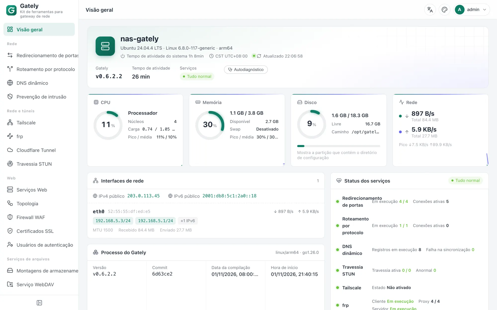

## O que ele substitui

| O que você usa hoje | No Gately |
| --- | --- |
| nginx ou Nginx Proxy Manager | Serviços Web: proxy reverso, sites estáticos, redirecionamentos, HTTP/3, regras de acesso por site; importa configurações do nginx |
| certbot / acme.sh | Certificados ACME com DNS-01 e HTTP-01, curinga, renovação e distribuição automáticas |
| ddns-go ou scripts de DDNS | DNS dinâmico com mais de 30 provedores, IPv4 e IPv6 |
| roteamento SNI do haproxy / sslh | Roteamento por protocolo: HTTPS, SSH, RDP e mais compartilham uma só porta |
| fail2ban | Regras de logs, portas-armadilha e detecção de varredura, com bloqueios gravados no nftables ou iptables |
| ModSecurity / um WAF separado | Coraza com OWASP CRS v4, por site |
| Login no estilo Authelia na frente dos aplicativos | Login integrado, TOTP, Passkeys e um provedor OIDC; autenticação delegada (forward auth) também é suportada |
| frpc / cloudflared / tailscaled executados à mão | frp, Cloudflare Tunnel, Tailscale, NetBird e EasyTier gerenciados, com instalação, atualização e rollback |
| Gambiarras de redirecionamento de portas sem IPv4 público | Travessia STUN: hole punching TCP / UDP, mudanças de endereço sincronizadas com registros DNS, Webhooks e scripts |

Você pode desativar qualquer módulo de que não precisa, ou gerar um binário só com os módulos escolhidos em [build.gately.cn](https://build.gately.cn).

## Experimente

```bash
docker run -d --name gately --network host --cap-add NET_ADMIN \
  -v ./gately-data:/etc/gately \
  ghcr.io/wangwanjie/gately:latest
```

Abra `http://<IP do dispositivo>:16680`, entre com `admin` / `gately.cn` e defina a sua própria senha quando for solicitado. O modo de rede do host permite que o Gately escute as portas que você configurar; `NET_ADMIN` permite que os bloqueios cheguem ao firewall do host (sem ele, os bloqueios continuam valendo para os serviços do próprio Gately). Adicione `-v /var/run/docker.sock:/var/run/docker.sock` se quiser o módulo Docker. As imagens existem para amd64, arm64 e arm/v7 no GHCR e no Docker Hub como `vanjayak/gately` (mesma imagem; use-a se o GHCR for difícil de acessar).

Outras formas de instalar: [binário e serviço do sistema](#instalação) · [OpenWrt](#instalação) · [fnOS](#instalação) · [Docker Compose](../../deploy/docker-compose.yml) · [todas as opções](https://gately.cn/pt-BR/docs/guide/install)

Esqueceu a senha ou perdeu o autenticador? Execute `gately reset-password` ou `gately reset-totp` no servidor (`docker exec -it gately gately reset-password` no Docker); veja [Redefinir a senha e a autenticação em dois fatores](https://gately.cn/pt-BR/docs/guide/install#reset). Pouco espaço de armazenamento, como em um roteador? Em [build.gately.cn](https://build.gately.cn) você gera um binário, um pacote OpenWrt ou fnOS, ou uma imagem Docker multiarquitetura só com os módulos e idiomas da interface que escolher.

## Por que confiar nele na borda da sua rede

- **Legível e discreto**: Apache-2.0, por padrão nenhuma conexão com servidores do projeto e nenhum envio de informações do dispositivo; todo endereço externo (consulta de IP, STUN, verificação de atualizações) é visível, editável e pode ser desativado. O login de terceiros usa seus próprios aplicativos OAuth, sem intermediários.
- **Releases verificáveis**: assinaturas cosign, proveniência do build e SBOM em todos os artefatos ([como verificar](../pt-BR/VERIFY.md)); as correções de segurança são publicadas como [avisos do GitHub](https://github.com/wangwanjie/gately/security/advisories). O `checksums.txt` também é assinado com minisign, e as atualizações online verificam essa assinatura antes de instalar.
- **Toda alteração fica registrada**: log de auditoria, histórico de configuração com diff e rollback em um clique, JSON simples que você pode manter no git.
- **Acompanha haproxy + nginx**: 26 mil req/s contra 14,7 mil nos mesmos 2 núcleos, em uma comparação equivalente ([números e método](#desempenho)).

## Recursos

Um tour rápido pela interface de administração. A lista completa de módulos fica no fim desta seção.

### Tudo num relance

A visão geral mostra CPU, memória, disco e tráfego, as interfaces de rede com o IPv4 e o IPv6 públicos e o estado de cada módulo, para você ver em segundos se algo precisa de atenção.


### Serviços Web que podem substituir o nginx

Proxy reverso, arquivos estáticos e redirecionamentos por domínio, com HTTPS e HTTP/3. Cada site tem seu próprio WAF, regras de IP e login, e as alterações valem sem derrubar conexões.

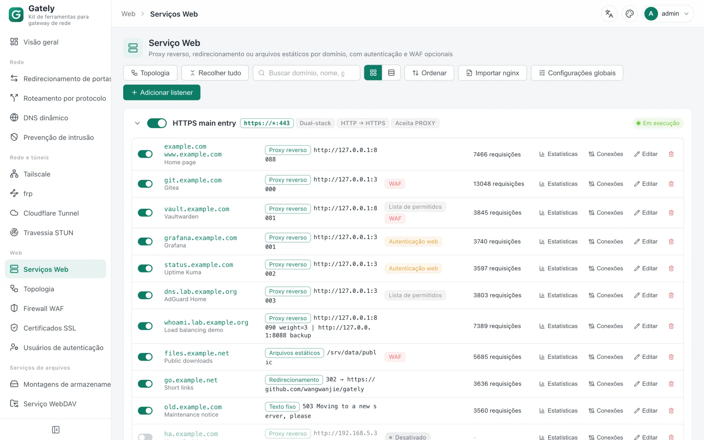

<p><b>Estatísticas por site</b> — requisições, erros, saúde dos backends, principais IPs e países de origem, minuto a minuto.</p>

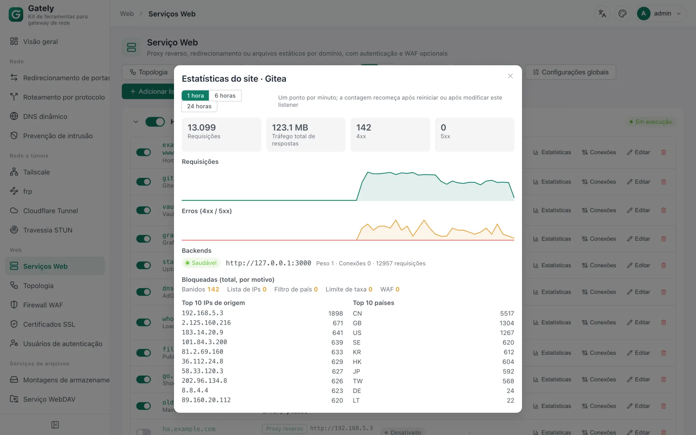

### Topologia de rede

Veja em tempo real como o tráfego flui dos visitantes, passando por listeners e sites, até os backends. Selecione um nó para ver QPS, tráfego e IPs ativos, filtre por IP de visitante, alterne entre sete layouts e oculte endereços antes de compartilhar uma captura de tela.

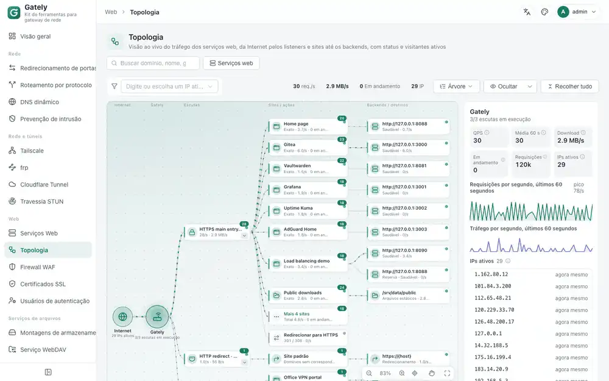

### Uma só porta 443 para todos os serviços

O roteamento por protocolo deixa vários serviços compartilharem a mesma porta por domínio ou protocolo: o TLS passa direto e o protocolo PROXY preserva o endereço real do cliente.

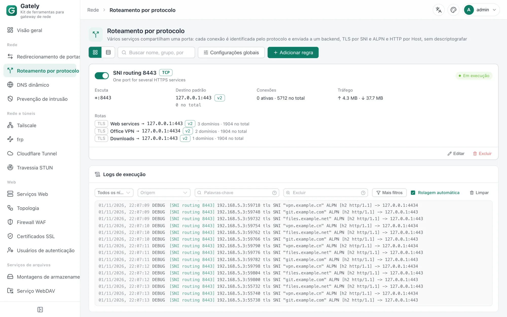

### DNS dinâmico com os principais provedores

Cloudflare, Alibaba Cloud, DNSPod, Route 53 e outros. IPv4 e IPv6, endereço obtido de uma URL, de uma interface de rede ou de um comando, e uma notificação sempre que algo muda.

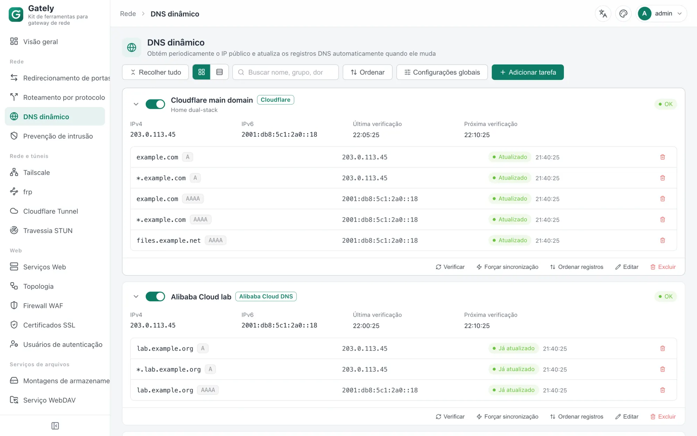

### Prevenção de intrusão

Regras no estilo do fail2ban leem logs de arquivos, do journald e de contêineres, enquanto portas-armadilha e a detecção de varreduras pegam as sondagens. Os bloqueios são sincronizados com o nftables e o tráfego é descartado no kernel.

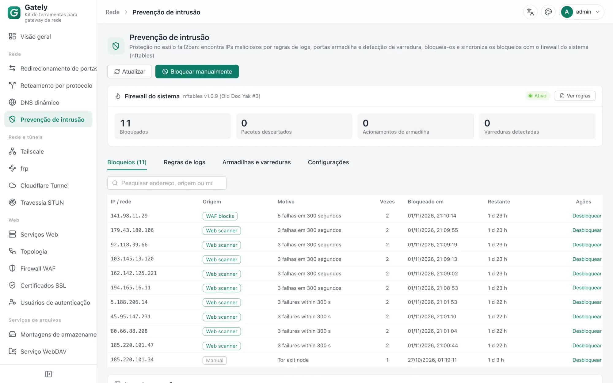

### frp, Tailscale e túneis da Cloudflare

Várias instâncias de frpc e frps lado a lado, junto com o Tailscale e os túneis do cloudflared. O Gately instala, atualiza e faz rollback desses programas por você.

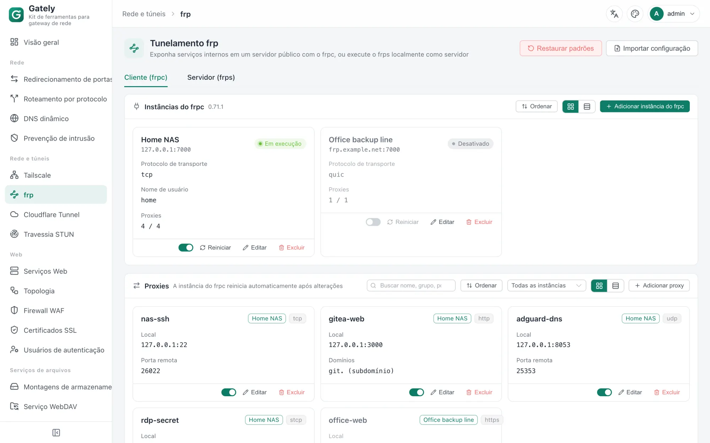

### E mais

<table>
<tr>
<td width="50%" valign="top">

**Docker**<br>Contêineres, Compose, logs e terminais, com atualização de imagens em um clique e rollback automático se algo der errado.

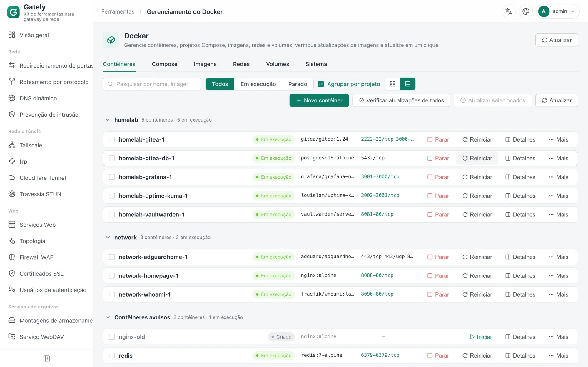

</td>
<td width="50%" valign="top">

**Terminal Web**<br>SSH, Telnet e o shell local no navegador, com SFTP e divisão de tela.

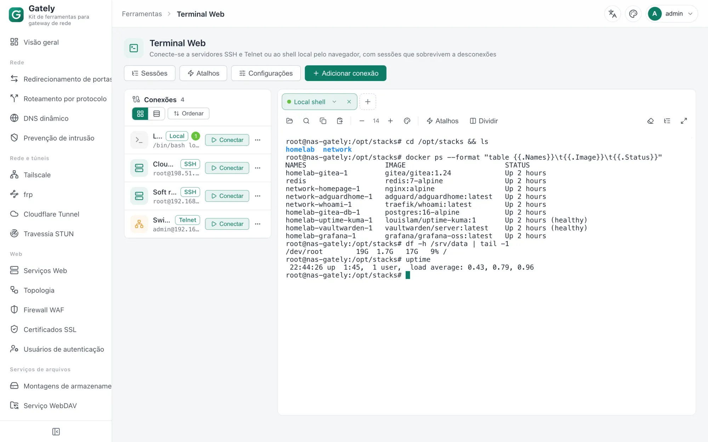

</td>
</tr>
</table>

<table>
<tr>
<td width="50%" valign="top">

**Histórico de configuração**<br>Cada alteração guarda a versão anterior, com comparação das diferenças e rollback em um clique.

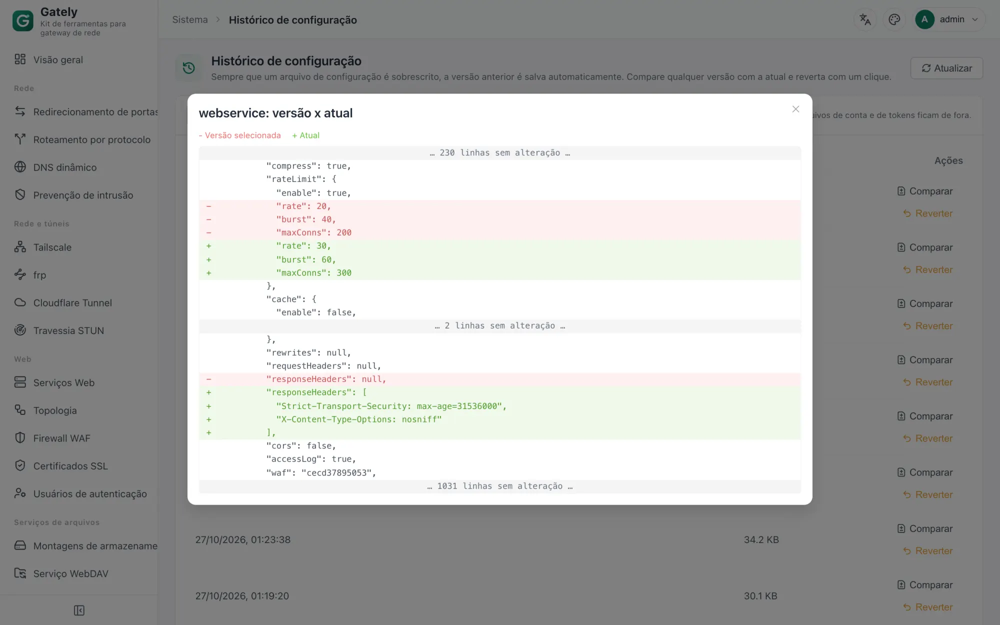

</td>
<td width="50%" valign="top">

**API, linha de comando e MCP**<br>Tokens de API por módulo, documentação OpenAPI integrada, `gately ctl` e um servidor MCP para assistentes de IA.

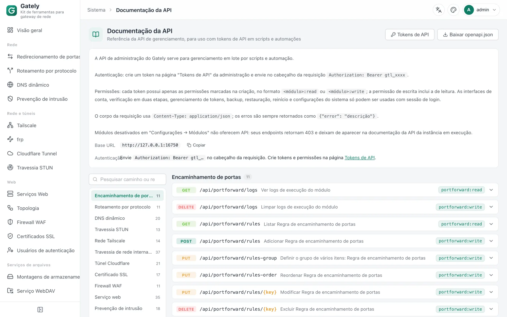

</td>
</tr>
</table>

<details>
<summary><b>Lista completa de recursos</b></summary>

Vários módulos compartilham os mesmos blocos de construção. A travessia STUN, o redirecionamento de portas e o roteamento por protocolo aceitam uma lista de permissão / bloqueio por IP de origem e uma lista de bloqueio prioritário (que podem referenciar listas de IP assinadas) e liberam automaticamente suas portas no firewall local. Tailscale, NetBird, EasyTier, frp, Cloudflare Tunnel e File Browser executam programas externos que o Gately instala, atualiza, reverte e desinstala online, e todos eles têm uma ação de «restaurar as configurações padrão».

| Módulo | Recursos |
| --- | --- |
| DNS dinâmico | Alibaba Cloud, Cloudflare, Tencent Cloud, DNSPod, Huawei Cloud, GoDaddy, Porkbun, dynv6, DuckDNS, Amazon Route 53, OVHcloud, Gandi, NS1, Bunny DNS, Namecheap, Tencent Cloud EdgeOne, Alibaba Cloud ESA, Baidu AI Cloud, Volcano Engine, DNS.LA, Rainyun, Now.cn, Eranet, Tnet.hk, HiPM DNSMgr, Vercel, NameSilo, Dynadot, Spaceship, Name.com, Gcore, ClouDNS, deSEC, DynDNS2 (No-IP, Dynu, …), callback personalizado |
| DNS dinâmico: tarefas | Obtenção do IP por URL, interface de rede ou comando; IPv4/IPv6; Webhook; grupos, ordenação e busca; observações gravadas no provedor; ao excluir uma tarefa, é possível excluir também o registro no provedor |
| Travessia STUN | TCP/UDP, keepalive, UPnP/NAT-PMP, encaminhamento integrado; Webhook e script acionados quando o endereço muda |
| Redirecionamento de portas | TCP/UDP, IPv4/IPv6, intervalos de portas, failover entre vários destinos, limite de conexões, estatísticas de tráfego, protocolo PROXY v1/v2; grupos, ordenação e busca; limite de conexões simultâneas por origem e tempo limite para conexões que não enviam dados |
| Roteamento por protocolo | Vários serviços compartilham uma mesma porta, como a 443, repassados sem descriptografar: TLS por SNI e ALPN, HTTP por Host, Minecraft por endereço do servidor, além de SSH, RDP, SOCKS, OpenVPN, RTSP, SIP, XMPP, MQTT, AMQP, PostgreSQL, Redis, SMB, Git, IRC, ADB, BitTorrent e uma rota de tempo de espera para protocolos em que o servidor fala primeiro, como VNC; um destino padrão e protocolo PROXY por rota |
| Certificados SSL | Emissão e renovação automáticas por ACME via DNS-01 (curinga; zona DNS de subdomínios delegados detectada via SOA) ou HTTP-01 (sem provedor de DNS); EAB, upload, leitura de arquivos, mapeamento para diretório e execução de script |
| Certificados SSL: IP e curta duração | Certificados de curta duração e para endereços IP públicos (perfil shortlived do Let's Encrypt) |
| Certificados SSL: distribuição | Após a renovação, envio do certificado por SSH a outros hosts com execução de comando, ou reinício dos contêineres Docker que o usam |
| Tailscale | tailscaled gerenciado (rede em espaço de usuário, compatível com contêineres) ou um daemon já existente no sistema; chave de autenticação/link de login, Headscale, rotas de sub-rede, nó de saída, lista de nós, proxy SOCKS5, porta fixa, argumentos extras e variáveis de ambiente; instalação online no Linux |
| NetBird | NetBird Cloud ou um servidor de gerenciamento auto-hospedado; daemon netbird gerenciado (rede em espaço de usuário, permite que outros pares alcancem serviços locais) ou um serviço já existente no sistema; chaves de configuração / links de login, rotas, par de roteamento, DNS, bloquear entrada, lista de pares (direto / relay, latência), proxy SOCKS5; instalação online no Linux, macOS e Windows |
| EasyTier | easytier-core gerenciado: hole punching P2P primeiro, nós de retransmissão auto-hospedados ou à escolha, rede em espaço de usuário com redirecionamento de portas, proxy de sub-rede, nós de saída, proxy KCP / QUIC |
| frp | Várias instâncias de frpc e frps: frpc (proxies tcp/udp/http/https/stcp/xtcp, alterações aplicadas na hora, endereços de acesso clicáveis e copiáveis) e frps (lista de portas permitidas, subdomínios, painel, limites por IP de origem para o login do frpc); importação em um clique de configurações no formato ini antigo e toml novo; portas KCP e QUIC no frps, ajuste do QUIC nas duas pontas e liberação automática das portas do frps no firewall local |
| Cloudflare Tunnel | Túneis cloudflared com token e túneis temporários trycloudflare, vários túneis, reinício automático, exibição do endereço público; edição das rotas dos túneis com token pela API da Cloudflare e criação dos registros DNS |
| WAF | Coraza + OWASP CRS v4, regras ativáveis por arquivo, SecLang personalizado, bloquear ou apenas detectar; também pode enviar requisições a um mecanismo de detecção SafeLine auto-hospedado; sessões de administrador desta instância não passam pelo WAF; pode confiar em usuários autenticados |
| WAF: requisições grandes | Limite de inspeção do corpo ajustável, com inspeção só da parte inicial ou exceção por caminho, para usar o WAF também em sites de upload como nuvens pessoais e WebDAV |
| Prevenção de intrusão: regras | Regras de logs no estilo fail2ban (arquivos de log, journal do systemd, saída de comandos, logs de contêineres Docker, falhas de login no painel, bloqueios do WAF, knocks recusados) com modelos para SSH, Nginx, Vaultwarden e outros |
| Prevenção de intrusão: sondagens | Portas-armadilha e detecção de varredura de portas (reconhece as portas abertas dos módulos do Gately, incluindo portas remotas solicitadas pelo frpc; o modo estrito IPv6 bloqueia por /64; o motivo do bloqueio lista as portas atingidas); bloqueio por sondagem de caminhos web por escuta (caminhos isca como /.env e /.git, varreduras de domínios desconhecidos, 404 repetidos); bloqueio por falhas de handshake TLS por tipo de falha (interrupção no meio, reset, timeout, não TLS etc.) e por escuta |
| Prevenção de intrusão: bloqueios | Uma lista de bloqueio com bloqueios manuais de redes CIDR e permanentes, durações progressivas e lista de permissões; sincronizada com o firewall do sistema (nftables / iptables + ipset) e descartada no kernel, ou válida para os serviços do Gately onde não há nftables |
| Port Knocking | Single Packet Authorization (SPA) compatível com clientes fwknop: criptografia AES-256, autenticação HMAC, proteção contra replay e janela de tempo; as portas protegidas são bloqueadas no firewall do sistema (nftables / iptables + ipset) e o endereço que faz o knock é liberado por tempo limitado, sem afetar conexões já estabelecidas |
| Port Knocking: integrações | Redirecionamento de portas, roteamento por protocolo (por rota) e STUN podem usar «Exigir knock», sem permissão de firewall; o roteamento por protocolo aceita pacotes de knock por TCP, expondo uma única porta; a liberação após login web autoriza o IP do visitante (IPv6 por /64, podendo ser gravada no firewall do sistema), sem cliente; knocks recusados podem ser entregues à Prevenção de intrusão |
| Gerenciamento do Docker | Criação e edição de contêineres, logs e terminal, Compose, verificação de atualização de imagens e atualização em um clique (rollback automático em caso de falha), redes e volumes; tarefas em segundo plano, como downloads, compilações, Compose e atualizações em lote, podem ser interrompidas no meio |
| Docker: atualização do próprio Gately | Atualização do contêiner em que o próprio Gately roda, por um contêiner auxiliar temporário, restaurando o antigo em caso de falha |
| Terminal Web | SSH (confiança na chave do host no primeiro acesso), Telnet, shell local (desativado por padrão); proxy, sessões persistentes, gerenciamento de arquivos por SFTP, 2FA e confirmação de protocolo, comandos rápidos, divisão de tela; seleção e cópia com toque longo no celular, painel de colagem e histórico da área de transferência |
| Diagnóstico de rede | Ping, traceroute, teste de porta, consulta DNS, teste de velocidade, varredura da rede local |
| Central de notificações | Webhook, Telegram, Bark, ntfy, Gotify, Pushover, Discord, Slack, ServerChan, PushPlus, WeCom, DingTalk, Feishu, e-mail; níveis, regras com curingas e de silenciamento/desduplicação; proxy global ou por canal (HTTP e SOCKS5); modelos de regras integrados (falhas críticas, expiração de certificados, mudanças de endereço, logins, alterações de configuração, atualizações de versão); alerta de login na interface de administração a partir de um novo endereço |
| Backup da configuração | Backups criptografados (scrypt + AES-GCM), política de retenção, backup agendado para um diretório local ou ponto de montagem de armazenamento |
| Linha de comando e MCP | `gately ctl` controla a instância em execução, `gately mcp` fornece um serviço MCP via stdio (somente leitura por padrão) |
| Wake-on-LAN | Broadcast do magic packet, detecção de status online; controle por voz com Bemfa (Xiao AI, Xiaodu, Google Assistant) |
| Wake-on-LAN: desligamento | Desligamento, reinicialização e suspensão remotos por um agente no dispositivo (Windows/Linux/macOS/OpenWrt, conexão iniciada pelo dispositivo, sem abrir portas), um comando SSH do terminal web ou uma requisição HTTP |
| WebDAV, FTP, SMB | Vários usuários, diretórios independentes, somente leitura; usuários compartilhados comuns aos três serviços; o FTP acrescenta FTPS e intervalo de portas passivas; o SMB acrescenta compartilhamentos por usuário com um ou mais diretórios, SMB 2/3, criptografia e descoberta Bonjour |
| File Browser | Hospeda o gerenciador de arquivos web FileBrowser Quantum: várias instâncias, vários diretórios compartilhados com somente leitura, autenticação por senha ou proxy reverso |
| Montagens de armazenamento | Diretórios locais, montagens WebDAV remotas e compartilhamentos SMB, gerenciamento de arquivos online |
| Tarefas agendadas | Expressões cron, comandos ou requisições HTTP, histórico de execuções |
| Gestão de listas | Regras, instâncias, certificados, registros DNS, conexões de terminal, tokens de API e outras listas têm grupos, ordenação manual (arrastar ou setas, com seleção múltipla) e busca, com ativação, desativação e exclusão em lote; os sites dos Serviços Web também permitem adicionar, remover ou substituir domínios, alterar opções em lote e ser movidos para outro listener (ao editar, em lote ou arrastando); a maioria alterna entre visão em cartões e compacta; reordenar ou agrupar não reinicia nenhum serviço e funciona no celular; a maioria dos itens pode ser duplicada como ponto de partida, reaproveitando os segredos salvos |
| Login de administração | Login com passkey (WebAuthn), autenticação em dois fatores (TOTP), contas somente leitura, limitação de falhas de login (bloqueio progressivo), orçamento de falhas de endereços desconhecidos (contra força bruta distribuída), detecção de senhas fracas e troca obrigatória de senha, desativação do login por senha (apenas passkey), pontuação de segurança |
| Acesso à administração | Entrada de segurança, acesso somente pela rede interna, resposta configurável a solicitações não autorizadas para ocultar a porta de administração (404 simples, página em branco, fechar a conexão, sem resposta ou página personalizada), HTTPS na interface de administração, endereço real do cliente vindo de proxies reversos locais confiáveis |
| Configurações | Vários tokens de API (autorização de leitura e escrita por módulo), senhas e chaves salvas exibidas sob demanda (exige permissão de escrita), DNS personalizado (com suporte a DoH), fuso horário, backup e restauração da configuração, ativação e desativação dos módulos de recursos (módulos desativados não iniciam serviços nem oferecem API), nível de log (`GATELY_LOG_LEVEL`) |
| Interface de administração | Busca global (Ctrl/⌘+K) por páginas, abas, domínios de sites, regras de redirecionamento de portas, registros DDNS e certificados; escolha do cenário de uso na primeira execução com uma lista de primeiros passos; assistente de site rápido em três etapas que testa o endereço do backend; modelos de cenário nas listas vazias de redirecionamento de portas e DDNS; modo de demonstração pública somente leitura (`-demo`) |
| Verificação de atualizações | Verificação automática de novas versões e avisos de segurança (requisições anônimas ao GitHub, desativável), com alerta destacado e notificação quando um problema de segurança publicado afeta a versão em uso |
| Aplicativo nativo para fnOS | Pacotes `.fpk` offline (x86 / ARM); integrado ao gateway unificado do fnOS, abre pelo ícone na área de trabalho do fnOS e funciona pelo seu domínio remoto do fnOS; os administradores do fnOS podem entrar com a sessão do fnOS (desativado por padrão); roda como root para escutar nas portas 80/443 e gerenciar o Docker |
| Auditoria e histórico | Log de auditoria de logins, alterações de configuração e acessos a conteúdo sensível (nunca registra corpos de requisição nem segredos); cada arquivo de configuração sobrescrito mantém as versões anteriores, com diff e rollback em um clique; diretório de configuração declarativa (`-apply`) para GitOps |
| Monitoramento | Painel de desempenho com tendências de 60 segundos / 1 hora / 24 horas do host, do processo do Gately e dos sites, incluindo o tempo até o primeiro byte P50 / P95; CPU e memória dos processos gerenciados (frp, Tailscale, NetBird, cloudflared, File Browser); alertas por limite (métrica + limite + duração) com avisos de disparo e recuperação pela central de notificações |
| Métricas e autodiagnóstico | Endpoint global do Prometheus `/api/metrics` (certificados, DDNS, STUN, redirecionamento de portas, serviços Web) com painel do Grafana pronto para uso; autodiagnóstico de rede em um clique (IP público, CGNAT, relógio, portas 80/443, resolução DDNS, expiração de certificados, sites HTTPS sem certificado, conflitos de proxies frp) |
| Migração | Importa configurações do nginx (incluindo a saída de `nginx -T`): proxy reverso e upstream, diretórios estáticos, redirecionamentos, backends por caminho e controle de acesso, com `auth_request` convertido em autenticação delegada; importa diretamente configurações do Nginx Proxy Manager (variáveis `set` substituídas em `proxy_pass`); converte exportações do Sun-Panel 1.x / 2.x em painéis de navegação |

#### Serviços Web

Os detalhes de cada recurso estão na [documentação dos Serviços Web](https://gately.cn/pt-BR/docs/modules/web).

| Área | Recursos |
| --- | --- |
| Tipos de site | Proxy reverso, redirecionamento, arquivos estáticos (URLs limpas, página 404 personalizada), texto fixo, fechar conexão (como o `return 444` do nginx), painel de navegação |
| Listeners e protocolos | HTTPS, HTTP/3 (QUIC), HTTP e HTTPS na mesma porta (redirecionamento ou atendimento direto), porta HTTP extra por listener (como 80 ao lado de 443), WebSocket, backends HTTP/2 sem criptografia (h2c) para gRPC, envio e recebimento do protocolo PROXY, portas liberadas automaticamente no firewall local |
| Backends | Backends por caminho, backends por usuário autenticado (como o `map $remote_user` do nginx, também para sites de redirecionamento, arquivos estáticos, painel de navegação e texto fixo), peso dos backends/backup/estratégias de balanceamento de carga, verificações de integridade ativas e passivas, nova tentativa no próximo backend quando a conexão falha, tempos limite de conexão, handshake TLS e cabeçalhos de resposta, tempos limite de inatividade de leitura/escrita do visitante, backends HTTPS que recebem o domínio visitado como SNI, reescrita de caminhos e remoção de prefixo |
| Login | Autenticação básica, autenticação web, login via GitHub / Google / QQ / OIDC, usuários compartilhados com verificação em dois fatores TOTP, Passkeys e troca da própria senha, login único entre subdomínios, provedor OIDC integrado para Gitea, Grafana e outros aplicativos OpenID Connect, autenticação delegada (forward auth) a um serviço externo como o Authelia, um Gately público que encaminha seus cookies de login a um Gately da rede local, cabeçalhos de requisição com o usuário, o e-mail, o nome de exibição e os grupos do usuário conectado, dispensa de autenticação com sessão de administração (administradores com sessão no console acessam os sites sem nova autenticação, inclusive entre domínios pai), confiar em usuários autenticados (pulam o WAF e a sondagem de caminhos) |
| Controle de acesso | Listas de IP permitidos / bloqueados, listas de IP assinadas com atualização periódica (como faixas de IP por província ou cidade), uma lista de bloqueio prioritário verificada antes da lista de permissão (indicada para listas de IPs maliciosos), filtro de países por GeoIP, regras por caminho, links de compartilhamento temporários, bloqueio automático após falhas de autenticação, admissão por knock (origens que não fizeram o knock não acessam o site) e liberação após login, fechar a conexão em vez de responder 403 quando o acesso é negado |
| Desempenho | Compressão, limitação de taxa, cache de respostas com regras por caminho (sem cache / duração própria / forçar) e limpeza do cache |
| Páginas de erro | Páginas 404 e 5xx em 10 estilos integrados ou com seu próprio HTML (enviado ou arquivo do servidor, verificado e isolado em sandbox), com opção de substituir os erros do backend (como o `proxy_intercept_errors` do nginx) |
| Visibilidade | Estatísticas de acesso por minuto e métricas do Prometheus, conexões ao vivo por site com encerramento ou banimento, visão de topologia com QPS, tráfego e IPs ativos em tempo real de listeners a sites e backends (destaque do caminho por IP, mascaramento de endereços, foco "Somente ativos", reprodução de instantâneos gravados mantidos em memória por tamanho, desativada por padrão), auditoria de visitantes por endereço (sites, caminhos, identidades, proporção bloqueada, retenção), arquivamento diário compactado e exportação dos logs de acesso |
| Painéis de navegação | Uma página de links servida como site: visitantes da LAN recebem endereços da LAN, ícones integrados, outras formas de acesso, temas iguais aos da interface de administração, mecanismos de pesquisa, imagem de fundo, links visíveis após login, tamanhos de cartão, menu de idioma para visitantes, rodapé próprio; estilos de link (cartões ou ícones de app) e layout (tamanho do ícone, links por linha, espaçamento, largura); seletor de endereço para links com vários endereços; contagem por grupo e selo de endereços opcionais |
| Operação | Alterações aplicadas sem derrubar as conexões abertas, grupos de sites, ordenação e busca, IP real do visitante obtido dos cabeçalhos de proxies confiáveis (CDN, WAF), domínios clicáveis, com cópia do endereço completo, as linhas de sites HTTPS mostram o certificado correspondente e os dias restantes |

</details>

## Instalação

O Docker é o caminho mais rápido (veja [Experimente](#experimente)). As outras formas:

<details>
<summary><b>Binário</b></summary>

Baixe o pacote da sua plataforma em [Releases](https://github.com/wangwanjie/gately/releases) (Linux amd64/arm64/arm/mips/mipsle/riscv64, macOS, Windows, FreeBSD), extraia e execute:

```bash
./gately -c /etc/gately
```

Parâmetros: `-c` diretório de configuração (também pode ser definido pela variável de ambiente `GATELY_CONFIG_DIR`), `-listen` substitui o endereço de escuta da interface de administração, `-apply` aplica a cada inicialização os arquivos `<nome>.json` de um diretório ao diretório de configuração (`GATELY_APPLY_DIR`, útil para GitOps e Kubernetes; os arquivos de contas e tokens não podem ser sobrescritos), `-version` exibe a versão. Em instalações automatizadas, defina `GATELY_INITIAL_PASSWORD` para escolher a senha inicial do administrador em vez da senha padrão `gately.cn`.

Iniciar com o sistema: depois de extrair, execute `sudo ./gately service install` (no Windows, `.\gately.exe service install` em um terminal de administrador). Isso registra uma unidade systemd no Linux, um daemon launchd no macOS (com `-user`, um item de login sem sudo) e um serviço no Windows, inicia o Gately e o reinicia após uma falha. O diretório de configuração padrão é `/etc/gately`, `/usr/local/etc/gately` ou `%ProgramData%\Gately`; `-c` e `-listen` o substituem. O serviço aponta para o caminho do executável, então coloque-o antes no local definitivo. Depois, gerencie com `gately service uninstall|start|stop|restart|status`; a desinstalação mantém o diretório de configuração.

Modelos de serviço: [systemd](../../deploy/systemd/gately.service) e [OpenWrt procd](../../deploy/openwrt/gately.init). Para verificar os pacotes e imagens baixados (assinaturas cosign, proveniência do build, SBOM), consulte [Verificação dos artefatos de release](../pt-BR/VERIFY.md).

</details>

<details>
<summary><b>Aplicativo nativo para fnOS</b></summary>

Cada Release inclui pacotes `.fpk` offline para o fnOS: `gately_<versão>_fnos_x86.fpk` (Intel/AMD) e `gately_<versão>_fnos_arm.fpk` (ARM). Eles não estão na Central de aplicativos oficial, então instale-os manualmente: abra **Central de aplicativos → Instalação manual** (o botão no canto inferior esquerdo), escolha o arquivo e conclua o assistente.

- **Integrado ao gateway unificado do fnOS**: clique no ícone do Gately na área de trabalho do fnOS e a interface de administração abre pelo gateway unificado do fnOS em `/app/gately/`, compartilhando o ponto de entrada que você já usa para o fnOS. Tanto o endereço da rede local quanto o seu domínio remoto do fnOS funcionam, sem precisar abrir ou redirecionar a porta 16680. O acesso pelo gateway é controlado pelo fnOS (somente administradores do fnOS podem abri-lo), por isso a entrada segura e o acesso somente pela rede local valem apenas para o acesso direto pela porta 16680.
- **Administradores do fnOS entram com a sessão do fnOS**: ative **Configurações → Controle de acesso → Entrar com o fnOS** e os administradores que já estão conectados ao fnOS entram no Gately pelo ícone da área de trabalho sem senha nem código de verificação em dois fatores; os usuários comuns do fnOS continuam fazendo login. Depois que você sai, a página de login mostra um botão "Entrar como usuário do fnOS &lt;nome&gt;" em vez de conectar você de novo silenciosamente. A opção vem desativada por padrão e só aparece no pacote do fnOS.
- Na rede local, a interface de administração também fica em `http://<endereço do NAS>:16680`. Conta padrão `admin`, senha padrão `gately.cn`.
- O aplicativo roda como `root`, então pode escutar nas portas 80/443, gerenciar o Docker pelo `docker.sock` e abrir um terminal Web de verdade. Instale-o somente em um NAS que você controla.
- A configuração fica no diretório `var` do aplicativo e é mantida na desinstalação, a menos que você escolha "excluir tudo" no assistente de desinstalação. Para atualizar, instale manualmente o `.fpk` mais novo.
- O pacote também adiciona o comando `gately` (`/usr/local/bin/gately`) para usar `gately ctl` e `gately mcp`.
- A porta 16680 é a mesma da imagem Docker. Pare o contêiner `gately` antes de iniciar o aplicativo nativo.
- Verifique o download conforme [Verificação dos artefatos de release](../pt-BR/VERIFY.md); os arquivos `.fpk` constam em `checksums.txt`.

</details>

<details>
<summary><b>OpenWrt</b></summary>

Cada Release inclui pacotes para OpenWrt: `gately_<versão>_openwrt_<arquitetura>.ipk` para o OpenWrt 24.10 e anteriores (incluindo o iStoreOS), instalado com `opkg install`, e `.apk` para o OpenWrt 25.12 e posteriores, instalado com `apk add --allow-untrusted`. Os pacotes cobrem amd64 / arm64 / arm / mipsle / mips / riscv64; escolha pelo `DISTRIB_ARCH` em `/etc/openwrt_release` (veja a tabela no [guia de instalação](https://gately.cn/pt-BR/docs/guide/install#openwrt)).

- O serviço é ativado e iniciado na instalação; a interface de administração fica em `http://<endereço do roteador>:16680`, com a conta padrão `admin` e a senha padrão `gately.cn`.
- A configuração fica em `/etc/gately` e é mantida em atualizações, desinstalações e atualizações de firmware (sysupgrade). Para atualizar, instale o pacote mais novo; a atualização online na página Sobre indica o gerenciador de pacotes.
- O binário tem cerca de 32 MB, então os pacotes atendem boxes OpenWrt x86, boxes ARM64 e outros dispositivos com bastante armazenamento; o pacote arm requer ARMv7 com ponto flutuante por hardware.
- Um aplicativo LuCI independente de arquitetura, `luci-app-gately_<versão>_openwrt_all.ipk` / `.apk`, adiciona **Serviços → Gately** ao LuCI: estado do serviço, iniciar / parar, início automático, porta de administração e um link direto para a interface.

</details>

## Operações

Monitoramento, API e programas gerenciados têm páginas próprias na [documentação](https://gately.cn/pt-BR/docs/guide/introduction); o essencial está aqui.

<details>
<summary><b>Monitoramento</b></summary>

Crie um token de API apenas com a permissão `metrics:read` e aponte o Prometheus para `/api/metrics`. As métricas, os exemplos de alertas e o painel do Grafana estão descritos em [Monitoramento](../pt-BR/MONITORING.md).

</details>

<details>
<summary><b>Chamadas de API</b></summary>

Na página "Tokens de API" do painel de administração, crie um token (é possível criar vários, concedendo somente leitura ou leitura e escrita por módulo, com prazo de validade opcional; o valor em texto simples é exibido apenas uma vez após a criação) e seus scripts poderão chamar a API de administração em lote:

```bash
curl -H "Authorization: Bearer gtl_xxxx" http://localhost:16680/api/ddns/tasks
```

Conta, autenticação em dois fatores, gerenciamento de tokens e as interfaces de backup, restauração, reinício e configurações do sistema só podem ser usadas com uma sessão de login. Todas as interfaces, permissões necessárias e estruturas de dados estão na página "Documentação da API" do painel de administração; também é possível exportá-las com `make api-docs` para [docs/api](../api/pt-BR) (`openapi.json` e `API.md`), que o site https://gately.cn referencia diretamente na publicação.

Ao atualizar de uma versão antiga, o token de API global anterior se torna automaticamente um token "Legado" (o valor não muda e tem permissão em todos os módulos). Recomenda-se restringir suas permissões na página "Tokens de API" ou substituí-lo por um novo token.

</details>

<details>
<summary><b>Tailscale, NetBird, EasyTier, frp, cloudflared</b></summary>

Esses cinco módulos gerenciam programas externos oficiais (reinício automático, logs reunidos na interface). O Gately não os inclui. O cartão "Instalação online" na página de cada módulo baixa do upstream a versão estável mais recente ou uma versão específica, verifica o SHA-256, instala em `bin/` no diretório de configuração e reinicia os processos que a usam; cada programa pode ter seu próprio proxy de download, e vazio usa o proxy de atualização das configurações. As 3 últimas versões substituídas ficam guardadas, e se a nova tiver problemas dá para reverter com um clique; um programa que não for mais necessário pode ser desinstalado. O botão "Restaurar padrões" no cabeçalho da página é separado da desinstalação: ele para os processos, limpa as configurações do módulo e apaga os arquivos que o Gately gerou para ele (arquivos de configuração do frp, dados das instâncias do File Browser, estado de login do Tailscale e do NetBird); a configuração antiga pode ser recuperada no histórico de configuração. O Tailscale só publica pacotes prontos para executar no Linux; em outros sistemas, use o instalador oficial e informe o caminho. Os programas são procurados nesta ordem: o caminho informado nas configurações do módulo, `bin/` no diretório de configuração e `PATH`. Você também pode colocar o binário no diretório de configuração por conta própria, em implantações com Docker por exemplo `./gately-data/bin/frpc`; para o Tailscale, é preciso fornecer `tailscale` e `tailscaled`. Tokens e chaves nos arquivos de configuração são salvos com permissão 0600; o token do cloudflared é passado por variável de ambiente e não aparece na lista de processos.

O módulo File Browser hospeda o [FileBrowser Quantum](https://github.com/gtsteffaniak/filebrowser) (o filebrowser original está arquivado e não recebe mais correções de segurança); a ordem de busca e a instalação, atualização e reversão online são as descritas acima, com instalação em `bin/filebrowser`. A senha do administrador é passada por uma variável de ambiente e nunca é gravada no arquivo de configuração.

</details>

## Desempenho

O roteamento por protocolo via SNI junto com os Serviços Web pode substituir a dupla comum haproxy (roteamento TCP por SNI) + nginx (TLS e proxy reverso). Os números abaixo comparam as duas soluções na mesma máquina, com a configuração de um servidor real: 90 domínios roteados por SNI, protocolo PROXY v2 entre os dois saltos e um certificado ECDSA P-256 com TLS 1.3.

| Cenário | haproxy + nginx | Gately |
| --- | --- | --- |
| Proxy reverso HTTPS, keep-alive, respostas de 1 KB, 64 conexões | 14.767 req/s (p99 35,9 ms) | **26.434 req/s** (p99 5,7 ms) |
| O mesmo sobre HTTP/2 | não testado (a configuração do nginx usava HTTP/1.1) | 27.795 req/s |
| Uma nova conexão TLS para cada requisição, 32 por vez | 2.557 req/s | **3.448 req/s** |
| Respostas de 1 MB, 16 conexões | 1.053 MB/s | **1.585 MB/s** |
| Passagem direta SNI de um fluxo TLS, 4 conexões | 2.927 MB/s | **4.962 MB/s** |
| Passagem direta SNI, novas conexões por segundo, 64 por vez | 6.334 /s | 6.266 /s (empate) |
| Memória sob carga | haproxy ≈ 21 MB + nginx ≈ 21 MB | ≈ 110 MB (um único processo com todos os módulos) |

<details>
<summary><b>Como foi medido</b></summary>

- Máquina: Intel Core i5-13500T. Cada pilha foi limitada a 2 núcleos de CPU (haproxy e nginx no Docker com `--cpuset-cpus`, Gately fixado com `taskset`) para equivaler a um servidor pequeno na nuvem. Os backends e o gerador de carga rodaram em outros núcleos.
- O haproxy usou `mode tcp` com regras `req_ssl_sni` e `send-proxy-v2`. O nginx usou `worker_processes 2` e as configurações de proxy do site de produção, que enviam `Connection: upgrade` e, por isso, abrem uma nova conexão com o backend a cada requisição; um nginx ajustado, com keep-alive para o upstream, reduziria a diferença nas respostas pequenas.
- O caminho do Gately foi a regra SNI, o PROXY v2 e depois um listener de Serviços Web, o mesmo número de saltos do haproxy → nginx.
- Cada caso rodou por 10 segundos, e os casos repetidos concordaram dentro de 3%. Em um servidor real na nuvem com 2 vCPUs, o site estático serviu 5,5k req/s contra 3,4k req/s. As novas conexões TLS ficaram empatadas (cerca de 480–550 por segundo em ambos) quando o cliente usava X25519; com a troca de chaves híbrida pós-quântica que clientes Go e navegadores recentes oferecem, o Gately concluiu cerca de 13% menos handshakes nessa execução.
- Os resultados dependem de hardware, configuração e tráfego. Use-os como uma verificação de que o Gately acompanha o haproxy e o nginx, e meça com a sua própria carga de trabalho.

</details>

## Desenvolvimento

Dependências: Go 1.26+, Node.js 24+, pnpm.

```bash
make web      # compila o frontend (saída em web/dist, embutida via go:embed)
make build    # compila bin/gately
make test     # go test -race ./...
make lint     # gofmt, go vet, verificação de tipos do frontend
```

Tags de build personalizado, testes que exigem preparação extra, requisitos para módulos e o fluxo de i18n estão em [CONTRIBUTING.md](../../CONTRIBUTING.md) (em inglês). A estrutura de diretórios e as escolhas tecnológicas estão em [docs/pt-BR/ROADMAP.md](../pt-BR/ROADMAP.md). O código do site ([gately.cn](https://gately.cn)) fica em `website/` e usa VitePress: `cd website && pnpm install && pnpm dev`.

## Política de releases

- O Gately ainda está abaixo da versão 1.0. Os números de versão têm até quatro partes (por exemplo `v0.6.6.6`); a última parte aumenta nos releases de acompanhamento de uma versão menor.
- Cada tag `v*` executa o [workflow de release](../../.github/workflows/release.yml), que compila os binários, os pacotes OpenWrt e fnOS e a imagem Docker multiarquitetura, e assina os artefatos. As imagens recebem a tag da versão e `latest`, que sempre aponta para o release mais recente.
- Os releases são frequentes: 55 tags de versão entre 17 de outubro e 15 de novembro de 2026. Os [GitHub Releases](https://github.com/wangwanjie/gately/releases) agrupam as notas por módulo e destacam avisos de atualização; o [changelog](https://gately.cn/pt-BR/news/) no site traz os comunicados.
- As correções de segurança saem apenas para a versão mais recente ([SECURITY.md](../../SECURITY.md)). Em produção, fixe uma tag de imagem como `ghcr.io/wangwanjie/gately:v0.6.6.6`, leia as notas do release antes de atualizar e use o histórico de configuração para reverter uma configuração.

## Contribuição

Issues e pull requests são bem-vindos. A lista de verificação para código, módulos, testes e traduções está em [CONTRIBUTING.md](../../CONTRIBUTING.md), e todos os participantes seguem o [Código de Conduta](../../CODE_OF_CONDUCT.md).

## Comunidade

Tire dúvidas no [GitHub Discussions Q&A](https://github.com/wangwanjie/gately/discussions/categories/q-a), onde as respostas ficam pesquisáveis, e compartilhe a sua configuração no Discussions; para conversar na hora há o grupo do Telegram [t.me/gately_chat](https://t.me/gately_chat).

Relate bugs no [GitHub Issues](https://github.com/wangwanjie/gately/issues) e anexe um [pacote de diagnóstico](../pt-BR/DIAGNOSTICS.md) (Configurações → Diagnóstico). Ele é gerado localmente e não contém senhas, tokens, domínios nem IPs reais. Relate problemas de segurança em privado, como descrito em [SECURITY.md](../../SECURITY.md).

## Apoiar

Todos os recursos do Gately são gratuitos. Se ele for útil para você, é possível apoiar o desenvolvimento com USDT, [Afdian](https://ifdian.net/a/gately) ou WeChat Pay; endereços e QR codes estão na [página de apoio](https://gately.cn/pt-BR/sponsor).

## Licença

[Apache License 2.0](../../LICENSE)
