<p align="center">
  <a href="https://gately.cn/ru/"></a>
</p>

<p align="center">
  <a href="https://gately.cn/ru/">Сайт</a> · <a href="https://gately.cn/ru/docs/guide/quick-start">Документация</a> · <a href="https://github.com/wangwanjie/gately/releases/latest">Скачать</a> · <a href="https://gately.cn/ru/news/">История изменений</a> · <a href="https://github.com/user-attachments/assets/ae5b60a4-9402-4a66-86a1-48e40038b4d0">Видеообзор (2 мин)</a> · <a href="https://github.com/wangwanjie/gately/discussions">Discussions</a> · <a href="https://t.me/gately_chat">Telegram</a><br>
  <a href="../../README.md">English</a> | <a href="../../README.zh-CN.md">简体中文</a> | <a href="README.zh-TW.md">繁體中文</a> | <a href="README.ja.md">日本語</a> | <a href="README.ko.md">한국어</a> | <a href="README.es.md">Español</a> | <a href="README.fr.md">Français</a> | <a href="README.de.md">Deutsch</a> | <b>Русский</b> | <a href="README.pt-BR.md">Português (Brasil)</a>
</p>

<p align="center">
  <a href="https://github.com/wangwanjie/gately/releases/latest"></a>
  <a href="../../LICENSE"></a>
  <a href="https://hub.docker.com/r/vanjayak/gately"></a>
</p>

# Gately

**Самохостинговый шлюз с веб-интерфейсом: обратный прокси, автоматический HTTPS, динамический DNS, обход NAT, WAF и блокировки в духе fail2ban в одном бинарном файле.**

Gately стоит на границе домашней сети или сервера и берёт на себя весь путь от интернета до ваших служб: держит домен указывающим на меняющийся IP, получает и продлевает сертификаты, пропускает все службы через один порт 443, ставит перед ними вход и WAF и блокирует адреса, которые зондируют сеть. Всё настраивается в браузере. Apache-2.0, без телеметрии, конфигурация хранится в обычном JSON на вашем устройстве.

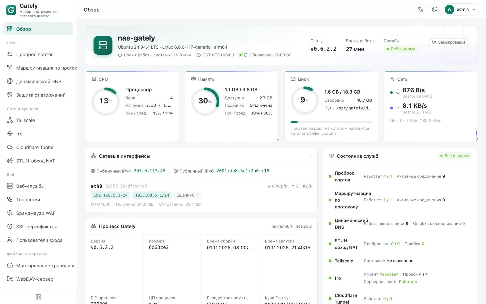

## Что он заменяет

| Что вы запускаете сейчас | Что в Gately |
| --- | --- |
| nginx или Nginx Proxy Manager | Веб-службы: обратный прокси, статические сайты, перенаправления, HTTP/3, правила доступа для каждого сайта; импорт конфигурации nginx |
| certbot / acme.sh | Сертификаты ACME через DNS-01 и HTTP-01, wildcard, автоматическое продление и развёртывание |
| ddns-go или скрипты DDNS | Динамический DNS для 30+ провайдеров, IPv4 и IPv6 |
| SNI-маршрутизация haproxy / sslh | Маршрутизация по протоколу: HTTPS, SSH, RDP и другие делят один порт |
| fail2ban | Правила журналов, порты-ловушки и обнаружение сканирования, блокировки отбрасываются в nftables или iptables |
| ModSecurity / отдельный WAF | Coraza с OWASP CRS v4, для каждого сайта |
| Шлюз входа вроде Authelia перед приложениями | Встроенный вход, TOTP, Passkey и OIDC-провайдер; поддерживается и внешняя аутентификация |
| Вручную запускаемые frpc / cloudflared / tailscaled | Управляемые frp, Cloudflare Tunnel, Tailscale, NetBird и EasyTier с установкой, обновлением и откатом |
| Обходные пути проброса портов без публичного IPv4 | STUN-обход NAT: TCP / UDP hole punching, смена адреса синхронизируется с DNS-записями, Webhook и скриптами |

Любой ненужный модуль можно отключить или собрать бинарный файл только с выбранными модулями на [build.gately.cn](https://build.gately.cn).

## Быстрый старт

```bash
docker run -d --name gately --network host --cap-add NET_ADMIN \
  -v ./gately-data:/etc/gately \
  ghcr.io/wangwanjie/gately:latest
```

Откройте `http://<IP устройства>:16680`, войдите как `admin` / `gately.cn` и задайте собственный пароль, когда будет предложено. Сеть хоста позволяет Gately слушать настроенные вами порты; `NET_ADMIN` позволяет блокировкам попадать в брандмауэр хоста (без неё блокировки по-прежнему действуют на собственные службы Gately). Добавьте `-v /var/run/docker.sock:/var/run/docker.sock`, если нужен модуль Docker. Образы для amd64, arm64 и arm/v7 доступны в GHCR и в Docker Hub как `vanjayak/gately` (тот же образ; используйте его, если GHCR недоступен).

Другие способы установки: [бинарный файл и системная служба](#установка) · [OpenWrt](#установка) · [fnOS](#установка) · [Docker Compose](../../deploy/docker-compose.yml) · [все варианты](https://gately.cn/ru/docs/guide/install)

Забыли пароль или потеряли приложение-аутентификатор? Выполните на сервере `gately reset-password` или `gately reset-totp` (в Docker — `docker exec -it gately gately reset-password`); см. [Сброс пароля и двухфакторной аутентификации](https://gately.cn/ru/docs/guide/install#reset). Мало места, например на роутере? [build.gately.cn](https://build.gately.cn) соберёт бинарный файл, пакет для OpenWrt или fnOS либо многоархитектурный образ Docker только с выбранными вами модулями и языками интерфейса.

## Почему ему можно доверять на границе сети

- **Читаемый и тихий**: Apache-2.0, по умолчанию нет подключений к серверам проекта и отправки данных об устройстве; каждый внешний адрес (определение IP, STUN, проверка обновлений) виден, изменяем и отключаем. Вход через сторонние сервисы использует ваши собственные OAuth-приложения без посредников.
- **Проверяемые выпуски**: подписи cosign, подтверждение происхождения сборки и SBOM для каждого артефакта ([как проверить](../ru/VERIFY.md)); исправления безопасности публикуются как [бюллетени GitHub](https://github.com/wangwanjie/gately/security/advisories). `checksums.txt` также подписан minisign, и онлайн-обновление проверяет эту подпись перед установкой.
- **Каждое изменение записывается**: журнал аудита, история конфигурации с просмотром различий и откатом в один клик, обычный JSON, который можно вести в git.
- **Не отстаёт от haproxy + nginx**: 26k req/s против 14,7k на тех же 2 ядрах при сопоставимой настройке ([цифры и методика](#производительность)).

## Возможности

Несколько снимков интерфейса управления. Полный список модулей — в конце раздела.

### Всё на одном экране

Обзор показывает загрузку CPU, памяти, дисков и трафик, сетевые интерфейсы с их публичными IPv4 и IPv6 и состояние каждого модуля — сразу видно, где нужно вмешаться.


### Веб-службы вместо nginx

Обратный прокси, статические файлы и перенаправления по доменам, с HTTPS и HTTP/3. Для каждого сайта — свой WAF, IP-правила и вход, а изменения применяются без разрыва соединений.

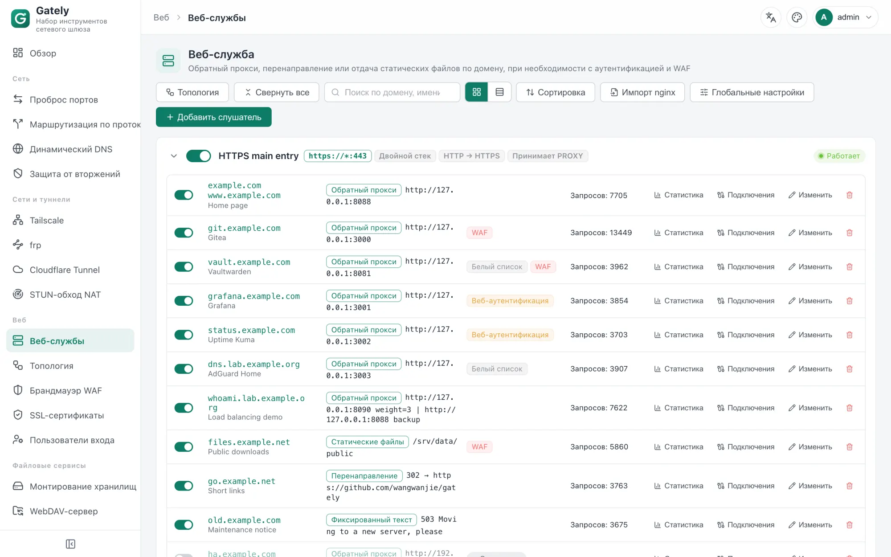

<p><b>Статистика по сайтам</b> — запросы, ошибки, состояние бэкендов, основные IP-адреса и страны клиентов — поминутно.</p>

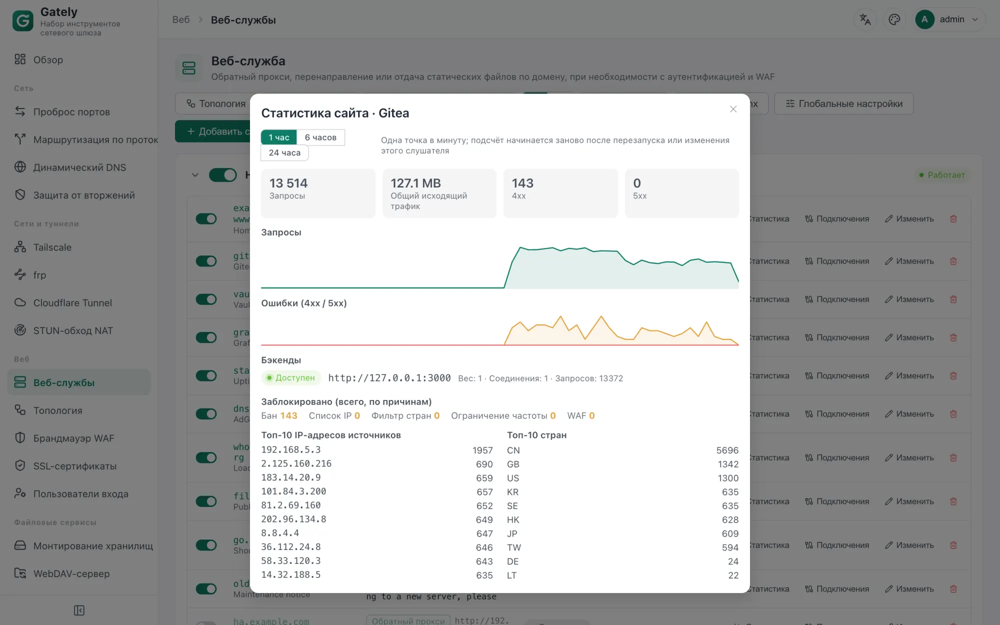

### Топология сети

Смотрите в реальном времени, как трафик идёт от посетителей через слушатели и сайты к бэкендам. Выберите узел, чтобы увидеть QPS, трафик и активные IP, отфильтруйте по IP посетителя, переключайтесь между семью раскладками и скрывайте адреса перед публикацией скриншота.

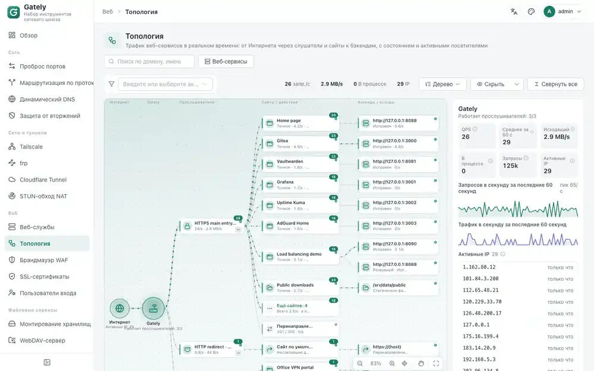

### Один порт 443 для всех служб

Маршрутизация по протоколу размещает несколько служб на одном порту по домену или протоколу: TLS проходит насквозь без расшифровки, а реальный адрес клиента передаётся по протоколу PROXY.

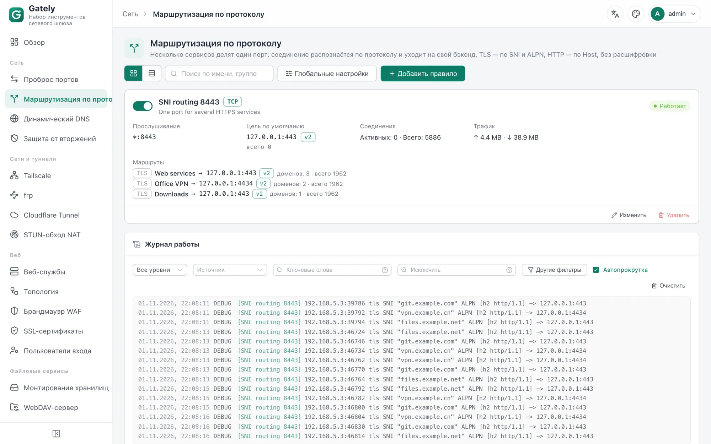

### Динамический DNS с ведущими провайдерами

Cloudflare, Alibaba Cloud, DNSPod, Route 53 и другие. IPv4 и IPv6, адрес берётся из URL, с сетевого интерфейса или из вывода команды, а при каждом изменении приходит уведомление.

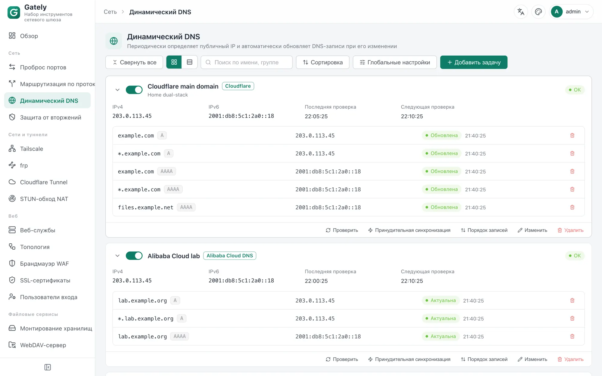

### Защита от вторжений

Правила в духе fail2ban читают журналы из файлов, journald и контейнеров, а порты-ловушки и обнаружение сканирования ловят разведку. Блокировки синхронизируются в nftables, и пакеты отбрасываются прямо в ядре.

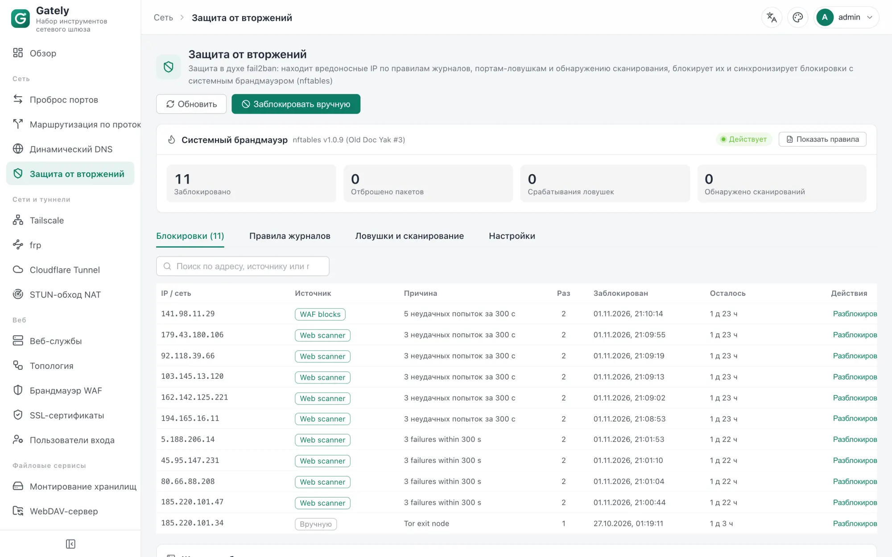

### frp, Tailscale и Cloudflare Tunnel

Несколько экземпляров frpc и frps работают одновременно рядом с туннелями Tailscale и cloudflared. Установку, обновление и откат этих программ Gately берёт на себя.

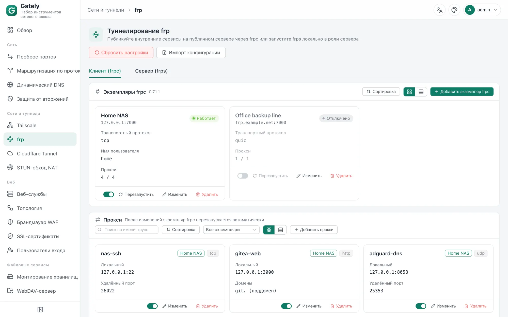

### И ещё

<table>
<tr>
<td width="50%" valign="top">

**Docker**<br>Контейнеры, Compose, журналы и терминал; обновление образа в один клик с автоматическим откатом при сбое.

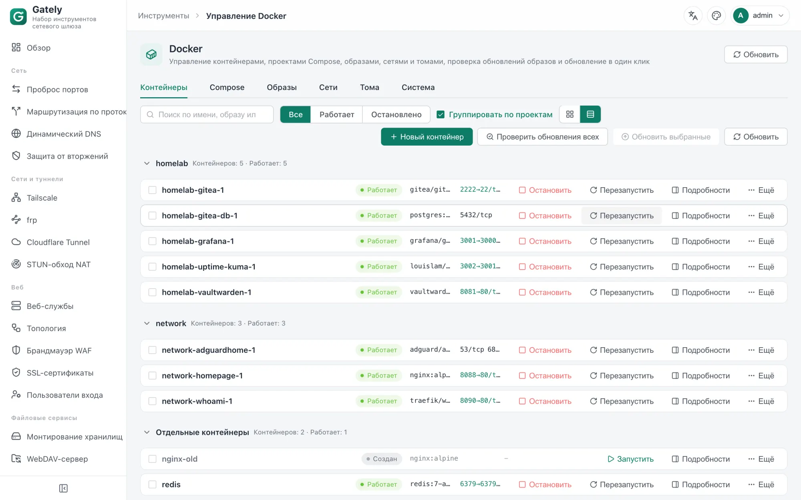

</td>
<td width="50%" valign="top">

**Веб-терминал**<br>SSH, Telnet и локальная оболочка в браузере, с SFTP и разделением экрана.

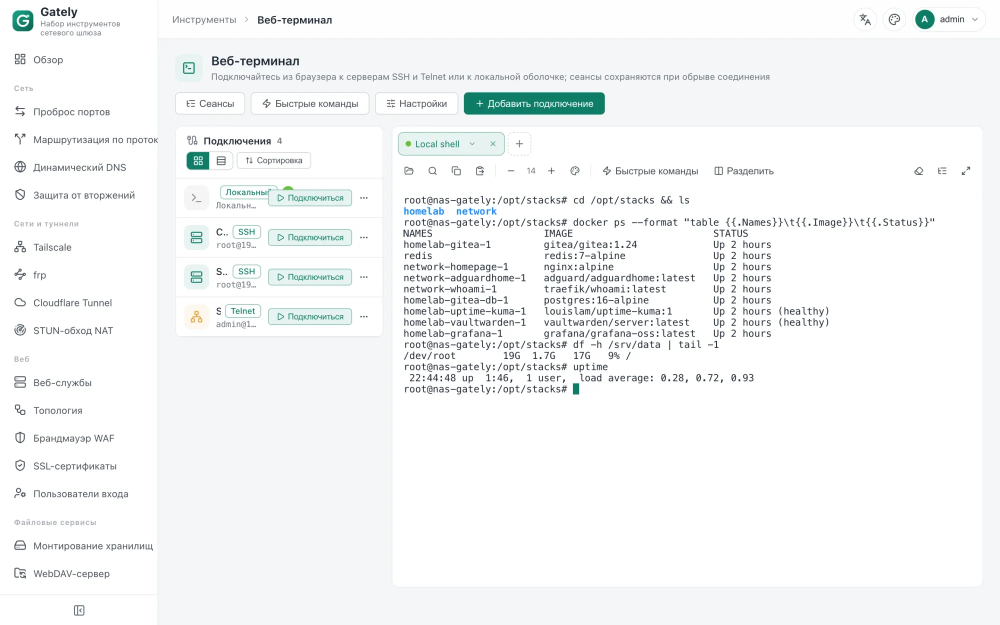

</td>
</tr>
</table>

<table>
<tr>
<td width="50%" valign="top">

**История конфигурации**<br>Каждое изменение сохраняет предыдущую версию: можно сравнить различия и откатиться в один клик.

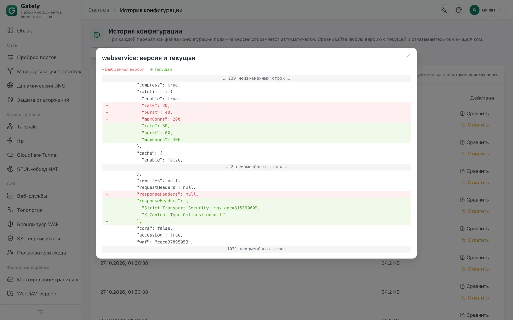

</td>
<td width="50%" valign="top">

**API, CLI и MCP**<br>API-токены с правами по модулям, встроенная документация OpenAPI, `gately ctl` и MCP-сервер для ИИ-ассистентов.

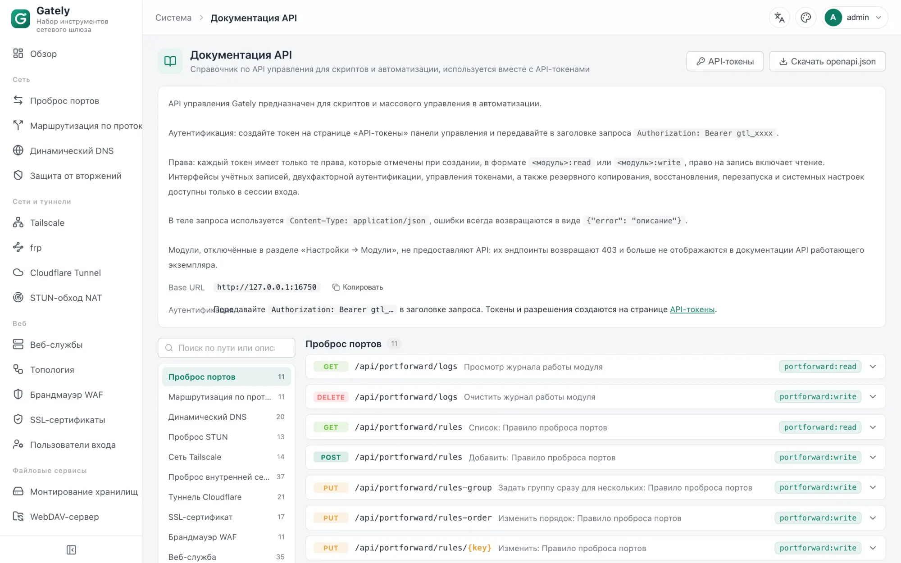

</td>
</tr>
</table>

<details>
<summary><b>Полный список возможностей</b></summary>

У нескольких модулей общие составные части. STUN-обход NAT, проброс портов и маршрутизация по протоколу принимают белый / чёрный список IP источников и приоритетный список запрета (можно ссылаться на подписные списки IP) и автоматически открывают свои порты в локальном брандмауэре. Tailscale, NetBird, EasyTier, frp, Cloudflare Tunnel и File Browser запускают внешние программы, которые Gately устанавливает, обновляет, откатывает и удаляет онлайн, и у каждого из них есть действие «сбросить настройки по умолчанию».

| Модуль | Возможности |
| --- | --- |
| Динамический DNS | Alibaba Cloud, Cloudflare, Tencent Cloud, DNSPod, Huawei Cloud, GoDaddy, Porkbun, dynv6, DuckDNS, Amazon Route 53, OVHcloud, Gandi, NS1, Bunny DNS, Namecheap, Tencent Cloud EdgeOne, Alibaba Cloud ESA, Baidu AI Cloud, Volcano Engine, DNS.LA, Rainyun, Now.cn, Eranet, Tnet.hk, HiPM DNSMgr, Vercel, NameSilo, Dynadot, Spaceship, Name.com, Gcore, ClouDNS, deSEC, DynDNS2 (No-IP, Dynu, …), пользовательский callback |
| Динамический DNS: задачи | Получение IP по URL, сетевому интерфейсу или команде; IPv4/IPv6; Webhook; группы, сортировка и поиск; примечания записываются у провайдера; при удалении задачи можно удалить и запись у провайдера |
| STUN-обход NAT | TCP/UDP, keepalive, UPnP/NAT-PMP, встроенная переадресация; Webhook и скрипт при смене адреса |
| Проброс портов | TCP/UDP, IPv4/IPv6, диапазоны портов, переключение между несколькими целями при отказе, ограничение числа соединений, статистика трафика, протокол PROXY v1/v2; группы, сортировка и поиск; лимит одновременных соединений с одного источника и тайм-аут для соединений без данных |
| Маршрутизация по протоколу | Несколько служб делят один порт, например 443, и передаются без расшифровки: TLS по SNI и ALPN, HTTP по Host, Minecraft по адресу сервера, а также SSH, RDP, SOCKS, OpenVPN, RTSP, SIP, XMPP, MQTT, AMQP, PostgreSQL, Redis, SMB, Git, IRC, ADB, BitTorrent и маршрут «Ожидание» для протоколов, где сервер говорит первым, например VNC; цель по умолчанию и протокол PROXY для каждого маршрута |
| SSL-сертификаты | Автоматический выпуск и продление через ACME по DNS-01 (wildcard; DNS-зона делегированных поддоменов определяется по SOA) или HTTP-01 (без DNS-провайдера); EAB, загрузка, чтение из файла, отображение в каталог и выполнение скрипта |
| SSL-сертификаты: IP и краткосрочные | Краткосрочные сертификаты и сертификаты для публичных IP-адресов (профиль Let's Encrypt shortlived) |
| SSL-сертификаты: развёртывание | После обновления сертификат отправляется по SSH на другие хосты с выполнением команды или перезапускаются использующие его Docker-контейнеры |
| Tailscale | Управление tailscaled (сеть в пользовательском пространстве, подходит для контейнеров) или подключение к существующему системному демону; ключ аутентификации/ссылка для входа, Headscale, маршруты подсетей, выходной узел, список узлов, SOCKS5-прокси, фиксированный порт, дополнительные аргументы и переменные окружения; онлайн-установка в Linux |
| NetBird | NetBird Cloud или собственный сервер управления; управление демоном netbird (сеть в пользовательском пространстве, другие узлы могут обращаться к локальным службам) или подключение к существующей системной службе; ключи настройки / ссылки входа, маршруты, маршрутизирующий узел, DNS, блокировка входящих, список узлов (напрямую / через ретранслятор, задержка), прокси SOCKS5; онлайн-установка в Linux, macOS и Windows |
| EasyTier | Управляемый easytier-core: сначала P2P hole punching, собственные или выбранные ретрансляционные узлы, сеть в пространстве пользователя с пробросом портов, прокси подсетей, выходные узлы, прокси KCP / QUIC |
| frp | Несколько экземпляров frpc и frps: frpc (прокси tcp/udp/http/https/stcp/xtcp, изменения применяются сразу, адреса доступа можно открыть и скопировать) и frps (белый список портов, поддомены, панель управления, ограничение входа frpc по IP источника); конфигурации в старом формате ini и новом toml импортируются в один клик; порты KCP и QUIC у frps, настройка QUIC на обеих сторонах и автоматическое открытие портов frps в локальном брандмауэре |
| Cloudflare Tunnel | Туннели cloudflared по токену и временные туннели trycloudflare, несколько туннелей, автоматический перезапуск, отображение публичного адреса; редактирование маршрутов туннелей с токеном через API Cloudflare и создание DNS-записей |
| Брандмауэр WAF | Coraza + OWASP CRS v4, включение правил по файлам, собственный SecLang, блокировка/только обнаружение; можно подключить и собственный движок обнаружения SafeLine; сеансы администратора этого экземпляра не проходят через WAF; можно доверять вошедшим пользователям |
| WAF: большие запросы | Настраиваемый лимит проверки тела запроса: можно проверять только начало или пропускать по путям, так что WAF подходит и для облачных дисков, WebDAV и других сайтов с загрузками |
| Защита от вторжений: правила журналов | Правила журналов в духе fail2ban (файлы журналов, журнал systemd, вывод команд, журналы контейнеров Docker, неудачные входы в панель, блокировки WAF, отклонённые стуки по портам) с шаблонами для SSH, Nginx, Vaultwarden и других |
| Защита от вторжений: зондирование | Порты-ловушки и обнаружение сканирования портов (автоматически распознаёт открытые порты модулей Gately, включая удалённые порты, запрошенные frpc; строгий режим IPv6 блокирует по /64; причина блокировки содержит затронутые порты); блокировка зондирования веб-путей по слушателю (пути-приманки вроде /.env и /.git, сканы неизвестных доменов, повторяющиеся 404); блокировка по сбоям TLS-рукопожатия по типу сбоя (обрыв, сброс, тайм-аут, не TLS и др.) и по слушателю |
| Защита от вторжений: блокировки | Единый список блокировок с ручными блокировками CIDR-сетей и постоянными блокировками, нарастающей длительностью и белым списком; синхронизируется с системным брандмауэром (nftables / iptables + ipset) и отбрасывается в ядре, а без nftables действует на службы Gately |
| Port Knocking | Односторонний стук одним пакетом (SPA), совместимый с клиентом fwknop: шифрование AES-256, аутентификация HMAC, защита от повтора и окно времени; защищённые порты блокируются в системном брандмауэре (nftables / iptables + ipset), адрес, успешно «постучавший», получает доступ на ограниченное время, установленные соединения не затрагиваются |
| Port Knocking: интеграции | Проброс портов, протокольная маршрутизация (по маршрутам) и STUN могут «Требовать стук» без прав на брандмауэр; протокольная маршрутизация принимает пакеты-стуки по TCP, открывая наружу один порт; разрешение после входа через веб выдаёт доступ IP посетителя (IPv6 по /64, можно записать в системный брандмауэр), клиент не нужен; отклонённые стуки можно передать защите от вторжений |
| Управление Docker | Создание и редактирование контейнеров, логи и терминал, Compose, проверка обновлений образов и обновление в один клик (при сбое автоматический откат), сети и тома; фоновые задачи — скачивание, сборку, Compose, пакетное обновление — можно остановить на полпути |
| Docker: самообновление | Обновление контейнера, в котором работает сам Gately, через временный вспомогательный контейнер; при сбое восстанавливается старый контейнер |
| Веб-терминал | SSH (доверие к ключу хоста при первом подключении), Telnet, локальная оболочка (по умолчанию отключена); прокси, постоянные сеансы, управление файлами по SFTP, 2FA и подтверждение протокола, быстрые команды, разделение экрана; выделение и копирование долгим нажатием на телефоне, панель вставки и история буфера обмена |
| Сетевая диагностика | Ping, трассировка маршрута, проверка портов, DNS-запросы, тест скорости, сканирование локальной сети |
| Центр уведомлений | Webhook, Telegram, Bark, ntfy, Gotify, Pushover, Discord, Slack, ServerChan, PushPlus, WeCom, DingTalk, Feishu, почта; уровни, правила с подстановочными символами, подавление и дедупликация; прокси глобально или для отдельного канала (HTTP и SOCKS5); встроенные шаблоны правил (критические сбои, истечение сертификатов, смена адреса, входы в систему, изменения конфигурации, обновления версий); уведомление о входе в панель управления с нового адреса |
| Резервное копирование конфигурации | Зашифрованные резервные копии (scrypt + AES-GCM), политика хранения, резервное копирование по расписанию в локальный каталог или точку монтирования хранилища |
| Командная строка и MCP | `gately ctl` управляет запущенным экземпляром, `gately mcp` предоставляет MCP-сервис через stdio (по умолчанию только чтение) |
| Wake-on-LAN | Рассылка magic-пакета, проверка доступности; голосовое управление через Bemfa (Xiao AI, Xiaodu, Google Assistant) |
| Wake-on-LAN: выключение | Удалённое выключение, перезагрузка и сон через агент на устройстве (Windows/Linux/macOS/OpenWrt, устройство подключается само, открывать порты не нужно), команду SSH веб-терминала или HTTP-запрос |
| WebDAV, FTP, SMB | Несколько пользователей, отдельные каталоги, только чтение; общие пользователи для трёх служб; FTP добавляет FTPS и диапазон пассивных портов; SMB добавляет общие ресурсы из одного или нескольких каталогов для каждого пользователя, SMB 2/3, шифрование и обнаружение Bonjour |
| File Browser | Запуск веб-файлового менеджера FileBrowser Quantum: несколько экземпляров, несколько общих каталогов с режимом только для чтения, вход по паролю или через обратный прокси |
| Монтирование хранилищ | Локальные каталоги, удалённые WebDAV-монтирования и общие папки SMB, онлайн-управление файлами |
| Запланированные задачи | Выражения cron, команды или HTTP-запросы, журнал выполнения |
| Управление списками | Правила, экземпляры, сертификаты, DNS-записи, подключения терминала, API-токены и другие списки поддерживают группы, ручную сортировку (перетаскивание или стрелки, с множественным выбором) и поиск, а также пакетное включение, отключение и удаление; для сайтов веб-служб доступны пакетное добавление, удаление и замена доменов, пакетное изменение опций и перенос в другой слушатель (при редактировании, пакетно или перетаскиванием); большинство списков переключаются между карточками и компактным видом; изменение порядка и групп не перезапускает службы и работает на телефоне; большинство элементов можно продублировать как основу, сохранённые секреты переносятся |
| Вход администратора | Вход по ключу доступа (Passkey, WebAuthn), двухфакторная аутентификация (TOTP), учётные записи только для чтения, ограничение попыток входа (с нарастающей блокировкой), бюджет неудач для незнакомых источников (защита от распределённого подбора), обнаружение слабых паролей и обязательная смена пароля, отключение входа по паролю (только Passkey), оценка безопасности |
| Доступ к панели | Защищённая точка входа, доступ только из внутренней сети, настраиваемый ответ на неавторизованные запросы, скрывающий порт панели (обычная 404, пустая страница, закрытие соединения, отсутствие ответа или своя страница), HTTPS для интерфейса управления, реальный адрес клиента от доверенных локальных обратных прокси |
| Настройки | Несколько API-токенов (права чтения и записи по модулям), показ сохранённых паролей и ключей по запросу (нужно право записи), собственный DNS (с поддержкой DoH), часовой пояс, резервное копирование и восстановление конфигурации, включение и отключение функциональных модулей (отключённые модули не запускают служб и не обслуживают API), уровень журнала (`GATELY_LOG_LEVEL`) |
| Интерфейс администратора | Глобальный поиск (Ctrl/⌘+K) по страницам, вкладкам, доменам сайтов, правилам проброса портов, записям DDNS и сертификатам; выбор сценария при первом запуске со списком первых шагов; мастер быстрого сайта в три шага с проверкой доступности бэкенда; шаблоны сценариев в пустых списках проброса портов и DDNS; публичный демо-режим только для чтения (`-demo`) |
| Проверка обновлений | Автоматическая проверка новых версий и бюллетеней безопасности (анонимные запросы к GitHub, отключается), с заметным предупреждением и уведомлением, если опубликованная уязвимость затрагивает текущую версию |
| Нативное приложение для fnOS | Офлайн-пакеты `.fpk` (x86 / ARM); интеграция с единым шлюзом fnOS, запуск значком с рабочего стола fnOS, работа через удалённый домен fnOS; администраторы fnOS могут входить по своему сеансу fnOS (по умолчанию отключено); работает от root, чтобы слушать порты 80/443 и управлять Docker |
| Аудит и история | Журнал аудита входов, изменений конфигурации и доступа к конфиденциальным данным (тела запросов и секреты никогда не записываются); каждый перезаписанный файл конфигурации сохраняет предыдущие версии с просмотром различий и откатом в один клик; декларативный каталог конфигурации (`-apply`) для GitOps |
| Мониторинг | Панель производительности с динамикой за 60 секунд / 1 час / 24 часа для хоста, процесса Gately и сайтов, включая время до первого байта P50 / P95; CPU и память управляемых процессов (frp, Tailscale, NetBird, cloudflared, File Browser); оповещения по порогу (метрика + порог + длительность) со срабатыванием и снятием через центр уведомлений |
| Метрики и самодиагностика | Глобальная конечная точка Prometheus `/api/metrics` (сертификаты, DDNS, STUN, проброс портов, веб-службы) с готовой панелью Grafana; самодиагностика сети в один клик (публичный IP, CGNAT, системное время, порты 80/443, разрешение DDNS, срок действия сертификатов, HTTPS-сайты без сертификата, конфликты прокси frp) |
| Миграция | Импорт конфигурации nginx (поддерживается вывод `nginx -T`): обратный прокси и upstream, статические каталоги, редиректы, бэкенды по путям, контроль доступа, `auth_request` преобразуется во внешнюю аутентификацию; прямой импорт конфигураций Nginx Proxy Manager (переменные `set` подставляются в `proxy_pass`); преобразование экспортов Sun-Panel 1.x / 2.x в панели навигации |

#### Веб-службы

Подробности по каждой возможности — в [документации по веб-службам](https://gately.cn/ru/docs/modules/web).

| Область | Возможности |
| --- | --- |
| Типы сайтов | Обратный прокси, перенаправление, статические файлы (URL без расширения, собственная страница 404), фиксированный текст, закрытие соединения (как `return 444` в nginx), панель навигации |
| Слушатели и протоколы | HTTPS, HTTP/3 (QUIC), HTTP и HTTPS на одном порту (перенаправление или обслуживание), дополнительный HTTP-порт у слушателя (например, 80 рядом с 443), WebSocket, бэкенды с незашифрованным HTTP/2 (h2c) для gRPC, приём и отправка протокола PROXY, порты автоматически открываются в локальном брандмауэре |
| Бэкенды | Бэкенды по путям, отдельные бэкенды для вошедших пользователей (как `map $remote_user` в nginx, также для сайтов перенаправления, статических файлов, панели навигации и фиксированного текста), веса бэкендов/резервные/стратегии балансировки нагрузки, активные и пассивные проверки состояния, повтор на следующем бэкенде при ошибке подключения, тайм-ауты подключения, TLS-рукопожатия и заголовков ответа, тайм-ауты простоя чтения/записи посетителя, HTTPS-бэкенды, получающие посещаемый домен как SNI, переписывание путей и удаление префикса |
| Вход | Базовая аутентификация, веб-аутентификация, вход через GitHub / Google / QQ / OIDC, общие пользователи с двухэтапной проверкой TOTP, Passkey и самостоятельной сменой пароля, единый вход на всех поддоменах, встроенный OIDC-провайдер для Gitea, Grafana и других приложений OpenID Connect, внешняя аутентификация через сервис вроде Authelia, публичный Gately пересылает свои cookie входа Gately в локальной сети, заголовки запроса с именем пользователя, e-mail, отображаемым именем и группами вошедшего пользователя, пропуск аутентификации при входе в консоль (администратор, вошедший в консоль управления, открывает сайты без повторной аутентификации, в том числе на другом родительском домене), доверие вошедшим пользователям (без WAF и обнаружения зондирования путей) |
| Контроль доступа | Чёрные и белые списки IP, периодически обновляемые подписные списки IP (например, диапазоны регионов), приоритетный список запрета (проверяется раньше белого списка, подходит для списков вредоносных IP), фильтр стран по GeoIP, правила по путям, временные ссылки для доступа, автоблокировка после неудачных попыток входа, допуск по стуку (источники без разрешения стука не могут открыть сайт) и разрешение после входа, закрытие соединения вместо ответа 403 при отказе в доступе |
| Производительность | Сжатие, ограничение скорости, кэш ответов с правилами по путям (без кэша / свой срок / принудительно) и очисткой кэша |
| Страницы ошибок | Страницы 404 и 5xx в 10 встроенных стилях или из собственного HTML (загруженного или файла на сервере, с проверкой и показом в песочнице), с возможностью подменять ошибки бэкенда (как `proxy_intercept_errors` в nginx) |
| Наблюдаемость | Поминутная статистика доступа и метрики Prometheus, текущие подключения по сайтам с разрывом или блокировкой, топология в реальном времени: QPS, трафик и активные IP от слушателей через сайты к бэкендам (подсветка пути по IP, маскировка адресов, режим «Только активные», воспроизведение записанных снимков, которые хранятся в памяти в пределах заданного объёма, по умолчанию выключено), аудит посетителей по адресам (сайты, пути, пользователи, доля заблокированных, срок хранения), ежедневные сжатые архивы и экспорт журналов доступа |
| Панели навигации | Страница ссылок, работающая как сайт: посетители из LAN получают адреса LAN, встроенные значки, другие способы доступа, темы как в интерфейсе управления, поисковые системы, фоновое изображение, ссылки только после входа, размеры карточек, меню языка для посетителей, свой подвал; стили ссылок (карточки или значки приложений) и раскладка (размер значков, ссылок в строке, отступы, ширина); выбор адреса для ссылок с несколькими адресами; необязательные счётчики групп и значок числа адресов |
| Эксплуатация | Изменения применяются без разрыва открытых соединений, группы, сортировка и поиск сайтов, реальный IP посетителя из заголовков доверенных прокси (CDN, WAF), домены открываются по клику и копируются полным адресом, строки HTTPS-сайтов показывают подходящий сертификат и оставшиеся дни |

</details>

## Установка

Быстрее всего через Docker (см. [Быстрый старт](#быстрый-старт)). Другие способы:

<details>
<summary><b>Бинарный файл</b></summary>

Скачайте архив для своей платформы из [Releases](https://github.com/wangwanjie/gately/releases) (Linux amd64/arm64/arm/mips/mipsle/riscv64, macOS, Windows, FreeBSD), распакуйте и запустите:

```bash
./gately -c /etc/gately
```

Параметры: `-c` — каталог конфигурации (можно также задать переменной окружения `GATELY_CONFIG_DIR`), `-listen` переопределяет адрес, на котором слушает интерфейс управления, `-apply` при каждом запуске применяет файлы `<имя>.json` из каталога к каталогу конфигурации (`GATELY_APPLY_DIR`, удобно для GitOps и Kubernetes; файлы учётных записей и токенов перезаписать нельзя), `-version` выводит версию. Для автоматической установки задайте `GATELY_INITIAL_PASSWORD`, чтобы указать начальный пароль администратора вместо пароля по умолчанию `gately.cn`.

Автозапуск при загрузке: после распаковки выполните `sudo ./gately service install` (в Windows — `.\gately.exe service install` в терминале администратора). Команда регистрирует unit systemd в Linux, демон launchd в macOS (с `-user` — элемент входа без sudo) и службу в Windows, сразу запускает Gately и перезапускает его после сбоя. Каталог конфигурации по умолчанию — `/etc/gately`, `/usr/local/etc/gately` или `%ProgramData%\Gately`, изменить его можно через `-c` и `-listen`. Служба ссылается на путь к исполняемому файлу, поэтому сначала поместите его на постоянное место. Дальше управляйте через `gately service uninstall|start|stop|restart|status`; при удалении каталог конфигурации сохраняется.

Шаблоны служб: [systemd](../../deploy/systemd/gately.service) и [OpenWrt procd](../../deploy/openwrt/gately.init). Проверка загруженных архивов и образов (подписи cosign, происхождение сборки, SBOM) описана в разделе [Проверка артефактов релиза](../ru/VERIFY.md).

</details>

<details>
<summary><b>Нативное приложение для fnOS</b></summary>

К каждому релизу прилагаются офлайн-пакеты `.fpk` для fnOS: `gately_<version>_fnos_x86.fpk` (Intel/AMD) и `gately_<version>_fnos_arm.fpk` (ARM). Их нет в официальном Центре приложений, поэтому устанавливайте их вручную: откройте **Центр приложений → Ручная установка** (кнопка в левом нижнем углу), выберите файл и пройдите мастер.

- **Работает с единым шлюзом fnOS**: щёлкните значок Gately на рабочем столе fnOS, и интерфейс управления откроется через единый шлюз fnOS по пути `/app/gately/`, используя ту же точку входа, что и сама fnOS. Работают и адрес в локальной сети, и удалённый домен fnOS, открывать или пробрасывать порт 16680 не нужно. Доступ через шлюз контролирует fnOS (открыть его могут только администраторы fnOS), поэтому настройки защищённого входа и доступа только из локальной сети действуют только при прямом обращении к порту 16680.
- **Вход администраторов fnOS по их сеансу fnOS**: включите **Настройки → Контроль доступа → Вход через fnOS**, и администраторы, уже вошедшие в fnOS, попадают в Gately со значка на рабочем столе без пароля и кода двухэтапной проверки; обычные пользователи fnOS по-прежнему входят с паролем. После выхода Gately не выполняет повторный вход автоматически: страница входа показывает кнопку «Войти как пользователь fnOS &lt;имя&gt;». Настройка по умолчанию отключена и отображается только в пакете для fnOS.
- В локальной сети интерфейс управления также доступен по адресу `http://<адрес NAS>:16680`. Учётная запись по умолчанию — `admin`, пароль по умолчанию — `gately.cn`.
- Приложение работает от `root`, поэтому может слушать порты 80/443, управлять Docker через `docker.sock` и открывать полноценный веб-терминал. Устанавливайте его только на NAS, который вы контролируете.
- Конфигурация хранится в каталоге `var` приложения и сохраняется при удалении, если в мастере удаления не выбрать «удалить всё». Обновление — это повторная ручная установка более нового `.fpk`.
- Пакет также добавляет команду `gately` (`/usr/local/bin/gately`) для `gately ctl` и `gately mcp`.
- Порт 16680 общий с образом Docker. Перед запуском нативного приложения остановите контейнер `gately`.
- Проверьте загруженный файл по инструкции [Проверка артефактов релиза](../ru/VERIFY.md); файлы `.fpk` перечислены в `checksums.txt`.

</details>

<details>
<summary><b>OpenWrt</b></summary>

К каждому релизу прилагаются пакеты для OpenWrt: `gately_<version>_openwrt_<arch>.ipk` для OpenWrt 24.10 и более ранних версий (включая iStoreOS), который устанавливается командой `opkg install`, и `.apk` для OpenWrt 25.12 и новее, который устанавливается командой `apk add --allow-untrusted`. Пакеты собираются для amd64 / arm64 / arm / mipsle / mips / riscv64; выбирайте пакет по `DISTRIB_ARCH` в `/etc/openwrt_release` (см. таблицу в [руководстве по установке](https://gately.cn/ru/docs/guide/install#openwrt)).

- Служба добавляется в автозагрузку и запускается при установке; интерфейс управления доступен по адресу `http://<адрес роутера>:16680`, учётная запись по умолчанию — `admin`, пароль по умолчанию — `gately.cn`.
- Конфигурация хранится в `/etc/gately` и сохраняется при обновлении и удалении пакета, а также при обновлении прошивки (sysupgrade). Для обновления установите более новый пакет; онлайн-обновление на странице «О программе» в этом случае направит вас к менеджеру пакетов.
- Бинарный файл занимает около 32 МБ, поэтому пакеты рассчитаны на x86-устройства с OpenWrt, приставки на ARM64 и другие устройства с большим объёмом памяти; пакету arm нужен ARMv7 с аппаратной поддержкой операций с плавающей точкой.
- Приложение LuCI `luci-app-gately_<версия>_openwrt_all.ipk` / `.apk`, не зависящее от архитектуры, добавляет в LuCI страницу **Службы → Gately**: состояние службы, запуск / остановка, автозапуск, порт панели управления и ссылка на панель.

</details>

## Эксплуатация

Мониторинг, API и управляемые программы описаны на отдельных страницах [документации](https://gately.cn/ru/docs/guide/introduction); главное — здесь.

<details>
<summary><b>Мониторинг</b></summary>

Создайте API-токен только с правом `metrics:read` и настройте Prometheus на сбор `/api/metrics`. Метрики, примеры оповещений и панель Grafana описаны в разделе [Мониторинг](../ru/MONITORING.md).

</details>

<details>
<summary><b>Вызовы API</b></summary>

На странице «API-токены» панели управления создайте токен (можно создать несколько, для каждого модуля отдельно выдаются права только на чтение или на чтение и запись, можно задать срок действия; открытое значение показывается только один раз после создания) — и скрипты смогут массово обращаться к API управления:

```bash
curl -H "Authorization: Bearer gtl_xxxx" http://localhost:16680/api/ddns/tasks
```

Учётная запись, двухфакторная аутентификация, управление токенами, а также интерфейсы резервного копирования, восстановления, перезапуска и системных настроек доступны только из сеанса входа. Все интерфейсы, необходимые права и структуры данных описаны на странице «Документация API» панели управления; их также можно экспортировать командой `make api-docs` в [docs/api](../api/ru) (`openapi.json` и `API.md`), на которые сайт https://gately.cn ссылается напрямую при публикации.

При обновлении со старой версии прежний глобальный API-токен автоматически становится «старым» токеном (значение сохраняется, права на все модули). Рекомендуется сузить его права на странице «API-токены» или заменить новым токеном.

</details>

<details>
<summary><b>Tailscale, NetBird, EasyTier, frp, cloudflared</b></summary>

Эти пять модулей управляют официальными внешними программами (автоматический перезапуск, логи собираются в интерфейсе). Сам Gately их не содержит. Карточка «Онлайн-установка» на странице каждого модуля скачивает из upstream последнюю стабильную или указанную версию, проверяет SHA-256, устанавливает её в `bin/` каталога конфигурации и перезапускает процессы, которые её используют; для каждой программы можно задать свой прокси загрузки, а при пустом значении используется прокси обновлений из настроек. Последние 3 заменённые версии сохраняются, и при проблемах с новой версией можно откатиться одним нажатием; ненужную программу можно удалить. Кнопка «Сбросить настройки» в заголовке страницы работает отдельно от удаления: она останавливает процессы, очищает настройки модуля и удаляет файлы, которые Gately для него создал (конфигурационные файлы frp, данные экземпляров File Browser, состояние входа Tailscale и NetBird); прежнюю конфигурацию можно восстановить из истории конфигурации. Готовые к запуску пакеты Tailscale официально выпускаются только для Linux; в других системах используйте официальный установщик и укажите путь. Программы ищутся в таком порядке: путь, указанный в настройках модуля, `bin/` каталога конфигурации, `PATH`. Бинарный файл можно также положить в каталог конфигурации самостоятельно, при развёртывании в Docker — например, `./gately-data/bin/frpc`; для Tailscale нужно предоставить и `tailscale`, и `tailscaled`. Токены и ключи в файлах конфигурации хранятся с правами 0600, токен cloudflared передаётся через переменную окружения и не попадает в список процессов.

Модуль File Browser запускает [FileBrowser Quantum](https://github.com/gtsteffaniak/filebrowser) (оригинальный filebrowser архивирован и больше не получает исправлений безопасности); порядок поиска, онлайн-установка, обновление и откат — как описано выше, программа устанавливается в `bin/filebrowser`. Пароль администратора передаётся через переменную окружения и не записывается в файл конфигурации.

</details>

## Производительность

Маршрутизация по протоколу на основе SNI вместе с веб-службами может заменить распространённую пару haproxy (TCP-маршрутизация по SNI) + nginx (TLS и обратный прокси). В таблице ниже обе связки сравниваются на одной машине с конфигурацией реального сервера: 90 доменов с маршрутизацией по SNI, протокол PROXY v2 между двумя узлами и сертификат ECDSA P-256 с TLS 1.3.

| Сценарий | haproxy + nginx | Gately |
| --- | --- | --- |
| Обратный прокси HTTPS, keep-alive, ответы по 1 КБ, 64 соединения | 14 767 req/s (p99 35,9 ms) | **26 434 req/s** (p99 5,7 ms) |
| То же по HTTP/2 | не тестировалось (конфигурация nginx использовала HTTP/1.1) | 27 795 req/s |
| Новое TLS-соединение для каждого запроса, по 32 одновременно | 2 557 req/s | **3 448 req/s** |
| Ответы по 1 МБ, 16 соединений | 1 053 MB/s | **1 585 MB/s** |
| SNI-passthrough потока TLS, 4 соединения | 2 927 MB/s | **4 962 MB/s** |
| SNI-passthrough, новых соединений в секунду, по 64 одновременно | 6 334 /s | 6 266 /s (на одном уровне) |
| Память под нагрузкой | haproxy ≈ 21 MB + nginx ≈ 21 MB | ≈ 110 MB (один процесс со всеми модулями) |

<details>
<summary><b>Как проводились измерения</b></summary>

- Машина: Intel Core i5-13500T. Чтобы приблизиться к небольшому облачному серверу, каждая связка была ограничена 2 ядрами CPU (haproxy и nginx в Docker с `--cpuset-cpus`, Gately с привязкой через `taskset`). Бэкенды и генератор нагрузки работали на других ядрах.
- haproxy использовал `mode tcp` с правилами `req_ssl_sni` и `send-proxy-v2`. nginx использовал `worker_processes 2` и настройки прокси боевого сайта, которые отправляют `Connection: upgrade` и поэтому открывают новое соединение с бэкендом на каждый запрос; настроенный nginx с upstream keep-alive сократил бы разрыв на небольших ответах.
- Путь Gately: правило SNI, PROXY v2, затем слушатель веб-служб, то есть столько же переходов, сколько у связки haproxy → nginx.
- Каждый сценарий выполнялся 10 секунд, повторённые сценарии совпадали с точностью до 3%. На реальном облачном хосте с 2 vCPU статический сайт отдавал 5,5k req/s против 3,4k req/s. Новые TLS-соединения шли на одном уровне (около 480–550 в секунду у обоих), когда клиент использовал X25519; при постквантовом гибридном обмене ключами, который предлагают клиенты на Go и современные браузеры, Gately в этом прогоне завершил примерно на 13% меньше рукопожатий.
- Результаты зависят от оборудования, конфигурации и трафика. Воспринимайте их как проверку того, что Gately не отстаёт от haproxy и nginx, и измеряйте на собственной нагрузке.

</details>

## Разработка

Зависимости: Go 1.26+, Node.js 24+, pnpm.

```bash
make web      # сборка фронтенда (вывод в web/dist, встраивается через go:embed)
make build    # сборка bin/gately
make test     # go test -race ./...
make lint     # gofmt, go vet, проверка типов фронтенда
```

Теги пользовательской сборки, тесты с дополнительной настройкой, требования к модулям и процесс локализации описаны в [CONTRIBUTING.md](../../CONTRIBUTING.md). Структура каталогов и выбор технологий — в [docs/ru/ROADMAP.md](../ru/ROADMAP.md). Исходный код сайта ([gately.cn](https://gately.cn)) находится в `website/` и основан на VitePress: `cd website && pnpm install && pnpm dev`.

## Политика выпусков

- Gately ещё не достиг версии 1.0. Номера версий состоят максимум из четырёх частей (например, `v0.6.6.6`); последняя часть увеличивается в последующих выпусках той же минорной версии.
- Каждый тег `v*` запускает [процесс выпуска](../../.github/workflows/release.yml): он собирает бинарные файлы, пакеты для OpenWrt и fnOS и многоархитектурный образ Docker и подписывает артефакты. Образы получают метку версии и `latest`, которая всегда указывает на новейший выпуск.
- Выпуски частые: 55 тегов версий с 17 октября по 15 ноября 2026 года. Заметки в [GitHub Releases](https://github.com/wangwanjie/gately/releases) сгруппированы по модулям и содержат замечания по обновлению; анонсы — в [истории изменений](https://gately.cn/ru/news/) на сайте.
- Исправления безопасности выходят только для последней версии ([SECURITY.md](../../SECURITY.md)). В продакшене закрепляйте тег образа, например `ghcr.io/wangwanjie/gately:v0.6.6.6`, читайте заметки к выпуску перед обновлением и откатывайте настройки через историю конфигурации.

## Участие в проекте

Issues и pull request приветствуются. Требования к коду, модулям, тестам и переводам собраны в [CONTRIBUTING.md](../../CONTRIBUTING.md); все участники соблюдают [Кодекс поведения](../../CODE_OF_CONDUCT.md).

## Сообщество

Задавайте вопросы в [GitHub Discussions Q&A](https://github.com/wangwanjie/gately/discussions/categories/q-a), где ответы можно найти поиском, и делитесь настройками в Discussions; для живого общения есть группа Telegram [t.me/gately_chat](https://t.me/gately_chat).

Об ошибках сообщайте в [GitHub Issues](https://github.com/wangwanjie/gately/issues) и прикладывайте [диагностический пакет](../ru/DIAGNOSTICS.md) (Настройки → Диагностика). Он создаётся локально и не содержит паролей, токенов, доменов и реальных IP-адресов. О проблемах безопасности сообщайте приватно, как описано в [SECURITY.md](../../SECURITY.md).

## Поддержать

Все функции Gately бесплатны. Если проект вам полезен, поддержать разработку можно через USDT, [Afdian](https://ifdian.net/a/gately) или WeChat Pay; адреса и QR-коды — на [странице поддержки](https://gately.cn/ru/sponsor).

## Лицензия

[Apache License 2.0](../../LICENSE)
